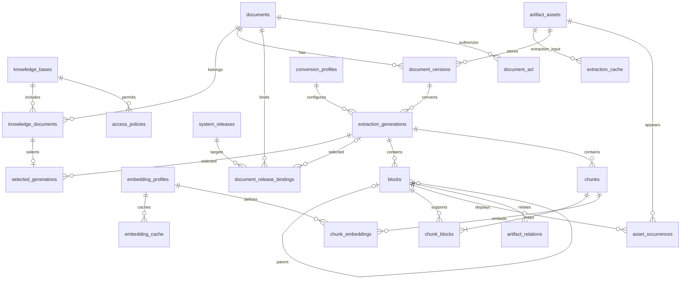

# データベース テーブル設計

日本語PDF OCRではDDL変更は不要。winnapの既存blocks.content_text・source_locationsへOCR本文・ページ・bboxを、extraction_methodへdocling_cpu_rapidocr_jaを保存する。OCR条件・モデルSHAは抽出プロファイル、OCRページ・セル数・平均信頼度はquality_summary内のmetricsへ記録する。これはOCR文字の正確性や図の説明完了を保証しない。詳細は[日本語OCR](../implementation/rapidocr-pdf.md)。

| 項目 | 内容 |
| --- | --- |
| プロジェクト | 2026-file-scan |
| 作成日 | 2026-10-12 |
| 最終更新日 | 2026-11-02 |
| 設計レベル | 論理設計・カラム／制約／索引の詳細設計案 |
| 状態 | 全体のテーブル設計案。登録に必要な部分を第1版CLIへ実装。実装範囲は下記参照 |
| 対象DB | 業務検索用PostgreSQL。pgvector・PGroongaの導入を前提とした案 |
| 関連設計 | [文書変換](01-document-conversion.md)、[検索基盤](02-search-platform.md)、[LLM＋チャット](03-llm-chat.md) |

2026-10-25の利用者指定により、検索の初回実装は文書ACL・SSOを保留した`local_prototype`とする。下記の権限対応テーブル・制約は将来の対応段階の仕様であり、初回の公開・リリース採用・検索監視の移行と分ける。`retrieval_events`は試作モードを`selection_summary`へ記録し、権限未適用時の`policy_revision`はNULLを許す。権限対応版の成功時に必須とする検証済みpolicy版を、試作で架空値に置き換えない。詳細は[検索API設計](02-search-platform.md)を参照。

2026-11-01：取込対象をWord（DOCX）・Excel（XLSX/XLSM）・PDF・TXT・Markdownに限定した。プログラム解析は別処理で設計・実装するため、本処理には含めない。SQL・JSON・YAML・YML・CSV・LOGも原本の取込対象外とする。YAMLの実行設定、JSON/JSONLの確認用出力、DB用SQLは引き続き使用する。

以下のGit関連列・コミット引用の構想は別処理向けの将来予約情報であり、今回の文書取込では生成・登録しない。既存の履歴データと互換性を保つため、DB列・テーブルの破壊的な削除は行わない。

## 1. 範囲と設計方針

本資料を、業務検索用DBのテーブル、カラム、キー、制約、索引の正本とする。変換データの意味と識別子の生成規則は文書変換設計、検索APIの契約は検索基盤設計を参照する。

2026-10-18の第1版では、`knowledge_bases`、`documents`、`knowledge_documents`、`artifact_assets`、`document_versions`、`conversion_profiles`、`extraction_generations`、`blocks`、`chunks`、`chunk_blocks`、`asset_occurrences`、`artifact_relations`、`index_jobs`を実装した。実DDLの定義と非破壊のv1/v2→v3移行は`src/file_scan/db.py`、操作手順は[第1版の実装・操作説明](../implementation/first-version.md)を参照する。

実装用補助表として、適用版を管理する`schema_migrations`と、1DBの実体保管先を固定する`ingestion_settings`を追加する。後者は`singleton_id=1`のPK・CHECK、`storage_root text NOT NULL`、共通時刻列を持ち、初回登録時に保管先を設定する。2026-10-25までに`embedding_profiles`・`chunk_embeddings`も実装し、スキーマv3で`selected_generations`・`extraction_cache`・`embedding_cache`を追加した。入力ハッシュ検索用索引も追加する。業務リリース、ACL、検索監視の表・拡張索引は後続である。検索公開のリリース・Embedding参照列は引き続きNULLのみとし、公開状態は`draft`、検索範囲は無効、ACLは未同期に制約する。`run_id`等のUUIDは第1版ではUUID文字列をtext列へ格納する。将来の検索公開機能では、移行を追加してこれらの制約を変更する。

- Dify内部DBのテーブルを本システムから直接更新しない。会話履歴の独自DB設計は本資料に含めない。
- 原本・画像のバイト列はストレージに置き、DBは参照・構造・検索本文・ベクトルを管理する。
- Excelのシート、Wordの章、本文、表、画像は共通の`blocks`で表現する。ファイル形式ごとに似たテーブルを増やさない。
- 原本論理ID、原本ハッシュ、変換世代、業務リリース、Embeddingプロファイルを区別する。
- 検索採用世代は原本と業務リリースの対応表で選ぶ。世代単体のグローバルな`active`フラグには依存しない。
- 由来、原本位置、公開状態、権限を、本文・関連情報・画像・履歴で維持する。
- 初期PoCは1システム・限定版・全員同一閲覧範囲とする。利用者別ACLの実連携は別途検証する。

現在の取り込み用の確定仕様は[取り込み改善設計](05-ingestion-improvements.md)を参照。以下の業務公開用の将来テーブル案と、v3で追加する補助表の物理定義を区別する。`embedding_profiles`の実装列名は`model`（将来案の`model_name`に相当）、入力版は`input_version`。`chunk_embeddings`は実測`input_tokens`も持つ。

### 1.1 PostgreSQLの物理スキーマ

2026-11-02から、取込20テーブルと検索のsearch_*テーブルは専用スキーマ`winnap`へ配置する。取込v3・検索v1は管理版の区別であり、物理スキーマを分ける意味ではない。SQLAlchemyのテーブル定義でwinnapを明示し、同期CLI・非同期検索APIとも同じ配置を使う。pgvectorは引き続きpublicへ配置する。SQLiteの単体テストではスキーマ変換で既定DBへ対応付ける。

既存publicのv3は表・本文・ベクトル・公開コピーを保持したまま専用スクリプトで移動する。旧配置を黙って参照したり、別の空テーブル群を作ったりしない。具体的な権限・手順・rollback条件は[専用スキーマの手順](../implementation/winnap-schema.md)を参照。

## 2. 共通規則

### 2.1 型・表記

| 表記 | 意味 |
| --- | --- |
| PK / FK / UQ | 主キー／外部キー／一意制約 |
| 必須 | `NOT NULL`。複合PKの各列も必須 |
| 任意 | NULLを許す。ただし状態遷移によって必須になる列は公開判定で検査する |
| `text` ID | 変換側や台帳が付与したIDを保存。UUID形式を強制しない |
| `uuid` | 実行・イベント等の新規ID。アプリ側で生成する案 |
| `timestamptz` | 時刻。UTCで保存し、画面で利用者のタイムゾーンへ変換 |
| `jsonb` | 表構造、形式別位置、補助メタデータ等。権限・採用版の判定を任意JSONだけに委ねない |

全表に`created_at timestamptz NOT NULL`を設ける。変更可能な管理行には`updated_at timestamptz NOT NULL`も設ける。以下のカラム表では、この共通列を省略する。公開済みの原本版・変換本文を、再試行で別内容へ上書きしない。

`source_version`、`conversion_revision`、`asset_id`は、原則として`sha256:`と小文字16進数64桁からなる`text`とする。ハッシュは内容の識別であり、閲覧権限の証明ではない。

`publication_state`は`draft / reviewed / published / excluded`、`artifact_type`は`source / derived`とする。`source`にはOCR等の抽出結果も含み、正確性を保証する意味ではない。

### 2.2 制約の実装区分

- 同じ行の範囲・状態値は`CHECK`、必須項目は`NOT NULL`、一意性はPK・UQで制約する。
- 参照先の存在や同一世代・由来の一致は、必要な複合UQと複合FKで制約する。
- 親子の循環、派生物の根拠充足、関連行の公開状態、権限の交差、処理完了の件数比較は、公開トランザクションで検証する。
- 他テーブルを参照する関数を`CHECK`に入れて、継続的な整合性が保証されるとは扱わない。
- FKの参照元に必要な索引は個別に設計する。PK・UQ用の索引と重複して作らない。

物理DDLの作成時に、アプリによる書き込みを専用サービスへ限定する。公開に関わる複数表を、利用者やLLMから直接更新する経路は設けない。

## 3. テーブル一覧

| No. | テーブル | 用途 |
| --- | --- | --- |
| 1 | `system_releases` | システム・環境・業務リリースの台帳 |
| 2 | `embedding_profiles` | ベクトル空間の設定 |
| 3 | `knowledge_bases` | Dify等から指定する検索範囲と既定版 |
| 4 | `documents` | 原本の論理台帳・現状・権限の状態 |
| 5 | `knowledge_documents` | 検索範囲に登録した予定原本と収集状況 |
| 6 | `artifact_assets` | 原本・画像・プレビューのストレージ参照 |
| 7 | `document_versions` | 原本の内容ハッシュごとのスナップショット |
| 8 | `conversion_profiles` | 変換設定と処理版 |
| 9 | `extraction_generations` | 原本版と変換設定の組による変換世代 |
| 10 | `document_release_bindings` | リリース別の必要原本版と検索採用世代 |
| 11 | `blocks` | 章・シート・本文・表・画像等の要素 |
| 12 | `chunks` | 検索・回答へ返す根拠単位 |
| 13 | `chunk_blocks` | チャンクの本文と原本ブロックの対応 |
| 14 | `asset_occurrences` | 画像等が文書中に現れる位置 |
| 15 | `artifact_relations` | 要素間の参照・派生元・関連シート等 |
| 16 | `chunk_embeddings` | チャンクとプロファイル別のベクトル |
| 17 | `document_acl` | 原本を読める主体の許可一覧 |
| 18 | `access_policies` | サービス接続元に許可する検索範囲 |
| 19 | `index_jobs` | 収集・変換・索引の実行試行 |
| 20 | `retrieval_events` | 検索要求・採用版・状態の監視記録 |

v3補助表：`selected_generations`（ナレッジ・文書ごとの選択世代）、`extraction_cache`（分割前の抽出結果）、`embedding_cache`（プロファイル・入力単位のベクトル）。適用管理は`schema_migrations`、保管先固定は`ingestion_settings`。

上記20表は既存要件を分解した設計案であり、20個のサービスを作る意味ではない。画像処理や利用者別ACLなどの導入段階に合わせて、実装順を決める。

## 4. 主な関係

図は主要関係を示す。ステージング中はチャンクと根拠の対応が未登録の場合もあるが、公開時には`chunk_blocks`が1件以上必要となる。関係の向き・複合FKの詳細は次節で定義する。

## 5. カラム設計

### 5.1 `system_releases`：業務リリース

| カラム | 型 | NULL | 内容・キー |
| --- | --- | --- | --- |
| `release_id` | text | 必須 | PK。業務リリースの内部ID |
| `system_id` | text | 必須 | 対象システムのID |
| `environment` | text | 必須 | 本番、検証等 |
| `release_name` | text | 必須 | 業務上のリリース名 |
| `effective_from` / `effective_to` | timestamptz | 任意 | 適用期間。終了がある場合は開始より後 |
| `repository_commits` | jsonb | 必須 | リポジトリごとの対象コミット。初期値`{}` |
| `metadata` | jsonb | 必須 | 補助情報。初期値`{}` |

UQ：`(system_id, environment, release_name)`。本番コミットが不明なら空の対応表を保持し、最新版のGitブランチから推測して埋めない。期間だけでは版が一意にならない場合は検索側で対象版を確認する。

### 5.2 `embedding_profiles`：Embedding設定

| カラム | 型 | NULL | 内容・キー |
| --- | --- | --- | --- |
| `embedding_profile_id` | text | 必須 | PK。モデル・版・前処理等に対応するID |
| `provider` / `model_name` | text | 必須 | 実行先とモデル名。秘密情報は入れない |
| `model_revision` | text | 必須 | 採用したモデルの版・識別情報 |
| `dimensions` | integer | 必須 | ベクトル次元。正数 |
| `distance_metric` | text | 必須 | 初期検索は`cosine`。`l2 / inner_product`等への変更時は検索設定・評価を更新 |
| `preprocessing` | jsonb | 必須 | 正規化等の設定。初期値`{}` |
| `profile_status` | text | 必須 | `building / usable / retired` |

UQ：`(embedding_profile_id, dimensions)`を複合FK用に設ける。既存プロファイルのモデルや次元を変更せず、別プロファイルとして登録する。外部モデルの版を固定できない場合の運用は未決事項とする。

検索初版は[検索API設計10.1](02-search-platform.md#101-現行実装を引き継ぎ未決から外す事項)に従い、実装済みの`provider / model / dimensions / input_version`と既存のプロファイルIDを維持する。上表の追加列は将来拡張案とし、初回検索の必須移行にはしない。cosine距離は初期の検索設定へ固定し、`model`を`model_name`へ改名するためだけの移行・ID再生成は行わない。公開先プロファイルの選択・FK制約は別途導入し、取得できない固定モデル版を架空値で埋めない。

### 5.3 `knowledge_bases`：検索範囲

| カラム | 型 | NULL | 内容・キー |
| --- | --- | --- | --- |
| `knowledge_id` | text | 必須 | PK。APIの`knowledge_id`と一致 |
| `name` | text | 必須 | 表示名 |
| `system_id` / `environment` | text | 必須 | 初期案では1検索範囲につき1システム・環境 |
| `default_release_id` | text | 任意 | FK → `system_releases.release_id`。未設定なら現行検索は保留 |
| `embedding_profile_id` | text | 任意 | FK → `embedding_profiles`。未設定なら意味検索は未準備 |
| `catalog_revision` | bigint | 必須 | 台帳・採用版等の変更で増やす版番号。初期値0 |
| `scan_status` | text | 必須 | `unknown / running / succeeded / partial / failed` |
| `last_successful_scan_at` | timestamptz | 任意 | 予定収集対象の列挙に成功した時刻 |
| `enabled` | boolean | 必須 | 検索範囲の有効・無効。初期値false |

既定リリースのシステム・環境との一致は管理更新時に検証する。スキャン失敗を「予定資料0件」と扱わない。`catalog_revision`は同じトランザクションで関連する台帳変更に追随させる。

### 5.4 `documents`：原本の論理台帳

| カラム | 型 | NULL | 内容・キー |
| --- | --- | --- | --- |
| `document_id` | text | 必須 | PK。文書変換設計の原本論理ID |
| `source_system` / `source_key` | text | 必須 | 収集元と安定した原本識別子 |
| `source_uri` | text | 必須 | 原本の所在。認証情報入りURLを保存しない |
| `title` / `format` | text | 必須 | 名称と形式 |
| `document_type` / `owner` | text | 任意 | 設計書、手順書、障害記録等と責任者 |
| `latest_source_version` | text | 任意 | 最新観測版。FK → `document_versions`との複合参照 |
| `source_status` | text | 必須 | `available / unavailable / deleted` |
| `acl_status` | text | 必須 | `unknown / synchronized / error` |
| `acl_revision` | bigint | 必須 | 原本ACLの版。初期値0 |
| `source_modified_at` / `last_observed_at` | timestamptz | 任意 | 原本更新時刻と観測時刻 |
| `metadata` | jsonb | 必須 | 別名等の補助情報。初期値`{}` |

UQ：`(source_system, source_key)`、`(document_id, acl_revision)`。複合FK：`(document_id, latest_source_version)` → `document_versions(document_id, source_version)`。原本登録は台帳行を先に作り、版登録後に最新観測版を設定する。

原本の最新観測版と、業務リリースで必要な版は別に扱う。内容ハッシュが同じ別原本をこの表で統合しない。削除・アクセス不能・ACL未同期の扱いは検索判定にも反映する。

### 5.5 `knowledge_documents`：予定原本と収集状況

| カラム | 型 | NULL | 内容・キー |
| --- | --- | --- | --- |
| `knowledge_id` | text | 必須 | PKの一部、FK → `knowledge_bases` |
| `document_id` | text | 必須 | PKの一部、FK → `documents` |
| `included` | boolean | 必須 | この検索範囲の収集・検索対象か |
| `collection_status` | text | 必須 | `pending / available / failed / excluded` |
| `last_seen_scan_id` | uuid | 任意 | FK → `index_jobs.run_id`。原本列挙の実行 |
| `last_error_code` | text | 任意 | 機密本文を含めない失敗区分 |

PK：`(knowledge_id, document_id)`。既知の予定原本は読み込み成功前に登録する。変換世代が存在しない資料も不足の集計対象にできるようにする。列挙自体の失敗・不明は`knowledge_bases.scan_status`で管理する。

### 5.6 `artifact_assets`：原本・画像等の実体参照

| カラム | 型 | NULL | 内容・キー |
| --- | --- | --- | --- |
| `asset_id` | text | 必須 | PK。保存バイト列のSHA-256 |
| `storage_key` | text | 必須 | ストレージ上の非公開の実体参照 |
| `mime_type` | text | 必須 | ファイル・画像の形式 |
| `byte_size` | bigint | 必須 | 0以上のバイト数 |
| `width` / `height` | integer | 任意 | 画像サイズ。設定する場合は正数 |
| `storage_status` | text | 必須 | `available / missing / pending_delete` |

同じバイト列は同じ実体を参照できる。ただし`asset_id`単独での閲覧許可は行わない。原本版または画像出現位置を介して認可する。外部公開URLや期限付き署名URLそのものを永続化しない。

### 5.7 `document_versions`：原本のスナップショット

| カラム | 型 | NULL | 内容・キー |
| --- | --- | --- | --- |
| `document_id` | text | 必須 | PKの一部、FK → `documents` |
| `source_version` | text | 必須 | PKの一部。原本バイト列のハッシュ |
| `asset_id` | text | 必須 | FK → `artifact_assets`。原本の作業コピー |
| `source_uri` / `title` / `format` | text | 必須 | この版を取得したときの所在・名称・形式 |
| `source_modified_at` | timestamptz | 任意 | 原本側の更新時刻 |
| `collected_at` | timestamptz | 必須 | 収集時刻 |
| `repository_uri` / `commit_id` / `repository_path` | text | 任意 | 初回収集時のGit情報。対象リリースの引用先とは区別 |
| `metadata` | jsonb | 必須 | 版固有の補助情報。初期値`{}` |

PK：`(document_id, source_version)`。原本バイト列をそのまま保管する初期案では`asset_id = source_version`を検査する。ファイルハッシュとGitコミットを混同しない。同じ内容が別コミット・別パスに現れても、この行の取得時情報を上書きせず、対象版での位置はリリース対応表に保持する。履歴版も原本論理台帳の最新ACLに従う。

### 5.8 `conversion_profiles`：変換設定

| カラム | 型 | NULL | 内容・キー |
| --- | --- | --- | --- |
| `conversion_revision` | text | 必須 | PK。正規化した変換設定等のハッシュ |
| `schema_version` | text | 必須 | 変換成果物のスキーマ版 |
| `configuration` | jsonb | 必須 | パーサー版、様式ルール、OCR・画像モデル、プロンプト、分割条件等 |
| `profile_status` | text | 必須 | `usable / retired` |

登録済みの設定本文は変更しない。変更時は新しいハッシュで登録する。実行認証情報は設定本文に含めない。

### 5.9 `extraction_generations`：変換世代

| カラム | 型 | NULL | 内容・キー |
| --- | --- | --- | --- |
| `generation_id` | text | 必須 | PK。変換処理が付与した世代ID |
| `document_id` / `source_version` | text | 必須 | 複合FK → `document_versions` |
| `conversion_revision` | text | 必須 | FK → `conversion_profiles` |
| `processing_status` | text | 必須 | `staging / succeeded / partial / failed` |
| `publication_state` | text | 必須 | 公開状態 |
| `quality_summary` | jsonb | 必須 | 予定・処理済みシート／ページ、未対応図形、OCR不備等 |
| `reviewed_by` / `reviewed_at` | text / timestamptz | 任意 | 必要な確認者と確認時刻 |
| `published_at` | timestamptz | 任意 | 公開時刻 |

UQ：`(document_id, source_version, conversion_revision)`、`(generation_id, document_id)`。初期の世代採用は本表の公開状態だけでは決めず、リリース対応表と本文・チャンクの公開状態も確認する。

同じ世代の再試行は同じ成果物を再利用する。公開内容を変える処理は、変換設定版の更新などによって新しい世代にする。部分抽出の公開には不足範囲の確認を要する。

### 5.10 `document_release_bindings`：リリース別の採用世代

| カラム | 型 | NULL | 内容・キー |
| --- | --- | --- | --- |
| `document_id` | text | 必須 | PKの一部、FK → `documents` |
| `release_id` | text | 必須 | PKの一部、FK → `system_releases` |
| `expected_source_version` | text | 任意 | この業務版で必要な原本版。文書版への複合FK |
| `expected_conversion_revision` | text | 任意 | FK → `conversion_profiles`。今回要求する変換設定 |
| `adopted_generation_id` | text | 任意 | 採用世代。原本と世代への複合FK |
| `repository_uri` / `commit_id` / `repository_path` | text | 任意 | このリリースでのGit引用先。Git管理ソースの採用時は3列とも必須 |
| `readiness_state` | text | 必須 | `unknown / pending / ready / partial / failed / excluded` |
| `binding_revision` | bigint | 必須 | 採用計画・状態の版。初期値0 |
| `approved_by` / `approved_at` | text / timestamptz | 任意 | 業務版との対応を確認した記録 |

PK：`(document_id, release_id)`。FK：`(document_id, expected_source_version)` → `document_versions`、`(adopted_generation_id, document_id)` → `extraction_generations(generation_id, document_id)`。

`ready / partial`で採用する際は、要求原本版・変換設定を必須とし、採用世代との一致と公開条件をトランザクション内で検査する。要求版が不明なら`unknown`とする。更新を検知したら対象のリリース対応を`pending`にし、旧ポインターが残っていても現行検索に使わない。収集前の新版は`document_versions`に仮登録せず、`expected_source_version`をNULLにして更新待ちを表す。収集成功後に原本版を登録して設定し、収集失敗ならNULLのまま`failed`とする。

Git管理ソースでは、対象コミットが`system_releases.repository_commits`の計画と一致し、そのコミット・パスのバイト列が`expected_source_version`と一致することを採用前に検証する。引用URLは本表のコミット・パスとブロックの行範囲から作る。同一内容のファイルが別コミットやリネーム先に現れても、変換世代を再利用しながら対象版の正しい位置を示せる。

履歴検索は指定リリースのこの対応表から世代を選ぶ。過去リリースの承認済み対応を、最新原本への更新だけで無条件に上書きしない。同一リリース内で過去時点の採用履歴まで再現する機能は初期対象外とし、必要なら対応履歴表を追加する。

### 5.11 `blocks`：文書の構造・内容

| カラム | 型 | NULL | 内容・キー |
| --- | --- | --- | --- |
| `block_id` | text | 必須 | PKの一部。世代内で一意の要素ID |
| `generation_id` | text | 必須 | PKの一部、FK → `extraction_generations` |
| `parent_id` | text | 任意 | 同一世代の親ブロックへの複合FK |
| `element_type` | text | 必須 | `document / section / sheet / paragraph / table / figure / navigation`等 |
| `reading_order` | integer | 必須 | 世代内の読み順。0以上 |
| `section_path` | jsonb | 必須 | 章・節／シートの階層。初期値`[]` |
| `content_text` | text | 任意 | 抽出本文・OCR・生成説明。由来ごとに別ブロック |
| `content_data` | jsonb | 必須 | 表の行列・結合、画面の観測等。初期値`{}` |
| `source_locations` | jsonb | 必須 | 原本位置の配列。未確定の下書きは`[]`を許す |
| `artifact_type` / `publication_state` | text | 必須 | 由来と公開状態 |
| `extraction_method` | text | 必須 | ネイティブ抽出、OCR、画像説明等 |
| `generation_details` | jsonb | 必須 | モデル・プロンプト版等。初期値`{}` |
| `quality_flags` | jsonb | 必須 | 読取不能・推定構造等。初期値`[]` |

PK：`(generation_id, block_id)`。UQ：`(generation_id, block_id, artifact_type)`。親FK：`(generation_id, parent_id)` → `blocks(generation_id, block_id)`。自分自身を親にしないことをCHECKし、より長い循環は公開前に検査する。

公開時には原本位置を必須とする。`derived`は公開前に元ブロックへの`derived_from`関係を必須とする。表のセル構造は`content_data`に保持し、初期から全セルを独立した行に正規化しない。

### 5.12 `chunks`：検索用チャンク

| カラム | 型 | NULL | 内容・キー |
| --- | --- | --- | --- |
| `chunk_id` | text | 必須 | PKの一部。世代内で一意の検索単位ID |
| `generation_id` | text | 必須 | PKの一部、FK → `extraction_generations` |
| `title` | text | 必須 | 文書名・章・表題等 |
| `content_text` | text | 必須 | 回答の根拠として返せる内容 |
| `search_text` | text | 必須 | 見出し等の文脈を補った検索用テキスト |
| `artifact_type` / `publication_state` | text | 必須 | 同一チャンク内の由来と公開状態 |
| `identifiers` | text[] | 必須 | 関数名、画面ID、エラーコード等。初期値`{}` |
| `feature_ids` | text[] | 必須 | 対応が確認された機能ID。初期値`{}` |
| `token_count` | integer | 任意 | 採用したトークナイザーでの数。0以上 |
| `quality_flags` | jsonb | 必須 | 品質情報。初期値`[]` |

PK：`(generation_id, chunk_id)`。UQ：`(generation_id, chunk_id, artifact_type)`。検索は`search_text`を使えるが、引用として返す内容は`content_text`と原本対応で検証する。生成説明と原文を一つの由来として混ぜない。公開するチャンクは、必要な元ブロックが公開可能か確認する。

### 5.13 `chunk_blocks`：本文と原本ブロックの対応

| カラム | 型 | NULL | 内容・キー |
| --- | --- | --- | --- |
| `chunk_id` | text | 必須 | PKの一部。チャンクへの複合FK |
| `sequence_no` | integer | 必須 | PKの一部。対応部分の順序。0以上 |
| `generation_id` | text | 必須 | PKの一部。チャンクとブロックの世代を一致させる |
| `artifact_type` | text | 必須 | チャンクとブロックの由来を一致させる |
| `block_id` | text | 必須 | ブロックへの複合FK |
| `chunk_char_start` / `chunk_char_end` | integer | 必須 | チャンク本文内の対応範囲。開始を含み終了を含まない |
| `block_char_start` / `block_char_end` | integer | 任意 | テキストの抜粋元範囲。使用時は両方設定 |
| `source_slice` | jsonb | 必須 | 表の行・セル範囲等の部分指定。初期値`{}` |

PK：`(generation_id, chunk_id, sequence_no)`。複合FK：`(generation_id, chunk_id, artifact_type)` → `chunks`、`(generation_id, block_id, artifact_type)` → `blocks`。

範囲は0以上かつ開始より終了が後であることをCHECKする。文字数との整合は公開判定で検証する。文字位置はUnicodeコードポイント基準とし、原本バイト位置とは区別する。同じブロックの複数部分を使う場合も対応を保持する。

### 5.14 `asset_occurrences`：画像等の出現位置

| カラム | 型 | NULL | 内容・キー |
| --- | --- | --- | --- |
| `occurrence_id` | text | 必須 | PK。世代・ブロック・出現位置に対応するID |
| `generation_id` / `block_id` | text | 必須 | 所属ブロックへの複合FK |
| `asset_id` | text | 必須 | FK → `artifact_assets` |
| `occurrence_order` | integer | 必須 | ブロック内の順序。0以上 |
| `asset_role` | text | 必須 | `original_image / region_image / page_preview / rendered_document`等 |
| `source_locations` | jsonb | 必須 | 原本のセルアンカー、ページ座標等 |
| `rendering_details` | jsonb | 必須 | 切り出し条件、レンダラー版等。初期値`{}` |

UQ：`(generation_id, block_id, occurrence_order)`。FK：`(generation_id, block_id)` → `blocks`。同じ画像でも出現位置・周辺文脈・確認状態はブロック側で別に保持する。画像の説明を他文書へ無条件に使い回さない。

### 5.15 `artifact_relations`：参照・派生元

| カラム | 型 | NULL | 内容・キー |
| --- | --- | --- | --- |
| `relation_id` | text | 必須 | PK。関係と根拠に対応するID |
| `from_generation_id` / `from_block_id` | text | 必須 | 参照元ブロックへの複合FK |
| `to_generation_id` / `to_block_id` | text | 必須 | 参照先ブロックへの複合FK |
| `relation_type` | text | 必須 | `references / describes / related_sheet / derived_from`等 |
| `relation_status` | text | 必須 | `confirmed / candidate / rejected` |
| `origin_type` | text | 必須 | `source / derived`。関係の抽出・生成方法の区分 |
| `evidence` | jsonb | 必須 | 明示リンク・画面ID・原本位置・推定方法等 |
| `publication_state` | text | 必須 | 関係の公開状態 |

from・toはそれぞれ`blocks(generation_id, block_id)`へ複合FKを張る。曖昧なポリモーフィックIDをFKなしで格納しない。チャンクとの対応は`chunk_blocks`、画像との対応は`asset_occurrences`を利用する。

関連シートは通常同一世代、原本間の参照・派生元は別世代も許す。検索の文脈拡張では公開済みで確認済みの関係を基本とし、参照先の検索範囲への所属・採用版・公開・権限を再確認する。派生元は複数持てるが、循環する由来は公開しない。派生元の全原本まで検索範囲と権限の判定を再帰適用する。

### 5.16 `chunk_embeddings`：ベクトル

| カラム | 型 | NULL | 内容・キー |
| --- | --- | --- | --- |
| `generation_id` / `chunk_id` | text | 必須 | PKの一部。チャンクへの複合FK |
| `embedding_profile_id` | text | 必須 | PKの一部。プロファイルへの複合FK |
| `dimensions` | integer | 必須 | プロファイルの次元。正数 |
| `embedding` | vector | 必須 | pgvector型。次元数は採用モデル確定後に決める |
| `input_hash` | text | 必須 | 埋め込みに使用した検索テキスト等のハッシュ |

PK：`(generation_id, chunk_id, embedding_profile_id)`。FK：`(generation_id, chunk_id)` → `chunks`、`(embedding_profile_id, dimensions)` → `embedding_profiles`。`vector_dims(embedding) = dimensions`をCHECKする案とする。失敗・処理待ちは`index_jobs`で保持し、本表には完成したベクトルだけを登録する。

異なる次元のプロファイルを同居させる場合、近似索引はプロファイル別の部分式索引等を検討する。`vector(D)`へのキャスト、演算子クラス、次元上限は採用するpgvector版とモデルで確定する。次元未定のまま固定次元のDDL・HNSW索引を完成扱いにしない。

### 5.17 `document_acl`：原本の閲覧許可

| カラム | 型 | NULL | 内容・キー |
| --- | --- | --- | --- |
| `document_id` | text | 必須 | PKの一部。原本への複合FK |
| `subject_type` / `subject_id` | text | 必須 | PKの一部。`user / group / service_scope`と主体ID |
| `acl_revision` | bigint | 必須 | 原本台帳のACL版と一致させる |
| `valid_until` | timestamptz | 任意 | 許可の期限 |

PK：`(document_id, subject_type, subject_id)`。FK：`(document_id, acl_revision)` → `documents(document_id, acl_revision)`。許可のみを格納し、一致する許可がなければ拒否する。拒否ルールや複雑な原本ACLは、採用する連携方式でこの許可集合へ正しく解決できるか検証する。

ユーザー・グループの所属は信頼できる認証・権限基盤で確定し、LLMの入力値から作らない。PoCは固定した`service_scope`を使う。ACL更新は旧許可行の削除、台帳の版更新、新許可行の登録を同一トランザクションで行い、未同期・失敗時は拒否する。

### 5.18 `access_policies`：接続元の検索範囲

| カラム | 型 | NULL | 内容・キー |
| --- | --- | --- | --- |
| `caller_id` | text | 必須 | PKの一部。信頼できる接続元台帳のID |
| `knowledge_id` | text | 必須 | PKの一部、FK → `knowledge_bases` |
| `service_scope_id` | text | 任意 | PoCで共有閲覧範囲として使う主体 |
| `policy_revision` | bigint | 必須 | 接続許可設定の版。初期値0 |
| `enabled` | boolean | 必須 | 許可の有効・無効 |

PK：`(caller_id, knowledge_id)`。APIキーの実値は保存せず、秘密情報管理側で認証済みの`caller_id`を渡す。キーの変更・失効は認証経路で反映する。本表の許可に加えて、原本ACLも満たす必要がある。共有接続の認証と個々の利用者の本人認証を混同しない。

### 5.19 `index_jobs`：処理の実行試行

| カラム | 型 | NULL | 内容・キー |
| --- | --- | --- | --- |
| `run_id` | uuid | 必須 | PK。試行ごとに新規付与 |
| `job_key` | text | 必須 | 同じ論理処理を識別するキー |
| `attempt_no` | integer | 必須 | 1以上の試行番号 |
| `stage` | text | 必須 | `scan / collect / convert / embed / publish / delete / acl_sync`等 |
| `knowledge_id` | text | 必須 | FK → `knowledge_bases` |
| `document_id` | text | 任意 | FK → `documents`。範囲スキャンではNULL |
| `generation_id` | text | 任意 | 対象世代。原本・世代への複合FK |
| `embedding_profile_id` | text | 任意 | FK → `embedding_profiles` |
| `status` | text | 必須 | `queued / running / succeeded / partial / failed / cancelled` |
| `target_parameters` | jsonb | 必須 | 必要原本版・設定、対象リリース、計画版等 |
| `started_at` / `finished_at` | timestamptz | 任意 | 実行開始・終了 |
| `lease_until` | timestamptz | 任意 | ワーカーの占有期限。回収方式は実装時に決める |
| `lease_version` | bigint | 必須 | 占有の取得・失効ごとに増やす版。初期値0 |
| `error_code` / `error_summary` | text | 任意 | 原本文面・秘密情報を含めない失敗記録 |

UQ：`(job_key, attempt_no)`。`queued / running`の行に対する`job_key`の部分一意索引で、同じ論理処理の待機・実行行が複数できることを防ぐ。世代がある場合は`document_id`を必須とし、FK：`(generation_id, document_id)` → `extraction_generations`を設ける。

部分一意索引だけでは、期限切れワーカーの処理継続を止められない。結果登録・公開時はジョブ行をロックし、`run_id`・`lease_version`の一致、`running`状態、有効な占有期限も検証する。回収後の古いワーカーからの書き込みを拒否する。

再試行は別行に記録し、前回の失敗を成功で上書きしない。`job_key`には段階、原本・世代、プロファイル、対象版など必要な計画情報を含める。`knowledge_documents.last_seen_scan_id`が同じ`knowledge_id`かつ`stage=scan`のジョブを参照することは登録サービスで検査する。

### 5.20 `retrieval_events`：検索の監視記録

| カラム | 型 | NULL | 内容・キー |
| --- | --- | --- | --- |
| `request_id` | uuid | 必須 | PK。要求受け付け時に付与 |
| `snapshot_id` | uuid | 任意 | UQ。整合した読み取りを開始できなければNULL |
| `knowledge_id` | text | 任意 | FK → `knowledge_bases`。範囲を解決できなければNULL |
| `release_id` | text | 任意 | FK → `system_releases`。解決失敗時はNULL |
| `search_mode` | text | 必須 | `current / history` |
| `catalog_revision` / `policy_revision` | bigint | 任意 | 読み取り時の台帳・接続許可の版。解決できなければNULL |
| `embedding_profile_id` | text | 任意 | FK → `embedding_profiles` |
| `result_status` | text | 必須 | `success / no_results / rejected / failed` |
| `coverage_state` | text | 必須 | `complete / incomplete / unknown` |
| `coverage_counts` | jsonb | 必須 | 認可範囲内の更新待ち・失敗・部分抽出件数 |
| `selection_summary` | jsonb | 必須 | 採用世代・根拠ID等の監視用情報。保存量は運用設定で制御 |
| `duration_ms` | bigint | 必須 | 0以上の処理時間 |
| `error_code` | text | 任意 | 失敗区分 |

権限対応版の`success / no_results`では`knowledge_id`、`release_id`、`snapshot_id`、台帳・接続許可の版を必須とする。初回の`local_prototype`では接続許可の版はNULLを許し、`selection_summary`へモードと権限未適用を記録する。認証前の拒否や範囲の解決失敗では、未確定の参照列・版をNULL、`coverage_state`を`unknown`、件数と採用情報を`{}`として記録する。実在しない原本・範囲をログのために台帳へ作らない。

質問・根拠本文・画像・APIキーを初期設定で保存しない。`snapshot_id`はその検索の整合した読み取りを識別するIDであり、後日同じDB状態を再現できる永続スナップショットではない。結果数と不足情報は認可範囲内だけを記録する。監視保存失敗時のPoCの継続方針は検索API設計8章に従う。本番の監査要件と保存期間は未決事項とする。

### 5.21 `selected_generations`：v3の下書き選択

| カラム | 型 | NULL | 内容・キー |
| --- | --- | --- | --- |
| `knowledge_id` / `document_id` | text | 必須 | 複合PK、FK → `knowledge_documents` |
| `generation_id` | text | 任意 | `document_id`との複合FK → `extraction_generations` |
| `conversion_revision` | text | 必須 | FK → `conversion_profiles`。取り込みで要求した設定 |

共通時刻列に加え`updated_at`を持つ。取り込み開始時に選択をNULLへ戻し、原本収集後に指定設定の世代へ更新する。失敗世代も記録する。世代と設定・最新原本版の一致は利用クエリで再検査し、作成日時による代替選択はしない。v3移行時に履歴から値を推測しない。将来のリリース別公開選択とは別の補助表である。

### 5.22 `extraction_cache`：v3の抽出キャッシュ

| カラム | 型 | NULL | 内容・キー |
| --- | --- | --- | --- |
| `cache_key` | text | 必須 | PK。原本ハッシュ＋抽出プロファイルのハッシュ |
| `source_version` | text | 必須 | FK → `artifact_assets.asset_id`。入力原本の実体 |
| `extraction_revision` | text | 必須 | 形式別の抽出設定・実装・依存・モデルのハッシュ |
| `payload` | jsonb | 必須 | ブロック・関係・品質・画像実体参照。画像バイト列は含めない |
| `payload_hash` | text | 必須 | ペイロード整合性のSHA-256 |

分割条件をキーへ入れず、分割変更時に再利用する。文書への登録と同じトランザクションで更新する。画像参照はJSONから取り出し、ストレージ規則・サイズ・ハッシュを検証する。現行は履歴・キャッシュを自動削除しない。将来GCを導入する場合はこの画像参照も保持対象に含める。

### 5.23 `embedding_cache`：v3の入力単位ベクトル

| カラム | 型 | NULL | 内容・キー |
| --- | --- | --- | --- |
| `embedding_profile_id` / `input_hash` | text | 必須 | 複合PK。プロファイルと実入力の組 |
| `dimensions` | integer | 必須 | プロファイルとの複合FKに使用 |
| `embedding` | vector | 必須 | 完成したベクトル |
| `input_tokens` | integer | 必須 | 正の実測トークン数 |

FK：`(embedding_profile_id, dimensions)` → `embedding_profiles`。PostgreSQLでは`vector_dims(embedding)=dimensions`をCHECKする。同じ入力を世代間で再利用し、チャンクへ適用した結果は`chunk_embeddings`にも保持する。既存のv2行は必要なハッシュだけ検索して再利用できる。`chunk_embeddings(embedding_profile_id, input_hash)`に逆引き索引を追加する。公開許可やACLの共通化には用いない。

## 6. 索引設計案

| 対象 | 索引候補 | 目的・条件 |
| --- | --- | --- |
| `system_releases` | UQ `(system_id, environment, release_name)` | 版の解決 |
| `knowledge_documents` | `(document_id, included)` | 原本変更時に影響する検索範囲を取得 |
| `document_versions` | `(asset_id)` | 実体参照・削除可否の確認 |
| `extraction_generations` | UQ `(document_id, source_version, conversion_revision)` | 冪等な登録 |
| `document_release_bindings` | `(release_id, readiness_state, document_id)`、`(adopted_generation_id)` | 対象版の採用世代と不足の集計 |
| `blocks` | `(generation_id, parent_id, reading_order)` | 章・シート・親子の取得 |
| `chunks` | `(generation_id, publication_state, artifact_type)` | 採用世代の公開チャンクに絞る |
| `chunks.search_text` | PGroonga索引 | 日本語全文検索。対象演算子・トークナイザーは評価で決定 |
| `chunks.identifiers` / `feature_ids` | GIN等を候補とする | 配列の一致・包含。演算子と対応する索引を選ぶ |
| `chunk_blocks` | `(generation_id, block_id, chunk_id)` | 原本要素からチャンクを逆引き |
| `asset_occurrences` | `(asset_id)` | 実体の参照数・利用位置を確認 |
| `artifact_relations` | from・toの各ブロックID＋関係種別 | 参照・派生元の両方向取得 |
| `chunk_embeddings` | PKに加えプロファイル別のHNSW等を候補とする | 次元・距離・絞り込みの評価後に採用 |
| `document_acl` | `(subject_type, subject_id, document_id)` | 主体から読める原本を取得 |
| `index_jobs` | `(status, stage, created_at)`、待機・実行中`job_key`の部分UQ | キュー取得・実行行の重複防止 |
| `retrieval_events` | `(knowledge_id, created_at)` | 監視・期間指定削除 |

意味検索は初期データ量で正確な近傍検索と近似索引を比較する。近似索引でACL・対象版を絞った際の候補不足も評価する。索引だけを根拠に権限判定を省略しない。任意JSON全体へ一律にGIN索引を作らず、実際の検索条件に合わせる。

## 7. 登録・公開・更新のトランザクション

### 7.1 初回登録

1. 予定原本を`documents`と`knowledge_documents`へ登録する。
2. 原本スナップショットと`document_versions`を登録する。
3. 原本版・変換設定に対応する`extraction_generations`を作る。
4. `blocks`、画像出現、関係、`chunks`、`chunk_blocks`をステージング登録する。
5. 必要なプロファイルのベクトルを生成し、索引・件数・由来・位置・権限を検証する。
6. 公開可能な要素・世代を公開し、`document_release_bindings`の採用世代・準備状態を切り替える。
7. 関連する`knowledge_bases.catalog_revision`を更新する。

採用切替は短いトランザクションにし、原本の変換やモデル呼び出しをDBロック中に行わない。公開に使う対応行をロックし、要求原本版・変換設定・`binding_revision`が処理開始時の計画と一致することを再確認する。遅れて終了した旧ジョブで新しい計画を上書きしない。

### 7.2 原本更新・失敗

対象リリースの要求版を更新して準備状態を`pending`にする。新世代が成功するまで、旧世代を現行として返さない。変換失敗は`failed`、承認された部分公開は`partial`とし、不足状態を回答側へ渡す。

原本が変わらず変換ルールだけを改善する場合、現在の正常な採用世代を維持できる。この場合、対応表の要求設定・採用世代・`ready`状態を維持し、改善処理の目標設定と待ち状態は`index_jobs`に記録する。成功時に処理開始時の対応版を再確認し、新しい要求設定と採用世代を同じトランザクションで切り替える。失敗した改善世代を公開済みとして扱わない。

Embeddingプロファイルの変更は、対象範囲の必要ベクトルを別プロファイルで準備してから、`knowledge_bases.embedding_profile_id`を切り替える。チャンクごとに異なるベクトル空間へ切り替えない。

### 7.3 削除・権限縮小

原本削除・権限変更を検知したら、台帳・ACLを優先して更新する。残存する本文や索引があっても検索に返さない。原本表示と画像取得も同じ認可を行う。

初期は論理削除と公開停止を基本とし、FKは原則`RESTRICT / NO ACTION`を用いる。物理削除は保持期間の方針に従い、監視記録の扱い、関係・埋め込み・チャンク・ブロック・世代・原本版を整理してから行う。実体ファイルは参照がなく、保存義務もないことを確認して削除する。共有画像を一つの文書削除だけで消さない。

## 8. 検索時の採用条件と不足状態

### 8.1 採用条件

検索処理は同じ整合した読み取りで、少なくとも次を確認する。

1. 接続認証、`access_policies`、有効な検索範囲。
2. 対象リリース、登録済み原本、原本の利用可能状態と最新ACL。
3. リリース対応の要求版・採用世代・準備状態。
4. 世代、チャンク、元ブロックの公開状態と由来。
5. 使用するEmbeddingプロファイルと必要なベクトル。
6. 派生物・関連要素の原本すべてに対する、同じ検索範囲への所属・対象版・公開・閲覧権限。

`ready`は通常検索できる状態、承認済み`partial`は不足を通知した上で取得できる範囲だけを返す状態とする。`unknown / pending / failed / excluded`の対応は回答根拠にしない。履歴検索も指定リリースの同じ条件で判定し、権限の古いスナップショットに戻さない。

複数原本に由来する派生物は、派生元をたどった全原本が同じ`knowledge_id`の`knowledge_documents`に登録され、`included=true`であり、選択版・公開条件と現在の権限を満たす場合だけ利用する。原本Aを読めることを理由に、原本Bの説明が混ざった派生物を返さない。別の検索範囲を読める接続元でも、その範囲の情報を現在の検索へ混ぜない。`asset_id`や未検証の利用者IDだけを条件に検索・取得しない。

### 8.2 coverageとsnapshot

APIの状態フィールド、coverageの集計範囲、エラーへの対応は[検索API設計6章](02-search-platform.md#6-検索apiの契約)を正本とする。追加の機能・由来フィルターで予定原本の集計範囲を狭めず、認可済みナレッジ・解決版全体を対象とする。件数の理由別内訳は`retrieval_events.coverage_counts`へ、検索設定版・スコア版は`selection_summary`へ記録する。

`knowledge_bases.scan_status`、`knowledge_documents`、対象リリースの`document_release_bindings`、索引準備状態から不足を算出する。成功した世代の件数だけでは集計しない。対象原本にリリース対応行がない場合も除外せず、版の対応が未確定である`unknown`として扱う。

| 状態 | 判定案 |
| --- | --- |
| `complete` | 台帳に登録した収集対象の列挙・必要処理が完了し、対象の準備不足がない |
| `incomplete` | 認可範囲内に未収集、更新待ち、失敗、部分抽出、必要索引の未準備がある |
| `unknown` | 原本の列挙や権限の同期等が不明で、予定対象・不足を確定できない |

単なる不明ではなく認証・ACLの検証に失敗した場合は、検索処理を拒否する。閲覧不可の原本数・名称はcoverageに含めて通知しない。`complete`は知識の網羅や回答の正しさを保証しない。

検索結果と不足集計は、同じDB読み取りスナップショット・採用設定で計算する。実装ではREPEATABLE READ等の整合した読み取りを候補とし、終了直前の権限失効との関係は実運用の反映時間条件を決めて検証する。要求に`snapshot_id`を付け、状態付きAPIへ返す。ID自体に権限や原本の内容を埋め込まない。

PoCは検索結果キャッシュを必須にしない。将来導入する場合は、範囲・対象版・主体または権限集合・ACL版・台帳版・採用世代・モデル設定を区別し、削除・権限変更に追随させる。

## 9. 公開前の整合性確認

- 同じ原本・原本版・変換設定から世代が重複作成されない。
- 別原本の同一ハッシュを論理原本やACLとして統合しない。
- 親子ブロックに別世代・循環が混入しない。
- チャンクの全根拠が同じ世代・由来で、本文範囲と原本位置が対応する。
- 派生物の元ブロック、関係、公開状態、全原本の権限を追跡できる。
- 画像出現位置を介して認可し、共通化した画像から別原本の情報が漏れない。
- ベクトルのモデル・次元・入力ハッシュが一致し、必要な範囲が準備済みである。
- 更新失敗・部分公開・世代未作成の予定原本も不足集計に現れる。
- 旧ジョブの完了や同時公開で採用世代が逆戻りしない。
- 履歴検索、削除、ACL更新、バックアップ復旧でも採用・由来・権限が整合する。

## 10. 未決事項

- 本番のPostgreSQL・拡張採用版、実行環境、DBスキーマ名。ローカルはPostgreSQL 18.6・pgvector 0.8.6、登録用の非破壊マイグレーションはv3まで実装済み。
- 検索用の距離・索引方式、サイズ・性能・可用性の目標。生成はOpenAI text-embedding-3-small・1536次元を既定とし設定可能。
- 原本IDと収集元安定IDの対応、ファイル移動時の台帳更新、リリース対応の承認担当。
- 単一リリース内の時点履歴、跨る業務版・システムの資料、主環境以外の扱い。
- グループ・原本ACLの同期方式、API認証の管理、権限変更反映の時間条件。
- 画像OCRの再利用キャッシュ、品質・公開レビューの監査履歴を独立表にするか。
- 物理削除・監視ログの保持期間、DBと実体ストレージの復旧整合性。

## 11. 参考資料

設計時の確認日：2026-10-12。バージョン選定時に対応する公式仕様を再確認する。

- [PostgreSQL：制約](https://www.postgresql.org/docs/current/ddl-constraints.html)
- [PostgreSQL：トランザクション分離](https://www.postgresql.org/docs/current/transaction-iso.html)
- [pgvector：型・索引・異なる次元の扱い](https://github.com/pgvector/pgvector)
- [PGroonga：索引の作成](https://pgroonga.github.io/reference/create-index-using-pgroonga.html)

## 12. ローカル試作で実装した検索専用スキーマv1

取り込みv3への影響を抑えるため、公開対象のコピー・採用ポインター・検索監視を別のmetadataと版で追加した。`file-search init-db`は既存の取り込みv3とvector／PGroongaの存在を確認し、検索専用表と索引を作成する。再実行時は検索版・表・必須索引を検査し、問題のある索引名を報告する。索引や未知版の修復はDB管理者が行う。

| テーブル | 主な列・キー・参照 |
| --- | --- |
| `search_schema_migrations` | `version integer PK`。初版は1。取り込みの`schema_migrations`とは分離 |
| `search_releases` | `release_id text PK`、`knowledge_id FK→knowledge_bases`、`name text`、`created_at`。UQ `(knowledge_id,name)` |
| `search_catalogs` | `knowledge_id PK/FK→knowledge_bases`、`default_release_id FK→search_releases`、`embedding_profile_id FK→embedding_profiles`、`revision bigint`、`enabled boolean`、`feature_filter_enabled boolean` |
| `search_release_bindings` | PK `(release_id,document_id)`、各FK→検索リリース／原本。要求する`expected_source_version / expected_conversion_revision`と、採用した`publication_id`。公開先・原本・リリースへの複合FKで別原本・別版の混入を防ぐ |
| `search_publications` | `publication_id text PK`、`release_id / document_id`、`generation_id`、`source_version / source_path / conversion_revision`、`embedding_profile_id`、`generation_updated_at`、`approved_by / approved_at`、`partial boolean`、`quality_summary / relations jsonb`。元世代・原本の複合FKと公開先の複合UQを持つ |
| `search_chunks` | PK `(publication_id,chunk_id)`、公開先FK。原文`content_text`、検索入力`search_text`、`title`、`identifiers / feature_ids text[]`、`mappings / quality_flags jsonb`、`embedding vector`（未生成はNULL）、`dimensions integer`、`input_hash text`。ベクトルの実次元をCHECK |
| `search_blocks` | PK `(publication_id,block_id)`、公開先FK。`parent_id / reading_order / element_type`、`content_text`、必要な`content_data / section_path / source_locations / quality_flags / assets jsonb`。セルはヘッダー元を追う座標を保持し、不要な解析用JSON全体は検索側へ複製しない |
| `search_events` | `request_id text PK`、`created_at`、任意の`knowledge_id / release_id / snapshot_id`、`result_status`、`duration_ms`、`summary jsonb`、`error_code`。本文・質問・キー・生SQLは保存しない |

公開IDはリリース・原本・世代・実際のコピー内容と元世代更新時刻から生成する。公開行の本文を管理コマンドでUPDATEせず、新しいコピーを作って採用ポインターだけを切り替える。元の取り込み世代・ブロック・チャンクはdraftを維持する。`published`は初版では承認済み検索コピーの状態を指す。

公開取り消しは対象版・原本の`search_release_bindings.publication_id`をNULLにし、`search_catalogs.revision`の更新、`search_events`への`publication_withdrawn`の操作記録と同じトランザクションで確定する。予定原本、要求版、公開コピー、原本実体は保持する。

`search_chunks.search_text`にはPGroonga（TokenBigram＋NormalizerAuto）、識別子・機能配列にはGINを追加する。ベクトルはcosine正確検索を用い、HNSWは追加していない。

現行検索では要求版・採用コピーと、現在の収集状態・原本ハッシュ・選択世代・変換版・元世代更新時刻を照合する。不一致は不足として通知する。履歴は起動時の明示許可と対象版を必要とし、古いコピーを再利用する場合も現在の削除・利用不能・所属除外を適用する。ACLは未適用として明示する。

物理定義の実装は[search/schema.py](../../src/search/schema.py)、登録・再公開と検証は[検索APIの操作手順](../implementation/search-api.md)を参照。上記以前の業務公開・ACL表は今後の統合設計であり、検索v1と両方の公開フラグを同時に更新する方式にはしない。
