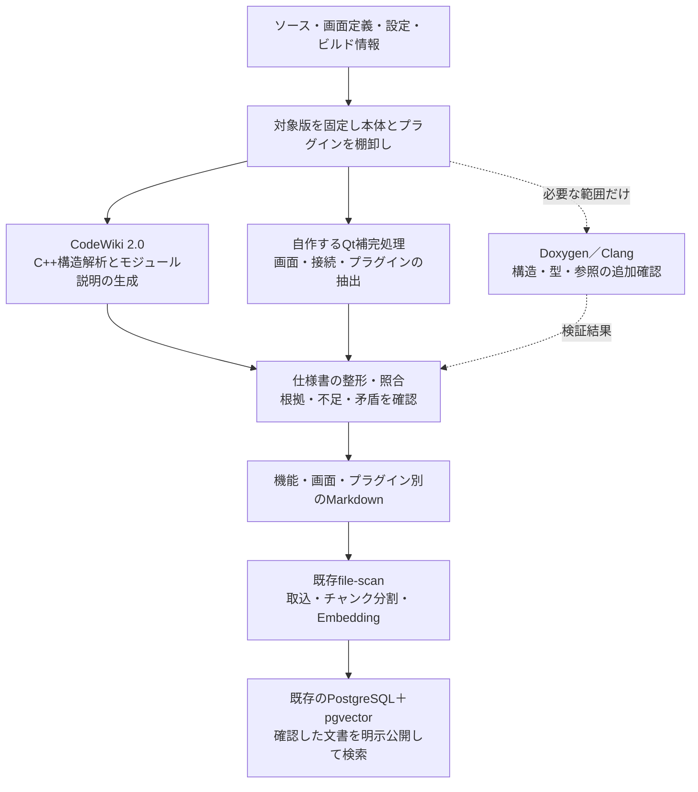

# 外部ツールを利用するC++／Qt解析の全体イメージ

作成日：2026-11-02。初期検証に向けた概要案。対象Qtソースの解析・外部ツールの導入はまだ実施していない。

初期版の確定範囲は[ソース解析・取込仕様](09-cpp-qt-source-ingestion-spec.md)を参照。利用者の指定により、`.pro`の細かな設定解析とビルド再現は初期版の必須条件から外す。

対象はQt 5を使う本体と多数のプラグイン。利用者の訂正を受け、Qt 3という想定を変更した。社内での目視情報により`.pro`と`QMAKE_EXTRA_TARGETS`があり、qmake用の構成として検討する。ビルド可能な環境はある。Qt 5の詳細版とWidgets／QMLの利用範囲は未確認。社内ソースへ個人PCからアクセスできないため、現段階は目視情報に基づく検討。生成した実装仕様書を、既存の文書取込・PostgreSQL＋pgvectorへ接続する。重要ファイルは[Qt 5プロジェクトの確認ガイド](08-qt5-project-analysis.md)を参照。

## 1. 基本方針

**CodeWiki 2.0でソースの全体構成・モジュールの説明を作り、Qt専用処理で画面・イベント・プラグイン情報を補う。両者を照合して仕様書を完成させ、既存のファイル取込へ渡す。**

初期版では、CodeWikiの標準的な出力を利用する。独自JSONを標準CodeWikiへ渡せば自動でグラフへ統合される、という前提にはしない。Qt補完資料は独立して生成し、後段で文書として統合する。

## 2. ツールの役割

| ツール・処理 | 主な役割 | 初期の扱い |
| --- | --- | --- |
| CodeWiki 2.0 | C++構造と依存関係を基に、モジュール別説明・全体概要・図を日本語で生成 | 文書生成の中心。代表プラグインで品質を確認する |
| Qt補完処理（自作Python等） | `.ui`と対応C++、QML、Signal／Slot、プラグイン宣言・メタデータ・読込・有効化条件を抽出 | 今回の対象アプリに合わせて作る部分 |
| Doxygen | クラス・関数・コメントをXML等へ抽出 | 最初の検証でCodeWikiの抽出結果と照合。常時併用するかは結果で決める |
| Clang／libclang | 型・宣言・参照・解決可能な呼出先を追加確認 | 誤対応や曖昧な箇所がある場合の補助。旧SDK互換性を先に検証する |
| Bear等 | 実際のコンパイル条件を収集 | Clang系の解析が必要になったとき、ビルド方式に合う方法を選ぶ |
| clang-uml | 代表処理のクラス図・シーケンス図等を追加生成 | CodeWikiの図で不足する場合に使用 |
| 既存file-scan・file-search | 完成した仕様書の取込、Embedding、公開、検索 | 現在の仕組みに接続する |

Code-Graph-RAGは関係検索の実装参考、CocoIndexはコードのベクトル登録例として残す。初期構成では、別のRAG基盤やグラフDBを必須にしない。

CodeWikiは階層的な文書生成、日本語出力、Markdownとグラフ等の保存に対応する。[公式README](https://github.com/FSoft-AI4Code/CodeWiki/blob/main/README.md)。Doxygenの機械向け出力にはXMLがある。[公式出力形式](https://www.doxygen.nl/manual/output.html)

## 3. 処理の流れ

### ① 対象を固定して棚卸しする

ソース一式のコピーまたはGitの固定版を用意する。未コミット変更・Git管理外の入力がある場合は、ファイル一覧と内容ハッシュも保存する。

ビルド環境から、実際に使うQtの版、コンパイラ、include、define、プロジェクトの入口、出力されるプラグインを確認する。旧アプリのビルドは既存環境で継続し、文書生成・DB登録は解析／取込環境へ分けて実施できる構成にする。Clangを別環境で動かすならSDK・パス・生成入力の再現を検証する。

初期の棚卸し結果は、本体、共通インターフェース、共通ライブラリ、各プラグイン、画面、設定の一覧。フォルダ名だけで所属を決めず、ビルド設定とローダーに照合する。

### ② CodeWikiで通常のC++部分を文書化する

固定したソースへCodeWikiを適用し、クラス・関数・依存関係を基に全体概要とモジュール説明を生成する。出力は日本語Markdownを基本にする。

生成時の指示には、機能、入口、入力・出力、処理の流れ、エラー、参照ソース、未確認事項を含める。初回は本体ローダー・共通インターフェース・代表プラグインに対象を絞る。

自動生成したモジュール階層が、実際のプラグイン境界と一致するか確認する。グラフが生成されたことだけでは網羅的な解析成功としない。CodeWikiの主な出力と設定は[公式CLI資料](https://github.com/FSoft-AI4Code/CodeWiki/blob/main/guides/cli-reference.md)を参照。

### ③ Qt特有の情報を別に抽出する

| 入力 | 補完する情報 |
| --- | --- |
| `.ui` | 画面、項目、表示文字列、ボタン、メニュー、明示された接続 |
| `.ui`に対応する`.h/.cpp` | `setupUi`、利用者のSlot実装、自動接続、初期化処理、入力チェック、処理呼出 |
| `.qml`・`.js`・`qmldir`と関連C++ | QML画面・部品・イベント・import・C++の型登録と公開機能 |
| `connect`・`SIGNAL`・`SLOT`・lambda等 | 操作元・イベント・受信処理・接続条件 |
| 本体ローダー・プラグイン宣言・共通インターフェース・参照先JSON | 提供機能、読込、生成、初期化、終了。標準プラグインと独自Factoryを区別 |
| `.pro`・`.pri`・ビルドログ等 | 所属ソース、出力ライブラリ、ビルド条件 |
| `.qrc` | QML等を指すリソースURLと実ファイルの対応 |
| 機能設定 | 読込対象、有効化条件、パス、処理の切替 |

XMLはXMLパーサー、C++は構文・トークン情報を利用する。単純な文字列検索で接続候補を探すことはできるが、候補だけで確定した関係を作らない。対象を一意に対応付けられない場合は未解決として残す。

Qt 5ではWidgetsとQMLのどちらか、または両方を解析する。`ui_*.h`・`moc_*.cpp`・`qrc_*.cpp`等は、生成元を主な仕様根拠としつつ意味解析に必要なら保持する。以前のQt 3向け`.ui.h`重点方針は置き換える。

ここで作る中間データは、画面・項目・接続・プラグイン・ソース根拠の一覧。最低限、対象版、所属、相手の識別子、原本パス・行範囲、抽出方式、確認／候補／未解決を保存する。C++の解析位置とCP932等の原本位置の対応も保持する。

### ④ 両方の結果を照合して実装仕様書にする

CodeWikiの生成文書とQt補完データから、次の文書を組み立てる。

- システム構成：本体、共通部品、各プラグインの役割。
- プラグイン仕様：提供機能、読込・有効化条件、依存、初期化・終了。
- 画面仕様：項目、入力条件、操作、呼び出す処理、画面遷移。
- 処理仕様：入力、手順、分岐、出力、更新先、エラー。
- 未確認事項：解決できない接続、実行確認が必要な条件、業務上の意味が不明な値。

初期版はQt補完データから専用のMarkdownを生成し、CodeWiki側の説明と相互参照する。必要なら整形・統合処理を追加する。標準CodeWikiが任意の補完JSONを自動で読み込む機能があるとは扱わない。

記述が食い違ったら矛盾を記録し、元ソースと必要な追加解析で確認する。AIの説明を自動的に正解としない。根拠への参照と「ソースで確認」「候補」「未確認」を本文に残す。業務要件の正当性は既存設計書や担当者の確認対象とする。

### ⑤ 確認できる文書一式を既存取込へ渡す

仕様書はプラグイン・画面・処理ごとに安定したファイル名で出力する。CodeWikiの内部作業ファイルや一時出力を直接収集せず、完成したMarkdownだけを専用の取込フォルダへ配置する。

生成対象、成功・失敗、対象版、成果物一覧をmanifestで照合してから既存取込を実行する。失敗した生成を、機能が削除された最新版と誤認して取り込まない。

既存の`file-scan ingest`で下書き登録し、`embed`でベクトルを保存する。確認後は既存の明示公開経路へ進める。同じDBなら保管ルートをそろえ、初期検証ではコード仕様専用の`knowledge_id`を使う。

この段階の引用先はMarkdownである。元C++の行へ検索APIから直接戻る機能や、呼出・接続関係の探索は次段階で追加する。原本コードと中間データは、その拡張と検証のために保管する。

## 4. 具体例：架空の顧客管理プラグイン

画面定義から保存ボタン、接続式から保存Slot、Slotとサービスから入力確認・保存処理を対応付ける。そこへプラグインの読込条件と設定を加え、「どの機能が、どの条件で動き、失敗すると何が表示されるか」を説明する。上図は方式説明用の架空例であり、対象アプリを解析した結果ではない。

検索では、利用者が「保存ボタンは何をするか」「このプラグインが有効になる条件は何か」と質問し、画面・処理・プラグイン仕様を取得する。第1段階は仕様書に書かれたソース参照を人が確認し、第2段階で根拠コードの直接取得へ広げる。

## 5. 更新時のイメージ

CodeWikiの`--update`は構成要素の変更を基に文書を更新する。[公式差分更新資料](https://github.com/FSoft-AI4Code/CodeWiki/blob/main/guides/incremental-updates.md)

Qt専用処理で扱う`.ui`・`.qml`・`qmldir`・`.qrc`・qmake・プラグインメタデータ・機能設定の変更も、独自に検知する。これらの変更が標準CodeWikiの更新判定へ自動的に伝わる前提にはしない。影響する補完資料を再生成し、必要なら関連するCodeWiki文書も再生成・照合する。

完成したMarkdownに変更があれば、既存取込が新しい原本版として処理する。Embeddingは同じモデル・入力なら既存キャッシュを利用できる。対象版・生成条件・確認状態を記録し、古い説明と新しい解析結果を混ぜない。

## 6. 初期検証の範囲

本体のプラグインローダー、共通インターフェース、代表プラグイン1〜2個、対応する画面1〜2個から始める。

確認する成果物は、全体構成、プラグイン仕様、画面仕様、代表処理の仕様、ソース根拠と未確認事項、既存検索での回答例。評価では説明の読みやすさに加え、画面から処理へ対応付けられるか、読込条件が合っているか、失敗・不足を隠していないかを確認する。

CodeWikiの生成結果で不足する範囲を見てから、Doxygen・Clang・clang-umlの常用範囲を決める。Qt補完とCodeWikiの連携を深める必要があれば、次の段階で解析器・グラフ・生成プロンプトへ追加情報を渡すアダプターを設計する。

詳細な原本・世代・検索への接続条件は[専用取込設計](06-cpp-qt-ingestion.md)、外部ツールの根拠資料は[GitHub比較](../research/2026-11-02-github-cpp-qt-analysis-comparison.md)を参照。
