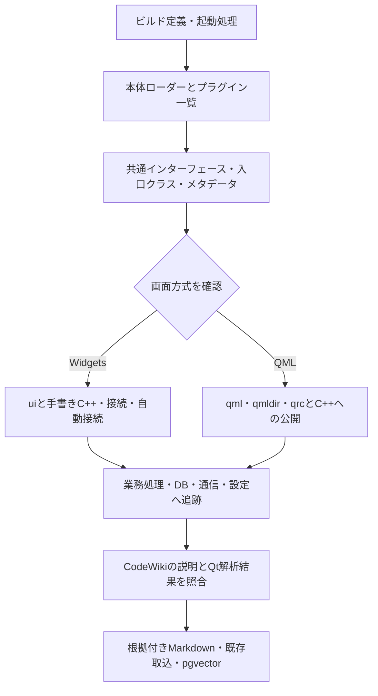

# Qt 5プロジェクトの重要ファイルと解析順序

本書はファイル確認の参考ガイド。利用者の指定により、`.pro`の細かな設定の確認完了を初期版の着手条件にはしない。実装範囲は[ソース解析・取込仕様](09-cpp-qt-source-ingestion-spec.md)を優先する。

作成日：2026-11-02。対象はQt 5。利用者の目視確認で`.pro`内に`QMAKE_EXTRA_TARGETS`等があり、`CMakeLists.txt`は見つからないことを確認した。qmake用のプロジェクト構成として検討する。Qt 5の詳細版、Widgets／QMLの利用範囲、実際のビルド対象・コマンドは未確認。ビルド可能な環境はある。本資料は解析方針であり、対象ソースによる検証結果ではない。

現在のワークスペースは文書取込システムであり、対象Qtアプリのソースはまだ確認していない。以下のファイル名・配置は例。`PluginManager.cpp`等の名前が必ず存在するとは前提にしない。

対象ソースは社内環境にあり、個人PC上の本作業環境からはアクセスできない。確認は社内PCでの目視情報に基づく。外部へソースを取得したり、ここから社内フォルダを走査した結果ではない。

## 1. Qt 5への訂正で変えること

CodeWiki 2.0による文書生成とQt補完処理、既存file-scan／pgvectorへの接続という構成は維持する。Qt補完の重点を次へ変更する。

- 標準プラグインの`Q_PLUGIN_METADATA`、共通インターフェース、メタデータJSON、本体ローダーを対応付ける。
- Signal／Slotは関数ポインタ・lambda・`SIGNAL`／`SLOT`の文字列形式を対象にする。
- Widgetsの画面なら`.ui`と手書きの`.h/.cpp`、自動接続を解析する。
- QMLの画面なら`.qml`・`qmldir`・`.qrc`と、C++の型登録・公開オブジェクト・プロパティ・メソッドを解析する。
- 以前のQt 3向け`.ui.h`重点方針は適用しない。実際に同名ファイルがある場合だけ、手書き・移行元・生成物を確認する。

Qt 5の標準プラグイン機構は公開されたマクロ・インターフェース・ローダーを手掛かりにできる。ただし、独自Factoryや`QLibrary`、設定からの動的選択も対象とする。[Qt 5.15のプラグインマニュアル保存版](https://qthub.com/static/doc/qt5/qtdoc/plugins-howto.html)

## 2. 優先して確認するファイル

| 優先 | ファイル・場所の例 | 分かること・確認する内容 |
| --- | --- | --- |
| 最優先 | ルートと各プラグインの`*.pro`・`*.pri`、または`CMakeLists.txt`・`*.cmake` | 本体・ライブラリ・プラグインの構成、対象ソース、依存、ビルド条件。QbsやIDEプロジェクトならその実際の入口も確認 |
| 最優先 | `main.cpp`と起動・初期化処理 | 起動順、設定読込、最初の画面、プラグイン管理、QMLエンジンの作成と画面読込 |
| 最優先 | 本体のローダー・プラグイン管理の`.h/.cpp` | どこから探し、何を読み、何を条件に有効化し、どのインターフェースで呼ぶか |
| 最優先 | 共通インターフェースの`.h` | プラグインの契約、純粋仮想関数、引数・戻り値、`Q_DECLARE_INTERFACE`、IID |
| 最優先 | 各プラグインの入口クラスの`.h/.cpp` | `Q_OBJECT`、`Q_INTERFACES`、`Q_PLUGIN_METADATA`、初期化・終了、機能の登録 |
| 最優先 | `Q_PLUGIN_METADATA(... FILE "xxx.json")`の参照先JSON（指定がある場合） | 名前・機能・バージョン・独自の依存情報等。各キーの意味をローダーと照合する |
| 高 | Widgetsの`*.ui`と対応する手書き`.h/.cpp` | 項目・ボタン・objectName・接続と、Slot・画面制御・業務処理の対応 |
| 高・QML利用時 | `main.qml`等の入口、`*.qml`・関連`*.js`・`qmldir` | 画面構成、イベント、import、部品・モジュール・QML拡張プラグイン |
| 高・QML利用時 | C++の型登録・context property・モデル実装 | QMLから呼べる処理とプロパティ。`qmlRegisterType`等、`setContextProperty`、`Q_PROPERTY`、`Q_INVOKABLE`、公開Slot・Signal |
| 高 | `*.qrc` | `qrc:/...`や`:/...`のリソースURLと実ファイルの対応、QMLの入口・alias |
| 高 | 各機能のサービス・モデル・DB・通信等の`.h/.cpp` | 入出力、入力チェック、更新、例外・エラー、外部システムとの関係 |
| 高 | 実際に読む`*.ini`・`*.json`・`*.xml`・`qt.conf`等 | 有効化条件、プラグインの場所、設定の既定値と上書き。`QSettings`等の読込箇所と照合 |
| 解析補助 | `compile_commands.json`、ビルドログ、生成入力、SDK情報 | Clang系に渡すinclude・define・言語モード・作業ディレクトリと、使用するQt 5の詳細版 |
| 照合用 | テスト、サンプル設定、`*.ts`、既存の設計書 | 期待動作、表示文言、日本語名、運用ルールの確認 |

プラグインのIIDは提供インターフェースを識別する。複数の実装が同じIIDを使えるため、一意なプラグインIDと同一視しない。メタデータJSONの名前・依存等の独自キーもQt共通の保証とせず、アプリの実装で意味を確認する。

## 3. ビルド定義のどこを見るか

確認されたqmakeの`.pro`では次を確認する。

| 項目 | 解析に使う情報 |
| --- | --- |
| `TEMPLATE`・`CONFIG`・`TARGET`・`DESTDIR` | アプリ／ライブラリ／プラグインの種類、名前、出力先 |
| `SUBDIRS`と依存指定 | 本体・共通ライブラリ・プラグインの構成とビルド順 |
| `SOURCES`・`HEADERS`・`FORMS`・`RESOURCES` | 実際に対象となるソース、画面、リソース |
| `QT`・`LIBS` | 利用するQtモジュール、外部・共通ライブラリ |
| `INCLUDEPATH`・`DEFINES`・`CONFIG` | 型解決・条件付き実装・C++言語モード |
| `include(...)`・platform／feature条件・コマンドライン指定 | 共通設定と構成ごとの差。`.pro`単独では最終値が分からない場合がある |
| `QMAKE_EXTRA_TARGETS`と対象名の`.target`・`.commands`・`.depends` | 追加ビルド処理。生成、コピー、配置等があるかを実際の定義で確認する。プラグインの一覧や実行時依存と同一視しない |

これらは[Qt 5.15公式qmake変数資料](https://doc.qt.io/archives/qt-5.15/qmake-variable-reference.html)に基づく確認項目。CMakeではターゲット・対象ソース・リンク先・include・define・AUTOMOC／AUTOUIC／AUTORCC等を対応付ける。実際のコンパイル条件とターゲット所属を両方保存する。

`QMAKE_EXTRA_TARGETS`の存在はqmake形式の根拠になるが、それだけで画面方式やプラグイン構成は分からない。次は`TEMPLATE`、`SUBDIRS`、`include(...)`で本体・共通設定・各プラグインの定義へ進み、`FORMS`、`QT`、`RESOURCES`から画面方式の手掛かりを得る。実際に使用される定義はビルド手順・ログで照合する。

## 4. 解析の順序

本体を起点に全プラグインを棚卸ししてから、代表プラグイン1〜2個を深く解析する。ディレクトリ一覧からプラグイン数・依存・有効化条件を推測しない。

Widgetsでは、明示的な`connect`に加え、`setupUi`等から呼ばれる自動接続と`on_<objectName>_<signal>`を確認する。QMLでは、画面のイベント・property binding・`Connections`等から、公開されたC++メソッド・プロパティ・モデルへ追う。QMLモジュールとプラグインの関係は`qmldir`も確認する。[Qt 5.15のQMLモジュール資料保存版](https://qthub.com/static/doc/qt5/qtqml/qtqml-modules-topic.html)

接続は作成条件・切断・オブジェクト寿命・接続種別・スレッド等も影響するため、ソース上の接続と実行時観測を分ける。全経路が静的に確定できることは前提にしない。

## 5. CodeWiki等への適用

CodeWiki 2.0はC++構造とモジュール説明の生成に使う。プラグイン境界・画面方式を事前に把握し、対象と生成指示へ反映する。C++以外の`.ui`・`.qml`・`qmldir`・`.qrc`・qmake・メタデータを確実に収集し、必要な形式別解析を補う。

拡張子を収集対象へ加えるだけでは、QMLや画面の意味解析ができるとは扱わない。Qt補完結果を専用Markdownとして出力してCodeWikiの文書と照合する初期案を維持する。より深い連携は、CodeWikiの解析器・グラフ・生成入力へ渡すアダプターを検討する。

Doxygenは構造の照合、Clang／libclangは型・呼出先の追加確認、clang-umlは必要な図に使う。Qt 5のSDKがあることだけでClang解析成功を保証せず、実際のコンパイル条件で検証する。

## 6. 生成物の扱い

| ファイル | 扱い |
| --- | --- |
| `.ui`・`.qml`・手書き`.h/.cpp`・`.qrc`・ビルド定義・メタデータ | 仕様書の主な根拠 |
| `ui_*.h`・`moc_*.cpp`・`qrc_*.cpp`等 | 生成元と対応付け、必要なら意味解析へ使用。手書き仕様と重複して文書化しない |
| `compile_commands.json`・ビルドログ・生成された設定ヘッダー | 生成物でも解析条件の重要な入力。buildフォルダと一緒に一律除外しない |
| `.o`・`.obj`・実行ファイル・DLL・キャッシュ | 通常のソース説明の主対象から外す。バイナリとソースの対応が必要な場合は別途記録 |
| `.pro.user`等の個人IDE設定 | 通常の仕様根拠の中心にはしない。使用Kit・構成の確認が必要な場合に参照 |

## 7. 最初にそろえる最小セット

1. ルートのプロジェクト定義、共通ビルド設定、本体と代表プラグインのプロジェクト定義。
2. `main.cpp`、起動処理、本体のプラグイン管理・読込処理。
3. 共通インターフェース、代表プラグインの入口`.h/.cpp`、参照先メタデータJSON。
4. 代表画面の`.ui`と対応C++、または入口QML・関連QML／JS・`qmldir`・C++への公開処理。関連する`.qrc`。
5. 画面から呼ぶ業務処理と、そのプラグインを有効にする設定、対応するテスト。
6. ビルドで使うQt 5.xの版・コンパイラ・構成と、可能ならコンパイルDB。

ルートの`.pro`や`main.cpp`だけでは機能の仕様まで分からない。上記をひとまとまりにすると、構成・読込条件・画面・実処理を追う検証を開始できる。

詳細は[全体イメージ](07-cpp-qt-analysis-overview.md)、[専用取込設計](06-cpp-qt-ingestion.md)、[外部ツール比較](../research/2026-11-02-github-cpp-qt-analysis-comparison.md)を参照。
