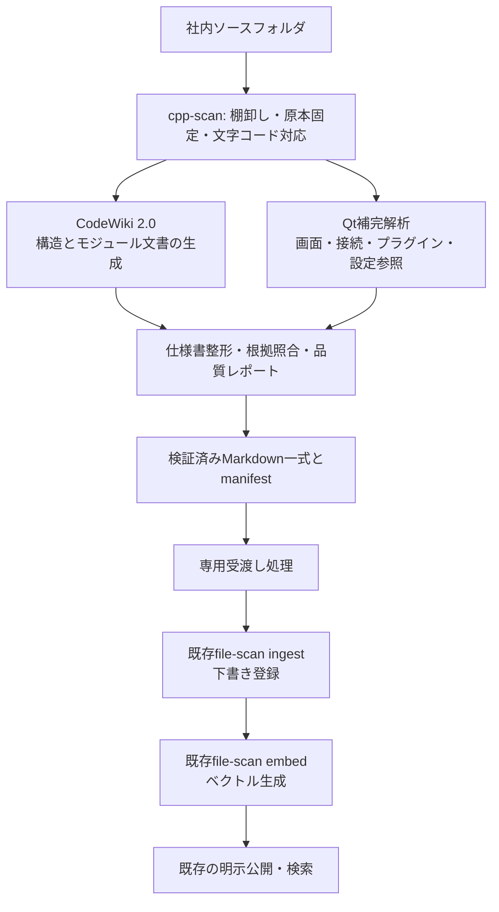

# C++／Qt 5 ソース解析・取込仕様（初期版）

作成日：2026-11-02。2026-11-03に専用CLI・CodeWiki連携・Qt補完・日本語仕様書生成・既存文書取込への受渡しを実装。[現在の対応範囲・導入手順](../implementation/cpp-source-ingestion.md)を参照。QMLは字句補完、金額上限はAPI側での制限等、仕様との差分・制限は同手順に記載する。

本書をソース解析取込の初期版仕様とする。[方式検討](06-cpp-qt-ingestion.md)、[全体イメージ](07-cpp-qt-analysis-overview.md)、[重要ファイル](08-qt5-project-analysis.md)と初期範囲の記述が異なる場合は、本書を優先する。

## 1. 目的と確定条件

Qt 5で開発されたC++アプリ本体・共通部品・多数のプラグインを解析し、根拠付きの日本語実装仕様書を生成する。そのMarkdownを既存の文書取込へ渡し、PostgreSQL＋pgvectorへ登録して機能・実装を検索できるようにする。

| 項目 | 初期版の前提 |
| --- | --- |
| 対象言語・フレームワーク | C++／Qt 5 |
| ビルド方式 | 利用者の目視情報で`.pro`と`QMAKE_EXTRA_TARGETS`が存在。qmake用構成として扱う |
| ビルド環境 | 社内に存在するが、初期版のソース解析では使用を必須にしない |
| ソースの場所 | 社内環境。本作業環境・個人PCからはアクセスできない。実際の解析は社内の実行環境で行う |
| 画面方式 | 未確認のためWidgetsとQMLの両方を検出対象とする。どちらかの事前回答を実行条件にしない |
| 文書生成 | CodeWiki 2.0を中心にする |
| 登録先 | 現行file-scan／file-searchとPostgreSQL＋pgvectorを利用する |
| `.pro`の詳細 | **初期版では条件評価・ビルド再現を行わない。細かな設定の確認完了を着手条件にしない** |

ソースから説明する内容は現在の実装仕様であり、業務要件の正当性や設計意図まで確定した文書とは区別する。

## 2. 初期版の範囲

### 2.1 対応する処理

- 指定フォルダの棚卸し、対象・除外・失敗の記録、原本スナップショットの保管。
- クラス・関数・コメント・構造・呼出候補等の抽出とCodeWikiによる文書生成。
- Qtの画面、Signal／Slot、プラグイン宣言・メタデータ・読込箇所、QMLとC++の連携の補完。
- 本体・共通部品・プラグイン・画面・処理への整理と、根拠・未解決事項の保持。
- 文書一式の整合性確認、既存取込への受渡し、下書き登録結果の記録。
- 同一入力の再利用、更新検知、失敗箇所の再実行、品質・網羅状況のレポート。

### 2.2 後続拡張とする処理

- `.pro/.pri`の完全な評価、`SUBDIRS`・platform条件・define等からの厳密なビルド構成復元。
- `QMAKE_EXTRA_TARGETS`・`QMAKE_EXTRA_COMPILERS`等のコマンド実行や生成処理の再現。
- SDK・コンパイルDBを必須とするClang意味解析、完全な型・オーバーロード・呼出先解決。
- アプリ起動、DLL／プラグインのロード、実行時トレースによる動作確認。
- DB内でのソース原文の直接検索・行引用、ファイル横断のグラフ探索API。
- 原本コード・生成説明を混在させる新しい検索公開スキーマ。

初期版でも`.pro/.pri`等は参考入力として保管できる。内容が変われば更新として検知するが、設定を解釈・実行したという解析結果を生成しない。条件付きコンパイルの有効・無効も、実ビルドを再現せずに断定しない。

## 3. 構成と責務



| 構成要素 | 責務 |
| --- | --- |
| `cpp-scan`（新設予定） | ソース専用の設定・収集・解析・文書生成・検証・受渡し・処理状態を管理 |
| CodeWikiアダプター | 共通のPython 3.14環境で固定版CodeWikiを子プロセスとして起動し、出力・終了状態・使用設定を記録 |
| Qt補完解析器 | C++の構文・トークン、画面XML、QMLの構文・参照等からQt固有情報を抽出 |
| 文書整形器 | CodeWiki文書とQt補完文書を対応付け、安定した文書ID・見出し・根拠・状態を付与 |
| 受渡し処理 | 文書一式の整合性確認と専用収集先の更新、既存取込の実行・結果照合 |
| 現行file-scan | Markdownの原本版・抽出世代・チャンク・Embeddingを管理 |
| 現行file-search | 確認した世代を明示公開し、公開された仕様書を検索・引用 |

Doxygenは抽出結果の比較用、Clang／Bear・clang-umlは後続の追加確認用とする。初期版の必須依存にしない。Code-Graph-RAGやCocoIndexの全体導入、新しいグラフDBも必須にしない。

CodeWikiの標準出力に独自のQt補完JSONが自動統合されるとは扱わない。初期版は独立した補完資料を生成し、後段で照合・相互参照する。

## 4. 入力仕様

| 入力 | 対象と扱い |
| --- | --- |
| C++ | `.cpp/.cc/.cxx/.c++`、`.h/.hpp/.hxx/.hh`、関連する`.ipp/.inl/.tpp`等。収集範囲と解析器の対応を照合する |
| Widgets | `.ui`、対応する手書きC++、関連する画面部品 |
| QML | `.qml`、関連`.js`、`qmldir`、関連C++、必要に応じて`.qmltypes`を参照 |
| リソース | `.qrc`、参照先のファイル一覧・alias。画像実体の意味解析は対象外 |
| プラグイン | 入口クラス、共通インターフェース、参照先メタデータJSON、ローダー・Factory |
| 機能設定 | 読込箇所で参照されるINI・JSON・XML・CONF等、または明示設定されたファイル |
| 参考資料 | `.pro/.pri/.prf`等、既存README・設計書・テスト。実装から抽出した事実と区別する |

設定・JSONを拡張子だけで無差別に取り込まず、参照関係・指定パス等から範囲を決める。既存文書取込にC++やJSONの対応拡張子を追加する方式にはしない。

バイナリ、依存ライブラリの実体、キャッシュ、バージョン管理内部、出力先、`ui_*.h`・`moc_*.cpp`・`qrc_*.cpp`等の生成物は既定の主解析対象から除外する。生成物しか存在しない機能は、抽出できない範囲として記録する。テスト・第三者コードは別区分とし、対象に含めるか設定できるようにする。

本体・プラグインの所属は登録クラス・インターフェース・ローダー・パス構成から対応付ける。ディレクトリ名だけの場合は候補とする。任意の対応設定で所属を補えるが、初回の必須設定にはしない。共有ソースは複数の機能へ所属できる。

## 5. 棚卸しと原本保管

1. 明示したソースルートだけを再帰走査し、対象・除外・読取失敗を記録する。
2. 各原本の相対パス・サイズ・内容ハッシュ・文字コードを記録し、原本バイト列を保管する。
3. 収集時に原本が変化した場合は再取得し、安定したコピーが作れなければ失敗とする。稼働中フォルダからのコピーだけで版が固定されたと見なさない。
4. 全入力の固定版はGitの指定版、読み取り専用の配布アーカイブ等を推奨する。通常フォルダでは前後の一覧・内容ハッシュを再照合し、ファイル横断で同時点を保証できない場合はその制限を記録する。
5. 解析は作業コピーで行い、原本フォルダと保管スナップショットを書き換えない。

UTF-8とCP932を対象にし、入力別の文字コード指定で上書きできるようにする。曖昧な判定やデコード失敗を記録する。解析用UTF-8コピーと原本の行・バイト範囲の対応を保持し、CodeWikiが読む作業コピーの位置から原本へ戻せるようにする。

`project_id`は設定した安定ID、`snapshot_id`は対象ファイルの相対パスと内容ハッシュ等から作る。Git管理の有無に依存させず、コミットIDは存在する場合の補助情報とする。解決済みの入力ルート、対象範囲、除外設定もスナップショットの識別に含める。

## 6. 解析仕様

### 6.1 通常のC++解析

CodeWikiの解析出力から、利用できるクラス・関数・メソッド・継承・依存・呼出候補・原本位置を取得する。CodeWiki側の内部IDだけに依存せず、相対パス・種類・修飾名・シグネチャ等から自前の識別子へ対応付ける。匿名要素等は宣言位置を併記する。

解析器の取得結果、抽出失敗、構文エラー、未対応構文を別々に集計する。構文解析のみの結果を、実ビルド条件で型・呼出先を確定した事実と表示しない。

### 6.2 Qt補完

| 対象 | 最低限抽出する情報 |
| --- | --- |
| メタオブジェクト | `Q_OBJECT`、Signal／Slot、`Q_PROPERTY`、`Q_INVOKABLE`と宣言位置 |
| 明示的な接続 | 関数ポインタ・lambda・`SIGNAL`／`SLOT`形式の送信元、受信先、接続箇所、読める条件・接続種別 |
| Widgets | `.ui`の画面・項目・objectName・表示名・明示接続。`setupUi`と対応する手書きクラス、自動接続の候補 |
| QML | 画面・部品・import、イベントハンドラ、明示的な参照、`Connections`、読めるproperty参照と定義位置 |
| QML／C++連携 | 型登録、context property、公開メソッド・プロパティ・モデル、画面読込先との対応候補 |
| プラグイン | `Q_PLUGIN_METADATA`、`Q_INTERFACES`、`Q_DECLARE_INTERFACE`、参照先JSON、`Q_IMPORT_PLUGIN`、読込箇所 |
| 独自の拡張 | Factory登録、`QLibrary`、設定からの選択等、認識できる登録・読込の根拠。未対応方式は未解決として残す |
| リソース・設定 | `.qrc`のURL・aliasとファイル、設定の参照キー・既定値・有効化条件の読み取れる範囲 |

QML全体の実行評価や動的property bindingの完全解決は行わない。必要な形式のパーサーが未対応・失敗した場合、C++だけを成功した全体解析に見せず、そのファイルと機能を未解析として記録する。単純な検索で得た候補は、構文や宣言との照合なしに確認済みへ昇格させない。

プラグインのIIDはインターフェースの識別子であり、プラグインの一意IDにしない。メタデータJSONの独自キーはアプリの読込処理と照合し、キー名だけで依存・順序・有効化を確定しない。

### 6.3 根拠と状態

各要素・関係に以下を保存する。

| 項目 | 内容 |
| --- | --- |
| 所属 | project、snapshot、解析版、component、plugin／screen／featureの対応 |
| 原本 | 相対パス、内容ハッシュ、文字コード、開始・終了行、必要な元バイト範囲 |
| 抽出 | 解析器・版、抽出方式、元の構文・文字列、参照先ID、読み取れる条件 |
| 確実性 | `source_fact`＝宣言や記述自体を確認、`candidate`＝対応・動作の候補、`unresolved`＝相手不明、`inferred`＝AI等による推定 |
| 確認状態 | `unreviewed`／`reviewed`。解析方式や処理成功とは別管理 |

ソースに接続式がある事実と、その接続が実行時に成立して処理が動くことは区別する。初期版は実行確認済みという状態を自動付与しない。

## 7. 文書生成仕様

| 文書 | 必須内容 |
| --- | --- |
| 全体構成 | 本体・共通部品・プラグインの役割と関連、対象範囲 |
| プラグイン仕様 | 提供機能、入口、インターフェース、読込・有効化の根拠、初期化・終了、依存候補 |
| 画面仕様 | 画面名、項目、操作、入力条件、接続先、処理・画面遷移の候補 |
| 処理仕様 | 起動契機、入力、処理手順、分岐、出力、更新・通信先、エラー |
| API・構造一覧 | 主要なクラス・関数・Signal／Slotと原本位置 |
| 未確認事項 | 解析不能、未解決、矛盾、推定、実行確認が必要な点 |

本文・見出しは日本語、コード・識別子・パスは原文を保持する。文書には生成文書である旨、解析範囲、確認状態、根拠参照を記載する。対象スナップショットと全体の解析状態は生成manifestに記録し、文書パスとハッシュで対応付ける。共通の版番号が更新されても、内容が同じ文書のハッシュは変わらない。

CodeWikiによるモジュール説明と、Qt補完データから作る画面・プラグイン資料を別々に生成して関連付ける。自動クラスタリングと実プラグイン境界の一致は照合対象とし、同一とは仮定しない。細かな根拠IDをCodeWikiの既存生成物へ自動付与できるとは扱わず、整形器で対応可能な範囲を検証し、未対応の説明を推定・未確認として表示する。

根拠参照は `main.cpp:12-18` の形式で、パスと行範囲を固定スナップショットに照合する。Markdownの内部リンクはファイルと見出しの存在を確認する。説明と根拠の意味の一致はレビューで確認する。CodeWiki文書と抽出結果が矛盾する場合は両者と根拠を記録する。

文書IDと受渡し先の相対パスはプラグイン・画面・処理等の安定IDに基づける。毎回の日時・実行IDをファイル名や見出しへ埋め込まない。CodeWikiの自動モジュール名が変わる場合は対応表を更新し、改名・分割・統合をレポートする。

## 8. 成果物と版管理

以下は配置例。生成物はGit管理する設計資料と分離する。

```text
artifacts/cpp-scan/<project_id>/
  snapshots/<snapshot_id>/          原本と入力manifest
  generations/<generation_id>/
    analysis/                      要素・関係・根拠・Qt補完JSON
    codewiki/                      CodeWikiの生出力・metadata
    documents/                     整形済みMarkdown
    manifest.json                  対象・版・状態・出力一覧とハッシュ
    quality-report.json            抽出率・失敗・未解決・参照検査
    review.md                      確認用の一覧
  handoff/current/                 既存取込が読む完成済みMarkdownだけ
  state/                           段階状態・選択世代・受渡し履歴
```

解析条件の識別に、対象ファイル一覧、CodeWiki・解析器・パーサーの版、Qt補完ルール、文字コード・除外設定等を含める。文書生成条件はモデル・プロバイダー・プロンプト版・言語・整形版等を別に記録する。認証情報はハッシュやmanifestへ含めない。

初期版は、入力か解析・生成条件が変われば対象プロジェクトを再解析・再生成する方式を基本とする。完全に同一の入力・条件で完成済み成果物があれば再利用する。CodeWikiの`--update`による細かな差分更新は最適化として後続検証し、初期版の正確性を依存させない。コメント・画面・設定・参考入力だけの変更も自前の内容ハッシュで検知する。

同じ条件でもLLMの出力は変わり得る。再生成時は新しい`generation_id`で保存し、完成した旧成果物を上書きしない。中断再開は段階ごとの入力・出力ハッシュを照合して行う。

## 9. 検証・状態・失敗

| 状態 | 意味と扱い |
| --- | --- |
| `pending`／`running` | 未実行／実行中。取込へ渡さない |
| `succeeded` | 指定段階を完了。未解決候補や推定が0であることは意味しない |
| `partial` | 一部入力の読取・解析・生成・検証に失敗。失敗対象と欠落文書を明示 |
| `failed` | 設定・依存・入力整合性等により段階を成立させられない |
| `cancelled` | 中断。検証できた段階までを保持し、未完成一式を受け渡さない |

処理状態とは別に、対象・除外・解析済み・解析不能ファイル数、プラグイン／画面の発見数と所属候補数、関係の確認・候補・未解決数、文書の根拠対応状況、検証失敗数を記録する。

生成後にmanifestの出力一覧・ハッシュ、UTF-8本文、必須文書、内部リンク、根拠のパスと位置を検査する。構文や生成結果を切り詰めた場合は省略範囲を記録する。タイムアウト・子プロセス終了・モデル応答失敗も成功へ置き換えない。

既定では`partial`／`failed`の世代を自動受渡ししない。部分取込を明示設定した場合だけ、失敗範囲を記載した文書一式を下書きとして渡せるようにする。候補・未解決が残るだけで処理を失敗にはしないが、その内容は必ず文書へ残す。

## 10. 既存取込・ベクトルDBとの接続

### 10.1 受渡し契約

1. `generation_id`を指定し、manifestと成果物の検証が通ることを確認する。
2. 対象プロジェクトの受渡し・取込を相互排他で実行する。専用収集先は新設の受渡しコマンドからのみ更新・取込する運用とする。
3. 完成したMarkdownだけで`handoff/current`を構成する。一時ファイルやCodeWikiの内部出力を混在させない。配置中断時は取込を開始せず、直前の一式へ復旧できるようにする。
4. 固定した`source_id`・`knowledge_id`・相対文書パスを用いて、既存`file-scan ingest`を実行する。世代IDごとに収集元IDやパスを変えて文書を増殖させない。
5. 取込レポートの成功・部分失敗、対象文書一覧とDBの選択世代を照合し、受渡し元の解析世代と対応を記録する。

入力ルートまたは収集範囲が変わる場合や、登録済みの文書が新しい一式から消える場合は、配置・DB更新の前に停止する。`cpp-scan status`の `latest.ingest.planned_removals` で削除候補を確認し、意図した変更は完全な生成版に `--accept-scope-change` を指定して適用する。部分失敗の受渡しを許可した場合は、生成できなかった文書を直前の一式から引き継ぐ。

### 10.2 既存設定と保存

- コード仕様専用の`knowledge_id`をプロジェクトごとに固定する。既存の業務文書ナレッジと初期は分ける。
- 既存取込側の`include_extensions`は`.md`だけとし、ソース原本や中間JSONを渡さない。
- DBを共用する場合、`storage_dir`はそのDBに結び付く既存ルートと一致させる。
- DBにはMarkdownの原本版・抽出世代・ブロック・チャンク・Embeddingを現行構造で保存する。初期版のためのDBスキーマ変更は行わない。
- C++原本・解析JSON・根拠対応は新設側の保管領域に残す。既存パーサーがsidecar JSONを自動読込するとは扱わない。
- Markdown中の品質注記は現行の`processing_status`へ自動反映されないため、解析側のmanifestと受渡し結果で管理する。

### 10.3 Embeddingと公開

取込とEmbeddingを別段階にする。生成・取込だけでEmbeddingを自動実行せず、現行`file-scan embed`で指定ナレッジの選択世代を処理する。モデル・次元・入力仕様は現行設定を使い、同一入力のキャッシュ再利用を維持する。

現行チャンク化により仕様書の見出し・文脈と本文を分割する。機能・画面・プラグインごとのファイル分割と見出しで検索文脈を保つ。任意のメタデータをそのまま検索フィルターにできるとは扱わない。

Markdownの内容と変換条件が同じ取込済み文書は、選択抽出世代と既存の公開状態を維持する。更新した文書は下書きとして登録し、Embeddingと内容を確認して既存file-searchで明示公開する。検索の引用先は生成Markdownとする。

既存取込は文書単位の確定であり、全仕様書を1トランザクションで切り替えるものではない。部分失敗時は世代を記録して再試行し、取込全体の完了前に新しい一式を公開しない。失敗時に過去の公開版が常に利用可能なことや、自動的にDB全体を旧状態へ戻すことは初期版の保証に含めない。

複数の`knowledge_id`を1要求で横断するAPIは初期版の追加対象外。業務文書とコード仕様の横断は後続で呼出側または検索APIを拡張する。

## 11. 設定・操作インターフェース案

以下は仕様策定時のインターフェース案。現在は同名のCLIを実装済みであり、固定版CodeWikiのPython等を含む実際の設定・操作は[実装手順](../implementation/cpp-source-ingestion.md)を参照する。

| コマンド案 | 処理 |
| --- | --- |
| `cpp-scan scan --config ...` | 対象・除外・棚卸し失敗・画面方式等の手掛かりを確認。LLM・DB登録を実行しない |
| `cpp-scan analyze --config ...` | 原本固定、CodeWikiの構造解析、Qt補完、解析結果保存。LLMによる文書生成は別段階 |
| `cpp-scan generate --config ... --analysis <ID>` | CodeWikiによる文書生成、補完文書、整形・検証。LLMへの入力送信が発生し得る |
| `cpp-scan ingest --config ... --generation <ID>` | 完成世代を検証して既存取込へ受け渡し、下書き登録結果を記録 |
| `cpp-scan status --config ...` | 解析・生成・受渡し・既存取込の状態、未解決・失敗、選択世代を表示 |

CodeWikiの構造解析とLLM生成を分けるアダプターを設ける。標準の`codewiki generate`がローカル構造解析だけを行うコマンドだとは扱わない。採用する版の解析API／MCP等と生成経路を固定し、ステージ間で同じスナップショット・対象範囲を使う。

```yaml
# 新設するcpp-scan専用設定の例。現行file-scan設定ではない。
schema_version: cpp-scan-v1
project_id: maintenance-app
source_root: data/qt-source
artifact_root: artifacts/cpp-scan/maintenance-app
source_encoding: auto
fallback_encoding: cp932
ui_mode: auto
pro_mode: reference_only
include_tests: false
include_third_party: false
allow_partial_ingest: false
documentation:
  language: ja
  provider: codewiki
  model_env: CPP_SCAN_LLM_MODEL
  api_key_env: CPP_SCAN_LLM_API_KEY
  base_url_env: CPP_SCAN_LLM_BASE_URL
ingestion:
  file_scan_config: config.cpp-docs.local.yaml
```

相対パスは設定ファイルの場所を基準にする。入力・保管・作業・受渡し先の重複と自己取込を拒否する。`*_env`は新処理が環境変数を読むための項目であり、YAMLへのシェル展開を仮定しない。モデル名・接続先・認証は社内実行環境で設定し、認証値を成果物へ出さない。

## 12. 外部ツールと実行環境

CodeWikiは2.0系の採用コミットを固定し、アダプターの互換性検査を行う。取込・検索と共通のPython 3.14環境を使い、依存バージョンは単一のlockで管理する。

CodeWikiは作業コピーを対象に、専用の設定領域・出力先で実行する。元リポジトリのブランチ作成・公開・既存docsの上書きを行うオプションは使用しない。設定は専用実行アカウント等で分離し、利用者の別用途のモデル設定を暗黙に変更しない。

社内の実行環境でソースと成果物を保持する。LLMの送信先・送信内容を設定で明確にし、図の検証・描画サービスも実際の接続先を確認する。CodeWiki開発資料には図の検証で外部レンダリングサービスを呼ぶ旨があるため、社内要件に合わせローカル処理等へ接続を調整してから運用する。

実行時間、ファイルサイズ、同時生成数、モデル入力・出力、生成費用の上限を設定できるようにする。初期はプロジェクト単位の同時実行を1にし、長時間処理とDBトランザクションを分離する。各段階のログ・レポートには本文や認証値を無制限に出力しない。

## 13. 受入確認

| 確認項目 | 初期版で満たす条件 |
| --- | --- |
| `.pro`未評価での実行 | 詳細設定・SDK・ビルド結果がなくても棚卸し・構文解析・生成を開始できる |
| 原本保持 | 元フォルダを変更せず、ハッシュ付き原本へ根拠を戻せる |
| 文字コード | UTF-8／CP932の日本語を保持し、解析用コピーと原本の行・範囲を照合できる |
| Widgets | `.ui`、明示接続、自動接続候補、Slot実装、代表処理の対応を正解例と比較できる |
| QML | 画面・import・明示イベント・C++連携候補を記録し、未対応・未解決を表示できる |
| プラグイン | 入口、共通インターフェース、メタデータ、ローダーの根拠を保持し、IIDを一意IDにしない |
| 文書生成 | 全体・プラグイン・画面・処理の日本語文書に根拠と推定・未確認を表示できる |
| 参照整合性 | 存在しない原本・行範囲・内部リンクを検出できる |
| 同一入力 | 完成済み成果物と既存Embeddingを条件に応じて再利用できる |
| 更新 | コメント・画面・設定・参考入力を含む変更を検知し、新世代を作れる |
| 失敗と削除 | 取得・解析・生成失敗を削除に見せず、未完成一式を通常受渡ししない |
| 既存DB接続 | 安定した文書IDで下書き登録・再取込でき、保管先とモデル条件が一致する |
| 部分取込 | 文書単位のDB確定と全体状態を区別し、再実行で失敗範囲を回復できる |
| 検索 | 明示公開後、「画面操作の処理」「プラグインの機能」「エラー箇所」等の質問から根拠付き仕様書を取得できる |

最初は本体ローダー・共通インターフェース・代表プラグイン1〜2個と対応画面で検証する。精度・時間・費用の数値目標は社内ソースでの測定後に定め、公開ベンチマーク値をそのまま保証値にしない。

## 14. 実装単位と関連資料

新処理は`src/cpp_scan/`等へ分離し、設定、収集・snapshot、CodeWikiアダプター、Qt補完、文書整形・検証、状態・レポート、既存取込への受渡しを責務として分ける。初期版でDBや文書パーサーの対応形式を広げない。

実装順は、収集・固定 → 構造解析とQt補完 → 文書生成・検証 → 既存取込接続 → 再実行・異常系の確認とした。実装検証は公開ツールと合成ソースで行い、社内ソースの取得・社内LLM接続・社内DB登録・検索公開は実行していない。

外部ツールの根拠は[GitHub比較](../research/2026-11-02-github-cpp-qt-analysis-comparison.md)、既存取込の範囲は[文書形式への限定](../implementation/document-only-ingestion.md)、公開・検索は[検索API手順](../implementation/search-api.md)を参照。

CodeWikiについて確認した開発元資料：[CLI仕様](https://github.com/FSoft-AI4Code/CodeWiki/blob/main/guides/cli-reference.md)、[解析・生成の構成](https://github.com/FSoft-AI4Code/CodeWiki/blob/main/guides/development.md)、[差分更新](https://github.com/FSoft-AI4Code/CodeWiki/blob/main/guides/incremental-updates.md)、[解析ツールのMCP経路](https://github.com/FSoft-AI4Code/CodeWiki/blob/main/guides/mcp-ide-mode.md)。
