# C++・Qtソース取込処理 図解ガイド

確認日：2026-11-03。現行実装に基づく、初めて読む方向けの説明資料です。

[図解PDFを開く](../../output/pdf/C++・Qtソース取込処理_図解ガイド.pdf)

図の画面・コード・質問・数値は説明用です。社内アプリの解析結果や生成品質の測定結果ではありません。

## 目次

1. C++／Qtソースを、日本語の仕様書へ
2. 全体像：ソース解析を、既存取込の前に置く
3. 入力：C++に加え、Qtの周辺ファイルも読む
4. 棚卸し：まず、対象と除外を確認する
5. 原本固定：いつのコードか、後から戻れるように
6. CodeWiki：コードの骨組みを取り出す
7. Widgets：画面の項目と、操作の接点を拾う
8. Signal／Slot：接続式と、動作の成立を分ける
9. QML：画面側と、公開したC++の接点を見る
10. プラグイン：入口・契約・読込箇所を整理する
11. 文書生成：AIの説明と、Qtの抽出資料をまとめる
12. 品質：根拠・候補・推定を、読み分ける
13. 受渡し：完成Markdownを、既存取込へ渡す
14. ベクトル化：仕様書の文章を、検索につなぐ
15. 再実行：原本と条件を、版ごとに照合する
16. 操作：棚卸しから検索まで、段階を分けて実行
17. 失敗時：欠落を明示し、未完成の受渡しを止める
18. 詳しく読む：操作手順と、現在の実装の範囲

## 1. C++／Qtソースを、日本語の仕様書へ

ソースの構造とQt固有の記述を整理し、根拠付きの仕様書を作ります。その文章を、既存の取込・検索基盤へつなぎます。

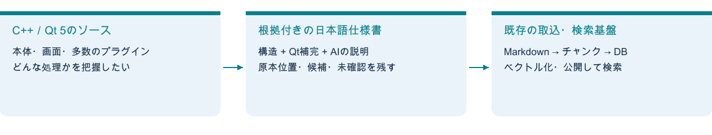

### この資料でわかること

- どのファイルから、何を取り出すか。
- CodeWikiとQt補完が分担する役割。
- 生成した仕様書を、どう検索に使うか。

### まず覚える3つの言葉

- スナップショット：解析用に保存した原本の版。
- 根拠：説明を照合するファイル・行・内容ハッシュ。
- 世代：条件を記録して保存した解析・生成の結果。

### 読む順番

- 全体像と入力：2～5ページ。
- C++・Qt解析と文書化：6～12ページ。
- 取込・検索・更新・操作：13～18ページ。

> 確認日：2026-11-03。現行実装の説明資料です。図の画面・コード・質問・数値は説明用で、社内アプリの解析結果ではありません。

根拠：[docs/implementation/cpp-source-ingestion.md](../../docs/implementation/cpp-source-ingestion.md)、[src/cpp_scan/cli.py](../../src/cpp_scan/cli.py)

## 2. 全体像：ソース解析を、既存取込の前に置く

新しいcpp-scanがソースからMarkdownを作り、既存file-scanが文書の分割・下書き登録・ベクトル化を担当します。

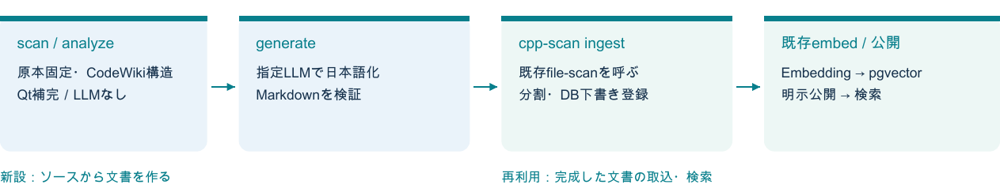

### 1. ソースを整理する

- scanで棚卸しし、analyzeで原本を保存。
- CodeWiki構造解析とQt補完を実行します。
- この段階はLLMとDBを呼びません。

### 2. 日本語仕様書を作る

- generateが指定したLLMへコード等を送ります。
- AIの説明とQtの抽出情報を資料へ整理。
- 未確認事項を残し、出力の整合性を検証します。

### 3. 既存の基盤へ渡す

- ingestが完成MarkdownをDBへ下書き登録。
- Embeddingはfile-scan embedで別に実行。
- 検索公開もfile-searchで別に行います。

> API送信の場面は2つ：仕様書生成でソース等をLLMへ、ベクトル化で仕様書の検索用テキストをEmbedding APIへ送ります。

根拠：[src/cpp_scan/pipeline.py](../../src/cpp_scan/pipeline.py)、[src/cpp_scan/handoff.py](../../src/cpp_scan/handoff.py)、[src/file_scan/embeddings.py](../../src/file_scan/embeddings.py)

## 3. 入力：C++に加え、Qtの周辺ファイルも読む

画面やプラグインの情報はC++だけに揃っていません。関連ファイルを一緒に棚卸しして、役割を分けて扱います。

| ファイル | 主な手掛かり | 現在の扱い |
| --- | --- | --- |
| .cpp / .h / .hpp等 | クラス、関数、Signal／Slot、Qtマクロ | CodeWiki構造解析とQtの字句補完 |
| .ui | Widgetsの画面、部品名、表示文字、接続 | XMLから宣言を抽出 |
| .qml / qmldir / 関連.js | QML画面、import、イベント、C++公開との接点 | QMLは字句補完。.jsはCodeWiki側の対象 |
| 参照されたプラグインJSON | Q_PLUGIN_METADATAのFILE、独自キー | 参照・明示指定のあるJSON等を選別 |
| .qrc / 設定 / 参考文書 | リソースURL・alias、設定参照、既存説明 | qrc等を補完。画像実体の意味解析は対象外 |
| .pro / .pri / .prf | qmake用の構成ファイルがあること | 参考保存・更新検知。条件評価・実行なし |

前提はQt 5とqmakeです。.proの細かな設定、Qt SDK、ビルド結果がなくても開始できます。テスト・第三者コード・生成物の除外は設定で調整します。

> JSON・INI・XML・YAML等を拡張子だけで全件収集しません。読める参照かinclude_filesで範囲を指定します。

根拠：[src/cpp_scan/collector.py](../../src/cpp_scan/collector.py)、[src/cpp_scan/config.py](../../src/cpp_scan/config.py)、[config.cpp-source.example.yaml](../../config.cpp-source.example.yaml)

## 4. 棚卸し：まず、対象と除外を確認する

最初のscanは対象フォルダの一覧を調べる処理です。原本コピーや本格的な解析を始める前に、収集範囲を確認できます。

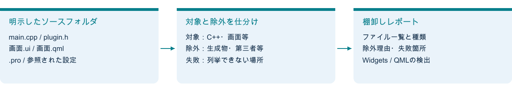

### 対象を選ぶ

- 明示したソースルートから再帰的に探します。
- C++・画面・参照設定等を種類別に記録。
- WidgetsとQMLの両方を検出します。

### 除外した理由も残す

- ビルド出力、moc_・ui_等の生成物を除外。
- テスト・第三者コードは既定で除外します。
- リンク先へ無制限に探索しません。

### 読めない場合を区別する

- 一覧取得・読み取りに失敗した場所を記録。
- 接続不能を、対象が0件の成功にしません。
- ソース本文を端末へ無制限に出しません。

> scanの結果は棚卸し用JSONです。原本スナップショットは次のanalyzeで作成し、scanではLLM・DBを使いません。

根拠：[src/cpp_scan/collector.py](../../src/cpp_scan/collector.py)、[src/cpp_scan/pipeline.py](../../src/cpp_scan/pipeline.py)、[src/cpp_scan/cli.py](../../src/cpp_scan/cli.py)

## 5. 原本固定：いつのコードか、後から戻れるように

analyzeは原本バイト列を保管し、解析用UTF-8コピーを作ります。日本語のCP932ソースでも、原本位置との対応を残します。

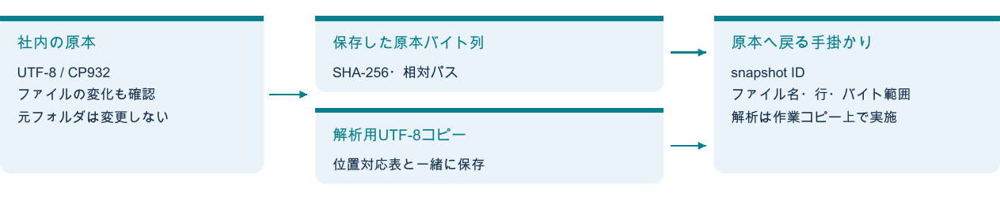

### 原本を保持する

- 内容全体のSHA-256と相対パスを記録。
- 取得中に変化した原本は再試行します。
- 元フォルダと保存した原本は書き換えません。

### 解析用コピーへ変換する

- UTF-8を優先し、CP932への切替を記録。
- ファイルごとの文字コード指定も可能です。
- 原本の行・バイト位置との対応表を保持。

### 一覧と内容を再照合する

- 収集の前後で対象一覧・内容を確認します。
- 変化やデコード失敗は部分失敗として記録。
- 読めない場合も取得できた原本は保持します。

> 通常フォルダの二度の照合は、全ファイルが同一時点の版である保証ではありません。固定したGitアーカイブ等の入力を推奨します。

根拠：[src/cpp_scan/snapshot.py](../../src/cpp_scan/snapshot.py)、[src/cpp_scan/text.py](../../src/cpp_scan/text.py)、[src/file_scan/storage.py](../../src/file_scan/storage.py)

## 6. CodeWiki：コードの骨組みを取り出す

固定版CodeWikiの構造解析APIで、クラスや関数、依存の候補と位置を取得します。日本語の説明を生成する工程は後に分けます。

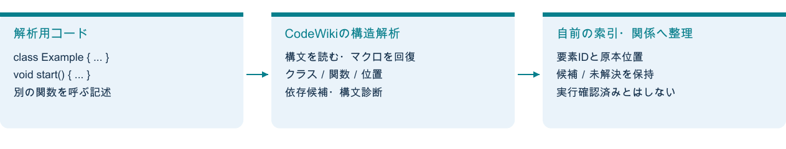

### 構文から要素を取り出す

- クラス・関数・メソッド等を索引化します。
- CodeWikiの位置を固定原本へ対応付けます。
- 依存・呼出先の候補と未解決を保持します。

### 型・動作は別途確認する

- 初期版ではClangやコンパイルDBを必須にしません。
- ビルド条件・型・オーバーロードの完全解決は対象外。
- コード上の構造を、実行済みの動作とは扱いません。

### 解析範囲を可視化する

- 構文エラー候補や未索引のファイルを記録。
- 一部を読めても、全構文の理解を意味しません。
- 構造を取り出せないエラーは部分失敗にします。

> CodeWiki 2.0.0の採用コミットを検査して別Python環境で実行。標準のcodewiki generateを、ローカル解析だけのコマンドとは扱いません。

根拠：[src/cpp_scan/codewiki.py](../../src/cpp_scan/codewiki.py)、[src/cpp_scan/codewiki_bridge.py](../../src/cpp_scan/codewiki_bridge.py)、[src/cpp_scan/pipeline.py](../../src/cpp_scan/pipeline.py)

## 7. Widgets：画面の項目と、操作の接点を拾う

.uiのXMLには部品名や表示文字、接続宣言があります。手書きC++の接続式・Slotと照合するための手掛かりを整理します。

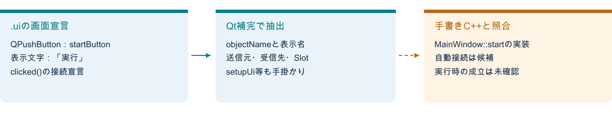

### 画面の宣言を読む

- 画面クラス、widget、objectNameを抽出。
- ボタン文字、タイトル等の一部の属性を取得。
- .uiに書かれた明示接続も保存します。

### C++との対応は候補にする

- setupUi等の呼出を対応付けの手掛かりに。
- on_部品名_シグナル名の自動接続も候補。
- Slot実装と実際の成立はレビューで確認します。

### 生成ヘッダーを主対象にしない

- ui_*.hは既定で生成物として除外します。
- 画面XMLと手書きソースを優先します。
- 生成物しかない場合の欠落は確認が必要です。

> 図は接続宣言を読む例です。startButtonのクリックからMainWindow::startが実行されることまで、自動で保証するものではありません。

根拠：[src/cpp_scan/qt.py](../../src/cpp_scan/qt.py)、[examples/qt5-source/main_window.ui](../../examples/qt5-source/main_window.ui)、[src/cpp_scan/collector.py](../../src/cpp_scan/collector.py)

## 8. Signal／Slot：接続式と、動作の成立を分ける

Qtの接続には、関数ポインタ、SIGNAL／SLOTマクロ、lambda等の書き方があります。まず接続式の存在と引数を記録します。

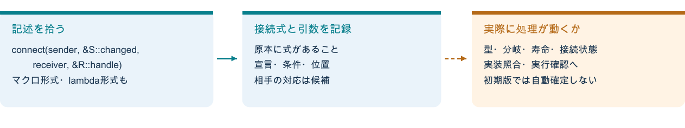

### 複数の書き方を拾う

- 釣り合う括弧の呼出式から引数を読みます。
- コメントや文字列内の見せかけは除きます。
- Signal／Slot宣言も候補として整理します。

### 条件を残す

- 読み取れるプリプロセッサ条件を併記。
- 実行時にどの分岐を通るかは評価しません。
- 相手の型や複雑な式は追加確認が必要です。

### 仕様書で読み分ける

- 式が書かれていることは原本で確認できます。
- 送信先の対応・到達する処理は候補です。
- 動作を確定するには実装照合や実行確認へ。

> 接続の数や記述が取得できても、全呼出の実行順・並行動作・到達性を解析し終えたことにはなりません。

根拠：[src/cpp_scan/text.py](../../src/cpp_scan/text.py)、[src/cpp_scan/qt.py](../../src/cpp_scan/qt.py)、[tests/test_cpp_scan.py](../../tests/test_cpp_scan.py)

## 9. QML：画面側と、公開したC++の接点を見る

QMLのimport・property・イベント記述と、C++の型登録やcontext propertyを並べ、画面と処理を照合する手掛かりにします。

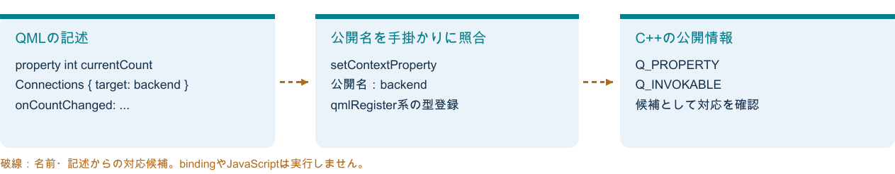

### QML側の記述

- import、id、property、signal等を抽出。
- onXxxやConnectionsの記述を候補で保持。
- qmldirのmodule・plugin宣言も記録します。

### C++側の公開情報

- setContextPropertyやqmlRegister系を検出。
- Q_PROPERTY、Q_INVOKABLE等も補完します。
- 同じ名前でも、同じ実体かは要確認です。

### 完全な実行評価は行わない

- QMLは字句ベースの部分的な補完です。
- bindingやJavaScriptを実行して追跡しません。
- 未対応・部分対応を網羅状況へ残します。

> ui_modeの事前回答を実行条件にせず、Widgets／QMLの両方を検出します。初期版のui_mode指定は検出対象を絞るスイッチではありません。

根拠：[src/cpp_scan/qt.py](../../src/cpp_scan/qt.py)、[src/cpp_scan/config.py](../../src/cpp_scan/config.py)、[examples/qt5-source/Main.qml](../../examples/qt5-source/Main.qml)

## 10. プラグイン：入口・契約・読込箇所を整理する

宣言クラス、共通インターフェース、参照JSON、ローダーの記述を拾います。どの機能に所属し、いつ動くかは候補として照合します。

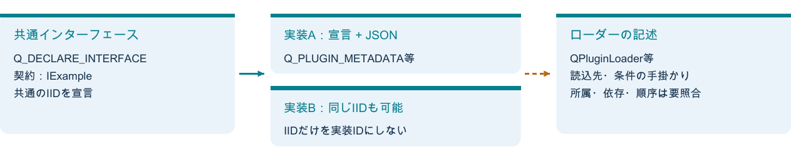

### 入口と契約を確認する

- Q_PLUGIN_METADATA等の宣言を抽出。
- Q_DECLARE_INTERFACE・Q_INTERFACESも保持。
- IIDは契約の識別子で、実装の一意IDではありません。

### JSONとローダーも読む

- FILEで参照するメタデータを収集します。
- QPluginLoader・QLibrary等の候補を検出。
- JSONのキー名だけで依存や順序を確定しません。

### 独自方式は未確認を残す

- 一部のFactory登録名を候補として検出。
- 動的パスや独自マクロは追い切れない場合があります。
- 所属・有効化・初期化順は原本と照合します。

> DLLをロードしたり、プラグインを起動したりする処理ではありません。CodeWikiのモジュール分割と実プラグイン境界の一致も未確認です。

根拠：[src/cpp_scan/qt.py](../../src/cpp_scan/qt.py)、[examples/qt5-source/example_plugin.h](../../examples/qt5-source/example_plugin.h)、[src/cpp_scan/collector.py](../../src/cpp_scan/collector.py)

## 11. 文書生成：AIの説明と、Qtの抽出資料をまとめる

指定した解析版を入力に、CodeWikiとLLMで日本語の説明を生成します。独立したQt補完資料を組み合わせ、根拠と未確認事項を付けます。

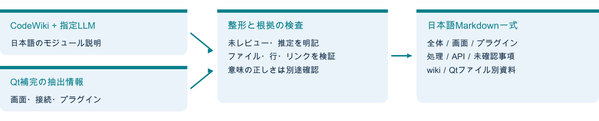

### CodeWikiが説明を作る

- モデル・接続先・キーを環境変数で指定します。
- コードや識別子は原文、日本語で本文を生成。
- 元リポジトリや利用者の設定を上書きしません。

### Qt補完を別の資料として合流

- 画面・プラグイン・接続・API等を表へ整形。
- 補完JSONがCodeWikiへ自動統合される前提にはしません。
- 全体・未確認事項・ファイル別資料も生成します。

### 完成した一式を検証する

- 必須ファイル、UTF-8、ハッシュ、リンクを検査。
- 抽出根拠の原本パス・行・バイト範囲を照合。
- 説明の意味の正しさはレビュー対象です。

> CodeWiki本文は推定を含む未レビュー文書です。Mermaidの外部検証は無効にしており、図が出ても検証済みとは表示しません。

根拠：[src/cpp_scan/codewiki_bridge.py](../../src/cpp_scan/codewiki_bridge.py)、[src/cpp_scan/documents.py](../../src/cpp_scan/documents.py)、[src/cpp_scan/pipeline.py](../../src/cpp_scan/pipeline.py)

## 12. 品質：根拠・候補・推定を、読み分ける

処理が成功したことと、説明をレビューしたことは別です。原本で確認した記述から、どこまで解釈したかを分けて読みます。

| 区分 | 例 | 読み取れる範囲 |
| --- | --- | --- |
| 原本の記述／source_fact | Q_PLUGIN_METADATAの宣言がある | 記述自体と原本位置を確認。実行時の成立は別 |
| 対応候補／candidate | この画面のSlotに対応しそう | 字句や名前からの候補。型や実体を照合する |
| 未解決／unresolved | 依存・呼出先の相手を特定できない | 未解決として保持。存在しないと結論付けない |
| 推定を含む説明 | CodeWikiが説明した機能や処理の意図 | AI説明の意味は未確認。根拠と人手で照合する |
| レビュー状態 | unreviewed／reviewed | 抽出の確実性と別の概念。現処理は未レビューで生成 |

根拠には固定原本のパス、SHA-256、文字コード、開始・終了行、必要なバイト範囲を保存します。AIの各文へ根拠が自動対応する保証はなく、未対応の説明は未確認として扱います。

> 根拠位置の整合性検査は、業務要件・設計意図・AI説明の正しさを保証しません。実行確認済みの状態も自動付与しません。

根拠：[src/cpp_scan/qt.py](../../src/cpp_scan/qt.py)、[src/cpp_scan/documents.py](../../src/cpp_scan/documents.py)、[docs/design/09-cpp-qt-source-ingestion-spec.md](../../docs/design/09-cpp-qt-source-ingestion-spec.md)

## 13. 受渡し：完成Markdownを、既存取込へ渡す

新しい処理の出口をMarkdownに揃えることで、既存の文書変換・チャンク化・DB登録をそのまま活用します。

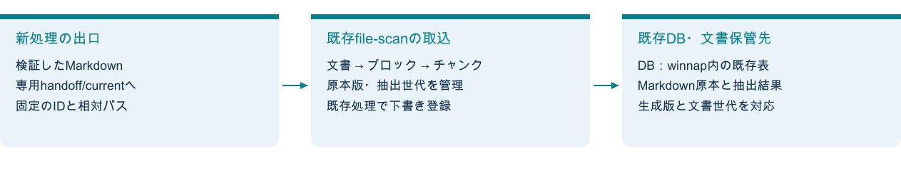

### 専用フォルダへ完成版だけ配置

- 世代とハッシュを検証してhandoff/currentを更新。
- C++原本や中間JSONを混ぜません。
- ソース・ナレッジのIDと文書パスを固定します。

### 既存の取込処理を呼ぶ

- file_scan.pipeline.ingestで抽出・分割・登録。
- 既存の原本版・抽出世代・キャッシュを使います。
- ソース解析用のDBスキーマ追加はありません。

### DBとの対応を記録する

- 生成版・文書ID・選択抽出世代を照合。
- 取込レポートを受渡し履歴へ残します。
- 同じDBのstorage_dirは既存ルートに揃えます。

> 登録はdraftです。DBの確定単位は1文書であり、全仕様書の同時切替やDB全体の自動ロールバックは保証しません。

根拠：[src/cpp_scan/handoff.py](../../src/cpp_scan/handoff.py)、[src/file_scan/pipeline.py](../../src/file_scan/pipeline.py)、[config.cpp-docs.example.yaml](../../config.cpp-docs.example.yaml)

## 14. ベクトル化：仕様書の文章を、検索につなぐ

ソースから作った仕様書も、既存の文書と同じ経路で分割・ベクトル化します。公開後は説明文を根拠として検索できます。

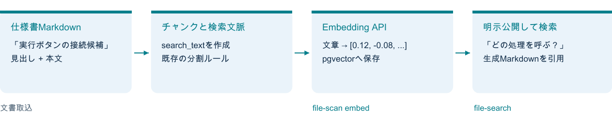

### 何をベクトル化するか

- 対象は仕様書のチャンクと見出し等の検索文脈。
- 関数のASTを直接ベクトルDBへ登録する経路ではありません。
- 既存のモデル・次元数・入力キャッシュを使います。

### 別のコマンドで実行する

- 確認後にfile-scan embedを実行します。
- 生成・下書き取込だけでAPI送信は始まりません。
- 仕様書のsearch_textをAPIへ送って数値化します。

### 公開してから検索する

- file-searchで文書ID・DB抽出世代・業務版を指定。
- 検索の引用先は生成Markdownです。
- 本文のソース参照を手掛かりに原本を照合します。

> 公開の抽出世代IDはcpp-scanの生成IDとは別です。図の数値・質問は説明用で、Embeddingが推定や誤記を修正するわけではありません。

根拠：[src/file_scan/embeddings.py](../../src/file_scan/embeddings.py)、[src/file_scan/chunking.py](../../src/file_scan/chunking.py)、[docs/implementation/search-api.md](../../docs/implementation/search-api.md)

## 15. 再実行：原本と条件を、版ごとに照合する

入力や条件が同じなら完成済みの成果物を検証して再利用し、変わった場合は新しい解析・生成版を作ります。

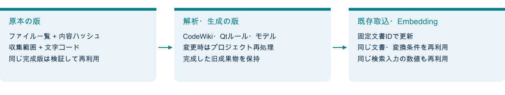

### 何を変更として見るか

- ファイル一覧・内容・対象範囲・文字コード。
- CodeWiki・解析ルール・モデル等の条件。
- コメント・画面・.proだけの変更も検知します。

### 初期版の更新単位

- 変更時は対象プロジェクトを再解析・再生成。
- CodeWikiの--updateには依存しません。
- --forceで同じ条件でも新しい版を作れます。

### 既存取込側も再利用する

- 文書ID・配置先を毎回変えずに更新します。
- 同じMarkdown・変換条件は既存世代を再利用。
- 同じ検索入力・モデルのベクトルも再利用します。

> スナップショットは内容等から識別し、解析・生成版は別IDで保存します。日時や実行IDを文書ファイル名へ増殖させる方式ではありません。

根拠：[src/cpp_scan/pipeline.py](../../src/cpp_scan/pipeline.py)、[src/cpp_scan/snapshot.py](../../src/cpp_scan/snapshot.py)、[src/file_scan/profiles.py](../../src/file_scan/profiles.py)

## 16. 操作：棚卸しから検索まで、段階を分けて実行

Sはソース解析用設定、Dは生成文書の取込設定です。解析IDと生成IDは、前のコマンドが返した実際の値を指定します。

| 順序 | コマンド例・公開操作 | 主な結果・接続 |
| --- | --- | --- |
| 事前準備 | file-scan init-db --config D | 既存DBを初期化。準備済みなら不要 |
| 1. 棚卸し | cpp-scan scan --config S | 一覧・除外・失敗。LLM／DBなし |
| 2. 解析 | cpp-scan analyze --config S | 原本固定・構造・Qt。LLM／DBなし |
| 3. 生成 | cpp-scan generate --config S --analysis analysis-... | 日本語仕様書。指定LLMへ送信 |
| 4. 下書き取込 | cpp-scan ingest --config S --generation gen-... | 既存処理でDB登録。Embeddingなし |
| 5. ベクトル化 | file-scan embed --config D | 設定で有効な場合にEmbedding APIへ |
| 6. 公開 | file-searchのcreate-release・publish | 業務版・文書・抽出世代等の引数は検索手順へ |
| 状態確認 | cpp-scan status --config S | 工程履歴・選択版・受渡し。DB接続なし |

S＝config.cpp-source.local.yaml、D＝config.cpp-docs.local.yaml。...は仮表記です。モデルの環境変数、CodeWiki専用Python、文字辞書キャッシュ、既存DBの接続・保管先を事前に設定します。

> 操作の詳細は実装手順へ。終了コードは0＝成功、1＝工程エラー、2＝部分失敗、130＝中断。statusはDB内の最新状態を直接照会するコマンドではありません。

根拠：[src/cpp_scan/cli.py](../../src/cpp_scan/cli.py)、[docs/implementation/cpp-source-ingestion.md](../../docs/implementation/cpp-source-ingestion.md)、[src/search/cli.py](../../src/search/cli.py)

## 17. 失敗時：欠落を明示し、未完成の受渡しを止める

読取不能・構文エラー・タイムアウトを成功へ置き換えずに記録します。既定では部分失敗した仕様書一式を取込へ渡しません。

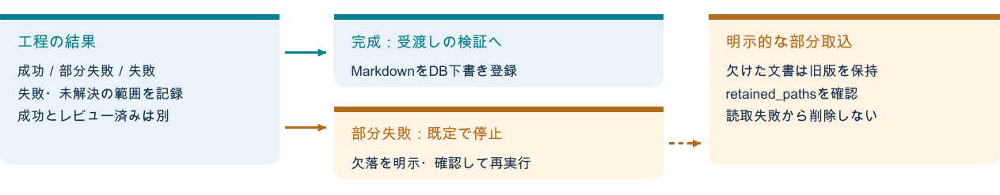

### 未完成を通常版へ流さない

- 設定・ツールの全体失敗と、個別の部分失敗を区別。
- 未解決の候補があるだけで失敗とはしません。
- 本文・網羅状況・品質レポートを併せて確認します。

### 部分取込を明示した場合

- allow_partial_ingest=trueで下書きとして許可。
- 欠けた文書は直前のMarkdownで保持します。
- retained_pathsと、残った旧版の根拠を確認します。

### 変更・中断を管理する

- 範囲変更は専用オプションで意図を明示します。
- 排他と履歴で配置中断・再実行を管理。
- DB開始後、ファイルだけ旧版へ戻しません。

> LLMの期限・応答長・エージェント単位の回数を制限できます。プロジェクト全体の金額上限が必要な場合はAPI側の予算制限も使います。

根拠：[src/cpp_scan/handoff.py](../../src/cpp_scan/handoff.py)、[src/cpp_scan/store.py](../../src/cpp_scan/store.py)、[src/cpp_scan/pipeline.py](../../src/cpp_scan/pipeline.py)

## 18. 詳しく読む：操作手順と、現在の実装の範囲

このガイドは処理の仕組みを説明する資料です。導入条件・設定・個別の制限は、実装手順と各モジュールで確認できます。

| 順序 | 参照先 | 確認すること |
| --- | --- | --- |
| 1 | docs/implementation/cpp-source-ingestion.md | 導入・操作・対応範囲・社内受入確認 |
| 2 | config.cpp-source.example.yaml / config.cpp-docs.example.yaml | 専用設定と、既存文書取込への接続 |
| 3 | src/cpp_scan/cli.py / config.py / collector.py | コマンド・設定・対象と除外 |
| 4 | src/cpp_scan/snapshot.py / text.py | 原本固定・文字コード・根拠の位置 |
| 5 | src/cpp_scan/codewiki_bridge.py / qt.py | 固定版CodeWikiの呼出とQt補完 |
| 6 | src/cpp_scan/pipeline.py / documents.py / handoff.py | 状態・文書検証・既存取込への受渡し |
| 7 | src/file_scan/pipeline.py / embeddings.py | 既存の文書取込・分割・ベクトル化 |

合成ソース、固定版CodeWiki、ローカル固定応答API、実PostgreSQLで工程間の接続を検証しています。社内実ソースと実モデルの生成品質・費用・検索精度は、社内環境での受入確認が必要です。

> C++・Qtの完全な意味解析、ビルド再現、実行時トレース、プラグイン所属の完全確定、C++原本の直接検索・引用APIは初期版の対象外です。

根拠：[docs/implementation/cpp-source-ingestion.md](../../docs/implementation/cpp-source-ingestion.md)、[tests/test_cpp_scan.py](../../tests/test_cpp_scan.py)、[docs/design/09-cpp-qt-source-ingestion-spec.md](../../docs/design/09-cpp-qt-source-ingestion-spec.md)
