# ファイル取込処理 図解ガイド

確認日：2026-11-02／日本語PDF OCRと専用スキーマ`winnap`に対応した修正版。初めて読む方向けの説明資料です。

[図解PDFを開く](../../output/pdf/ファイル取込処理_図解ガイド.pdf)

図中の業務内容・数値ベクトル・座標は説明用です。設定値は同梱設定とコードの既定値を示し、実行環境の設定値を保証するものではありません。

## 目次

1. ファイル取込処理を、図で理解する
2. 全体像：取込とベクトル化は別の処理
3. 対応する文書と、解析の入口
4. テキスト・Markdown：段落と見出しを拾う
5. Excel：シート・セル・数式を分けて読む
6. Word：本文の順に、段落・表・見出しを読む
7. PDF：文字層も、日本語スキャンも読み取る
8. 画像：文字を読むことと、意味の説明を分ける
9. チャンク化：本文と検索用の文脈を分ける
10. ベクトル化：文章の意味を、数値の列へ変える
11. 保存：原本、抽出結果、ベクトルをつなぐ
12. 再実行：変わった段階だけ、やり直す
13. 運用：どこまで終わったかを確認する
14. 設計書を読むときの注意：現状と将来構想
15. 根拠資料と、プログラムの読み順

## 1. ファイル取込処理を、図で理解する

ファイルの種類に合わせて読み取り、検索しやすい小さな文章へ整理し、その意味を数値の列に変えます。

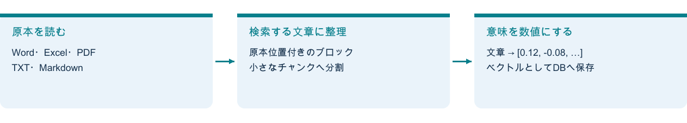

### この資料でわかること

- 種類ごとに何をどう読み取るか。
- 本文・表を、どう分割するか。
- どの文章をベクトル化し、どこに保存するか。

### まず覚える3つの言葉

- ブロック：段落・表など、原本のひとまとまり。
- チャンク：検索・ベクトル化に使う小さな文章。
- Embedding：文章の意味を数値の列で表す処理。

### 読む順番

- 全体像・対応形式：2～3ページ。
- 形式ごとの図解：4～8ページ。
- 分割・ベクトル化・保存・運用：9～14ページ。

> 確認基準：2026-11-02／日本語RapidOCR・winnap対応版。値は同梱設定・コードの既定値。図中の業務内容と数値ベクトルは説明用です。

根拠：[README.md](../../README.md)、[src/file_scan/domain.py:16](../../src/file_scan/domain.py#L16)、[config.example.yaml](../../config.example.yaml)

## 2. 全体像：取込とベクトル化は別の処理

ingest はローカルで抽出・分割し、embed が抽出済みの検索用テキストをOpenAI APIへ送信します。

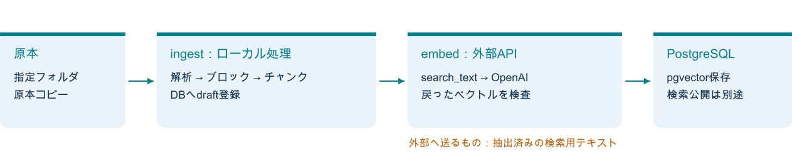

### 1. 対象を決めて保管

- 指定フォルダを列挙し、拡張子・除外規則で絞ります。
- 原本全体のSHA-256で変更を確認。原本コピーは内容ハッシュで保管します。
- 共有元のファイルは変更しません。

### 2. 読み取り・整理

- 形式別の解析器が、本文・表・位置を抽出します。
- ブロックを小さなチャンクへ分割し、DBに下書き保存します。
- PDF内の画像文字は日本語OCR。図の意味説明は解析待ちです。

### 3. 意味を数値にする

- embed が選択中の世代のチャンクを対象にします。
- 同じモデル・入力の保存済みベクトルは再利用します。
- 新しい入力だけをAPIへ送り、pgvectorに保存します。

> ingest と embed の実行だけでは検索公開されません。公開は検索側の file-search publish で別途行います。

根拠：[src/file_scan/pipeline.py:406](../../src/file_scan/pipeline.py#L406)、[src/file_scan/embeddings.py:121](../../src/file_scan/embeddings.py#L121)、[docs/implementation/search-api.md](../../docs/implementation/search-api.md)

## 3. 対応する文書と、解析の入口

OfficeやPDFを一律に画像化せず、文字・セル・構造を読み取れる形式では、その情報を直接利用します。

| 種類 | 読み取り方式 | 検索用テキストになるもの | 原本へ戻る手掛かり |
| --- | --- | --- | --- |
| TXT / MD | 文字コードを判定して読込 | 段落／MDの見出しの文脈 | 開始・終了行 |
| Excel (.xlsx / .xlsm) | openpyxl + OOXML | セル番地付きの行テキスト | シート名・セル範囲 |
| Word (.docx) | OOXMLを直接解析 | 段落・表・見出しの文脈 | 段落番号・表番号 |
| PDF・スキャンPDF | Docling + 日本語RapidOCR CPU | 文字層・OCRの本文と表 | ページ・領域座標 |
| Office画像・図の意味 | 実体と出現位置を保存 | 文字・意味説明は後続処理 | 文書内の位置・画像参照 |

対象はTXT・MD・XLSX・XLSM・DOCX・PDF。別拡張子.markdownも設定できます。プログラム解析は別処理とし、SQL・JSON・YAML・CSV・LOG等も対象外です。対象外の形式は設定で追加してもエラーになります。

> YAMLの実行設定、JSON/JSONLの確認用出力、DB用SQLは引き続き使用します。原本の取込対象とは別です。

根拠：[src/file_scan/parsers.py](../../src/file_scan/parsers.py)、[src/file_scan/config.py](../../src/file_scan/config.py)、[config.example.yaml](../../config.example.yaml)

## 4. テキスト・Markdown：段落と見出しを拾う

文字を直接読み取り、空行で段落に分けます。Markdownは # 形式の見出しを見て、章・節の文脈を付けます。

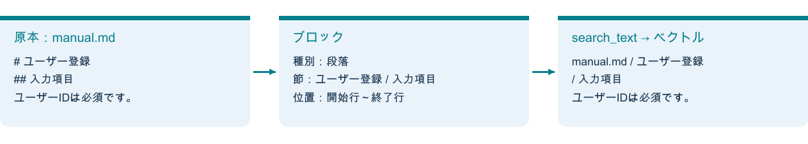

### どう解析するか

- UTF-8（BOM付きも可）、次にCP932で読み取ります。
- 行番号を保持し、空行やMarkdown見出しでブロックを分けます。
- コードフェンス内の # は見出し扱いにしません。

### どうベクトル化するか

- 本文にファイル名・章節の見出しを添えた search_text を作ります。
- 長い段落は共通の文字数・トークン上限で分割します。
- 形式ごとに別のEmbeddingモデルを使う構成ではありません。

### 理解しておきたい点

- 対象はTXT・Markdown文書です。設定・ログ・データファイルは取り込みません。
- 文書内のコード片も原文として扱い、プログラムの構造解析はしません。
- 読めない文字コードやNULを含む入力は明示的にエラーにします。

> 例は説明用です。MDの見出しは主に検索文脈に使用し、通常は見出し自体を本文チャンクに重ねません。

根拠：[src/file_scan/parsers.py](../../src/file_scan/parsers.py)、[src/file_scan/parsers.py](../../src/file_scan/parsers.py)、[src/file_scan/chunking.py:30](../../src/file_scan/chunking.py#L30)

## 5. Excel：シート・セル・数式を分けて読む

各シートの実在セルを調べ、行ごとに「セル番地：値」のテキストへ変換します。数式と保存済み結果は別に保持します。

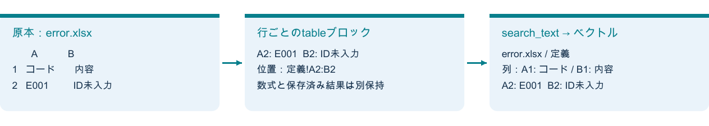

### どう解析するか

- openpyxlで数式用・保存済み結果用の2通りを読みます。
- 結合セル情報はシートに保持し、表示形式・コメント等はセル情報に残します。
- 既定では非表示シート・行・列を本文から除外します。

### どうベクトル化するか

- 例：A2: E001、B2: ID未入力。行テキストがチャンク本文です。
- ファイル名・シート名・該当する列見出しを検索文脈に添えます。
- 現実装では行が別のtableブロックとなり、行ごとのチャンクを基本にします。

### 理解しておきたい点

- 数式を再計算しません。保存済み結果がなければ警告を付けます。
- 数式の結果は構造データに保持しますが、検索本文へ自動追加しません。
- 見出しはExcelテーブル定義を優先。先頭行からの推定は候補です。VBAも実行しません。

> 埋込画像は位置と実体を保存します。図形・グラフ・VBA等の未処理要素は警告で残します。

根拠：[src/file_scan/parsers.py](../../src/file_scan/parsers.py)、[src/file_scan/parsers.py](../../src/file_scan/parsers.py)、[src/file_scan/chunking.py:14](../../src/file_scan/chunking.py#L14)

## 6. Word：本文の順に、段落・表・見出しを読む

DOCXの内部XML（OOXML）を直接読み、本文中に現れる段落・表の順番と、見出しの階層を保持します。

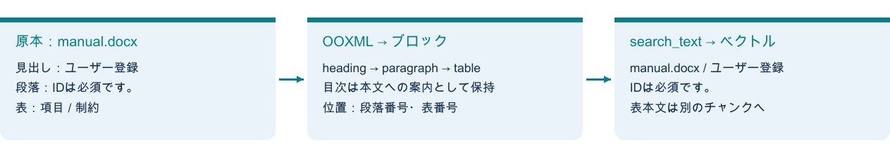

### どう解析するか

- 見出しスタイルとアウトラインレベルから章節を取得します。
- 表は行・セルの文字を取り出し、結合情報も保持します。
- 目次は案内用のnavigationとし、ブックマークで本文へ関連付けます。

### どうベクトル化するか

- 段落・表の本文に、ファイル名と見出しの文脈を添えます。
- 目次を通常の本文チャンクに重ねず、本文の重複を抑えます。
- Word表の列見出しは自動判定・再付与が保証されません。

### 理解しておきたい点

- 原本位置は段落番号・表番号等。Wordの表示ページ番号は再現しません。
- 自動採番、変更履歴、補助文書、浮動要素、入れ子表等は警告対象です。
- テキストボックスで文字が取れても、読み順未確認の警告を残します。

> WordをPDFや画像へ変換して読み直す経路ではありません。本文の構造と、画面上のレイアウト再現は別です。

根拠：[src/file_scan/parsers.py](../../src/file_scan/parsers.py)、[src/file_scan/parsers.py](../../src/file_scan/parsers.py)、[src/file_scan/chunking.py:14](../../src/file_scan/chunking.py#L14)

## 7. PDF：文字層も、日本語スキャンも読み取る

文字層は直接読み、画像の文字はRapidOCR＋ONNX Runtime CPUで読み取ります。本文・表・位置を共通のブロックにします。

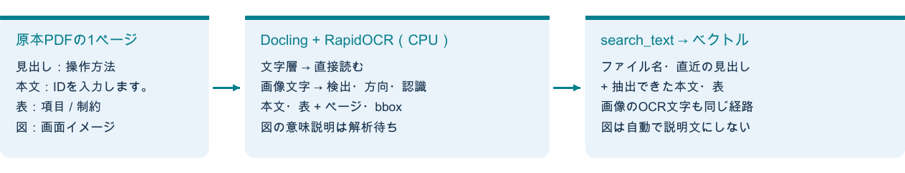

### どう解析するか

- Doclingが必要な画像領域を選び、日本語OCRを実行します。
- 文字検出 → 方向分類 → 認識。既定216dpi・smallモデルです。
- 本文・表と、ページ番号・bbox（領域座標）を残します。

### どうベクトル化するか

- OCR本文にもファイル名・見出しを添え、共通の分割処理を使います。
- 取得できた列見出しを表の後続チャンクにも添えます。
- search_textをOpenAIでベクトル化。OCR自体にAPIキーは不要です。

### 設定と注意点

- autoが既定。不良な文字層はfull_pageでOCR結果に置き換えます。
- OCR有効PDFの期限は既定30分。途中再開は未実装です。
- OCR後も文字のないページは部分抽出。実書籍の精度確認が必要です。

> モデルは事前配置し、固定版・SHAを検査します。OCRはローカル実行。ベクトル化時には抽出文を外部APIへ送ります。

根拠：[src/file_scan/parsers.py](../../src/file_scan/parsers.py)、[src/file_scan/ocr_models.py](../../src/file_scan/ocr_models.py)、[docs/implementation/rapidocr-pdf.md](../../docs/implementation/rapidocr-pdf.md)

## 8. 画像：文字を読むことと、意味の説明を分ける

PDF内の文字は日本語OCRで抽出できます。フロー図の意味説明やOffice画像のOCRは後続処理として残します。

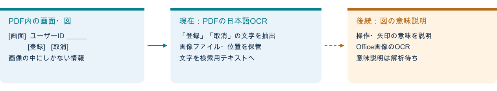

### PDFでできること

- 日本語の文字を読み、通常本文と同じ検索用テキストにします。
- 原画像・図領域の実体とページ・位置を保存します。
- OCR済みの全面スキャン背景だけ、画像待ちを外します。

### 後続処理になるもの

- Word・Excel埋込画像のOCR。単独画像の取込も対象外です。
- フロー図の矢印や図形の意味を説明文にすること。
- pending_images と image_analysis_pending に意味解析待ちを残します。

### 検索・運用への影響

- OCR文字の検索は可能でも、図の意味を検索できるとは限りません。
- 部分抽出の文書でも、取れた本文チャンクはembedの対象になります。
- OCRの誤字はEmbeddingで直りません。重要な数値は原本と照合します。

> 全面背景は原画像1点・ページ面積95%以上・OCR文字取得を条件に判定。部分的な図の意味説明待ちは残します。

根拠：[src/file_scan/parsers.py](../../src/file_scan/parsers.py)、[src/file_scan/domain.py:61](../../src/file_scan/domain.py#L61)、[docs/implementation/rapidocr-pdf.md](../../docs/implementation/rapidocr-pdf.md)

## 9. チャンク化：本文と検索用の文脈を分ける

本文は原文に対応する形で保持し、ファイル名・見出し・取得できた列見出しは、検索用テキストにだけ添えます。

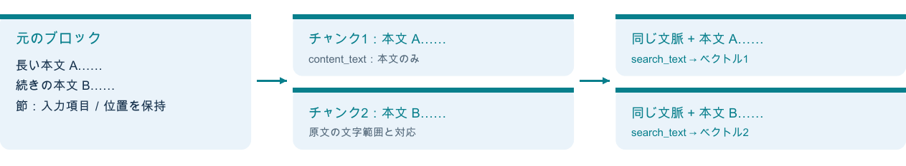

### 何を単位に分けるか

- 章節・親要素・由来の違うブロックを安易に混ぜません。
- 本文は既定1,800文字以内。長い本文は改行等を優先して分割します。
- 固定幅の重なりを入れる実装ではありません。

### トークンも測る

- トークンはモデルが読む小さな文字片。文字数とは異なります。
- cl100k_baseで、文脈を含む入力全体を実測します。既定上限は8,191です。
- 文脈は既定1,024トークン以内、かつ全体予算の半分以下です。

### 表と原本対応を守る

- 表は行の境界を優先。1行が長すぎる場合は分割し、警告します。
- 長すぎる検索文脈は省略を記録し、本文の続きを別チャンクに残します。
- chunk_blocksに原文とチャンクの文字範囲を保存して一致を検査します。

> content_text＝チャンク本文。search_text＝文脈＋本文。Embeddingへ送るのはsearch_textです。

根拠：[src/file_scan/chunking.py:14](../../src/file_scan/chunking.py#L14)、[src/file_scan/chunking.py:30](../../src/file_scan/chunking.py#L30)、[src/file_scan/tokens.py](../../src/file_scan/tokens.py)、[src/file_scan/pipeline.py:239](../../src/file_scan/pipeline.py#L239)

## 10. ベクトル化：文章の意味を、数値の列へ変える

既定ではtext-embedding-3-smallを使い、1つのsearch_textから1,536個の数値を得ます。全文書形式で共通の処理です。

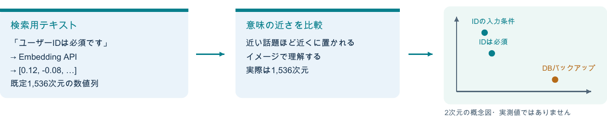

### どの文章を送るか

- 原本・収集状態・選択世代・変換設定が一致する、下書きチャンクです。
- 処理状態succeededとpartialが対象。failed・stale等は対象にしません。
- 実APIへ送る前に、入力が1～8,191トークン内か再検査します。

### どう呼び出すか

- DB読込は既定128件ずつ。APIへは既定16入力ずつ送ります。
- 1要求の合計トークンも制限します。同時API要求は1つです。
- 同じ入力はキャッシュや要求内のまとめ処理で再利用します。

### どう保存するか

- 応答の件数・順序・次元数・有限数・非ゼロを確認します。
- モデル等のプロファイルと入力ハッシュを付け、pgvectorに保存します。
- 質問も同じモデル・次元で数値化すると、意味の近さを比較できます。

> 同梱設定はembedding.enabled=false。図の座標は概念図、数値は架空です。近さは関連性の手掛かりであり、正しさの保証ではありません。

根拠：[src/file_scan/embeddings.py:69](../../src/file_scan/embeddings.py#L69)、[src/file_scan/embeddings.py:121](../../src/file_scan/embeddings.py#L121)、[src/file_scan/config.py](../../src/file_scan/config.py)、[src/search/service.py](../../src/search/service.py)

## 11. 保存：原本、抽出結果、ベクトルをつなぐ

原本と画像はファイル保管先へ。抽出本文・構造・位置・ベクトルは、DBの専用スキーマwinnapへ保存します。

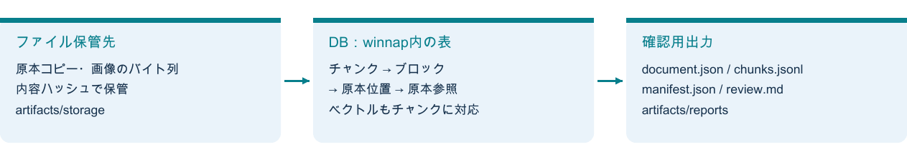

### ファイルとして保存

- artifacts/storage：同梱設定の原本コピー・抽出画像。内容ハッシュで管理します。
- DBには実体参照を保存します。DBと保管先を一緒に扱います。
- storage_dirは1つのDBの初回登録先に固定されます。

### DBに保存

- winnap内のdocuments / document_versions：文書の識別と原本の版。
- blocks / chunks / chunk_blocks：構造・検索用本文・文字対応。
- chunk_embeddings：チャンクのベクトル。embedding_profiles：モデル等の条件。

### 人が確認する出力

- manifest.json：処理状態・件数等。document.json：ブロック・位置・画像参照。
- chunks.jsonl：検索用テキスト。review.md：抽出内容の確認用。
- generations/<世代ハッシュ>/に出力。編集してもDBには逆反映されません。

> 取込・検索の表はwinnap内。pgvectorの型・関数はpublic。チャンクから原本ブロック・位置・保管原本へ戻れます。

根拠：[src/file_scan/db.py](../../src/file_scan/db.py)、[src/file_scan/namespace.py](../../src/file_scan/namespace.py)、[docs/implementation/winnap-schema.md](../../docs/implementation/winnap-schema.md)、[src/file_scan/pipeline.py:283](../../src/file_scan/pipeline.py#L283)、[src/file_scan/pipeline.py:354](../../src/file_scan/pipeline.py#L354)、[config.example.yaml](../../config.example.yaml)

## 12. 再実行：変わった段階だけ、やり直す

原本、抽出条件、分割条件、Embedding入力を分けて識別し、同じ結果を再利用します。過去の履歴も保持します。

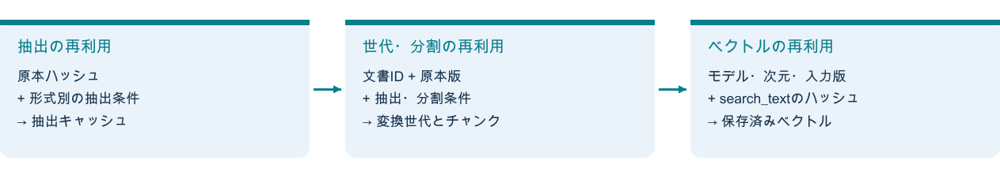

### 原本が同じ

- 変更確認では毎回、共有元を全文ハッシュします。
- 同じ原本・同じ変換設定なら既存世代を再利用します。
- mtime・サイズだけで同一とは判断しません。ネットワーク読込は残ります。

### 分割条件だけが変わった

- 抽出キャッシュからブロックを読み、新たな分割条件を適用します。
- 画像参照・キャッシュの整合性も検査します。
- モデルやパーサーの変更なら、該当する抽出もやり直します。

### Embeddingをやり直す

- モデル・次元・入力版が同じでsearch_textも同じなら再送しません。
- 成功済みバッチを残し、失敗後は未完了の入力から再開できます。
- 選択中世代を明示管理し、失敗時に古い世代へ自動で戻りません。

> 同じ条件で部分抽出をやり直す指定は ingest --retry-partial。変更のない通常再実行ではpartialも再利用されます。

根拠：[src/file_scan/profiles.py](../../src/file_scan/profiles.py)、[src/file_scan/profiles.py](../../src/file_scan/profiles.py)、[src/file_scan/pipeline.py:406](../../src/file_scan/pipeline.py#L406)、[docs/design/05-ingestion-improvements.md](../../docs/design/05-ingestion-improvements.md)

## 13. 運用：どこまで終わったかを確認する

準備済みのPython環境・DB・モデル・設定を前提に、棚卸し→取込→抽出確認→ベクトル化→状態確認の順に進めます。

| 順序 | コマンド例（設定ファイルはconfig.local.yaml） | 確認すること |
| --- | --- | --- |
| 1 | file-scan scan --config config.local.yaml | 対象・除外・列挙エラー。DB登録しない |
| 2 | file-scan init-db --config config.local.yaml | 初回導入・既存DBのスキーマ移行 |
| 3 | file-scan ingest --config config.local.yaml | registered / unchanged / failed と partial |
| 4 | generations/<世代>/review.md 等を読む | 抽出本文・原本位置・画像待ち・品質警告 |
| 5 | file-scan embed --config config.local.yaml | 有効化・実キー設定済みならAPIへ送信 |
| 6 | file-scan status --config config.local.yaml | 現在の世代状態・ready / pending / total |

succeeded＝品質警告・画像待ちなし、partial＝警告または画像待ちあり、failed＝失敗。これらは処理状態です。draft（下書き）は別の公開状態です。終了コードは0：正常、1：実行全体のエラー、2：部分完了。

> 資料作成では実API呼出・業務データ取込・業務DB移行・公開を行っていません。.envはCLIが自動読込しません。

根拠：[src/file_scan/cli.py](../../src/file_scan/cli.py)、[src/file_scan/domain.py:61](../../src/file_scan/domain.py#L61)、[docs/implementation/first-version.md](../../docs/implementation/first-version.md)、[docs/implementation/openai-embedding.md](../../docs/implementation/openai-embedding.md)

## 14. 設計書を読むときの注意：現状と将来構想

設計書には目標構成や古い時点の記述も含まれます。本資料は現在のプログラムと、後から追加された実装資料を優先しています。

| 論点 | 設計上の記述・構想 | 現在のプログラム |
| --- | --- | --- |
| PDF OCR・図の説明 | 日本語OCRはCPU、図の説明は後続API | PDFはRapidOCR実装済み。図の意味説明は待ち |
| 分割の数値 | 400～800トークン等のPoC候補 | 既定1,800文字／入力8,191トークン以内 |
| 検索公開 | 改善設計の冒頭には未実装と記載 | 検索側にpublish実装あり。取込側はdraftのまま |
| Word / PDF構造 | 階層・表・レイアウトを幅広く扱う構想 | Wordはページ再現なし。PDF見出しは直近のみ |
| 並列処理 | parse_workersを設定可能 | 現在は文書ごとに順次確定。同時解析は1文書 |
| 権限・対話 | 利用者ACL、レビュー画面、Dify等 | 文書ACL・SSO・レビュー画面・Chatflow等は未実装 |

ベクトル化済みでも自動公開されません。検索側は管理者が承認した世代の本文・出典・完成ベクトルを凍結コピーします。公開後にembedした場合は、同じ世代を再公開して反映します。

> 「警告がない」ことは、原本内容を100%正しく理解できたという意味ではありません。実物との照合は引き続き必要です。

根拠：[docs/design/01-document-conversion.md](../../docs/design/01-document-conversion.md)、[docs/design/05-ingestion-improvements.md](../../docs/design/05-ingestion-improvements.md)、[docs/implementation/search-api.md](../../docs/implementation/search-api.md)、[src/search/management.py:116](../../src/search/management.py#L116)、[src/file_scan/workers.py](../../src/file_scan/workers.py)

## 15. 根拠資料と、プログラムの読み順

業務担当者は図解から、保守担当者は以下のファイルから実装の詳細へ進めます。本文各ページの下部にも参照先を記載しました。

| 知りたいこと | 主な確認先（プロジェクトルート基準） |
| --- | --- |
| 入口・全体の進行 | src/file_scan/ 内：cli.py / pipeline.py:406 |
| 形式別の解析 | src/file_scan/parsers.py：114（TXT・MD）、234（Excel） |
| Word・PDFの解析 | src/file_scan/parsers.py：511（Word）、797（Docling）、721（native PDF） |
| 分割・トークン・ベクトル | src/file_scan/ 内：chunking.py:30 / tokens.py / embeddings.py:121 |
| 条件・世代・保存 | src/file_scan/ 内：config.py / profiles.py / state.py / db.py / storage.py |
| 設計・運用 | docs/design/01-document-conversion.md / 05-ingestion-improvements.md |
| 操作と検索公開 | docs/implementation/first-version.md / openai-embedding.md / search-api.md |

今回の確認：実PostgreSQL・pgvector・PGroongaを使った全232テストが成功（スキップなし）。日本語OCR・文書取込・検索・Docling実モデルと、スキーマ移行時のデータ保持・rollbackを検証しました。実OpenAI API送信・業務データ移行・検索精度の測定は未実施です。

> 確認日：2026-11-02／日本語PDF OCR・専用スキーマwinnapに対応した作業ツリー。既存の業務DB移行は専用手順で行います。

根拠：[tests/test_collection.py](../../tests/test_collection.py)、[tests/test_parsers.py](../../tests/test_parsers.py)、[tests/test_pipeline.py](../../tests/test_pipeline.py)
