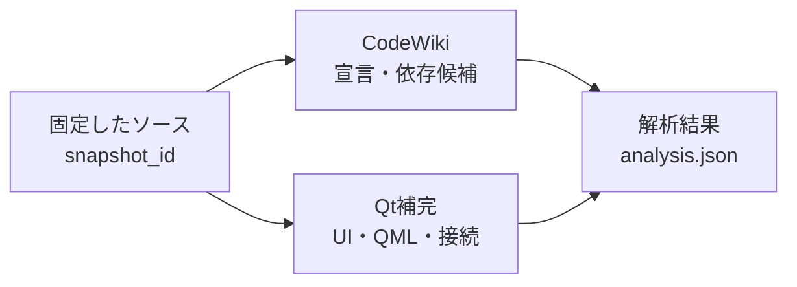
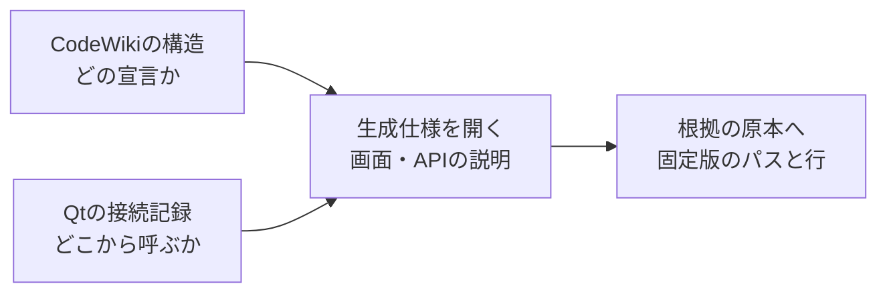

# C++とQtのソース取込の仕様と実行準備

src/cpp_scan　｜　2026年11月19日

- [解析と仕様書生成の準備](#section-1)
- [ソースを固定して構造を読む](#section-2)
- [CodeWikiとQt補完を一つの画面で読む](#section-3)
- [仕様書を生成して引き渡す](#section-4)
- [再実行と検索への引き継ぎ](#section-5)

<a id="section-1"></a>

## 解析と仕様書生成の準備

cpp-scan はQt 5／qmakeプロジェクトのソースを固定し、画面・処理・APIを日本語の仕様書にまとめます。コードを調べる段階、LLMで文章を書く段階、生成文書をDBへ渡す段階で必要なものが変わります。


| 工程 | 準備するもの |
| --- | --- |
| 棚卸し・解析 | Python 3.14環境、読取可能な source_root、それと重ならない書込先 artifact_root を用意。設定例の対象は examples/qt5-source です。config.cpp-source.example.yaml を基に config.cpp-source.local.yaml を作ります。解析には固定版CodeWikiとトークナイザー辞書 cl100k_base が必要です。 |
| CodeWikiの導入 | 統合環境の依存は requirements/ubuntu-26.04.lock、CodeWiki本体は requirements/codewiki-source.txt に固定されています。プロジェクトと同じ仮想環境で導入し、下の環境照合を実行します。 |
| 仕様書生成 | CPP_SCAN_LLM_MODEL、CPP_SCAN_LLM_API_KEY、CPP_SCAN_LLM_BASE_URL を実行環境に設定。generate で選別したソースに基づく内容が、指定したモデルの接続先へ送られます。analyze はLLMキーなしで実行できます。 |
| 後でDBに登録する場合 | config.cpp-docs.example.yaml から専用の config.cpp-docs.local.yaml を作り、ingestion.file_scan_config で参照。収集元は handoff/current、対象は再帰的な .md のみ。固有の source_id と default 以外の専用 knowledge_id を割り当てます。 |

```sh
python -m pip install --no-deps -r requirements/codewiki-source.txt
python scripts/check_python_environment.py --codewiki
cpp-scan scan --config config.cpp-source.local.yaml
```

現行実装は CodeWiki 2.0.0 と指定コミットを照合します。初回の構築コマンド、閉域環境での辞書準備、接続設定は下記の導入手順を参照してください。

実装・設定の参照先　[config.cpp-source.example.yaml](../../../config.cpp-source.example.yaml) ・ [config.cpp-docs.example.yaml](../../../config.cpp-docs.example.yaml) ・ [requirements/codewiki-source.txt](../../../requirements/codewiki-source.txt) ・ [docs/implementation/cpp-source-ingestion.md](../../implementation/cpp-source-ingestion.md) ・ [scripts/check_python_environment.py](../../../scripts/check_python_environment.py)

<a id="section-2"></a>

## ソースを固定して構造を読む

scan は対象と除外を棚卸しします。analyze は自分で入力を列挙し直して解析対象を固定します。保存済みの版を使いたい場合は --snapshot にそのIDを指定します。



| 入力・処理 | 記録される内容 |
| --- | --- |
| 収集対象 | C++実装・ヘッダーに加え、.ui、QML、JavaScript、.qrc、qmakeの参考設定など。ビルド出力、Qt自動生成コード、リンクは除外し、テスト・第三者コードは既定で除外します。 |
| スナップショット | 原本、UTF-8の作業用コピー、行・元バイト位置の対応を snapshots/snap-…/ に保存。文字コードは通常UTF-8を先に試し、設定例はCP932にフォールバックします。一覧・内容を再照合し、収集中の変化を検出します。 |
| CodeWikiの構造解析 | DependencyGraphBuilder と構文解析器でC++等の宣言、識別子、行範囲、依存候補を抽出。パス・行範囲をソース版と照合し、ハッシュと元バイト位置を付けます。 |
| Qt固有の補完 | XMLでWidgetsやリソースを、C++・QMLの記述から接続、プロパティ、プラグインなどを採取。.pro は参照情報として扱い、qmakeの条件評価やビルドは実行しません。 |

```sh
cpp-scan analyze --config config.cpp-source.local.yaml
cpp-scan status --config config.cpp-source.local.yaml
```

analyze の出力から snapshot_id と analysis_id を控えます。analyses/<analysis_id>/analysis.json には components、relations、qt、errors などが入り、後続の生成・再確認で同じ根拠を参照できます。

実装・設定の参照先　[src/cpp_scan/collector.py](../../../src/cpp_scan/collector.py) ・ [src/cpp_scan/snapshot.py](../../../src/cpp_scan/snapshot.py) ・ [src/cpp_scan/text.py](../../../src/cpp_scan/text.py) ・ [src/cpp_scan/codewiki_bridge.py](../../../src/cpp_scan/codewiki_bridge.py) ・ [src/cpp_scan/qt.py](../../../src/cpp_scan/qt.py) ・ [src/cpp_scan/pipeline.py](../../../src/cpp_scan/pipeline.py)

<a id="section-3"></a>

## CodeWikiとQt補完を一つの画面で読む

同梱の examples/qt5-source を実際に解析すると、対象は8ファイルで、CodeWikiの構造要素は7件、Qt補完の記録は24件でした。二つの結果は、同じコードについて別々の問いに答えます。



| 調べたいこと | この例で確認できたこと |
| --- | --- |
| どの宣言を起点に読むか | CodeWikiは example_plugin.h の13〜25行を ExamplePlugin クラス、main.cpp の8〜18行を main 関数として抽出。generate ではこの構造を使い、日本語の全体説明やモジュール別のページを作ります。 |
| 「実行」ボタンは何に接続するか | main_window.ui のXMLは startButton の clicked() から MainWindow の start() への接続を宣言しています。Qt補完は ui_connection として保存し、screens.md から確認できます。 |
| QMLにどの名前が渡るか | main.cpp の14行目で setContextProperty("backend", &backend) を確認。解析はその呼出しと引数を source_fact として記録します。 |
| プラグインが実際に使われたか | main.cpp の16行目に QPluginLoader の対象文字列があります。解析上は candidate。どのバイナリが読み込まれ、初期化に成功したかの判断には実行環境の確認が要ります。 |

### 仕様書をレビューする順序

生成文の識別子から api.md や screens.md の根拠を開き、固定した原本の記述に戻ります。例のXML接続は原本の11行目にあり、補完が保存する根拠範囲はファイル全体の1〜13行です。自動検証は根拠位置までを確認し、業務上の意味や実行結果はレビューで確かめます。

実装・設定の参照先　[examples/qt5-source/example_plugin.h](../../../examples/qt5-source/example_plugin.h) ・ [examples/qt5-source/main.cpp](../../../examples/qt5-source/main.cpp) ・ [examples/qt5-source/main_window.ui](../../../examples/qt5-source/main_window.ui) ・ [src/cpp_scan/codewiki_bridge.py](../../../src/cpp_scan/codewiki_bridge.py) ・ [src/cpp_scan/qt.py](../../../src/cpp_scan/qt.py) ・ [src/cpp_scan/documents.py](../../../src/cpp_scan/documents.py)

<a id="section-4"></a>

## 仕様書を生成して引き渡す

generate に渡すのは analysis_id、ingest に渡すのは生成結果の generation_id です。どちらも対象を固定したIDなので、作業中に新しい解析ができても渡す版を選べます。

```sh
# ANALYSIS_ID に analyze の analysis_id 全体を設定して実行
cpp-scan generate --config config.cpp-source.local.yaml --analysis "$ANALYSIS_ID"
# 生成結果の generation_id 全体を CPP_GEN_ID に設定
file-scan init-db --config config.cpp-docs.local.yaml
cpp-scan ingest --config config.cpp-source.local.yaml --generation "$CPP_GEN_ID"
```

| 生成先 | 内容と用途 |
| --- | --- |
| documents/ 以下 | overview.md が入口。plugins.md、screens.md、processes.md、api.md、unknowns.md に、プラグイン、画面、処理、宣言、未確認事項を整理します。wiki/ にはCodeWiki由来のページ、qt/ にはファイル別の補完資料を置きます。 |
| 生成版の管理ファイル | generations/gen-…/ に manifest.json、quality-report.json、usage.json、review.md などを保存。内容ハッシュ、必須資料、内部リンク、根拠パスと行範囲をチェックします。 |
| handoff/current/ | 検証済みMarkdownをいったん pending に整え、current に切替。専用設定で file_scan.pipeline.ingest を呼び、通常の文書と同じ仕組みで下書き登録します。C++原本と中間JSONは解析領域に残ります。 |


生成版1件から文書が複数生まれます。state/handoffs/<run_id>.json の documents 配列が、Markdownのパス・ハッシュ、document_id、extraction_generation_id を記録します。file-search publish が受け取る世代IDはこちらの文書単位のIDです。

例　screens.md は documents 上の1文書になります。内容版は document_versions、抽出結果は extraction_generations、段落と分割本文は blocks・chunks に入り、selected_generations が現行の下書きを指します。handoff の完了時は publication=draft、embedding=not_requested です。

実装・設定の参照先　[src/cpp_scan/documents.py](../../../src/cpp_scan/documents.py) ・ [src/cpp_scan/pipeline.py](../../../src/cpp_scan/pipeline.py) ・ [src/cpp_scan/handoff.py](../../../src/cpp_scan/handoff.py) ・ [src/file_scan/pipeline.py](../../../src/file_scan/pipeline.py) ・ [src/search/cli.py](../../../src/search/cli.py)

<a id="section-5"></a>

## 再実行と検索への引き継ぎ

DBの確定単位はMarkdown文書1件です。生成版全体の状態、文書ごとの取込結果、検索への採用は別々に確認します。

| 状況 | 次に確認するもの |
| --- | --- |
| 元ソースまたは設定を変更 | 同じ固定版と解析・生成条件の成功成果物は検証後に再利用します。指定版から別の結果を作るときは analyze または generate に --force。新しい解析・生成IDが割り当てられます。 |
| 生成結果の一部に不足 | quality-report.json と unknowns.md で未解析箇所を確認。部分生成の取込は既定で停止します。allow_partial_ingest: true の場合は欠落した旧Markdownを保持し、受渡し結果の retained_paths に記録します。 |
| 収集範囲の変更や削除 | cpp-scan status の latest.ingest.planned_removals を確認します。意図どおりなら完全な生成版に --accept-scope-change を付けます。部分生成で範囲変更は確定できません。 |
| 一部の文書だけ変更 | 同じMarkdown・変換条件で既存の正常な選択が検証できた文書はその世代を再利用します。変更文書は別の原本版・抽出世代となり、現行検索に戻すにはその文書を再公開します。 |

### 検索まで使う場合

```sh
file-scan status --config config.cpp-docs.local.yaml
file-scan embed --config config.cpp-docs.local.yaml
file-search init-db --config config.cpp-docs.local.yaml
file-search create-release --config config.cpp-docs.local.yaml --release qt-review
```

ベクトル化には文書用設定の embedding.enabled とキー、検索初期化にはPGroongaも必要です。公開時は、上の業務版名、受渡し記録の document_id と extraction_generation_id、承認者を指定して file-search publish を実行します。

検索APIの出典は採用したMarkdownの行です。元のC++／Qtコードを確認するには、仕様書中のソースパス・行番号を開き、その生成版と対応する snap-… の原本に戻ります。

実装・設定の参照先　[src/cpp_scan/handoff.py](../../../src/cpp_scan/handoff.py) ・ [src/cpp_scan/pipeline.py](../../../src/cpp_scan/pipeline.py) ・ [tests/test_cpp_scan.py](../../../tests/test_cpp_scan.py) ・ [src/file_scan/embeddings.py](../../../src/file_scan/embeddings.py) ・ [src/search/management.py](../../../src/search/management.py)
