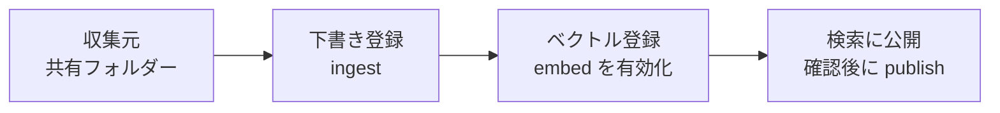
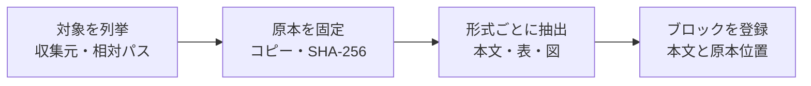
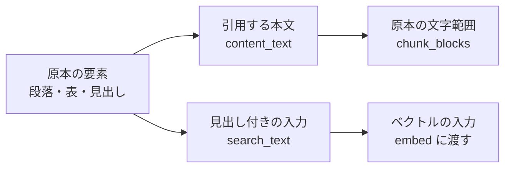
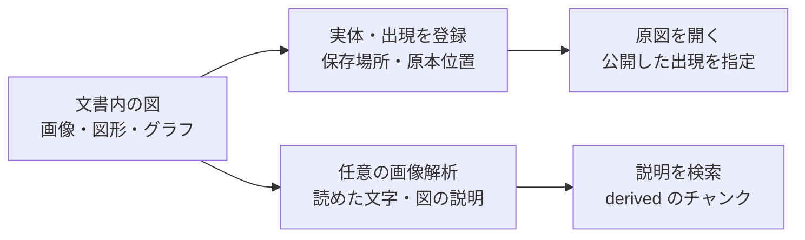
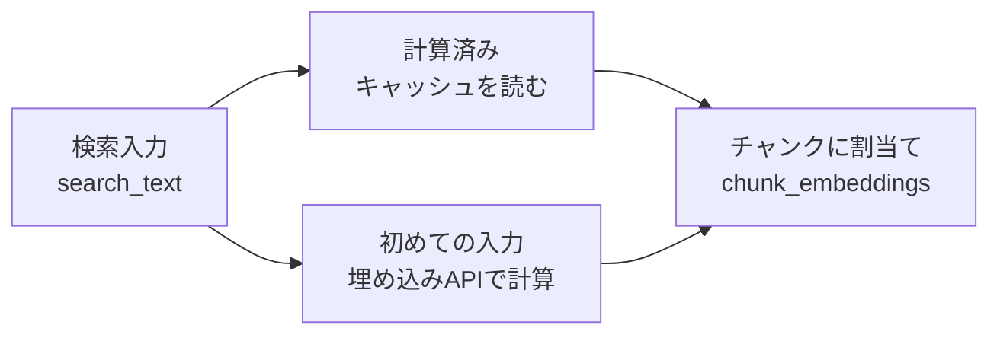

# ファイル取込の仕様と実行準備

src/file_scan　｜　2026年11月19日

- [取込前に用意するもの](#section-1)
- [原本を固定して本文と位置を取り出す](#section-2)
- [文章の切り方と引用元の残し方](#section-3)
- [貼り付け画像と図をどう登録するか](#section-4)
- [ベクトル登録と再実行の判断](#section-5)

<a id="section-1"></a>

## 取込前に用意するもの

file-scan は共有フォルダーの文書を読み、引用できる文章と原本の位置を下書きとして登録します。画像の説明を作る工程と、文章をベクトルにする工程は、それぞれ設定して使います。



| 用意するもの | 設定と確認方法 |
| --- | --- |
| 入力と保存先 | 設定例 config.example.yaml を基に config.local.yaml を用意します。sources の source_id と root、knowledge_id、storage_dir、report_dir を指定。相対パスの基準はYAMLの所在です。サンプルを試すときは root を examples/input に設定します。 |
| PythonとDB | リポジトリ直下でREADMEの導入手順に従い、Python 3.14の仮想環境と固定依存を準備。file-scan --help でCLIを確認します。PostgreSQLで vector 拡張を有効化し、FILE_SCAN_DATABASE_URL または database_url を設定します。同じDBを使う収集設定は storage_dir の実パスをそろえます。 |
| 分割とPDFのモデル | 分割には cl100k_base の辞書を使います。閉域環境では準備済みのキャッシュを TIKTOKEN_CACHE_DIR に指定します。PDFでDoclingを選ぶ場合はレイアウトモデル、日本語OCRを使う場合はRapidOCRモデルも配置します。 |
| 任意の外部処理 | 画像説明を作る場合は image_analysis.enabled、文章をベクトル化する場合は embedding.enabled を true にし、それぞれ設定が指す環境変数（標準は OPENAI_API_KEY）を用意します。 |

### 登録前に確かめる

```sh
file-scan scan --config config.local.yaml
file-scan init-db --config config.local.yaml
```

scan は対象・除外・列挙エラーをレポートに出し、init-db は取込v3の表を準備します。PDFでDoclingを使う場合は次のコマンドでモデルを準備し、実行環境で同じコマンドに --verify-only を加えて確認します。

```sh
python scripts/download_docling_models.py --config config.local.yaml
```

実装・設定の参照先　[README.md](../../../README.md) ・ [config.example.yaml](../../../config.example.yaml) ・ [docs/implementation/environment-setup.md](../../implementation/environment-setup.md) ・ [scripts/download_docling_models.py](../../../scripts/download_docling_models.py) ・ [src/file_scan/cli.py](../../../src/file_scan/cli.py) ・ [src/file_scan/config.py](../../../src/file_scan/config.py)

<a id="section-2"></a>

## 原本を固定して本文と位置を取り出す

同じ名前のファイルでも、更新後の内容は別の原本版です。先に内容を固定し、そのコピーから抽出することで、後から検索結果と同じ版を開けます。



| 形式 | 取り出す内容 | 出典に使う位置 |
| --- | --- | --- |
| TXT・Markdown | 段落を取り出し、Markdownの見出し階層を記録します。既定で .txt と .md が対象。 | .txt／.md の開始行・終了行。 |
| Word（DOCX） | 見出し、段落、表、図などを順に読み、構造や画像の出現を記録します。 | 段落番号や表の位置、画像の出現番号など。 |
| Excel（XLSX／XLSM） | シートの行ごとにセル値を読み、数式と保存済みの計算結果を分けます。計算結果の欠落は警告。既定は非表示のセルを本文から除外します。 | シート名とセル範囲。列見出しの元のセル座標も保持。 |
| PDF | Doclingは段組み・表・図を解析。日本語OCRの auto は必要領域を、full_page は全ページを対象にします。native は既存の文字層を読む軽量な方式です。 | ページ番号。Doclingでは取得できた矩形座標も保存。 |

### DBに書き込む単位

documents は収集元と相対パスで文書を識別し、document_versions が内容版を持ちます。バイト列は保管領域、ハッシュ・サイズ・保管先は artifact_assets に保存します。本文と位置は blocks、今回選ぶ世代は selected_generations に記録します。

対象外の拡張子や除外ディレクトリは棚卸し時に分かります。正常に列挙できた範囲の消失と、収集元を読めない場合を区別し、後者は利用不能として扱います。

画像ファイル単体（PNG・JPEG等）は設定例の収集対象外です。Word・Excel・PDFに含まれた画像の取得、画像を含むPDFのOCR、図の説明生成については「貼り付け画像と図をどう登録するか」で説明します。

実装・設定の参照先　[src/file_scan/collector.py](../../../src/file_scan/collector.py) ・ [src/file_scan/storage.py](../../../src/file_scan/storage.py) ・ [src/file_scan/parsers.py](../../../src/file_scan/parsers.py) ・ [src/file_scan/pipeline.py](../../../src/file_scan/pipeline.py) ・ [docs/implementation/rapidocr-pdf.md](../../implementation/rapidocr-pdf.md)

<a id="section-3"></a>

## 文章の切り方と引用元の残し方

ブロックは段落や表など原本の要素です。チャンクは、一度に検索して返せる長さに整えた文章です。ファイル名や見出しを検索に加えても、返答に引用する本文の位置は保たれます。



| 分割時の判断 | 処理 |
| --- | --- |
| まとまりを決める | 見出しやシート境界で区切り、親・節・原本由来か生成説明か・表見出しが同じ本文をまとめます。個別の表ブロックは区別します。空白だけの本文は飛ばします。 |
| 長さを測る | 設定例の本文上限は1,800文字。ファイル名・節・列見出しを含む検索入力は8,191トークン以内、追加文脈は最大1,024トークン（かつ全体上限の半分以内）です。 |
| 上限を超える | 改行を優先し、通常文では空白も使って切ります。長い表の行を途中で切った場合は table_row_split を記録。各断片の文字範囲を chunk_blocks に保存します。 |

### 同梱の「ユーザー登録.md」で見る

設定例の上限で実際に分割すると、文書全体は8ブロック・4チャンクになります。18行目の段落 text-18 を含むチャンクでは、以下の2種類の文字列を保存します。

```text
引用本文  content_text
E001はユーザーIDの未入力を示します。
検索入力  search_text
ユーザー登録.md / ユーザー登録（検証用サンプル） / エラー

E001はユーザーIDの未入力を示します。
```

この例の検索入力は53トークンです。見出しは節の切れ目と検索用の文脈に使います。本文がなく見出しだけの文書では、見出しを本文として組み直します。引用本文には行末の改行も含まれ、[0, 22) が元段落の [0, 22) に対応します。終了位置の22は含みません。

実装・設定の参照先　[examples/input/ユーザー登録.md](../../../examples/input/%E3%83%A6%E3%83%BC%E3%82%B6%E3%83%BC%E7%99%BB%E9%8C%B2.md) ・ [src/file_scan/chunking.py](../../../src/file_scan/chunking.py) ・ [src/file_scan/tokens.py](../../../src/file_scan/tokens.py) ・ [src/file_scan/pipeline.py](../../../src/file_scan/pipeline.py)

<a id="section-4"></a>

## 貼り付け画像と図をどう登録するか

画像の実体、文書のどこに現れたか、その画像を読んで作った説明は別のデータです。この区別により、説明文で検索し、同じ場所の元画像で確かめられます。



| 対象 | 保存されるものと条件 |
| --- | --- |
| 貼り付け画像 | Word・Excelのパッケージ内画像やPDF内の取得可能な画像を保管。artifact_assets は内容ごとに1件、asset_occurrences は貼り付け位置ごとに1件です。同じ画像が2回あれば実体1件・出現2件になります。 |
| グラフ・図形 | Doclingは取得できた図領域を region_image として保存。Officeの図形・グラフ等に未処理フラグがあり、画像解析と render_office が有効なら、LibreOfficeでPDF化しページ内の図形領域をまとめて画像化します。出典はプレビューのページ・矩形です。 |
| スキャンPDFの文字 | PDF OCRは画像中の文字をローカルで読み、本文とページ位置を保存します。ページ背景として扱えたスキャン画像と、説明を要する挿図を区別します。図の矢印や関係は画像説明側の対象です。 |
| 画像説明を有効にした場合 | 対象画像をOpenAI Responses APIへ送信（設定例の上限は1文書20画像）。読めた文字・図の説明・判読不能箇所を記録し、image_description ブロックを derived として親の図に結びます。読めた文字と説明が検索本文になり、derived_from で原図をたどれます。 |

### 例　申請画面のスクリーンショット

画面図だけを保存した段階では、画像に本文がなくても原図と位置は残ります。認識した「左側に一覧、右側に編集欄」がベクトル化されるのは、その説明文をチャンク化して embed した後です。画像バイト列自体はこのベクトル化の入力に含めません。

認識失敗・枚数上限・判読不能は未処理や品質警告として確認します。画像説明を検索公開する際は原図を照合して --include-image-descriptions、部分抽出の世代なら加えて --allow-partial を指定します。

実装・設定の参照先　[src/file_scan/image_analysis.py](../../../src/file_scan/image_analysis.py) ・ [src/file_scan/office_render.py](../../../src/file_scan/office_render.py) ・ [src/file_scan/parsers.py](../../../src/file_scan/parsers.py) ・ [src/search/management.py](../../../src/search/management.py) ・ [tests/test_image_analysis.py](../../../tests/test_image_analysis.py)

<a id="section-5"></a>

## ベクトル登録と再実行の判断

embed は、選択中の世代にある検索入力を数値の列に変換します。質問も同じモデル・次元で変換することで、検索側が表現の異なる文の近さを比較できます。



### 下書きを作って準備件数を見る

```sh
file-scan ingest --config config.local.yaml
file-scan embed --config config.local.yaml
file-scan status --config config.local.yaml
```

設定例のモデルは text-embedding-3-small、1チャンクにつき1,536次元です。既定は embedding.enabled: false。利用時は有効化してキーを設定します。取得可能で、設定・原本が一致する選択世代の succeeded／partial の下書きが対象です。

| 見る場所 | 判断できること |
| --- | --- |
| embedding_cache と chunk_embeddings | 同じプロファイル・同じ search_text のハッシュなら計算済みの値を再利用。チャンクごとの割当ては chunk_embeddings に登録します。設定例はDBから128件ずつ読み、外部要求は最大16入力ずつです。 |
| report_dir 以下 | ingest-*.json で文書ごとの状態・IDを確認。generations/&lt;世代ハッシュ&gt;/ の review.md で本文と位置、chunks.jsonl で分割と元ブロック、manifest.json で対象文書・世代を確認します。 |
| 再取込 | 原本・変換条件が同じなら既存世代を再利用。分割条件だけ変えると抽出キャッシュから新しいチャンクを作れます。未処理の図などを再試行するには ingest に --retry-partial を付けます。 |
| 検索に渡す | status の embeddings で対象プロファイルの ready／pending を確認。検索管理側で業務版を作り、確認済みの文書・世代を publish して初めて公開コピーが検索対象になります。 |

実装・設定の参照先　[src/file_scan/embeddings.py](../../../src/file_scan/embeddings.py) ・ [src/file_scan/state.py](../../../src/file_scan/state.py) ・ [src/file_scan/cache.py](../../../src/file_scan/cache.py) ・ [src/file_scan/pipeline.py](../../../src/file_scan/pipeline.py) ・ [src/file_scan/cli.py](../../../src/file_scan/cli.py) ・ [src/search/management.py](../../../src/search/management.py)
