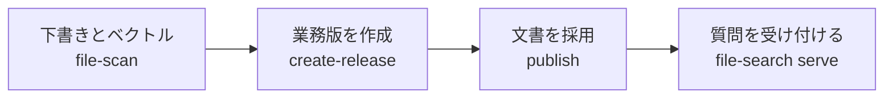
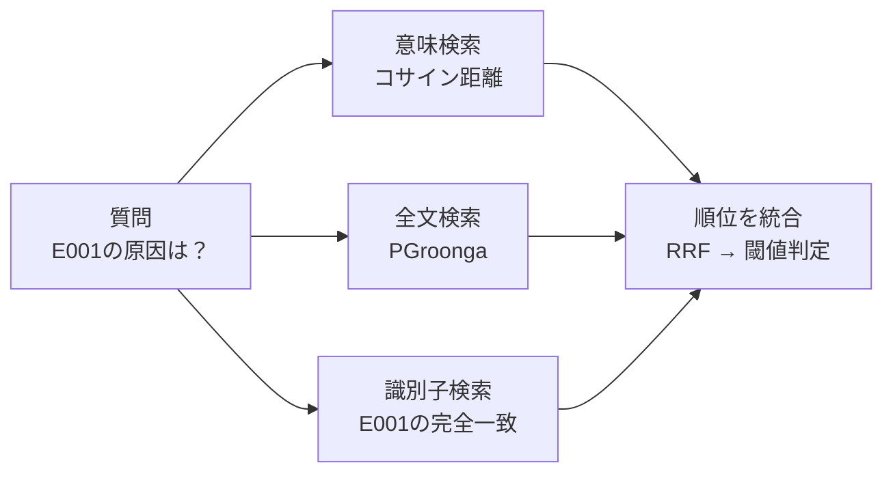
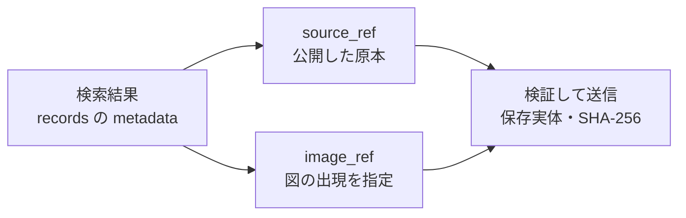

# 検索APIの仕様と実行準備

src/search　｜　2026年11月19日

- [検索できる文書を準備する](#section-1)
- [質問が届くと、どの公開版を読むか](#section-2)
- [3通りの検索で候補を集め、順位を決める](#section-3)
- [2つの検索POSTに共通する入力](#section-4)
- [検索結果と準備状況を読み分ける](#section-5)
- [稼働確認・原本取得・画像取得](#section-6)
- [HTTPエラーから確認先を決める](#section-7)

<a id="section-1"></a>

## 検索できる文書を準備する

検索APIが読むのは、取込担当者が確認して業務版に採用した文書です。取込と同じナレッジ・DB・保管場所を指定し、公開から質問までを一度つないで確認します。



| 準備 | 設定する内容 |
| --- | --- |
| アプリとDB | Python 3.14環境でプロジェクトの search 追加依存を導入します。PostgreSQLには vector と pgroonga が必要です。file-scan init-db で取込表、file-search init-db で検索表・索引を準備します。 |
| 取込済みの下書き | 文書の取込とベクトル化（file-scan ingest、embed）を済ませ、review.md で内容を確認します。config.example.yaml を基にした設定で embedding.enabled を有効にし、通常は OPENAI_API_KEY を準備します。 |
| 接続キーと公開単位 | クライアント接続用に FILE_SCAN_SEARCH_API_KEY を環境変数に設定。DOC と GEN は対象文書の manifest.json の文書IDと抽出世代ID、REVIEWER は確認者です。最初の業務版が既定版になり、別の版を既定にするには作成時に --make-default を使います。 |

### 1文書を公開し、ローカルで起動する

```sh
CFG=config.local.yaml
file-search init-db --config "$CFG"
file-search create-release --config "$CFG" --release demo-v1
file-search publish --config "$CFG" --release demo-v1 \
  --document-id "$DOC" --generation-id "$GEN" --reviewed-by "$REVIEWER"
file-search serve --config "$CFG" --port 8000
```

接続先は 127.0.0.1:8000。GET /healthz が基盤の状態を返し、/docs と /openapi.json で起動中のAPI定義を確認できます。Bearerキーは接続認証に使い、現行実装の利用者別アクセス制御は未実装です。公開を取り消すときは unpublish に業務版・文書ID・--withdrawn-by を指定します。

実装・設定の参照先　[config.example.yaml](../../../config.example.yaml) ・ [pyproject.toml](../../../pyproject.toml) ・ [src/search/cli.py](../../../src/search/cli.py) ・ [src/search/management.py](../../../src/search/management.py) ・ [src/search/schema.py](../../../src/search/schema.py)

<a id="section-2"></a>

## 質問が届くと、どの公開版を読むか

同じナレッジに古い公開版や作業中の下書きがあっても、文書ごとに採用された公開IDを確定してから、検索対象のチャンクを取得します。


| 手順 | DBで確かめる条件 |
| --- | --- |
| 1　ナレッジと業務版 | knowledge_id が起動設定に一致し、有効な search_catalogs を解決できること。通常は target_release=current として既定の search_releases を使用します。 |
| 2　採用中の公開ID | ナレッジの対象文書と収集元の状態を確認し、search_release_bindings から採用した search_publications を引きます。期待する原本版・変換条件、埋め込みプロファイルが合う文書を残します。 |
| 3　現行と履歴 | 現行は最新原本・選択世代・変換条件・世代の更新時刻も照合します。原本を更新すると、再公開まで旧版は現行候補から外れます。履歴は --allow-history で起動し、対象版名またはIDを明示。収集対象から外れた文書や利用不能な収集元は履歴でも返しません。 |
| 4　質問を埋め込む | 公開IDと要求の絞り込み条件に合う候補があれば、同じ埋め込みプロファイルのモデル・次元で質問を1本のベクトルにします。外部呼び出し中はDBトランザクションを保持しません。失敗時はエラーで返します。 |
| 5　一貫した版を読む | 読取専用の REPEATABLE READ で対象を確認し、公開チャンクを検索。返却前にも対象の変更を再照合します。document_id で絞っても、準備状況は業務版全体を集計します。 |

例　マニュアル第2版を取り込んだだけの間は、第1版を現行の根拠には使いません。第2版を確認して publish すると、新しい原本に対応するチャンクが現行候補に入ります。

実装・設定の参照先　[src/search/repository.py](../../../src/search/repository.py) ・ [src/search/service.py](../../../src/search/service.py) ・ [src/search/management.py](../../../src/search/management.py) ・ [tests/test_search.py](../../../tests/test_search.py)

<a id="section-3"></a>

## 3通りの検索で候補を集め、順位を決める

質問が「E001の原因は？」なら、意味が近い説明、同じ語のある文章、E001という識別子をそれぞれ探します。同じ公開チャンクが複数の検索で上位に入るほど、統合後の順位が上がります。



| 検索の種類 | search_chunks をどう調べるか |
| --- | --- |
| 意味の近さ | 質問のベクトルと embedding のコサイン距離（1−類似度、pgvector の &lt;=&gt;）を計算し、小さい順に取得。現行は公開範囲の距離を直接並べる厳密検索です。既定ではコサイン類似度が正の候補だけを採用します。search.semantic_min_cosine_similarity を正に設定すると、その値以上が対象です。 |
| 全文一致 | PGroongaの TokenBigram と NormalizerAuto で質問を分解。2〜128文字の重複しない語を最大16個取り、search_text に1語以上が一致する候補を &@ で検索し、pgroonga_score の高い順に並べます。 |
| 識別子の完全一致 | 質問から英数字の識別子やバッククォート内の表記を最大16個抽出。大小文字を保ち、identifiers 配列との重複をGIN索引で探せる形で検索。完全一致した識別子の数が多い順です。 |

### 順位を合わせた score の読み方

各経路は最大50件。公開IDとチャンクIDの組をキーに、出現した各経路の順位 r（1位から）について 1/(60+r) を足し、3/61 で割って0〜1に整えます。これは順位の指標です。

計算例　意味検索だけで1位のAは0.3333。意味2位・全文1位・識別子1位のBは0.9946。score_threshold=0.4 ならBが残ります。意味検索の下限は候補選び、要求の score_threshold は統合後の採否に使います。

実装・設定の参照先　[src/search/repository.py](../../../src/search/repository.py) ・ [src/search/ranking.py](../../../src/search/ranking.py) ・ [src/search/schema.py](../../../src/search/schema.py) ・ [src/search/config.py](../../../src/search/config.py) ・ [tests/test_search.py](../../../tests/test_search.py)

<a id="section-4"></a>

## 2つの検索POSTに共通する入力

POST /search-with-status と POST /retrieval は同じJSONを受け取ります。次の例はナレッジ demo から、統合スコア0.2以上の根拠を最大5件要求します。

```json
{
  "knowledge_id": "demo",
  "query": "E001は何を示しますか",
  "retrieval_setting": {"top_k": 5, "score_threshold": 0.2}
}
```

上のJSONを request.json として保存し、次を実行します。/retrieval を呼ぶ場合もヘッダーと本文は同じです。

```sh
curl -sS http://127.0.0.1:8000/search-with-status \
  -H "Authorization: Bearer $FILE_SCAN_SEARCH_API_KEY" \
  -H "Content-Type: application/json" --data-binary @request.json
```

| 入力項目 | 必須・範囲・意味 |
| --- | --- |
| knowledge_id / query | 必須の文字列。順に1〜128文字、1〜4,000文字。空白だけの入力やNUL文字を拒否。通常モードの質問は2,048トークン以内です。 |
| retrieval_setting | 必須。top_k は整数1〜20、score_threshold は0〜1の有限数。文字列の数値や真偽値は不可。JSON上で未定義のフィールドは拒否されます。 |
| metadata_condition | 任意。logical_operator は and（省略可）。conditions 配列は最大8条件で同名を重複指定できません。name は target_release、document_id、feature_id、artifact_type の4種です。 |
| 各条件の指定 | comparison_operator=is の value は文字列、in は重複なしの文字列配列（1〜20件）。各値は1〜256文字。target_release は is のみ。artifact_type は source または derived。feature_id は公開時に --feature-id で登録しフィルターを有効にします。 |

例えば原本由来だけに絞るには、metadata_condition.conditions の1要素を {"name":"artifact_type","comparison_operator":"is","value":"source"} にします。本文の上限は32,768バイトで、Content-Encoding を指定した要求は受け付けません。

実装・設定の参照先　[src/search/models.py](../../../src/search/models.py) ・ [src/search/api.py](../../../src/search/api.py) ・ [src/search/repository.py](../../../src/search/repository.py) ・ [src/search/management.py](../../../src/search/management.py)

<a id="section-5"></a>

## 検索結果と準備状況を読み分ける

「一致する文章がない」と「必要な文書がまだ公開されていない」は、呼出し側の次の行動が異なります。準備不足を利用者に伝える画面では、状態も返すAPIを使えます。

| 項目・API | 返り値と判断 |
| --- | --- |
| POST /search-with-status | 200で api_version（"1"）、request_id、records、retrieval_status を返します。準備未完了でも、利用可能な文書の根拠が返る場合があります。 |
| POST /retrieval | Dify互換の成功応答は {"records":[…]}。通常モードで準備が完全でなければ409 COVERAGE_NOT_COMPLETE。準備完了後も返却予算で根拠を1件も返せなければ409 RESULT_BUDGET_EXHAUSTED。完了・該当なしは200で空配列です。 |
| coverage_state | complete は対象が準備完了。incomplete は更新待ち・部分抽出・索引待ち等の不足あり。unknown は棚卸し未完了または状態不明の文書あり。対象範囲は configured_knowledge_release です。 |
| 内訳の件数 | pending_updates は公開待ち・版ずれ、failed_documents は失敗、partial_documents は部分抽出、uncollected_documents は未収集、index_pending_documents はベクトル不足、unknown_documents は状態不明。 |
| result_state | matched は根拠あり、no_match は条件を満たす根拠なし、budget_exhausted は返却上限により根拠を返せない状態。returned_records と limit_reasons も確認します。 |

### 1件の根拠から原本を開く

records の1件は content（引用）、score（統合順位の値）、title、metadata。公開時の search_chunks の文字範囲対応と search_blocks から元位置を復元します。source_locations と source_spans で原本位置・文字範囲を確認でき、生成説明は description_spans に範囲を持ちます。

evidence_role=hit が直接のヒット。context は関連する1段先の補助根拠です。同じ文書の直接ヒットは最大3件。補助は最大 min(5, top_k÷3 の切捨て) 件。全体6,000トークン、1件2,000トークン、応答262,144バイトが標準上限です。

状態付き応答の読み取り例（抜粋）。対象がすべて準備済みで一致がない場合は、次の組合せです。

```json
{
  "records": [],
  "retrieval_status": {"coverage_state": "complete", "result_state": "no_match"}
}
```

実装・設定の参照先　[src/search/models.py](../../../src/search/models.py) ・ [src/search/service.py](../../../src/search/service.py) ・ [src/search/evidence.py](../../../src/search/evidence.py) ・ [src/search/config.py](../../../src/search/config.py)

<a id="section-6"></a>

## 稼働確認・原本取得・画像取得

検索結果の source_ref をそのまま使うと、公開時と同じ原本を取得できます。画像は文書内での出現ごとに識別するため、同じ画像が複数の場所に出ても該当箇所を指定できます。



| API | 入力と応答 |
| --- | --- |
| GET /healthz | 認証不要。通常はスキーマ版、vector と pgroonga、必要な索引を確認し、200で status、execution_mode、access_control、extensions を返します。基盤に不備があれば503。個別の文書の公開状況は検索応答で確認します。 |
| GET /sources/{publication_id} | Bearer認証。metadata.source_ref が示すURL。公開IDから原本の保存場所を解決し、200で application/octet-stream の添付ファイル（source）を返します。C++の生成仕様を検索した場合は、採用したMarkdownを取得します。 |
| GET /sources/{publication_id}/images/{occurrence_id} | Bearer認証。metadata.related_assets[].image_ref がある出現を指定。公開ブロックに保存された original_image／region_image が対象です。既知の画像形式は対応するMIME型、それ以外は application/octet-stream で取得します。 |

どちらのダウンロードも mode=current が既定。履歴URLの mode=history には履歴有効化が必要です。取得時にも対象範囲を再確認し、保管ファイルのSHA-256とサイズを検証して送信します。対象外は404、実体の破損などは503です。

### DBなしで接続形式だけを確かめる

設定に search.test_mode: true を指定し、接続用キーを設定して起動。両POSTは固定レコードを返し、/healthz は execution_mode=test、database=not_used。原本と画像の取得は404です。通常検索の準備確認には通常モードを使います。

実装・設定の参照先　[src/search/api.py](../../../src/search/api.py) ・ [src/search/evidence.py](../../../src/search/evidence.py) ・ [src/search/stub.py](../../../src/search/stub.py) ・ [tests/test_search_mode.py](../../../tests/test_search_mode.py)

<a id="section-7"></a>

## HTTPエラーから確認先を決める

エラー応答には error_code（数値）、code（識別名）、error_msg、request_id、retryable が入ります。API利用側は code と retryable を参照し、問合せ時は request_id を添えます。

| HTTP | code | 最初に確認すること |
| --- | --- | --- |
| 401 | UNAUTHENTICATED | 接続用Bearerキーと環境変数が一致するか。 |
| 404 | SCOPE_NOT_FOUND | ナレッジ名、対象版、公開ID、画像出現、履歴の有効化を確認。 |
| 409 | RELEASE_UNRESOLVED | 既定の業務版を作成・設定したか。 |
| 409 | COVERAGE_NOT_COMPLETE | 互換APIで対象が未準備。状態付きAPIで文書の件数と理由を確認。 |
| 409 | RESULT_BUDGET_EXHAUSTED | 互換APIで返却上限に達した。状態付きAPIの limit_reasons を確認。 |
| 413 / 415 | REQUEST_TOO_LARGE / UNSUPPORTED_MEDIA_TYPE | JSONのバイト数、Content-Type、Content-Encoding を確認。 |
| 422 | INVALID_REQUEST | 必須項目、値の範囲、フィルター、モードを確認。 |
| 429 | RATE_LIMITED | 同時検索枠（4件）を使い切った。Retry-After を参照。 |
| 503 / 504 | SEARCH_UNAVAILABLE / SEARCH_TIMEOUT | DB・索引・埋め込みAPI等を確認。検索の504は stage、elapsed_ms、timeout_kind で停止箇所を絞れます。 |
| 500 | INTERNAL_ERROR | request_id からサービス側の記録を確認。 |

通常の検索は全体10秒、質問の埋め込み4秒、DB文2秒が標準期限です。DBも埋め込みも使わない接続試験の成功と、通常検索の成功は execution_mode で区別できます。

実装・設定の参照先　[src/search/errors.py](../../../src/search/errors.py) ・ [src/search/api.py](../../../src/search/api.py) ・ [src/search/config.py](../../../src/search/config.py) ・ [src/search/service.py](../../../src/search/service.py) ・ [tests/test_search.py](../../../tests/test_search.py)
