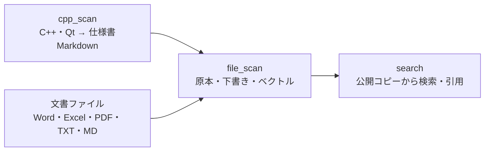
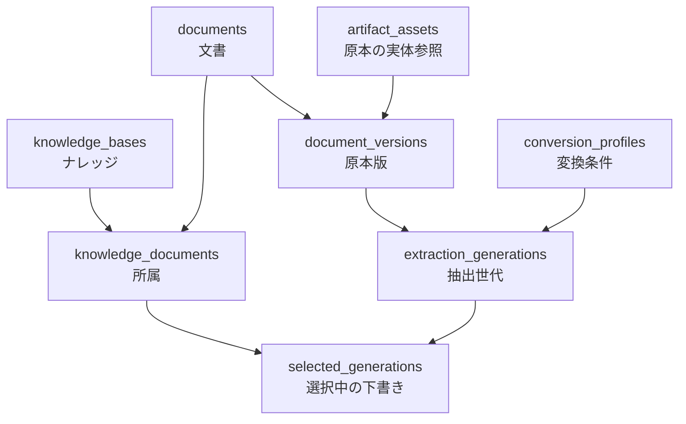
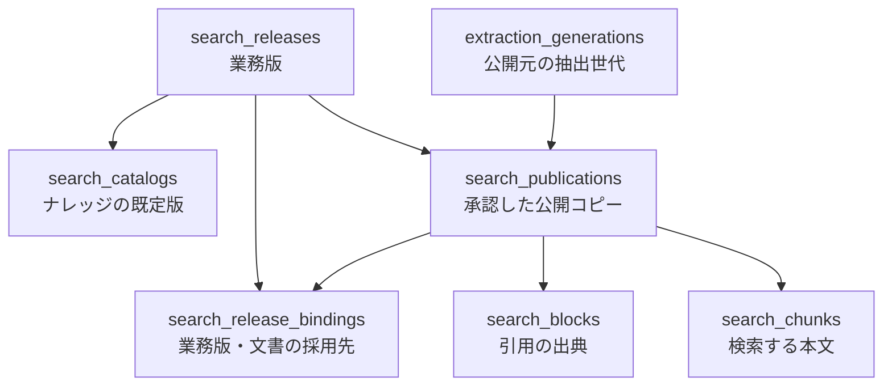

# 文書取込と検索を支えるテーブル

2026年11月18日 · 取込v3／検索v1

1件の文書が検索結果に出るまでには、原本を取り込む工程と、どの版を検索に使うか決める工程があります。この資料では、その間に各テーブルが何を受け取り、次の処理に何を渡すのかを追います。

| 機能 | 入力と出力 | DBを使う場面 |
| --- | --- | --- |
| cpp_scan | Qt 5／qmake のソースから、根拠行を添えた仕様書を生成。 | 解析成果はファイルに保存。仕様書の受渡しで取込用の表を利用。 |
| file_scan | DOCX、XLSX／XLSM、PDF、TXT、Markdownから本文・位置・検索用の分割本文を作成。 | 取込v3の20表。原本と画像の実体はファイル保管領域へ。 |
| search | 管理者が版と文書を指定して公開。APIは採用中の本文を検索して出典を返す。 | 検索v1の8表を追加。対象文書の現在の状態は取込側の表と照合。 |

**表を読むための用語**

主キーは1行を特定する列です。複数の列が並ぶときは、その組み合わせで1行を識別します。外部キーは別の行を参照する列で、どの文書・版・ブロックに属するかを追う手掛かりになります。

### 読みたい箇所から

[関係図](#section-1) ・ [C++の受渡し](#section-2) ・ [原本台帳](#section-3) ・ [変換世代](#section-4) ・ [本文と出典](#section-5) ・ [ベクトルと運用](#section-6) ・ [公開と採用](#section-7) ・ [検索結果](#section-8) ・ [文書の具体例](#section-9) ・ [設計図との対応](#section-10)

**対象**

2026年11月18日の作業ツリー。PostgreSQL上の物理スキーマは winnap です。表名を短く記すため、以下では winnap. を省略します。

## 原本の版と公開版のつながり

矢印は「参照される親表 → 外部キーを持つ子表」です。複合キーも1本で表しています。図は主要な経路を示し、各表の行の単位と読み書きは、以下の各節で説明します。

### 取込側で文書ごとの下書きを選ぶ

一つの文書には複数の原本版があり、同じ原本版でも変換条件を変えると別の抽出世代になります。一方、一つのナレッジ内で、同じ文書を指す選択行は最大1件です。

### 検索側で業務版ごとの公開コピーを選ぶ

一つの公開コピーに複数の公開ブロックと公開チャンクが属します。同じ文書・業務版の組で採用できるコピーは一度に1件です。採用先を空にすれば、その版から文書を取り下げられます。

参照箇所　[src/file_scan/db.py](../../src/file_scan/db.py) ・ [src/search/schema.py](../../src/search/schema.py) ・ [src/search/management.py](../../src/search/management.py)

## ソースと検索結果を結ぶ識別子

cpp_scan の解析単位はプロジェクト全体です。file_scan の取込単位は文書1件なので、一回のC++仕様書生成から、複数の文書IDと抽出世代が生まれます。

| 工程 | 何を保存し、後でどう使うか |
| --- | --- |
| 原本を固定する | snapshots/<snapshot_id>/ に原本、UTF-8の解析用コピー、行と原本バイト位置の対応を保存。マニフェストのハッシュで対象ファイルを照合します。 |
| 構造を読み取る | analyses/<analysis_id>/analysis.json に、CodeWikiが抽出した宣言・依存候補と、Widgets、Signal／Slot、QML、プラグインなどのQt補完情報を保存します。 |
| 仕様書を生成する | generations/<generation_id>/documents/ に screens.md、api.md などを出力。ソース位置の検証結果と品質情報は同じ生成版のファイルに記録します。 |
| 文書取込へ渡す | cpp-scan ingest が検証済みMarkdownを handoff/current/ に配置。専用の knowledge_id と収集元で file_scan の ingest を呼びます。生成や受渡しだけで検索には公開されません。 |

### 画面仕様から元のソース行を調べる

例えば main_window.ui の画面定義は screens.md に記載されます。検索APIが返す原本と行番号は取り込んだ screens.md のものです。C++／Qtの元の位置は、仕様書内のパス・行番号と、その生成版が参照したソースの snapshot_id を使って照合します。

**同じ generation_id という名前の読み分け**

C++側の gen-… は仕様書一式の生成版です。DBの extraction_generations.generation_id はMarkdown 1件の変換結果を指します。state/handoffs/<run_id>.json の documents 配列に、各パス、document_id、markdown_sha256、extraction_generation_id が並び、両者を結べます。

部分生成の受渡しには allow_partial_ingest が必要です。許可した場合、今回生成できなかった既存のMarkdownは保持されます。範囲変更や文書の削除は、完全な生成版で明示的に承認する操作です。

参照箇所　[src/cpp_scan/snapshot.py](../../src/cpp_scan/snapshot.py) ・ [src/cpp_scan/pipeline.py](../../src/cpp_scan/pipeline.py) ・ [src/cpp_scan/qt.py](../../src/cpp_scan/qt.py) ・ [src/cpp_scan/documents.py](../../src/cpp_scan/documents.py) ・ [src/cpp_scan/handoff.py](../../src/cpp_scan/handoff.py) ・ [examples/qt5-source/main_window.ui](../../examples/qt5-source/main_window.ui)

## どの文書のどの原本を取得したか

「ナレッジ」は資料をまとめる範囲です。文書の所属、ファイルの所在、取得したバイト列には、それぞれ別の識別子があります。

### `knowledge_bases`　ナレッジの台帳

1行が一つの資料群。対象システム、環境、棚卸し状態、最終成功日時、台帳の更新番号を持ちます。

- 主キー　`knowledge_id`
- 書く　ingest が登録し、列挙結果や変換確定時に状態・更新番号を更新します。
- 使う　検索は scan_status と catalog_revision で収集範囲の確かさや検索中の変更を確認します。

### `documents`　原本の所在と現在の状態

1行が収集元と相対パスで識別する文書。同じ場所の更新は同じ document_id にまとまります。

- 主キー　`document_id`
- 書く　ingest が発見時に登録。取得成功時に latest_source_version を進め、消失・取得不能時に source_status を更新します。
- 使う　取込・公開・検索が、対象原本の最新版と利用可否を確認します。
- 外部キーの参照先　`document_versions`

### `knowledge_documents`　ナレッジと文書の所属

1行がナレッジと文書の組。included、収集状態、最終確認の棚卸しジョブ、エラーを記録します。

- 主キー　`knowledge_id`、`document_id`
- 書く　ingest が発見・収集・除外を反映。正常に列挙できた範囲で消失した場合は、原本の論理削除も記録します。
- 使う　リリース作成と検索が予定文書を列挙。所属除外は履歴検索にも効きます。
- 外部キーの参照先　`documents`、`index_jobs`、`knowledge_bases`

### `document_versions`　取得した原本版の履歴

同じ文書でも内容ハッシュが変われば別行。取得時の所在・形式・時刻と asset_id を保持します。

- 主キー　`document_id`、`source_version`
- 書く　ingest が安定した原本コピーを取得して追加。source_version は原本の asset_id と一致します。
- 使う　最新原本の参照先となり、抽出世代がどの文書のどのバイト列に基づくかを固定します。
- 外部キーの参照先　`artifact_assets`、`documents`

### `artifact_assets`　原本と画像の保管台帳

1行が一つの内容ハッシュ。実体の相対保管キー、サイズ、MIME型、保管状態を記録します。

- 主キー　`asset_id`
- 書く　ingest が原本・抽出画像の実体を保管し、同じ内容の台帳行を再利用します。
- 使う　取込時の再利用、公開時の原本照合、APIの原本・画像配信に使います。

**同じファイルを二か所に置くと**

相対パスが異なるため documents は2件になります。バイト列が同じなら、両方の document_versions は同じ artifact_assets の1件を参照します。

file-scan scan 単独は棚卸しのレポートを作ります。このページの台帳を更新するのは、棚卸しと原本取得を実行する file-scan ingest です。

参照箇所　[src/file_scan/cli.py](../../src/file_scan/cli.py) ・ [src/file_scan/collector.py](../../src/file_scan/collector.py) ・ [src/file_scan/pipeline.py](../../src/file_scan/pipeline.py) ・ [src/file_scan/storage.py](../../src/file_scan/storage.py) ・ [src/search/repository.py](../../src/search/repository.py) ・ [src/search/api.py](../../src/search/api.py)

## 原本からどの変換結果を選んだか

原本の内容に加え、解析方式や分割条件も検索結果を変えます。変換条件、変換結果、現在の選択、再利用できる中間結果をそれぞれ記録します。

### `conversion_profiles`　変換条件の台帳

1行が形式別の変換設定。抽出器・依存ライブラリ・対象モデル・分割条件などを configuration に保持します。

- 主キー　`conversion_revision`
- 書く　ingest が形式ごとに設定と実装の識別値を計算し、未登録の conversion_revision を追加します。
- 使う　抽出世代と現在の選択が参照し、同じ原本をどの条件で変換したか説明できます。

### `extraction_generations`　抽出世代と品質

1行が「文書 × 原本版 × 変換条件」。処理状態と、ブロック数・チャンク数・警告などの quality_summary を持ちます。

- 主キー　`generation_id`
- 書く　ingest が世代を登録し、変換後に succeeded・partial・failed を反映します。
- 使う　status、embed、publish、検索の鮮度照合が参照。取込側の publication_state は draft のままです。
- 外部キーの参照先　`conversion_profiles`、`document_versions`

### `selected_generations`　現在選択中の下書き

ナレッジ・文書ごとに、処理対象の世代と要求する変換版を1行で指します。世代IDは空にもなります。

- 主キー　`knowledge_id`、`document_id`
- 書く　ingest が再確認中に選択を解除し、原本と設定が確定すると今回の世代を選びます。
- 使う　embed と publish はこの選択を検査。current 検索も公開元と照合し、過去の成功世代へ自動では戻りません。
- 外部キーの参照先　`conversion_profiles`、`extraction_generations`、`knowledge_documents`

### `extraction_cache`　分割前の抽出結果

1行が原本ハッシュと抽出条件の組。ブロック、関係、品質、画像への参照と整合性ハッシュを持ちます。

- 主キー　`cache_key`
- 書く　ingest が抽出結果を保存。明示的な部分抽出の再試行ではキャッシュを読み飛ばして再抽出します。
- 使う　再取込時に内容と参照画像を検査。分割条件だけを変えた場合、抽出を再利用してチャンクを作り直せます。
- 外部キーの参照先　`artifact_assets`

**原本が同じでも世代が増える場合**

同じPDFをより短く分割すると、document_versions は同じです。分割条件は conversion_revision に含まれるため、新しい extraction_generations を作り、その文書の selected_generations を切り替えます。

参照箇所　[src/file_scan/profiles.py](../../src/file_scan/profiles.py) ・ [src/file_scan/pipeline.py](../../src/file_scan/pipeline.py) ・ [src/file_scan/cache.py](../../src/file_scan/cache.py) ・ [src/file_scan/state.py](../../src/file_scan/state.py)

## 検索用の文章から原本の位置へ戻る仕組み

ブロックは文書構造に沿った要素、チャンクは検索しやすい長さに分割した文章です。両者の対応を文字単位で持つため、複数の段落をまとめても引用元をたどれます。

### `blocks`　文書の構造と原本位置

1行が世代内の1要素。段落・表・画像・見出しなどの本文、親、順序、出典位置、抽出方法を持ちます。

- 主キー　`generation_id`、`block_id`
- 書く　ingest が解析結果を親から順に登録します。PDFはページ、Excelはシート・セル範囲、Markdownは行番号などを保存します。
- 使う　チャンクとの照合、再出力、公開時の出典コピーに使用。source と画像説明などの derived を識別します。
- 外部キーの参照先　`blocks`、`extraction_generations`

### `chunks`　検索に使う分割本文

1行が世代内の1チャンク。content_text は引用本文、search_text はファイル名・見出しなどの文脈を加えた検索入力です。

- 主キー　`generation_id`、`chunk_id`
- 書く　ingest が構造、文字数、トークン上限を考慮して生成・保存します。
- 使う　embed が search_text をベクトル化し、publish が検索用コピーの本文と検索入力を作ります。
- 外部キーの参照先　`extraction_generations`

### `chunk_blocks`　チャンクと原文の文字対応

1行が一つのチャンクの一部分。対応順、元ブロック、チャンク側とブロック側の開始・終了文字位置を持ちます。

- 主キー　`generation_id`、`chunk_id`、`sequence_no`
- 書く　ingest が分割時の対応を保存。複合外部キーが同じ世代・由来のブロックとチャンクを結びます。
- 使う　publish が両側の文字列と範囲（開始を含み、終了を含まない文字位置）を検査し、search_chunks.mappings にコピーします。
- 外部キーの参照先　`blocks`、`chunks`

### `asset_occurrences`　画像が出現した場所

1行が世代内のブロックにある画像の1回の出現。同じ asset_id も、貼り付け位置ごとに別の occurrence_id を持ちます。

- 主キー　`occurrence_id`
- 書く　ingest が画像の役割、順序、原本位置と一緒に登録します。
- 使う　publish が search_blocks.assets に写し、APIはその公開コピー内の出現IDから画像を返します。
- 外部キーの参照先　`artifact_assets`、`blocks`

### `artifact_relations`　ブロック同士の関係

1行が出発・到着ブロックの関係。種類、確認状態、根拠を持ちます。例はWordの目次参照や画像説明の derived_from です。

- 主キー　`relation_id`
- 書く　ingest が解析で得た関係を両端の世代・ブロックとともに登録します。
- 使う　publish は同一世代の confirmed かつ両端を公開する関係を採用。APIが関連文脈を補う際に参照します。
- 外部キーの参照先　`blocks`

参照箇所　[src/file_scan/parsers.py](../../src/file_scan/parsers.py) ・ [src/file_scan/chunking.py](../../src/file_scan/chunking.py) ・ [src/file_scan/pipeline.py](../../src/file_scan/pipeline.py) ・ [src/file_scan/image_analysis.py](../../src/file_scan/image_analysis.py) ・ [src/search/management.py](../../src/search/management.py) ・ [src/search/evidence.py](../../src/search/evidence.py)

## 再計算を省き処理履歴と保管先を守る表

意味検索で比較するベクトルには、作成条件・どのチャンクのものか・同じ入力で再利用できるかという三つの情報があります。後半の3表は取込処理そのものを管理します。

### `embedding_profiles`　ベクトルの作成条件

1行が提供元、モデル、次元数、入力仕様の組。これらから embedding_profile_id を決めます。

- 主キー　`embedding_profile_id`
- 書く　file-scan embed と file-search create-release が、必要な設定を登録します。
- 使う　公開と検索はプロファイルを照合。質問も同じモデル・次元数でベクトル化します。

### `chunk_embeddings`　各チャンクのベクトル

1行が世代・チャンク・プロファイルの組。ベクトル、入力ハッシュ、次元数、トークン数を保存します。

- 主キー　`generation_id`、`chunk_id`、`embedding_profile_id`
- 書く　embed が選択中の対象チャンクに計算済みまたは再利用した値を登録します。
- 使う　status が準備件数を集計し、publish が search_text のハッシュの合う値を公開コピーへ写します。
- 外部キーの参照先　`chunks`、`embedding_profiles`

### `embedding_cache`　同じ入力の計算結果

1行がプロファイルと入力ハッシュの組。文書や世代をまたいで再利用できるベクトルを保存します。

- 主キー　`embedding_profile_id`、`input_hash`
- 書く　embed がチャンクへの割当てと一緒に保存します。
- 使う　次の embed が同じ検索入力でのAPI再呼出しを省きます。旧データは chunk_embeddings からも再利用します。
- 外部キーの参照先　`embedding_profiles`

### `index_jobs`　取込処理の試行履歴

1行が棚卸し・取得・変換・ベクトル化の1試行。工程、状態、試行番号、占有期限、エラー区分を持ちます。

- 主キー　`run_id`
- 書く　ingest と embed が開始・終了を記録し、中断した試行を失敗として回収します。
- 使う　再試行は同じ job_key で試行番号を進めます。所属行の last_seen_scan_id は棚卸しの run_id を参照します。
- 外部キーの参照先　`documents`、`extraction_generations`、`knowledge_bases`

### `ingestion_settings`　DBと実体保管先の対応

DB全体で最大1行。初回取込時の storage_root を保持します。

- 主キー　`singleton_id`
- 書く　ingest が singleton_id = 1 でルートの絶対パスを登録します。
- 使う　取込、C++受渡し、公開、原本・画像配信が設定との一致を確かめます。

### `schema_migrations`　取込スキーマの適用版

現行の管理値は3。取込のテーブル構造にどの版を適用したかを表します。

- 主キー　`version`
- 書く　file-scan init-db または新規導入用SQLが記録。旧版からの移行では既存の版を更新します。
- 使う　取込や検索初期化の前に、版と必須の取込表がそろっているか確認します。

参照箇所　[src/file_scan/embeddings.py](../../src/file_scan/embeddings.py) ・ [src/file_scan/cli.py](../../src/file_scan/cli.py) ・ [src/file_scan/pipeline.py](../../src/file_scan/pipeline.py) ・ [src/file_scan/db.py](../../src/file_scan/db.py) ・ [src/search/management.py](../../src/search/management.py)

## どの業務版でどのコピーを公開するか

業務版は複数の文書をまとめる検索対象です。create-release で予定文書をそろえ、publish で個々の文書と世代を指定します。この2段階で、まだ公開されていない資料も把握できます。

### `search_releases`　業務版の台帳

1行がナレッジ内の一つの名前付き業務版。release_id、名称、作成日時を持ちます。

- 主キー　`release_id`
- 書く　file-search create-release が登録。名称は同じナレッジ内で一意です。
- 使う　publish・unpublish の対象を決め、APIが既定版や明示された履歴版を解決します。
- 外部キーの参照先　`knowledge_bases`

### `search_catalogs`　検索範囲ごとの設定

1行がナレッジの検索設定。既定の業務版、ベクトル設定、検索有効フラグ、公開更新番号を持ちます。

- 主キー　`knowledge_id`
- 書く　create-release が初回の既定版を設定。版設定・公開・取消時に revision を進めます。
- 使う　検索と原本配信が既定版や有効状態を確認。取込側 knowledge_bases.enabled は false に固定されています。
- 外部キーの参照先　`embedding_profiles`、`knowledge_bases`、`search_releases`

### `search_release_bindings`　予定文書と採用先

業務版と文書の組に、要求する原本版・変換版と、採用した publication_id を持ちます。未公開の採用先は空です。

- 主キー　`release_id`、`document_id`
- 書く　create-release が予定行を作り、publish が行の追加・採用切替を行います。unpublish は採用先を空にします。
- 使う　検索と原本配信はこの採用先を使用。要求版との差や未公開の文書は準備不足として集計します。
- 外部キーの参照先　`documents`、`search_publications`、`search_releases`

### `search_publications`　承認時点の公開コピーの台帳

1行が1文書の1公開コピー。元世代・原本版・元世代の更新時刻・承認者・品質・確定した関係を保存します。

- 主キー　`publication_id`
- 書く　publish が原本・選択世代・引用範囲を検証し、コピー内容等から公開IDを決定。同じIDなら既存コピーを再利用します。
- 使う　検索が採用先と元世代を照合。配下の search_chunks と search_blocks を同じ publication_id で読めます。
- 外部キーの参照先　`documents`、`embedding_profiles`、`extraction_generations`、`search_releases`

部分抽出した世代の公開には --allow-partial を指定します。画像から生成した説明は既定で除外し、--include-image-descriptions を指定したときに元画像との対応を検査して含めます。

**取り下げた後の記録**

unpublish はその業務版の採用先を解除し、カタログの更新番号と操作記録を同じトランザクションで確定します。公開コピーと原本は残り、別の業務版の採用先も保持されます。

参照箇所　[src/search/cli.py](../../src/search/cli.py) ・ [src/search/management.py](../../src/search/management.py) ・ [src/search/schema.py](../../src/search/schema.py) ・ [src/search/repository.py](../../src/search/repository.py) ・ [tests/test_search_publication.py](../../tests/test_search_publication.py)

## 公開済みの本文を検索して根拠を返す表

通常モードの検索APIは、採用できる公開IDを先に決め、その範囲の本文から候補を探します。結果の文字範囲や画像位置も同じ公開コピーから組み立てます。

### `search_chunks`　検索候補と引用本文

1行が公開コピー内の1チャンク。本文、検索入力、識別子、機能ID、引用対応 mappings、公開時点のベクトルを持ちます。

- 主キー　`publication_id`、`chunk_id`
- 書く　publish が chunks・chunk_blocks・chunk_embeddings 等からコピー。該当するベクトルがなければ NULL です。
- 使う　APIが意味類似、PGroonga全文検索、識別子一致の3経路で候補を求め、各順位をRRFで統合します。
- 外部キーの参照先　`search_publications`

### `search_blocks`　公開時点の出典と周辺要素

1行が公開コピー内の1ブロック。本文、親、読み順、位置、品質、表のヘッダー・セル座標や画像の出現情報を保持します。

- 主キー　`publication_id`、`block_id`
- 書く　publish が blocks から出典に使う情報を選び、画像の出現を assets にまとめます。
- 使う　APIが引用範囲と原文を照合し、行・ページ・セル位置、関連画像、親や隣接要素などの補足を返します。
- 外部キーの参照先　`search_publications`

### `search_events`　検索結果と公開取消の記録

1行が検索処理の記録または公開取消操作。要求ID、結果区分、処理時間、要約、エラー区分などを持ちます。

- 主キー　`request_id`
- 書く　検索サービスが処理終了時に記録を試みます。unpublish が実際に採用を取り消した場合にも1行追加します。
- 使う　要求IDから失敗や準備不足を調査し、取消時は対象文書と実行者を確認できます。質問や原文は保存しません。

### `search_schema_migrations`　検索スキーマの適用版

検索の管理版を記録する表。現行の値は1で、取込スキーマの版とは別に管理します。

- 主キー　`version`
- 書く　file-search init-db が取込v3と vector・pgroonga を確認し、検索表と索引を作成して版1を記録します。
- 使う　再初期化時に版・表・主要索引を確認。通常モードの /healthz も版、拡張、索引の利用可否を検査します。

**検索対象の準備状況**

公開後に取込側でベクトルを補っても、公開コピーには自動反映されません。再公開するとそのベクトルを検索に使えます。ベクトル欠落は index_pending_documents に数えられます。

DBを使用する通常モードは local_prototype です。接続確認用の test_mode は固定応答を返し、このページの検索表や外部Embeddingを使用しません。

参照箇所　[src/search/schema.py](../../src/search/schema.py) ・ [src/search/repository.py](../../src/search/repository.py) ・ [src/search/ranking.py](../../src/search/ranking.py) ・ [src/search/evidence.py](../../src/search/evidence.py) ・ [src/search/service.py](../../src/search/service.py) ・ [src/search/api.py](../../src/search/api.py)

## エラー番号から原本の18行目へ戻る

同梱の「ユーザー登録.md」の18行目には「E001はユーザーIDの未入力を示します。」とあります。この一文が検索に出るまでの、表のつながりをたどります。

| 操作 | 行に何が起きるか |
| --- | --- |
| 1　取り込む | ingest が documents に文書、document_versions に内容版を登録。Markdownの解析では段落 text-18 の source_locations に開始行18・終了行18と記録します。 |
| 2　検索用に分割する | blocks にこの段落、chunks に引用本文と「エラー」見出しを含む検索入力を保存。chunk_blocks の文字範囲で本文の該当部分を text-18 に対応させます。 |
| 3　業務版で公開する | embed を行えばチャンクにベクトルが付きます。create-release に続けて、選択中の世代・文書・承認者を指定して publish。採用先と、本文・出典の公開コピーが確定します。 |
| 4　E001を検索する | APIが業務版・所属・原本と世代の鮮度を確認。識別子 E001 も候補取得に使い、採用されたチャンクの mappings と search_blocks を照合して出典を組み立てます。 |
| 5　出典を開く | 応答の source_locations で文書名と該当行を確認し、source_ref から原本に戻れます。配信時も採用状態を再照合し、原本のサイズとハッシュを検証します。 |

### 結果が空のときに見分ける三つの状態

| 状況 | 確認する表と意味 |
| --- | --- |
| 未公開／更新後の再公開待ち | search_release_bindings の採用先、documents の最新版、selected_generations と search_publications の元世代・更新時刻を照合。古いコピーは current の候補から外れます。 |
| 取込の網羅性が不明 | knowledge_bases.scan_status が成功以外、または対象文書の予定行が未作成なら coverage_state は unknown。収集・更新待ち等を特定できると incomplete になります。 |
| 検索したが一致しない | 対象の準備が完了していても該当候補がなければ no_match。/search-with-status は網羅性と結果状態を返し、/retrieval は網羅性が complete の場合に限り結果を返します。 |

参照箇所　[examples/input/ユーザー登録.md](../../examples/input/%E3%83%A6%E3%83%BC%E3%82%B6%E3%83%BC%E7%99%BB%E9%8C%B2.md) ・ [src/file_scan/parsers.py](../../src/file_scan/parsers.py) ・ [src/file_scan/chunking.py](../../src/file_scan/chunking.py) ・ [src/search/repository.py](../../src/search/repository.py) ・ [src/search/evidence.py](../../src/search/evidence.py) ・ [src/search/api.py](../../src/search/api.py)

## 構築図の表名と現行実装の対応

設計書「データベース テーブル設計」の第3節は将来像を含む一覧、第4節はその主要関係図です。下記の5表名は設計段階のもので、現行の28表に同名のテーブルはありません。

| 構築図・設計一覧の表 | 想定していた役割 | 現在その用途を担うもの |
| --- | --- | --- |
| system_releases | システム・環境・業務リリースの台帳。 | search_releases がナレッジごとの業務版を管理。既定版は search_catalogs が指定します。 |
| document_release_bindings | リリースごとの必要原本版と採用対象。 | search_release_bindings が要求版と採用先を保持。承認したコピーの詳細は search_publications へ。 |
| document_acl | 文書ごとに閲覧を許す利用者・グループを管理。 | 文書単位ACLは未実装。documents.acl_status は unknown に固定されています。 |
| access_policies | 接続主体に許すナレッジや検索範囲を管理。 | APIのBearer認証と設定済みの knowledge_id で範囲を確認。利用者別ポリシーの表は未実装です。 |
| retrieval_events | 検索要求・採用版・処理状態の監視。 | search_events が要求ID、状態、所要時間、要約等を記録します。 |

**取込の状態と検索の公開状態**

検索の有効化は search_catalogs、文書の採用先は search_release_bindings が管理します。取込側の blocks、chunks、extraction_generations は公開後も draft です。履歴検索を許可した場合も、現在の所属・削除・利用不能を確認します。

### 照合と動作確認

取込DDLと実装の生成結果が一致することを確認しました。一時PostgreSQLで取込v3と検索v1を初期化し、実装定義と実表の表名・列名・主キーを28表すべて照合しました。

関連する既存テスト8件が成功しました。対象は配布DDL、C++仕様書の差分受渡し、抽出・ベクトルの再利用、公開と検索、原本更新、削除、ベクトル不足、公開取消です。C++生成とEmbeddingにはテスト用応答を使いました。

参照箇所　[docs/design/04-database-tables.md](../design/04-database-tables.md) ・ [sql/postgresql/schema-v3.sql](../../sql/postgresql/schema-v3.sql) ・ [src/file_scan/db.py](../../src/file_scan/db.py) ・ [src/search/schema.py](../../src/search/schema.py) ・ [tests/test_schema_sql.py](../../tests/test_schema_sql.py) ・ [tests/test_cpp_scan.py](../../tests/test_cpp_scan.py) ・ [tests/test_improvements.py](../../tests/test_improvements.py) ・ [tests/test_search.py](../../tests/test_search.py) ・ [tests/test_search_publication.py](../../tests/test_search_publication.py)
