# 検索API 図解ガイド

確認日：2026-11-15。現行の作業ツリーをもとに、初めて読む方向けに検索APIを説明します。

[図解PDFを開く](../../output/pdf/検索API_図解ガイド.pdf)

図の文書・質問・順位・数値は説明用です。実データの検索結果や、検索品質の測定結果ではありません。

## 目次

1. 検索APIを、図で理解する
2. 全体像：質問から、根拠と状態を返す
3. 公開：取込済みと、検索できるを分ける
4. 検索前に、対象範囲と条件を確かめる
5. 意味検索：質問と文章の、話題の近さを比べる
6. 全文検索：日本語の言葉で、本文を探す
7. 識別子検索：E001のような名前を、そのまま照合
8. 順位統合：3つの順番を、1つにまとめる
9. 根拠づくり：近くの文脈も、一緒に返す
10. 出典：根拠の位置と、原本・画像を確認する
11. 検索結果と、資料の準備状態を分ける
12. APIの入口：状態付きと、Dify互換を選ぶ
13. 更新・削除・公開取り消し
14. テストモード：DBなしで、接続だけ試す
15. 配置と設定：取込と検索は、並列の機能
16. Difyと本番運用：根拠を受けて、回答へつなぐ
17. 根拠資料と、プログラムの読み順

## 1. 検索APIを、図で理解する

質問に合う公開済みの文章を探し、原本を確かめる手掛かりと、資料の準備状態を返します。

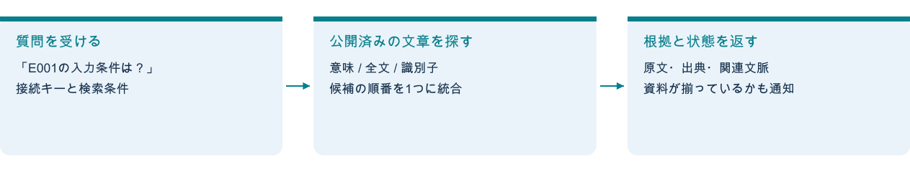

### この資料でわかること

- どの資料を検索してよいか、どう決めるか。
- 意味・言葉・識別子の3つで、どう探すか。
- 根拠と出典、不足をどう呼出元へ渡すか。

### まず覚える3つの言葉

- チャンク：検索に使う小さな原文のまとまり。
- 公開コピー：管理者が確認して採用した内容。
- coverage：予定した資料が準備できている状態。

### 読む順番

- 全体像と公開対象：2〜4ページ。
- 探し方・順位・出典・不足：5〜11ページ。
- API・更新・試験・配置：12〜16ページ。

> 確認日：2026-11-15。図の文書・質問・順位・数値は、現行の仕組みを説明するための例です。

根拠：[src/search/api.py](../../src/search/api.py)、[src/search/service.py](../../src/search/service.py)、[docs/implementation/search-api.md](../../docs/implementation/search-api.md)

## 2. 全体像：質問から、根拠と状態を返す

検索APIは関連する原文を探します。会話の回答文を組み立てる処理は、Difyなどの呼出側で行います。

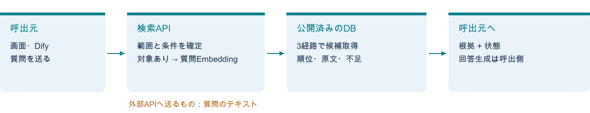

### 1. 質問を受ける

- ナレッジ・質問・返却件数などをJSONで受けます。
- Bearer接続キーと、入力の形式・上限を検査します。
- 検索対象の業務版はサーバー側で確定します。

### 2. 公開済みの根拠を探す

- 対象チャンクがある場合に、質問を数値化します。
- 意味・全文・識別子で探し、候補の順位を統合します。
- 承認した公開コピーの本文・位置を取得します。

### 3. 呼出側へ返す

- 原文・出典・関連する文脈を返します。
- 未公開や更新待ちなどの不足も状態として返します。
- Difyは根拠と状態から回答の流れを決めます。

> 検索時に共有フォルダ全体を読み直したり、足りない文書のEmbeddingを自動生成したりする処理ではありません。

根拠：[src/search/api.py](../../src/search/api.py)、[src/search/service.py](../../src/search/service.py)、[src/search/repository.py](../../src/search/repository.py)

## 3. 公開：取込済みと、検索できるを分ける

ingest・embedの完了だけでは検索しません。管理者が業務版と採用世代を決め、publishで公開します。

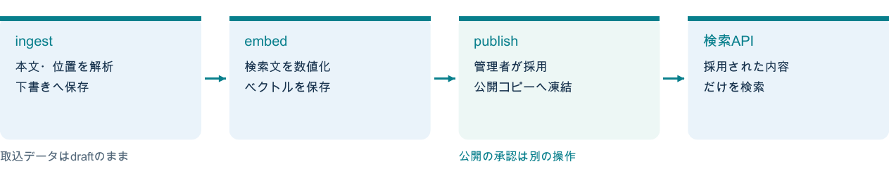

### 取込側で準備する

- ingestが原本を解析し、下書きのチャンクを作ります。
- embedが検索用テキストを数値化して保存します。
- 取込元の世代・本文はdraftのまま維持します。

### 管理者が明示する

- create-releaseで業務版を作り、予定対象を登録。
- publishで文書・世代・承認者を指定します。
- 部分抽出は不足を確認し、個別に公開承認します。

### 検索側へ凍結する

- 本文・位置・関係・一致するベクトルをコピーします。
- 公開コピーと採用先の切替を、DBへ一括登録します。
- 公開後にembedした場合は、再publishが必要です。

> 初回の業務版は既定です。既定版の切替は--make-default、公開の取り消しはunpublishを使います。

根拠：[src/search/management.py](../../src/search/management.py)、[src/search/schema.py](../../src/search/schema.py)、[docs/implementation/search-api.md](../../docs/implementation/search-api.md)

## 4. 検索前に、対象範囲と条件を確かめる

質問者が送った条件をそのままSQLへつなげず、許可した項目と、サーバーの設定から検索範囲を作ります。

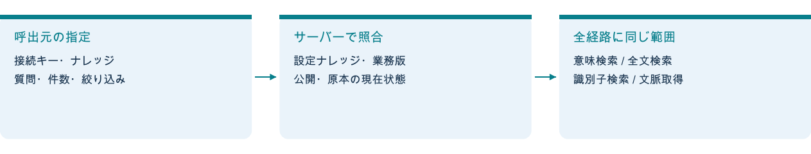

### 接続と入力を検査

- Bearerキーが違えば401。未指定でも検索しません。
- 質問は通常モードで4,000文字・2,048トークン以内。
- top_kは1〜20。未知の入力項目は422で拒否します。

### ナレッジと業務版を確定

- 設定ナレッジ以外や未設定の範囲は404になります。
- 現行検索は既定の業務版を使います。
- 履歴は起動時の許可と、対象版の明示が必要です。

### 絞り込みは全経路で共通

- 文書ID・機能IDなど、許可した項目で絞れます。
- 条件の組合せはAND。機能ラベルは公開時に付与。
- ラベル未整備の範囲への機能条件は422です。

> 初版は文書ACL・利用者別SSOを適用しません。接続キーは質問者ごとの閲覧権限を証明するものではありません。

根拠：[src/search/models.py](../../src/search/models.py)、[src/search/repository.py](../../src/search/repository.py)、[src/search/api.py](../../src/search/api.py)

## 5. 意味検索：質問と文章の、話題の近さを比べる

質問を保存済みのベクトルと同じモデル・次元数で数値化し、言い方が違っても近い話題の文章を探します。

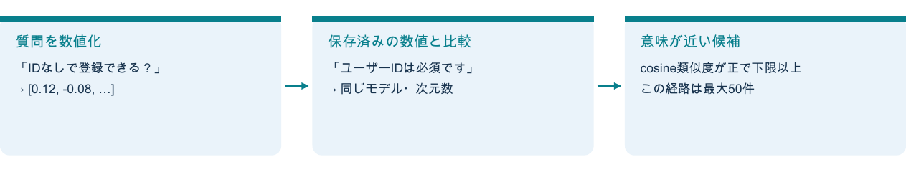

### 質問だけを数値化する

- 公開・絞り込み条件に合うチャンクがあるとき、質問をOpenAIへ送ります。
- 採用済みプロファイルのモデル・次元数を使います。
- 対象がゼロのときは、外部APIを呼びません。

### 近さから候補を作る

- cosine類似度が正で、設定した下限以上の行を採用。
- 下限はsearch.semantic_min_cosine_similarity。既定は0.0です。
- pgvectorで近い順に最大50候補を選びます。

### 外部APIの待ちを分ける

- 質問Embeddingは4秒以内、自動再試行0回。
- 外部APIを待つ間は、DB接続を返却します。
- Embeddingの失敗は検索障害として呼出元へ返します。

> 図は概念例です。意味検索の下限は候補選びに使い、統合後のscore_thresholdは別に適用します。

根拠：[src/search/service.py](../../src/search/service.py)、[src/search/repository.py](../../src/search/repository.py)、[src/search/config.py](../../src/search/config.py)

## 6. 全文検索：日本語の言葉で、本文を探す

質問を検索語へ分け、公開チャンクの検索用テキストに、その言葉が含まれるかをPGroongaで調べます。

### 質問から検索語へ

- TokenBigramとNormalizerAutoで分割・正規化します。
- 重複を除いた先頭16語まで。各2〜128文字です。
- 図の語の並びは説明用で、分割結果の実測ではありません。

### 言葉が含まれる本文を取得

- 複数の語をORで検索します。全語一致とは限りません。
- 検索語はリテラル値として渡し、式として解釈させません。
- この経路でも最大50候補を得ます。

### 意味検索を補う

- 業務用語や、本文に書かれた表現を拾う手掛かりです。
- 検索対象はsearch_text。返す引用はcontent_textです。
- 語の選び方と業務用語の精度は、実質問で評価します。

> 全文・識別子の必須索引が欠落または無効な場合は、通常モードのhealthと検索が503を返します。

根拠：[src/search/repository.py](../../src/search/repository.py)、[src/search/schema.py](../../src/search/schema.py)、[docs/implementation/search-api.md](../../docs/implementation/search-api.md)

## 7. 識別子検索：E001のような名前を、そのまま照合

文書中のエラーコードや名前を公開時に登録し、質問から抜き出した識別子と、文字列で完全一致させます。

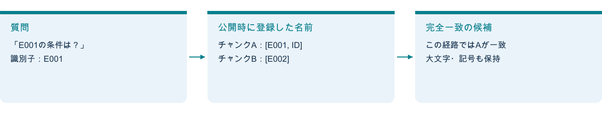

### 公開時に登録する

- チャンクの保存済み識別子と、本文等から補った名前を使います。
- 例：エラーコードE001、文書中の英数字の名前。
- 識別子一覧を検索用の公開チャンクへ保持します。

### 質問から取り出す

- 英数字の名前や、バッククォートで囲んだ表現を抽出。
- 質問から使う識別子は最大16個です。
- 大文字・小文字や記号を保ち、配列の値と照合します。

### 他の経路と合わせる

- 一致する識別子の数などから候補の順番を作ります。
- この経路も最大50候補で、順位統合へ渡します。
- E001の一致と、文書が答えとして正しいことは別です。

> 図は識別子経路だけの例です。他の経路の候補も統合されます。プログラムの構造解析をする検索APIではありません。

根拠：[src/search/ranking.py](../../src/search/ranking.py)、[src/search/repository.py](../../src/search/repository.py)、[src/search/management.py](../../src/search/management.py)

## 8. 順位統合：3つの順番を、1つにまとめる

意味・全文・識別子は点数の尺度が違います。各経路の順位を使い、複数の経路で上位の根拠を押し上げます。

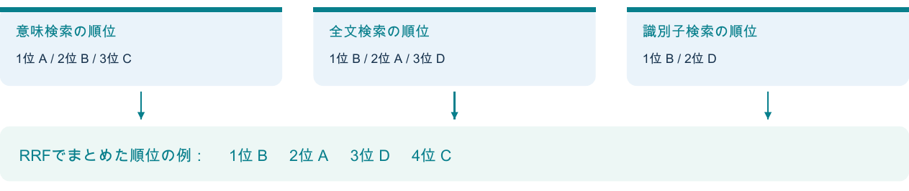

### 点数を直接足さない

- 各経路は同じ候補でも、違う尺度で評価します。
- RRFは1 / (60＋順位)を経路ごとに足します。
- 経路内の重複は除き、同じチャンクをまとめます。

### 0〜1の互換スコアにする

- 3経路で全て1位の上限を使って正規化します。
- score_thresholdは、この統合後スコアに適用します。
- 質問ごとの最高点を必ず1にする方式ではありません。

### 返却量をさらに整える

- 最終結果には関連文脈も含み、top_k以内にします。
- 同じ文書からのヒットは最大3件に抑えます。
- スコアは正答確率でも、cosine距離そのものでもありません。

> A〜Dは説明用のチャンクです。この例ではBが3経路で上位となり、統合後の先頭に来ます。実測の順位ではありません。

根拠：[src/search/ranking.py](../../src/search/ranking.py)、[src/search/evidence.py](../../src/search/evidence.py)、[src/search/models.py](../../src/search/models.py)

## 9. 根拠づくり：近くの文脈も、一緒に返す

短いヒットだけでは意味が伝わらない場合に備え、保存済みの見出しや関係を使って、補助文脈を付けます。

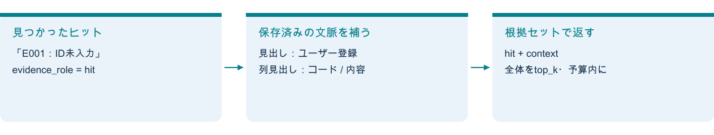

### 必要な範囲だけ広げる

- 同じ公開コピー内で、親・見出し・表ヘッダー等を探します。
- 確認済み関係や近隣も候補にし、1段だけ取得します。
- 関係のない文書全体や、全シートへは展開しません。

### ヒットと文脈を区別する

- evidence_roleでhitとcontextを区別します。
- 文脈には、どのヒットを補うかのIDを付けます。
- 文脈も返却件数に含め、文脈枠は最大5件です。

### 引用の予算を守る

- 1件2,000、全体6,000トークン。JSONは256KiBまで。
- 原文を切り出す場合も、元の文字範囲を保持します。
- 追跡可能な形で収まらない表は落とし、次候補を試します。

> APIが本文を生成要約へ置き換える処理ではありません。文脈も原本に対応する文章として返します。

根拠：[src/search/evidence.py](../../src/search/evidence.py)、[src/search/config.py](../../src/search/config.py)、[src/search/management.py](../../src/search/management.py)

## 10. 出典：根拠の位置と、原本・画像を確認する

どの文書・版・ブロックが根拠かを示します。原本と関連画像は、検索APIの接続キーを使って取得できます。

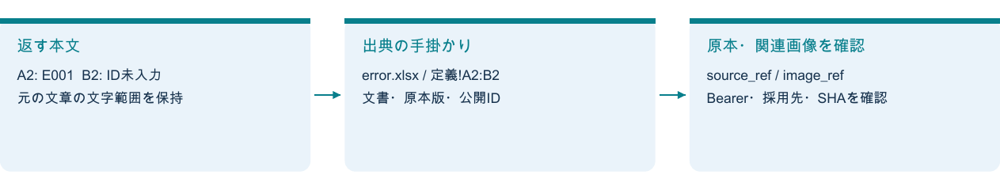

### 引用を追跡する

- 文書・世代・公開コピー・原本版のIDを返します。
- 原文の文字範囲はsource_spansで示します。
- 画像説明はartifact_typeがderivedとなります。

### 原本の位置を示す

- TXT/MDは行、Excelはシート・セル範囲を使います。
- Wordは段落や表番号、PDFはページ・領域座標です。
- PDFの座標やセルを、引用文字だけの位置へ推測で狭めません。

### 原本と関連画像を取得する

- 原本はsource_ref、関連画像はimage_refで取得。
- 採用中の公開コピーと、サイズ・SHA-256を検証します。
- 履歴のリンクには?mode=historyが付きます。

> 図のセル位置と本文は例です。接続キーはURLに含めず、Authorizationヘッダーで送ります。

根拠：[src/search/evidence.py](../../src/search/evidence.py)、[src/search/api.py](../../src/search/api.py)、[src/file_scan/storage.py](../../src/file_scan/storage.py)

## 11. 検索結果と、資料の準備状態を分ける

ヒットがあっても、調べる予定の資料が揃っているとは限りません。根拠の配列と、資料の不足を別に返します。

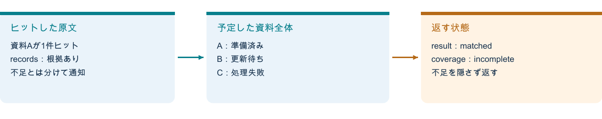

### complete：準備完了

- 予定範囲で、必要な公開・索引等が揃っています。
- ヒットが0件なら、条件に合う根拠が返らなかった状態です。
- 準備完了でも、世の中に答えがないと証明はできません。

### incomplete：不足あり

- 更新待ち、失敗、未収集、partial、ベクトル不足等を数えます。
- 例のAがヒットしても、B・Cの不足を残します。
- 文書や機能で絞っても、予定対象の不足を消しません。

### unknown：確認できない

- 原本の列挙が未確認など、台帳の状態が不明です。
- 不明な件数を0として正常に見せません。
- 呼出側は不足を伝え、返った根拠の範囲で扱います。

> result_stateはmatched / no_match / budget_exhausted。coverage_stateとは別軸で、空結果と障害も区別します。

根拠：[src/search/repository.py](../../src/search/repository.py)、[src/search/service.py](../../src/search/service.py)、[src/search/models.py](../../src/search/models.py)

## 12. APIの入口：状態付きと、Dify互換を選ぶ

状態付きAPIを主経路にすると、ヒットと不足を一緒に扱えます。Dify標準連携には互換APIも用意しています。

| 入口 | 返すもの・用途 | 判断のポイント |
| --- | --- | --- |
| POST /search-with-status | records＋retrieval_status。主経路向け | 不足があっても状態を付けた200を返せる |
| POST /retrieval | recordsのみ。Dify External Knowledge互換 | coverage未完了・返却予算不足は409 |
| GET /sources/{公開ID} | 採用中の公開コピーから保管原本を取得 | Bearer。履歴は?mode=history |
| GET /sources/{公開ID}/images/{出現ID} | 公開コピーに含まれる画像を添付で取得 | 原本と同じ認証・業務版の条件 |
| GET /healthz | DB・検索管理版・拡張・必須索引を検査 | 公開資料やEmbeddingの確認は別途実施 |
| /docs・/openapi.json | 入力・出力・Bearer認証のAPI定義 | 運用時は必要な範囲だけから閲覧する |

recordsの基本項目はcontent（原文）、score（統合順位の点数）、title、metadata（出典等）。正常0件、資料不足、実行障害を呼出側で区別します。

> 接続認証401、入力422、同時実行上限429、検索障害503、期限超過504。条件や設定を無視して正常結果にはしません。

根拠：[src/search/api.py](../../src/search/api.py)、[src/search/models.py](../../src/search/models.py)、[src/search/errors.py](../../src/search/errors.py)

## 13. 更新・削除・公開取り消し

原本と選択世代が変わると、古い公開コピーを現行検索から外します。新しい内容の確認と再公開を待ちます。

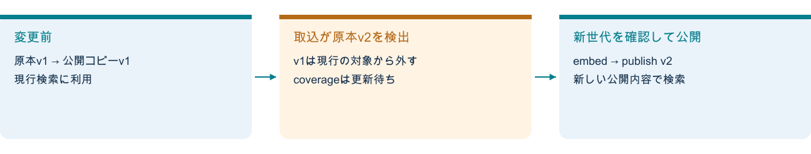

### 更新を取込が検出

- 原本版・選択世代・変換設定・更新時刻等を照合します。
- 古い公開コピーの本文は、そのまま凍結して保持します。
- 現行では古い成功内容へ自動で戻りません。

### 検索中の一貫性を守る

- 根拠とcoverageは同じDBスナップショットで読みます。
- 返す直前にも、採用版や対象の変化を再確認します。
- 途中で切り替わった結果は、503等で再検索を促します。

### 削除と公開取り消し

- 削除・利用不能・対象外の資料は履歴でも除外します。
- unpublishで指定版の採用を解除し、公開コピーを保持します。
- 解除後は検索・原本・画像の取得から外れます。

> DBへ反映されるまでの時間は取込の起動頻度等に依存します。更新検出から再公開までの運用も決めます。

根拠：[src/search/repository.py](../../src/search/repository.py)、[src/search/service.py](../../src/search/service.py)、[src/search/management.py](../../src/search/management.py)

## 14. テストモード：DBなしで、接続だけ試す

設定ファイルのsearch.test_modeをtrueにして再起動すると、検索の代わりに固定のテスト文言を返します。

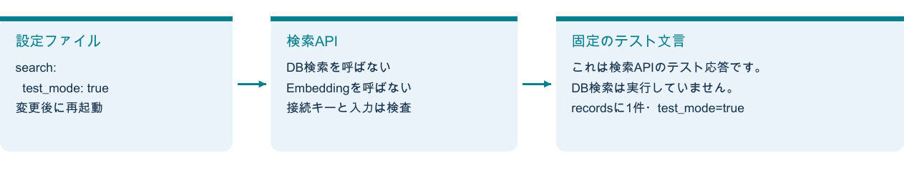

### 設定で切り替える

- search配下にtest_mode: trueを記載します。
- falseまたは未指定なら、通常検索を行います。
- HTTPリクエストからモードは切り替えられません。

### 外部処理を呼ばない

- DBエンジン・検索サービス・質問Embeddingを使いません。
- トークナイザーの取得や監視表への書込みもしません。
- 接続キーとJSON形式・文字数・本文上限は検査します。

### 実検索と区別する

- 両検索APIで、固定文言を1件返します。
- metadata.test_mode=true。状態はexecution_mode=test。
- healthもDBを使わず、原本・画像の取得は404です。

> 接続試験であり、検索精度・資料の公開準備・実Embeddingの検査ではありません。通常モードへ戻して受入確認します。

根拠：[src/search/config.py](../../src/search/config.py)、[src/search/stub.py](../../src/search/stub.py)、[config.search-test.example.yaml](../../config.search-test.example.yaml)

## 15. 配置と設定：取込と検索は、並列の機能

本番例のルートは/opt/file-scan/です。ソースは直下のsrc/、共通設定と環境変数ファイルはルート直下に置きます。

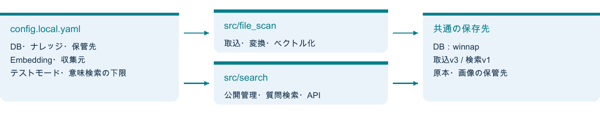

### ソースと役割

- src/file_scan：ファイルの収集・解析・Embedding。
- src/search：質問検索・根拠・状態・公開管理・API。
- 検索側は既存のDB定義・設定・原本処理を参照します。

### 共有するデータと設定

- config.local.yamlでナレッジ・保管先等を共有。
- DBの物理配置はwinnap。取込v3と検索v1を別管理。
- 本番例は原本の保存領域を/var/lib/file-scan/へ置きます。

### 機能ごとに制御する

- .envは取込・公開管理用、.env.searchは常駐API用。
- 接続先DBは同じで、DBロールを分けます。
- 検索のポートと履歴許可は起動コマンドで指定。

> 共通YAMLのsearch配下でテストモードと意味検索の下限を設定します。期限・候補数・返却予算はコードの既定値です。

根拠：[src/search/config.py](../../src/search/config.py)、[src/file_scan/namespace.py](../../src/file_scan/namespace.py)、[docs/implementation/search-api-production.md](../../docs/implementation/search-api-production.md)

## 16. Difyと本番運用：根拠を受けて、回答へつなぐ

API単独で検索を実装し、DifyからHTTPで呼べます。本番ではHTTPSの接続入口と、停止・復旧の運用も用意します。

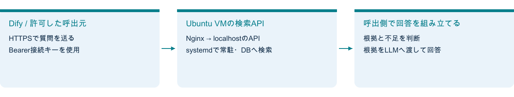

### Difyで回答へつなぐ

- HTTP Requestノードから状態付きAPIへ送ります。
- 非200や不足・空結果を分岐し、根拠をLLMへ渡します。
- Dify本体の配備・Chatflow作成は別途行います。

### 本番環境で起動する

- Ubuntu VMでsystemd常駐化し、APIはlocalhost待受。
- NginxでHTTPSと接続元制限。test_mode=falseを確認。
- DBとstorageを揃えて保護し、復元試験を行います。

### 適用範囲を守る

- 文書ACL・利用者別SSOは保留。共有可能な範囲で利用。
- 画像説明を公開する場合は、原図と照合して承認します。
- Difyでの画像表示や回答への入力は、呼出側で構成します。

> 同時検索4件、全体10秒が1プロセスの既定。healthの200だけで、実資料の準備・精度・本番受入を完了としません。

根拠：[docs/implementation/search-api-production.md](../../docs/implementation/search-api-production.md)、[docs/design/03-llm-chat.md](../../docs/design/03-llm-chat.md)、[src/search/cli.py](../../src/search/cli.py)

## 17. 根拠資料と、プログラムの読み順

この資料は現行実装の説明です。操作は実装手順、本番配置は構築手順、将来の拡張は設計書で確認します。

| 順序 | 参照先 | 確認すること |
| --- | --- | --- |
| 1 | docs/implementation/search-api.md | 公開・起動・API契約・テストモード |
| 2 | src/search/api.py・models.py | HTTP受付、認証、入力と出力、原本取得 |
| 3 | src/search/service.py・repository.py | 質問Embedding、範囲、3経路、coverage、鮮度 |
| 4 | src/search/ranking.py・evidence.py | 順位統合、文脈、原文位置、返却予算 |
| 5 | src/search/management.py・schema.py | 承認コピー・業務版・検索v1の表 |
| 6 | docs/implementation/search-api-production.md | Ubuntu VM、常駐化、HTTPS、監視、復旧 |

設計書02・03・04には将来案も含まれます。本資料の例は説明用で、実OpenAI API・Dify本体・検索品質・Ubuntu本番環境の検証結果を示すものではありません。

> 確認対象は2026-11-15の作業ツリーです。PDF、Markdown、図は同じ定義から生成します。

根拠：[docs/design/02-search-platform.md](../../docs/design/02-search-platform.md)、[docs/implementation/search-api.md](../../docs/implementation/search-api.md)、[src/search/](../../src/search/)
