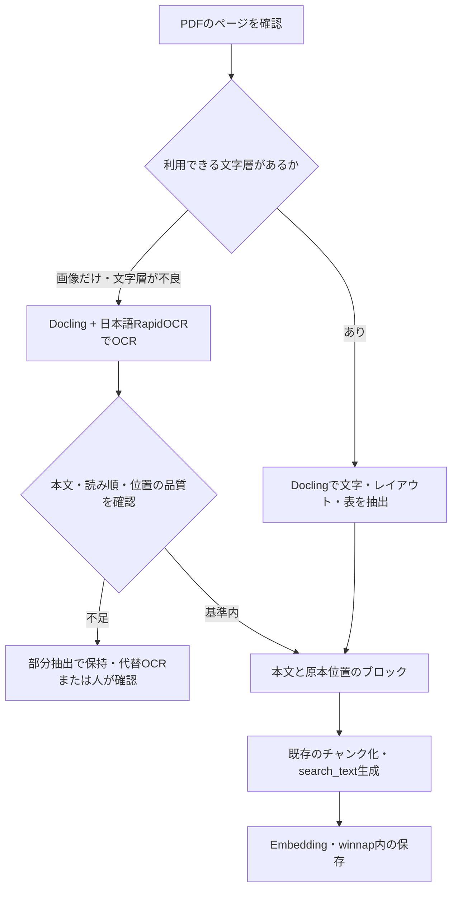

# 横書き中心の日本語スキャン書籍PDF：OCR方式の検討

**採用後の追記：第一候補RapidOCR＋ONNX Runtime CPUを実装した。** 以下は選定時点の調査記録。現在の設定・導入・制約・実モデル検証は[日本語OCRの実装・運用](../implementation/rapidocr-pdf.md)を正とする。実書籍での品質比較は未実施。

確認日：2026-11-02。利用者から「スキャンした日本語書籍が多い」「横書きが中心」と回答されたことを前提とする。現行コード・配置済みライブラリ・公式資料を照合した技術調査であり、OCRの採用・実装完了を示す資料ではない。

## 1. 判断

**画像だけの日本語書籍PDFを検索対象にするにはOCRが必要である。横書き中心・CPU実行・既存Doclingの継続利用という条件では、Docling＋RapidOCR＋ONNX Runtime CPUを第一評価候補とする。** 日本語書籍向けの対抗候補NDLOCR-Liteも同じ代表ページで比較し、Docling＋Tesseract CLIを比較基準に加えるのがよい。

これは認識精度の実測順位ではなく、既存構成との接続しやすさ・CPU実行・日本語対応に基づく推奨評価順である。対象書籍での実測後に採用を確定する。Doclingの「日本語OCR」は、Docling自身の単一モデルではなく、選択したOCRエンジンで文字を読み、その結果をレイアウト・表構造の処理へ渡す構成である。[DoclingのOCR方式](https://docling-project.github.io/docling/concepts/OCR/)

以前の設計には画像OCRを外部APIで実施する方針があるが、今回の入力条件では、書籍本文のOCRはローカル処理を先に評価することを提案する。画像の意味説明・図の解釈は本文OCRと別の処理として維持する。実装・既存設定・モデルlockは今回変更していない。

## 2. 現行実装で不足すること

| 確認箇所 | 現状 | スキャン書籍への影響 |
| --- | --- | --- |
| `src/file_scan/parsers.py` の `_docling_converter` | `do_ocr=False`。CPUでレイアウト・表構造を解析 | 画像内の本文は文字列にならない |
| `_parse_pdf_docling` | 文字を取れないページを`pdf_page_without_text_ocr_required`にする | 検索可能な本文がないページが残る |
| `_pdf_original_images` | 原画像を保存し、画像ごとに`pending_images`を加算 | OCRを有効にするだけでは、スキャン背景画像も解析待ちとして残り得る |
| `scripts/download_docling_models.py` とモデルlock | レイアウト・TableFormerのみを取得・照合 | OCRの認識・検出モデルの取得・固定版管理が別途必要 |
| `src/file_scan/profiles.py` | PDF抽出条件のOCR値が固定でfalse | OCRエンジン・言語・モデル・モード等の識別を追加する必要がある |
| 解析ワーカー | 既定120秒／文書。メモリ閾値は文書処理後に検査 | 厚い書籍の全文OCRは時間制限やメモリ使用量の再検討が必要 |

OCRを行わない現在の方式では、本文が画像にしかないページをチャンク化・ベクトル化できない。OCR結果の本文とページ・座標をブロックへ変換できれば、既存の分割→`search_text`→Embedding→winnap内の保存処理は継続利用できる。

## 3. 候補の比較

以下の「位置付け」「優先順位」は、このプロジェクトに対する判断である。各方式の精度・速度は同じ書籍と同じCPUで未比較。

| 候補 | Doclingへの接続 | 今回の位置付け | 確認すべき点 |
| --- | --- | --- | --- |
| **RapidOCR＋ONNX Runtime CPU** | 標準のOCRエンジン | **第一評価候補**。日本語を明示し、smallで開始 | 日本語・英数字混在、段組み、表、薄い印刷。言語・実モデル・依存版を固定する |
| **Tesseract CLI** | 標準のOCRエンジン | **比較基準・導入の単純さを優先する候補**。日本語`jpn`と英語`eng` | 同じページでRapidOCRと比較。綺麗な活字と低品質スキャンを分けて評価する |
| **NDLOCR-Lite** | 現在のDocling標準エンジンには含まれない。ページ画像と構造化出力を接続するアダプターが必要 | **書籍向けの対抗候補**。同じ代表ページで本文・読み順・旧字体等を比較 | 画像化したPDFページと元ページ・座標の対応、別環境の依存、モデルの利用条件 |
| EasyOCR | 標準のOCRエンジン | 追加比較候補。最初の比較対象を増やしすぎないため後順位 | 日本語と英語の設定、CPU時間、現行の依存との整合 |
| YomiToku / Lite | 別の日本語文書解析器として接続する必要がある | 表・読み順等を含めた追加比較候補 | 現行のPython要件が`>=3.10,<3.14`、コード・モデルの利用条件、別環境での実行 |

### RapidOCRを最初に評価する理由

Doclingの公式資料では日本語を`iso:ja`または対応するエンジンコードで指定できる。現在の公式記述では日本語はPP-OCRv6へ対応し、smallが既定。日本語にtinyを指定する組み合わせは対応しないとされる。RapidOCRは1変換で単一言語を選ぶため、`ja,en`を指定すれば別々のモデルを同時に使う、とは想定しない。日本語モデルで英数字も適切に読めるかを実物で確認する。[Doclingの言語・モデルサイズ](https://docling-project.github.io/docling/concepts/OCR/#rapidocr)

RapidOCRはONNX Runtime等での実行に対応する。既存のレイアウト処理を保ち、そのOCR段階へ接続できるため、この構成を第一候補と判断した。GPU・PaddlePaddle本体を必須にする構成にはしない。[RapidOCR公式](https://github.com/RapidAI/RapidOCR)

### Tesseract CLIの位置付け

日本語の`jpn`学習データが公開されている。DoclingはCLI経由とPythonバインディング経由を区別しており、今回はCLI経由を比較する。言語モデルは事前配置する。縦書きは`jpn_vert`等の別設定と分割モードの調整が必要であり、横書きと同じ設定で一律に扱わない。[日本語の学習データ](https://tesseract-ocr.github.io/tessdoc/Data-Files-in-different-versions.html)、[DoclingのTesseract対応](https://docling-project.github.io/docling/concepts/OCR/#tesseract-tesserocr)

### NDLOCR-Liteの位置付け

国立国会図書館が公開する、GPUを必須としない図書・雑誌の画像からの文字抽出器である。公式に横書き・縦書きの例があるため、日本語書籍の代替候補にする。Doclingの標準OCRへそのまま選択できる方式ではないので、まず別プロセスの試験として比較する。[NDLラボの公開案内](https://lab.ndl.go.jp/news/2025/2026-02-24/)、[NDLOCR-Lite](https://github.com/ndl-lab/ndlocr-lite)

公式ソースは読み順処理と構造化出力を持つ。採用時は、全文TXTだけを受け渡して原本位置を失う方式を避け、ページ・画像サイズ・文字領域を保持して共通ブロックへ対応付ける。[OCR処理ソース](https://github.com/ndl-lab/ndlocr-lite/blob/master/src/ocr.py)

### YomiTokuとEasyOCR

YomiTokuは日本語のOCR・読み順・表構造の機能とCPU向け軽量モードを提供する。一方、現行pyprojectはPython 3.14を対象外とし、公式説明ではコード・モデルがCC BY-NC-SA 4.0で、商用向けライセンスも案内されている。現在の業務環境へそのまま採用する候補にはせず、別環境・利用条件を整理した上で比較する。[機能・利用条件](https://github.com/kotaro-kinoshita/yomitoku)、[Python要件](https://github.com/kotaro-kinoshita/yomitoku/blob/main/pyproject.toml)

EasyOCRはCPU実行と複数言語の指定に対応し、日本語用の認識モデルも提供する。初回の評価ではRapidOCRとTesseractを優先し、両方で不足があれば比較対象を追加する。[EasyOCR公式](https://github.com/JaidedAI/EasyOCR)、[日本語モデル定義](https://github.com/JaidedAI/EasyOCR/blob/master/easyocr/config.py)

## 4. 現行の仮想環境との相性

実際の配置済み環境で確認した値：Python 3.14系、docling-slim 2.140.0、PyTorch 2.9.1、Transformers 4.57.6。RapidOCR・ONNX Runtime・EasyOCRのPythonパッケージとTesseract実行ファイルは未導入。

- 配置済みDocling 2.140.0のメタデータには`feat-ocr-rapidocr-onnx`があり、RapidOCRは`>=3.9.1,<4.0.0`、Python 3.14のONNX Runtimeは`>=1.24.1,<2.0.0`という条件がある。これは依存条件の確認であり、実際のwheel導入・モデル推論までの動作保証ではない。
- CPU構成ではCPU用`onnxruntime`を明示して評価する。GPU用の追加依存をまとめて導入することは避ける。アプリの既存lockと合わせた解決・固定が必要。[固定版の依存定義](https://github.com/docling-project/docling/blob/v2.140.0/pyproject.toml)
- NDLOCR-Liteの公式requirementsはNumPy 2.2.2等を固定しており、本プロジェクトのNumPy 2.3.5等と異なる。既存`.venv`にrequirementsを直接投入せず、別venv等で評価する。READMEとパッケージ定義のPython下限にも差があるため、対象版のpyprojectを優先して確認する。[NDLOCR-Liteの依存](https://github.com/ndl-lab/ndlocr-lite/blob/master/requirements.txt)、[パッケージ定義](https://github.com/ndl-lab/ndlocr-lite/blob/master/pyproject.toml)

NDLOCR-Liteの公式READMEはコードのCC BY 4.0に加え、同梱モデルに関するDINOv3の条件も記載している。評価・配布に用いる版のコードとモデルの条件を分けて確認する。ここでは組織での利用可否の法的判断は行っていない。[利用条件の記載](https://github.com/ndl-lab/ndlocr-lite#readme)

## 5. 推奨する処理の流れ（実装案）



文字層の有無だけでなく品質も見る。古いOCRの文字層が少し存在するだけで、全文を読めたと判断しない。初回の比較では、画像だけのページは全ページOCR、通常の文字PDFはOCRなしとして処理し、混在PDFと不良文字層は別の評価群にする。

OCR済みPDFを別ファイルで生成して再度Doclingに渡す方式も候補にできるが、透明文字の重複、読順、表と文字の対応、派生PDFと原本の座標対応を検証する必要がある。今回の最初の候補はDocling内部でのOCRとする。

### 設定の検証用イメージ

次は配置済みDocling 2.140.0で設定オブジェクトの型検査が通った例。既存`config.local.yaml`にこの設定を追加できる実装はまだない。OCR本体・認識モデルを導入していないため、OCRの実行成功を確認したコードでもない。

```python
from docling.datamodel.pipeline_options import PdfPipelineOptions, RapidOcrOptions, OcrMode

options = PdfPipelineOptions()
options.do_ocr = True
options.do_table_structure = True
options.ocr_options = RapidOcrOptions(
    lang=["iso:ja"],
    backend="onnxruntime",
    model_size="small",
    mode=OcrMode.FULL_PAGE,  # 画像だけのスキャンPDFを比較する場合
)
```

この設定に加え、現在のCPU指定・ローカルモデル配置・外部サービス無効等を引き継ぐ。通常の文字PDFまで一律に全ページOCRする設定にはしない。公式最新版の設定例を、固定版で未検証のままコピーしない。

## 6. 実装時に必要になる修正

1. OCRの有効・無効、エンジン、言語、全ページ処理、モデル配置先を設定として持つ。現行の`do_ocr=False`や`ocr_enabled=False`、`docling_cpu_ocr_disabled`の固定表記も処理条件に合わせる。
2. OCRモデル・認識用辞書・ライブラリ版の事前取得と固定版・ハッシュ検査を用意する。現在のDoclingモデル取得だけでOCRの準備が終わるとは扱わない。
3. OCR条件を抽出プロファイルとConverterの再利用キーに含める。言語・モデル・モードの変更時に、古い抽出結果を誤って再利用しない。
4. スキャン背景画像で本文OCRが完了した場合と、図の意味説明が未実施の場合を区別する。画像を保存した事実だけで一律に「文字解析待ち」とせず、図の説明待ちを本文OCR完了で隠すこともしない。
5. 原本ページ・領域座標・座標系を保持する。見開き分割、傾き補正、回転、余白除去を行う場合は原本座標への変換を記録する。
6. 書籍全体のOCRが既定120秒を超える可能性を測定する。時間制限・ページ単位の実行・中断再開を検討し、失敗ページを無言で除外しない。ページを分けて処理しても元の文書IDとページ番号を維持する。
7. 本文・見出し・表・脚注・ルビの読み順を確認し、取りこぼしを部分抽出として記録する。OCRの信頼度スコアだけで完全抽出・自動公開を判断しない。

OCRは文字の転記であり、要約や画像説明とは分ける。OCR本文を保存した後のベクトル化は既存経路を使う。Embedding自体がOCR誤りや段落の読み順を訂正する機能とは扱わない。

## 7. 実物による比較計画

横書き中心の代表書籍から20～50ページ程度を選び、同一ページを各候補で比較する。これは評価規模の提案である。

| 評価群 | 確認すること |
| --- | --- |
| 横書き・1段組み | 普通の本文、句読点、漢字・かなの欠落 |
| 横書き・2段組み | 段をまたいで本文が混ざらないか、段落の順序 |
| 表・図・脚注のあるページ | セルと値、本文と図中文字、脚注の対応 |
| 小さい字・ルビ・英数字混在 | ルビが本文に混ざるか、型番・数値・単位・記号の正確さ |
| 薄い印刷・傾き・見開き・ノドの歪み | 前処理の効果、文字の抜け、原本座標との対応 |
| 少数の縦書き・方向混在 | 横書き設定の適用限界を把握し、例外経路を決める |

測定項目は、手作業の正解に対する文字誤り率（CER）、重要な数値・用語の正解、本文・表の欠落、読順、秒／ページ、ページ処理完了率、ピークメモリとする。OCRエンジンが返す信頼度の数値は、異なるエンジン間で同じ尺度として比較しない。

比較時はレンダリング解像度・画像前処理・モデル名・版・言語・CPU条件を記録する。300dpi相当を開始候補にし、Doclingの既定scale 3.0（216dpi相当）等との品質・時間差を実測する。解像度を上げれば必ず精度が改善するとは仮定しない。

最後に、書籍内の用語・質問から正しいページへ到達するかを確認する。単純な文字認識率だけでなく、検索に必要な単位を欠落なく保持できたかで採用を判断する。普遍的な合格率はここでは決めず、対象書籍と重要項目に合わせて設定する。

## 8. 今回確認した範囲

- 現行アプリ、モデル取得処理、固定依存とインストール済みDoclingのOCR設定・依存条件を確認した。
- 日本語`iso:ja`、ONNX Runtime、small、全ページOCRの設定オブジェクトを構築できることを確認した。認識処理は実行していない。
- 公開サンプルは英語PDF等で、対象の日本語スキャン書籍を使った正解付き比較は未実施。
- 新しいOCRパッケージやモデルの導入、外部OCR/APIへの文書送信、DB変更、OCR有効化は行っていない。

**次の作業は、RapidOCRとNDLOCR-Liteを隔離した評価環境で同一の日本語書籍ページにかけ、Tesseract CLIも比較基準に加えること。本文・位置・読み順・処理時間の結果から本番採用を決める。既存構成との接続の容易さを優先する場合の第一候補はRapidOCRとする。**
