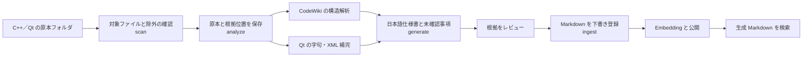

# C++／Qt ソース取込の機能説明資料

[機能別ドキュメント一覧](../README.md)

保守担当者が「このボタンはどの処理につながるか」「このプラグインはどこで宣言されているか」を調べるとき、ソースの構成と該当箇所を日本語の仕様書からたどれます。取込担当者は対象のソースを固定し、解析結果を確認してから文書を登録します。検索利用者は公開された生成 Markdown を出典として読めます。

## ソースを固定してから仕様書にする

`scan` で棚卸しすると、収集に含めたファイル、除外した理由、読み取り時の問題を確認できます。`analyze` は原本を保存し、UTF-8 の作業コピーを解析します。CP932 のソースでも、対応表から原本の位置に戻れます。CodeWiki が C++ のクラスや関数を拾い、Qt 補完が `.ui` や `.qrc` の XML、QML、プラグインマクロ、接続式を整理します。

`generate` は LLM を使ってモジュールの説明を作り、Qt 補完と合わせて日本語 Markdown にします。ここで設定した API へ作業コピーの関連情報が送られます。原本を送信できる接続先を選び、生成後は根拠と未確認事項を確認します。

## 例で見る画面とプラグインの調べ方

同梱の Qt 5 サンプルには、Widgets の画面、QML の画面、プラグインの宣言があります。保守担当者が「カウントの変更を画面に伝える経路はどこか」を調べるとします。生成文書の `screens.md`、`processes.md`、`plugins.md` を開き、次の順に原本の記述を確認できます。

| 探す情報 | 読む場所と根拠 | ここから分かること |
| --- | --- | --- |
| 画面に渡した C++ オブジェクト | `screens.md` → `main.cpp:14` | `setContextProperty("backend", &backend)` の呼出しがある |
| QML 側の更新 | `screens.md` → `Main.qml:5-8` | `Connections` が `backend` を参照し、`onCountChanged` が `currentCount` を書き換える記述がある |
| QML の読み込み先 | `main.cpp:15` と `screens.qrc:2` | `qrc:/screens/Main.qml` と、リソースの prefix・alias を照合できる |
| C++ 側の接続と通知 | `processes.md` → `main.cpp:11-12`、`api.md` → `example_plugin.h:17-22` | C++ の接続式、`Q_PROPERTY`、`countChanged` の宣言を確認できる |
| プラグインの契約とロード候補 | `plugins.md` → `example_plugin.h:10-16`、`main.cpp:16` | IID とメタデータ JSON、ローダーの対象文字列が分かる。どのバイナリをロードして初期化できたかは環境で確認する |
| Widgets の「実行」ボタン | `screens.md` → `main_window.ui:6-11` | `startButton` の表示と `clicked()` から `MainWindow::start()` への XML 上の接続宣言を確認できる |

表の行番号はサンプル原本を手で照合した範囲です。XML の抽出レコードはファイル全体を根拠にするため、表示された範囲から該当箇所を読みます。ドキュメント生成時の根拠検査ではパスと行範囲の存在を確認します。例えば、Widgets の `MainWindow::start()` を同名のプラグインメソッドへ結び付けるには、対応する画面クラスの実装を確認します。IID はインターフェースの識別に使われ、複数のプラグイン実装が共有できます。[サンプルの説明](../../examples/qt5-source/README.md)

### どの程度まで確認できたかを見る

| 見つかった情報 | 判断のしかた |
| --- | --- |
| ソース上の記述 | 原本の行や XML に該当の宣言・式があることを確認できます。例えば、`setContextProperty` の呼出しや `Q_PLUGIN_METADATA` の宣言です |
| 対応の候補 | `setupUi` や自動接続、Factory 登録、ローダーの対象など。クラスの実装、設定、初期化順を照合します |
| CodeWiki が生成した説明 | 全体構成や処理の概要をつかむために読みます。根拠行と説明が一致するかを確認し、業務要件や動作成立は実機・設計資料で確かめます |
| 欠落・未確認 | `unknowns.md` と `quality-report.json` で、未解析ファイル、Qt 補完の範囲、C++ 構文エラー候補、レビュー前の項目を確認します |

## 取込と検索で扱う版

例えば `Main.qml` の表示条件だけを修正した場合でも、原本のハッシュが変わり、次の解析と生成の根拠は新しいスナップショットになります。以前の原本・解析・生成は保存され、文書がどのソースから作られたかを各版の manifest で確認できます。入力と条件が同じときは成功済みの成果物が再利用されます。

生成 Markdown を登録すると、既存の文書取込が本文を分割し、文書 ID と抽出世代を管理します。同じパスの内容と変換条件に差分がなければ、その文書の選択抽出世代と公開状態を維持します。更新された文書は下書きの抽出世代を確認し、Embedding を作って業務版に公開します。検索結果の引用元から生成仕様書を読み、そこに記載された根拠を `cpp-scan` の成果物にさかのぼれます。

## 結果が不足しているとき

部分完了の場合は、まず `unknowns.md` と解析レポートで欠落を調べます。標準運用では完全版の生成まで受渡しを保留します。部分取込を許可した場合は、今回欠けた文書について前回の Markdown を保持し、受渡し結果に `retained_paths` として記録します。入力元・収集範囲を変えたり、生成文書が減ったりした場合は、`status` の変更理由と削除候補を確認してから反映します。

コマンド、環境変数、復旧手順は[本番導入仕様](本番導入仕様.md)、入力・出力・版管理の詳細は[仕様書](仕様書.md)を参照。
