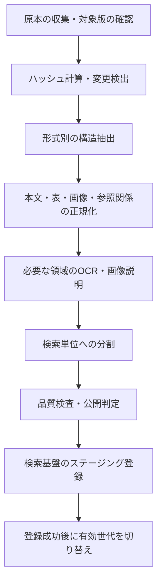

# 文書変換処理 詳細設計

| 項目 | 内容 |
| --- | --- |
| プロジェクト | 2026-file-scan：維持管理システムのナレッジ基盤 |
| 作成日 | 2026-10-12 |
| 設計レベル | 詳細設計案 |
| 実装状態 | 未実装。製品の具体的なバージョン、モデル、閾値は未選定 |
| 対象 | Office・PDF・テキスト・ソースから、検索可能な構造化データを作る処理 |
| 関連設計 | [検索基盤](02-search-platform.md)、[LLM＋チャット画面](03-llm-chat.md) |

## 1. 目的と責務

部署内の設計書、マニュアル、問い合わせ記録、障害対応記録、ソースを、根拠と対象版を追跡できるナレッジに変換する。

本処理は原本の収集、構造の抽出、画像の処理、検索単位への分割、品質検査、検索基盤への登録準備を担当する。検索順位の決定と回答生成は、それぞれ機能2・機能3が担当する。

共通モデルは「文書 → 章／シート → 本文・表・画像 → 検索単位」とする。原本を保持し、変換結果から原本の該当箇所に戻れることを必須とする。

## 2. 基本方針と適用範囲

- 文書の構造を抽出してから分割する。固定文字数だけで分割しない。
- Excelは複数シートを処理し、シート間の明示的な参照関係を残す。
- Wordの目次は本文見出しやリンク先と照合して利用する。
- 画面画像・図は、画像本体、抽出文字、説明、周辺本文を関連付ける。
- 原本からの抽出結果と、AIが生成した説明・推測を区別する。
- 部分的な抽出失敗を記録し、「未取得」と「原本に存在しない」を区別する。
- 初期はバッチで実行する。チャットの応答中に全文書を再変換しない。
- 原本を上書きしない。社内資料、画像、変換生成物の保管先はアプリのGitリポジトリとは分ける。

| 入力 | 初期の方式 | 補足 |
| --- | --- | --- |
| DOCX | Docling＋必要箇所のpython-docx／OOXML解析 | 目次、独自見出し、画像参照等を補完する |
| XLSX・XLSM | openpyxlを中心とする構造抽出 | 全シート、結合、書式、数式、参照を扱う。マクロは実行しない |
| PDF | Doclingを中心に文字・レイアウト・画像を抽出 | ページ／領域単位でOCRの要否を判定する |
| TXT・Markdown | 文字コードの判定と構造抽出 | 元の行位置を保持する |
| ソース・設定・SQL | Gitの対象コミットから読み取り、言語別の構造抽出 | 初期はファイル・識別子・行位置。関数等の抽出は対象言語に応じて追加 |
| DOC・XLS・PPT等の旧形式 | 作業コピーを対応形式に変換する経路を用意 | 変換エンジン、レイアウト差、対応範囲はPoCで決定 |
| PPTX | Doclingによるスライド単位の抽出を候補とする | 複雑な図形は画像化で補完。専用の詳細ルールは今後設計 |

Doclingなどの対応形式に含まれることと、各社内様式を十分に抽出できることは別に検証する。利用ライブラリを一つに統一することは要件としない。

## 3. 全体処理



| 段階 | 主な処理 | 出力 |
| --- | --- | --- |
| 収集 | 許可された保管場所・Gitコミットから作業コピーを取得 | 原本、収集情報、対象版 |
| 変更判定 | 原本ハッシュと変換設定を比較 | 再利用／再処理の判断 |
| 抽出 | 形式別に構造・内容・原本位置を取得 | 抽出ブロック、画像、参照 |
| 正規化 | 共通スキーマに変換し、読み順と親子関係を付ける | 構造化JSON |
| 画像処理 | OCR、画像分類、必要な視覚説明を生成 | OCR文字、画像説明、確認状態 |
| 分割 | 構造とトークン上限に基づき検索単位を作成 | チャンクJSONL |
| 検査 | 欠落・不一致・読取不能等を判定 | 品質レポート、公開状態 |
| 登録 | 機能2へ引き渡し、登録結果を確認 | 登録件数、失敗理由、有効世代 |

## 4. 識別子・版・データモデル

本節を機能1～3で共有する変換データの正本とする。DBの物理設計と検索APIの契約は機能2で定義する。

### 4.1 識別子と世代

| フィールド | 意味・生成方針 |
| --- | --- |
| `document_id` | 原本の論理ID。収集元の安定ID、または登録台帳で割り当てるID。ファイル内容ハッシュとは分ける |
| `source_version` | 原本バイト列のSHA-256。業務上のリリース番号とは分ける |
| `conversion_revision` | スキーマ、パーサー、OCR／画像モデル、プロンプト、正規化・分割設定等を正規化して算出するハッシュ |
| `generation_id` | `document_id`、`source_version`、`conversion_revision`の組に対する識別子 |
| `block_id` | 世代、要素種別、原本位置、読み順等から決める世代内の一意ID |
| `chunk_id` | 世代、参照ブロック、分割条件、分割順等から決める一意ID |
| `asset_id` | 保存する画像バイト列のハッシュ。同じ画像の処理を再利用するためのID |
| `occurrence_id` | 画像が文書中に現れる位置のID。同一画像でも節・位置が違えば別に保持する |
| `run_id` | 実行を識別するID。同じ世代の再試行でも別に記録する |

同一入力と同一設定での再実行は重複登録しない。ライブラリ更新や分割ルール変更時は、原本が同じでも別の変換世代を作る。埋め込みモデルの版と検索インデックスの世代は、機能2で別途管理する。

ファイル移動・名称変更は、収集元IDや台帳で同じ原本と判定できる場合に限り`document_id`を引き継ぐ。内容が同じという理由だけで、閲覧権限が異なる別原本を統合しない。

### 4.2 共通フィールド

| 分類 | 主なフィールド |
| --- | --- |
| 文書 | `document_id`、`title`、`format`、`source_uri`、`source_version`、`generation_id` |
| 業務上の対象 | `system_id`、`feature_ids`、`target_release`、`environment`、`document_type` |
| 日時・責任者 | `source_modified_at`、`effective_from`、`effective_to`、`collected_at`、`owner` |
| 構造 | `block_id`、`parent_id`、`element_type`、`reading_order`、`section_path` |
| 内容 | 原文、正規化テキスト、表構造、画像参照、OCR結果、画像説明 |
| 原本位置 | `source_locations`。形式別の位置を配列で持ち、複数ページにまたがる表等も表せる |
| 関係 | `relations`。参照先、関係種別、根拠、確定／候補を記録する |
| 品質 | `quality_flags`、`extraction_method`、`model_id`／版、必要に応じた確認者・確認日時 |
| 公開・権限 | `artifact_type`、`publication_state`、`acl_ref`、業務上の原本状態 |

必須の識別子・原本位置が欠けるデータは公開しない。対象リリース・適用時期などが不明な場合は不明として保持し、更新日から推測して補わない。文書の更新日、収集日、仕様の適用時期は別項目とする。

### 4.3 内容の由来と公開状態

- `artifact_type=source`：原本からの本文・表・OCR等の抽出結果。抽出誤りがないことを保証する区分ではない。
- `artifact_type=derived`：画像モデルによる説明、AI要約、推定した関係等。元ブロックへの参照と生成方法を必須にする。
- `publication_state`：`draft`（未確認）、`reviewed`（確認済み）、`published`（検索公開）、`excluded`（対象外）。

公開は原本の権限と品質条件を満たした範囲で行う。正常な原文抽出は設定した品質条件を満たした場合に公開できる。初期案では、画像モデルが生成した説明は`derived/draft`で保存し、確認後に公開する。自動公開の範囲拡大は実物評価後の判断とする。

廃止文書などの業務上の状態と、変換データの公開状態は分ける。過去版の検索を許可する場合も、対象版を明示する。

### 4.4 原本位置

| 形式 | 保持する位置 |
| --- | --- |
| Excel | シート名、セル範囲、表／画像の識別子、画像のアンカー位置 |
| Word | 章・節のパス、ブックマーク等、世代内の段落／表／画像位置 |
| PDF | 物理ページ番号、利用可能なら印刷上のページラベル、矩形領域、座標系・回転情報 |
| テキスト・コード | パス、行位置。コードはリポジトリとコミットも保持 |
| 生成PDF | 元文書と生成PDFの対応、レンダラー・フォント等の環境識別、生成PDFのハッシュ、ページ・領域 |

DOCXのページは表示環境で変わり得るため、目次のページ番号だけで原本位置を確定しない。原本位置と変換後のプレビュー位置を混同しない。

## 5. Excelの変換アルゴリズム

### 5.1 全シートの棚卸し

1. 全シートの名称・順序・表示状態を収集する。選択中のシートだけを処理しない。
2. セル内容、結合範囲、書式、コメント、リンク、名前付き範囲、表定義、画像・図形等の有無を調べる。
3. 値や実際のオブジェクトが存在する領域を求める。書式だけで膨らんだ最終行・列を、そのまま全文走査の範囲にしない。
4. 「目次」「用語」「機能一覧」「項目定義」「操作手順」等の役割を、名前と内容から分類する。推定結果は候補として保持する。
5. 非表示シート・行・列も棚卸しに含め、内容の取り込み可否は設定で制御する。初期の公開対象は可視部分を基本とし、非表示部分の扱いは資料責任者と決める。

### 5.2 シート内の領域判定

明示的な表・名前付き範囲を手掛かりとし、結合セル、罫線、繰り返し見出し、内容、空白、印刷範囲等を組み合わせる。空行だけで領域を分割しない。

| 領域種別 | 主な特徴 | 正規化方針 |
| --- | --- | --- |
| 一覧表 | 列見出しと同型の行が続く | 行・列・多段見出し・単位・注記を保持 |
| 帳票・項目定義 | ラベルと値、結合セル、複数の小表 | 見出しと値の対応を保持 |
| 説明・操作手順 | 番号、文章、箇条書き | 手順順序と所属見出しを保持 |
| 画像・図 | セル上の画像、図形、矢印等 | 位置と周辺セルを関連付け、画像処理へ渡す |
| ナビゲーション | シートへのリンク、目次 | 構造情報・参照関係として保持 |

判定が曖昧な場合は無理に表に変形せず、セル位置付きの内容を残し、確認対象にする。様式別の設定で「表題の行」「見出しの行」「領域境界」を上書きできるようにする。

### 5.3 結合・書式・数式

- 結合範囲と左上セルの値を保存する。検索用の見出しは展開できるが、原本で空欄のセルを一律に前値で埋めない。
- 多段見出しは階層として復元する。例：「入力条件 → 最大桁数」。
- 値、型、表示書式を保存し、日付、単位、先頭ゼロ等の表示上の意味を検証する。
- 数式文字列と保存済み計算結果は別に取得する。openpyxlによる再計算は行わない。
- 保存済み計算結果がない数式セルは、空欄と区別して品質フラグを付ける。結果の鮮度が確認できない場合も断定しない。
- 数式参照・内部リンク・画面ID等の明示的な参照をシート間の関係として保存する。数式参照だけで業務上の依存関係を確定しない。
- 外部ブック参照先は、別途許可された収集対象である場合に限り取得する。

### 5.4 分割とシート間の検索

1. ブックの目録とシート別の構造情報を作る。
2. 表は行のまとまりで分割し、各チャンクに表題、多段見出し、単位、必要な注記を付ける。
3. 検索用テキストにはブック名、シート名、所属見出しを加える。原文とは別に生成する。
4. 目次リンク、画面ID、機能ID、項目ID等で関連領域を接続する。名前だけの曖昧な一致は候補とする。
5. 機能2がヒット箇所に応じて関連領域を取得できるようにする。全シートを一つの巨大なチャンクに連結しない。

例：機能一覧、ユーザー登録、項目定義、エラー一覧の各シートを、画面ID・項目ID等で結ぶ。登録画面の必須項目を尋ねられた場合は、操作説明と対応する項目定義を取得する。

## 6. Wordの変換アルゴリズム

### 6.1 本文構造の抽出

1. 段落、表、画像参照を本文の順序に沿って取得する。段落一覧と表一覧を単に後から連結しない。
2. 見出しスタイル、スタイル継承、段落のアウトラインレベル、番号定義を調べる。
3. 見出しの階層を作り、各要素を所属する章・節に割り当てる。
4. 構造情報が不足する場合は、章番号、文字の大きさ、太字、段落前後の余白等を補助情報にする。推定した階層は根拠と確認状態を残す。
5. テキストボックス、浮動図形、変更履歴等を検出する。取り込む表示状態を設定で決め、対応できない要素を報告する。

初期案では本文は現在の表示内容を基本とし、コメントと変更履歴は別要素として扱う。未確定の修正を承認済み仕様に混ぜない。具体的な変更履歴の読み方は代表資料で確定する。

### 6.2 目次の利用

1. 自動目次のフィールド・保存された項目、手動目次、関連リンクを検出する。
2. リンク先／ブックマークがあれば本文要素と直接対応付ける。
3. 直接参照がない場合は、章番号、正規化した見出し文字列、階層、出現順を照合する。
4. 同名の見出しが複数ある場合は、上位章と順序も使う。対応を一意に決められない場合は未解決とする。
5. 本文から得た階層と目次の階層を比較し、不一致を記録する。

| 状況 | 対応 |
| --- | --- |
| 目次と本文が一致 | 章の索引とナビゲーションとして利用 |
| 本文にある見出しが目次にない | 本文を保持し、目次の欠落を報告 |
| 目次にある見出しが本文にない | 未解決参照として記録。本文を生成しない |
| 名称・階層・順序が異なる | 不一致を記録し、曖昧な箇所は確認対象にする |
| 目次がない／画像の目次だけ | 本文の構造を優先。必要なら目次画像のOCRを補助利用 |

目次のページ番号だけで章の境界を決めない。取り込み処理による原本目次の自動更新や原本の保存は行わない。目次自体は主にナビゲーション要素として保持し、本文の回答根拠との重複を抑える。

### 6.3 節・表・画像の関連付け

- 確定した章・節単位で本文、表、画像、注記をまとめる。
- キャプションや「図3参照」等の明示的な参照を優先し、所属節・位置・前後の文章を補助情報として関連付ける。
- 本文内のアンカーと実際の見た目が離れる浮動図形は、ページのレンダリングも用いて確認する。
- 長い節だけを細分化し、各チャンクに上位章・節のパスを付ける。
- 手順、表の一行、図と直結する説明を不必要に切り離さない。

## 7. PDFの変換アルゴリズム

1. ページ数、文字レイヤー、レイアウト、画像・図形を調べる。
2. ページ／領域ごとに抽出文字の有無、文字化け、読み順等を確認する。
3. 文字が利用できる部分は文字抽出を使い、画像部分や文字が読めない領域にはOCRを適用する。
4. 見出し、段組み、表、図、キャプションを整理する。しおりや目次がある場合は本文と照合する。
5. 複数ページに続く表・手順を、見出しや列構造等に基づいて関連付ける。ページ境界だけで切らない。
6. 画像やベクトル図形を含む画面・図は、必要に応じて領域を画像化する。
7. 原本ページと矩形領域を保持し、原本プレビューから該当箇所を確認できるようにする。

繰り返しのヘッダー・フッターは本文から分離するが、版情報等は文書メタデータに残す。既存の文字抽出とOCRが同じ領域を表す場合は重複を整理し、座標対応を失わないようにする。

## 8. 画面画像・図の処理

### 8.1 画像の取得

- 埋め込み画像は元画像を保存し、必要に応じて見えている領域の画像も保存する。
- PDFの複数画像・図形からなる図や、Wordの図形・矢印の組み合わせは、まとまりをレンダリングして取得する。
- 画像参照だけでは再現できない場合はページ画像から切り出す。切り出し座標と生成方法を記録する。
- 同じ画像のOCR等は`asset_id`で再利用できる。ただし文書内の出現位置と周辺文脈は`occurrence_id`ごとに残す。
- ロゴ等の装飾と、画面・表・関係図を分類する。除外した画像も件数と理由を記録する。

### 8.2 OCRと視覚説明

| 画像種別 | OCRで取得する内容 | 視覚説明で補う内容 |
| --- | --- | --- |
| 操作画面 | 画面名、ラベル、ボタン、エラー文、表示値 | 配置、表示状態、注釈との関係 |
| フロー図 | 処理名、条件、矢印上の文字 | ノード、方向、分岐、処理の関係 |
| 構成図 | システム名、接続名等 | 要素と接続の関係 |
| 表画像 | 見出し、値、注記 | 行列の構造。本文の表と同様に扱う |

OCR文字、画像モデルの説明、周辺本文は別フィールドで保存する。小さい文字の再読取や領域拡大を再試行できるようにする。モデルが判読できない箇所は不明のまま保持する。

画像に見える必須マークから、サーバー側の入力検証を確定しない。ボタンの存在から、クリック後の保存処理や権限制御を推測して仕様にしない。モデル自身が出す自信の数値を正確性の保証として使わない。

### 8.3 文脈と検索への連携

所属節、図題、図番号、画面ID、明示的な本文参照を用いて画像を関連付ける。単純に直前の段落へ割り当てる方式だけには依存しない。

OCR文字と公開済みの画像説明は、それぞれ由来を保持した検索単位にする。各単位に文書名・所属節と関連本文の参照を付け、`source`と`derived`を一つの由来ラベルで平坦化しない。画像本体はファイル保管先に置き、検索結果にはその識別子を返す。回答時に画像が必要な場合のLLMへの受け渡しは機能3で扱う。

部分レコードの例（値は説明用であり、実データではない）：

```json
{
  "document_id": "doc-example-001",
  "element_type": "figure",
  "section_path": ["3. ユーザー管理", "3.2 ユーザー登録"],
  "ocr_text": "ユーザーID 氏名 所属 登録 キャンセル",
  "observations": ["ユーザーIDの横に必須と表示されている"],
  "related_text": "ユーザーIDは半角英数字で最大20文字と本文に記載されている",
  "artifact_type": "derived",
  "publication_state": "draft",
  "source_locations": [
    {"format": "docx", "paragraph_index": 34, "figure_index": 2}
  ]
}
```

実データではOCR・元画像の`source`ブロックを独立して保持し、上記の説明用`derived`レコードから参照する。生成説明に原文を混ぜて上書きしない。

## 9. チャンク生成

- トークン上限は設定値とし、埋め込みモデルと回答時の入力上限を踏まえて評価で決める。
- 見出し、段落、手順、表、画像と説明のまとまりを優先する。
- 大きい表には表題・列見出し・単位を再付与する。複数ページ・領域にまたがる場合は全原本位置を保持する。
- 原文と、見出し等を加えた検索用テキストを区別する。
- 各チャンクに参照ブロック、親要素、対象版、公開状態、権限参照を付ける。
- チャンク内の内容は同じ`artifact_type`で構成する。複数ブロックを含める場合は、内容と各ブロック・原本位置の対応を保持する。別由来の説明や関連本文は別のチャンクとして参照する。
- 隣接・関連チャンクの取得は機能2に任せ、全関連資料の全文を一律に複製しない。

問い合わせ・障害記録は、症状、発生条件、対象環境、原因、暫定対応、恒久対応、結果の単位を保持する。原因の仮説と確定事項を区別する。AIで構造化した内容は`derived`として元記録にひも付ける。

## 10. 品質検査と例外処理

| 検査 | 判定・処理 |
| --- | --- |
| 件数・範囲 | 予定したシート・ページと処理済み範囲を比較。画像・図形の棚卸しと抽出結果の差を記録 |
| 章構造 | 目次と本文の不一致、未解決リンク、重複見出しを記録 |
| 表 | 列対応、見出し、結合、注記、ページ間の継続を検査 |
| OCR | 読取不能、文字化け、重要な数字・コードの不一致等を確認対象にする |
| 原本位置 | 位置が原本の範囲内か、プレビューに対応するかを検査 |
| 参照 | 存在しない親・関連ブロック・画像への参照を検出 |
| 公開・権限 | 必須メタデータ、権限参照、公開条件を確認 |

パスワード保護、破損、未対応形式、未対応オブジェクト、変換タイムアウト、モデル/API障害は分類して記録する。一時的な障害は回数を制限して再試行し、入力不備は理由を残して停止する。再試行上限とタイムアウトは運用環境で決める。

実行状態は`queued / running / succeeded / partial / failed / cancelled`とする。公開状態とは別に管理し、要確認箇所や生成説明のレビュー待ちも品質レポートに含める。

部分失敗時は初期設定で自動公開しない。確認者が公開可能な範囲と不足を承認した場合に限り部分公開できる。その場合、検索・回答側にも対象資料の抽出不足を伝える。

## 11. 出力と検索基盤への引き渡し

| 出力 | 内容 |
| --- | --- |
| マニフェストJSON | 原本情報、対象版、変換世代、実行状態、件数、品質情報 |
| 構造化JSON | 本文・表・画像のブロック、親子関係、原本位置、関連参照 |
| チャンクJSONL | 検索用テキスト、参照ブロック、公開状態、権限参照 |
| 画像・プレビュー | 元画像、必要な領域画像、生成PDF等 |
| 確認用Markdown | 人が抽出内容を確認するための出力。正本は構造化JSON |
| 品質レポート | 件数、欠落、未対応要素、不一致、レビュー対象 |

アプリから参照する保管先は設定で決める。変換結果内には、原本ファイルのコピーや秘密情報を含む接続認証情報を埋め込まない。

機能2はステージング世代を登録し、必要な件数・参照・権限・索引を確認してから、有効な公開世代を切り替える。失敗した世代を現行として公開しない。

原本の変更を検知して再変換に失敗した場合は、旧世代が最新ではないことを台帳に残す。初期案では旧世代を現行検索から外し、明示的な過去版調査に限って参照する。原本削除・権限変更は、変換の成功を待たずに検索公開とプレビューアクセスへ反映する。

## 12. 実装単位と設定

| 論理モジュール | 責務 |
| --- | --- |
| Collector | 原本の収集、対象版・権限情報の取得 |
| ChangeDetector | ハッシュ、設定版、再利用判断 |
| FormatParser | Excel／Word／PDF／テキスト／コードの形式別抽出 |
| StructureNormalizer | 共通モデル、階層、読み順、原本位置 |
| ImageProcessor | 画像化、OCR、視覚説明、処理キャッシュ |
| ChunkBuilder | 構造に基づく分割 |
| QualityGate | 品質判定、部分失敗、公開条件 |
| Exporter | JSON、JSONL、Markdown、レポートの出力 |
| IndexPublisher | 機能2への登録要求と結果確認 |

一つのPythonプロジェクト内で実装を開始できる。初期から各モジュールを独立した常駐サービスにする必要はない。検索APIとは実行経路を分ける。

設定項目は、収集対象、対象版、除外規則、シート／行／列の公開方針、様式別抽出ルール、OCR言語、モデル・プロンプト版、分割条件、品質条件、再試行条件、保管先とする。設定変更もGitで管理し、認証情報は別途注入する。

## 13. PoCの受入観点

| ケース | 確認する結果 |
| --- | --- |
| 複数シートの設計書 | 全対象シートを処理し、セル範囲と関連シートをたどれる |
| 結合・多段見出し・空行のある表 | 見出しと値の対応を保持し、空行だけで誤分割しない |
| 数式・保存済み結果欠落 | 数式と結果を区別し、未取得を空欄と混同しない |
| 自動／手動／古い目次 | 本文と照合し、不一致を記録する |
| 目次なし・同名見出し | 本文を取り込み、曖昧な対応を確定しない |
| Wordの浮動画像・図形 | 取り込みまたは画像化で補完し、未対応を検知する |
| 文字PDF・画像PDF・混在PDF | 領域に応じて文字抽出とOCRを使い分ける |
| 画面画像だけにあるラベル | 検索でき、原画像と周辺説明に戻れる |
| 図にない動作の質問 | 画像説明に動作仕様を創作しない |
| 再実行・設定変更 | 重複登録せず、必要な世代だけを再生成する |
| 部分失敗・更新失敗・削除・権限変更 | 不完全／古いデータを現行として誤公開しない |

代表資料について、原本と抽出結果を人が比較する。抽出漏れ、表の誤対応、OCR誤り、参照位置、処理時間・費用を測る。合否の数値は資料の難易度と業務上の重要性に応じてPoC開始前に決める。

## 14. 未決事項

- 対象システム、ソース言語、対象リリースと本番コミットの対応。
- 実ファイル量、最大サイズ、更新頻度、保管場所、原本・プレビューの表示方式。
- 社内Excel／Word様式ごとの例外ルールと、非表示部分・変更履歴の扱い。
- Docling等の具体的なバージョン、旧形式の変換エンジン、レンダリング環境。
- 日本語OCR、画像対応モデル、外部API利用可否、モデル・画像処理の実行環境。
- 分割条件、品質閾値、公開レビューの担当者と許容する自動公開範囲。
- 利用者別権限との接続、保管期間、処理性能・費用の許容値。

## 15. 参考資料

以下は方式検討に用いた公式資料。仕様の確認日：2026-10-12。採用バージョンの確定時に、実際の対応範囲を再確認する。

- [Docling：対応形式](https://docling-project.github.io/docling/usage/supported_formats/)
- [Docling：文書モデル](https://docling-project.github.io/docling/concepts/docling_document/)
- [Docling：チャンク分割](https://docling-project.github.io/docling/concepts/chunking/)
- [Docling：画像の出力](https://docling-project.github.io/docling/_generated/examples/export_figures/)
- [Docling：画像説明APIの例](https://docling-project.github.io/docling/_generated/examples/pictures_description_api/)
- [openpyxl：読み込み・複数シート等](https://openpyxl.readthedocs.io/en/stable/tutorial.html)
- [openpyxl：数式](https://openpyxl.readthedocs.io/en/stable/simple_formulae.html)
- [python-docx：スタイル](https://python-docx.readthedocs.io/en/latest/user/styles-understanding.html)
- [Microsoft：Word文書の構造](https://learn.microsoft.com/en-us/office/open-xml/word/structure-of-a-wordprocessingml-document)
- [Microsoft：アウトラインレベル](https://learn.microsoft.com/en-us/dotnet/api/documentformat.openxml.wordprocessing.outlinelevel)
- [Microsoft：目次の更新](https://support.microsoft.com/en-us/word/update-a-table-of-contents)
