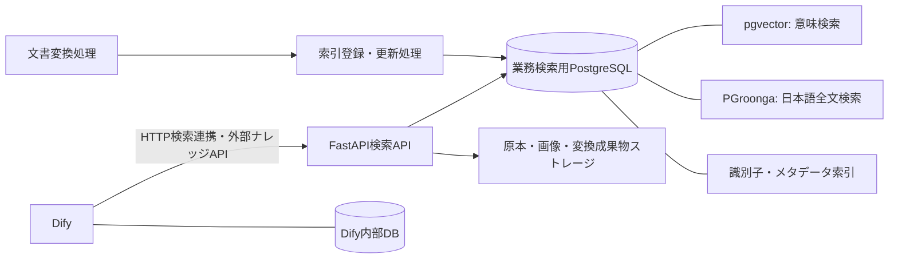

# 検索基盤 概要設計

- 作成日: 2026-10-12
- 状態: 設計案・未実装
- 対象: 部署内の維持管理システムに関する文書・ソースコードの検索
- 前提: PostgreSQLにpgvectorとPGroongaを導入できる実行環境を確保する

本書は、変換済みの文書・コードから質問の根拠を探し、Difyへ返す検索基盤の案を示す。記載する構成、API例、データモデルは実装済みの仕様ではない。製品・拡張の採否、組み合わせる版、Embeddingモデル、検索パラメータ、SSO・ACLの方式、性能目標はPoCで確認して決定する。検索精度や実行性能を保証するものではない。

## 1. 目的と責任範囲

検索基盤は、日本語の説明から探す検索と、関数名・テーブル名・エラーコードなどを指定する検索を組み合わせる。質問に関連する小さな抜粋に加え、必要な親見出し、表のヘッダー、画像の位置、関連シートなどの情報を取得し、回答の根拠を原本まで追跡できるようにする。

入力ファイルの変換と、その成果物の共通仕様は[文書変換設計](01-document-conversion.md)を正本とする。本書は変換済み成果物を受け取り、検索用データと索引を構築する。回答生成、会話履歴、相談画面の設計は[LLM・チャット設計](03-llm-chat.md)に分ける。

| 機能 | 検索基盤での責任 |
| --- | --- |
| 検索用データの登録 | 変換成果物を検証し、チャンク、メタデータ、ベクトル、全文索引を準備する |
| 検索 | 文書の意味検索、日本語全文検索、識別子一致検索を組み合わせる |
| 公開・権限判定 | 対象版、公開状態、ACLをサーバー側で制約し、閲覧可能な根拠だけを取得する |
| 文脈の補完 | 親子ブロック、表、関連シート、画像情報を必要な範囲で追加取得する |
| 原本の参照 | ページ、シート・セル、見出し、ファイル・行などの原本位置を返す |
| 回答生成 | 検索基盤では行わず、Dify側へ根拠を渡す |

## 2. 構成案



| 構成要素 | 役割・設計上の扱い |
| --- | --- |
| 業務検索用PostgreSQL | 文書管理情報、抽出世代、チャンク、関連情報、ACL、検索索引を保持する |
| pgvector | 文書・チャンクのEmbeddingを保持し、質問との意味的な近さによる候補を探す |
| PGroonga | 日本語の本文、見出し、用語、障害メッセージなどの全文検索に使用する候補 |
| 識別子索引 | 関数名、クラス名、テーブル名、エラーコード、パスなどを文字列として検索する |
| FastAPI | Dify向けAPI、入力検証、接続認証、検索範囲の決定、検索結果の組み立てを担う |
| 外部ストレージ | 原本ファイル、画像、レンダリング結果などの実体を保持する。DBは参照情報を保持する |
| Dify | 質問の受付、外部ナレッジ検索の呼び出し、取得根拠を使った回答生成を担う |

業務検索DBとDify内部DBは、データモデル、認証情報、移行、バックアップの責任を論理的に分離する。同じPostgreSQLサーバーに配置するか、別サーバーとするかは未決とする。Dify内部のテーブルや索引へ直接書き込む構成には依存しない。

PostgreSQL、pgvector、PGroongaの対応版と同居動作、導入権限、バックアップ・復旧手順を事前検証する。利用予定のマネージドサービスなどで拡張を導入できない場合は、この構成案の採否から見直す。

## 3. 変換成果物との共通契約

変換成果物の詳細は文書変換設計を参照する。検索側は少なくとも次の情報を受け取り、原本と抽出世代を区別して管理する。

| 項目 | 意味・制約 |
| --- | --- |
| `document_id` | 原本の論理ID。同じ文書の更新を追跡するために維持する |
| `source_version` | 原本内容のハッシュ。業務システムのリリース番号とは区別する |
| `conversion_revision` | 変換設定・処理仕様の版。同じ原本を再変換した場合の違いを識別する |
| `block_id` / `chunk_id` | 原本の版と変換世代に紐づくID。別世代の内容へ無条件に使い回さない |
| `artifact_type` | `source` または `derived`。原本に由来する抽出内容と、要約・説明などの派生成果物を区別する |
| `publication_state` | `draft` / `reviewed` / `published` / `excluded`。検索公開は`published`だけを対象とする |
| 原本位置 | 原本パス、ページ、見出し、シート名・セル範囲、コードの行など、形式に応じた参照情報 |
| 関連情報 | 親子ブロック、表ヘッダー、関連シート、画像などを結ぶ情報 |
| 対象システム・業務版 | システム名、機能、適用リリース、適用期間など。原本ハッシュとは別の検索条件 |
| 権限情報 | 原本の閲覧範囲とその更新情報。生成された派生成果物にも原本の制約を引き継ぐ |

現行検索の対象は、原本が利用可能で、サーバーが選択したactiveな抽出世代に属し、公開状態が`published`である内容に限る。明示的な履歴検索では、指定した業務版・期間に対応する公開済み旧世代をサーバーが文書ごとに選択する。全旧世代を一律に混ぜず、同一原本の同一対象版では採用する変換世代を一つに決める。履歴の原本スナップショットにも閲覧権限を適用する。

`reviewed`はレビュー済みを表すが、検索公開済みを意味しない。派生成果物も公開判定を経てから利用し、原本からの直接引用と混同しない。

`document_id`、`source_version`、`conversion_revision`の組み合わせで抽出世代を識別し、文書変換処理が付与した`generation_id`を使用する。Embeddingのモデル名、モデル版、次元数、前処理設定は別の`embedding_profile_id`で管理する。異なるモデルのベクトルを同じ検索空間へ混在させない。

## 4. 検索処理の概要

### 4.1 検索範囲の確定

検索APIはリクエストを受け取った時点で、接続元が利用可能なナレッジ、対象システム・業務版、公開状態、検索モードに応じた採用世代、閲覧範囲を決定する。この条件は意味検索、全文検索、識別子検索のすべてに適用する。権限を持たない本文を取得した後でDifyやLLMに隠す方式は採用しない。

利用者が指定する版・機能・文書種別などの条件は検索を狭めるために使用し、サーバーが確定した閲覧範囲を広げることは認めない。`knowledge_id`や任意のメタデータ条件だけを権限の証明として扱わない。

通常は指定した現行業務版を対象とする。過去の障害確認などで履歴を検索する場合は、明示的な対象版・期間と閲覧範囲に従う。現行検索の結果へ古い版を無表示で混ぜない。

### 4.2 候補検索

| 経路 | 主な対象・狙い | 注意点 |
| --- | --- | --- |
| 文書の意味検索 | 表現が異なる質問と設計書・手順・障害記録の内容を結び付ける | 日本語、業務用語、長い表、短いコード片での適合性を評価する |
| 日本語全文検索 | 正式名称、製品名、固有のメッセージ、業務用語を含む箇所を探す | 表記揺れ、トークナイザー、正規化、検索式は実データで調整する |
| 識別子一致検索 | 関数・クラス・テーブル・項目名、エラーコード、ファイルパスを探す | 大文字小文字、記号、アンダースコアを一律に除去しない |

質問は元の文字列を保持しつつ、必要に応じて自然言語部分と識別子候補を取り出す。識別子の完全一致を優先できるようにし、部分一致や別名展開を追加する場合は誤一致を評価する。全文検索と識別子一致検索の評価値を、ベクトル距離とそのまま足し合わせない。

各経路で候補数に上限を設け、同じ`chunk_id`の重複をまとめる。利用者が指定する`top_k`と、内部の候補取得数は別に管理する。`top_k`にはサービス側の上限を設定する。

### 4.3 順位統合と文脈取得

候補の順位統合にはrank fusionを使う案とし、実装候補をRRF（Reciprocal Rank Fusion）とする。各検索経路での順位を使って統合するため、異なる尺度の生スコアを直接比較する必要を減らせる。経路ごとの重み、RRFの定数、候補数、同一文書の占有上限は未決であり、評価で決める。

必要であれば、閲覧可能な候補だけを対象に再ランキングを追加する。モデルや外部サービスに送る場合は送信先の許可範囲を確認し、候補抜粋のみに制限する。検索の都合で原本全文をLLMへ一括送信しない。

順位統合後、次の情報を必要な範囲で補完する。補完する本文・画像・関連シートにも同じ公開状態とACLを適用する。

| 取得する文脈 | 例 |
| --- | --- |
| 親ブロック | 小さな段落が属する見出し、手順の前提、関数を含むクラス情報 |
| 子・隣接ブロック | 手順の続き、表の注記、コードの周辺行 |
| 表・関連シート | 列ヘッダー、単位、シート名、対応するセル範囲、明示された参照先 |
| 画像情報 | キャプション、OCR結果、画像参照、元のページと位置 |
| 原本参照 | 文書名とページ、Excelのシート・セル、コードのパス・行・コミット |

関連情報が存在することは、その内容を回答根拠として取得してよいことを意味しない。取得件数とテキスト量に上限を設け、無関係な親文書やワークブック全体へ展開しない。画像参照を返すだけでDifyやLLMが画像を自動的に読めるとは想定せず、画像を実際に使う経路はLLM・チャット設計で検証する。

補完した根拠も、本文・ブロックID・由来・原本位置の対応を維持する。異なる`artifact_type`や原本位置の内容は、区別できるレコードまたは根拠部分として返す。生成説明を原文の引用へ連結しない。

### 4.4 コード検索の補完

初期段階は、コードの文字列・識別子検索と、該当箇所の原文取得を組み合わせる。検索対象のリポジトリ、ブランチ、コミットを記録し、パスと行を原本位置として返す。原本ハッシュは`source_version`に保持し、Gitコミットはコード固有のメタデータとして別に保持する。

関数単位の分割、定義・参照解析、呼び出し関係、テーブル利用箇所の追跡などは、対象言語と必要な相談内容を確認して段階導入する。文字列一致だけで変更影響の全体が分かるとは扱わず、動的呼び出し、設定値による分岐、外部システム連携などの未確認箇所を残せるようにする。

## 5. データモデルと別資料

テーブル一覧、カラム、主キー・外部キー、一意制約、索引、登録・公開トランザクションは[DBテーブル設計](04-database-tables.md)を正本とする。本書では検索処理とAPIの責務を定義し、テーブル定義を重複管理しない。

| 管理対象 | 主な構造 |
| --- | --- |
| 原本・版・予定資料 | 原本台帳、原本スナップショット、検索範囲に登録した収集対象 |
| 採用版 | 業務リリースと原本ごとの要求版・採用変換世代・準備状態 |
| 根拠・検索 | 文書ブロック、チャンクとの本文対応、画像出現、関連参照、ベクトル |
| 権限・運用 | 原本ACL、接続元の許可範囲、実行試行、検索監視記録 |

本書でいうactiveな世代は、DBでは対象リリースの対応表が採用した世代を意味する。単独の世代フラグで全リリースの現行状態を表さない。予定資料は変換成功前から台帳に置き、未取得・更新失敗も不足の集計へ含める。

Embeddingモデルを変更する際は別のプロファイルで再生成し、完成前のベクトルを現行検索へ混在させない。意味検索の索引方式は、正確な近傍検索と近似近傍索引を比較して決定する。近似近傍検索と絞り込みを併用した際の候補不足・再現率も検証対象とする。

## 6. Difyとの外部ナレッジAPI契約案

公式External Knowledge APIを基に、FastAPI側で`POST /retrieval`を提供する。ここで示す必須項目に加え、サーバー側で型、文字列長、候補数、条件名・演算子の許可リストを検証する。Difyの採用版で契約を再確認する。

標準APIの`records`だけでは、ヒットしない資料の更新失敗・抽出不足を伝えられない。そのため本システムのChatflow向けには、6.4の状態付き検索APIをHTTP Requestノードで呼び出す構成を採用案とする。両APIは同じ検索処理を使用し、Chatflowから同一質問を二重検索しない。

```http
POST /retrieval
Content-Type: application/json
Authorization: Bearer <接続用APIキー>
```

### 6.1 リクエスト

| 項目 | 必須 | 本構成での扱い |
| --- | --- | --- |
| `knowledge_id` | 必須 | 接続先のナレッジ識別子。APIキーに許された範囲かサーバーで照合する |
| `query` | 必須 | 質問文。質問中の命令を検索範囲変更の権限として扱わない |
| `retrieval_setting.top_k` | 必須 | 最終的な返却件数の上限。サービス上限内に制限する |
| `retrieval_setting.score_threshold` | 必須 | Dify互換スコアの閾値。0〜1の範囲を検証する |
| `metadata_condition` | 任意 | 対象版などの追加条件。権限を緩める用途には使用しない |

```json
{
  "knowledge_id": "maintenance-shared-poc",
  "query": "日次締め処理で E1203 が発生する条件は何か",
  "retrieval_setting": {
    "top_k": 5,
    "score_threshold": 0.3
  },
  "metadata_condition": {
    "logical_operator": "and",
    "conditions": [
      {
        "name": "target_release",
        "comparison_operator": "is",
        "value": "current"
      }
    ]
  }
}
```

件数と閾値は説明用の値であり、推奨設定や性能保証ではない。`current`はAPI側が管理する業務版の対応表から解決する例であり、原本ハッシュを意味しない。`metadata_condition`の利用方法はDifyの採用版・接続経路で検証し、必ず送信されるとは想定しない。

### 6.2 レスポンス

```json
{
  "records": [
    {
      "content": "【原本由来の抜粋】日次締め処理の E1203 は、対象日の締め状態が確定済みの場合に返す。",
      "score": 0.82,
      "title": "日次締め処理設計書 / エラー条件",
      "metadata": {
        "document_id": "doc-example-001",
        "source_version": "sha256:<原本ハッシュ>",
        "conversion_revision": "sha256:<変換設定等のハッシュ>",
        "generation_id": "generation-example-001",
        "chunk_id": "chunk-example-001",
        "block_ids": ["block-example-001"],
        "artifact_type": "source",
        "publication_state": "published",
        "quality_flags": [],
        "target_release": "release-example",
        "source_locations": [
          {
            "format": "pdf",
            "path": "design/daily-close.pdf",
            "page": 12,
            "heading": "4.2 エラー条件"
          }
        ],
        "related_assets": []
      }
    }
  ]
}
```

文書名・本文・スコア・IDはすべて架空の説明用データである。各レコードの`content`はDifyへ渡す根拠抜粋、`title`は表示用タイトル、`metadata`は原本追跡用のオブジェクトとする。該当なしはHTTP 200と`{"records": []}`を返す。`metadata`は`null`にしない。

返却レコードは一つの由来と追跡可能な原本位置に対応させる。別の原本位置や由来を補完する場合はレコードを分け、関連IDで結ぶ。説明用の例は一つの位置だが、複数ページに続く一つの表などは`source_locations`を配列で保持する。派生成果物には元ブロックへの参照を付ける。

`score`は順位統合などの内部評価値を0〜1へ変換したDify互換の値とする。真の関連確率、回答の正答率、原本の信頼度を意味しない。変換方式と閾値は評価で決め、変更時に版を管理する。質問内での単純な最大値正規化だけに依存すると質問間で閾値の意味が変わり得るため、候補の少ない質問や関連文書のない質問も含めて調整する。

原本へのリンク生成と閲覧時にも権限を照合する。ストレージ参照や任意のメタデータがDifyの画面に自動表示されるとは想定せず、引用表示と取得方法は採用版で検証する。長期有効な公開URLを返す必要はなく、認可された原本閲覧経路へ案内する。

入力不正、認証失敗、ナレッジ範囲の拒否、検索処理の失敗は、検索結果なしと区別してHTTPエラーを返す。エラー本文やログに秘密情報・原本文面を含めない。Difyから見たエラー表示とリトライ動作は結合試験で確認する。

### 6.3 接続認証と利用者別ACL

Difyの標準外部ナレッジAPIでは、設定したBearer APIキーと検索条件を受け取る。共有キーはDifyから検索APIへの接続を認証するためのものであり、質問した利用者の本人性を証明しない。標準リクエストへ利用者identityやSSO情報が自動的に伝播する前提は置かない。

PoCは、参加者全員が同じ資料を閲覧できるナレッジ範囲に限定する。検索API側で共有キーと許可された`knowledge_id`・範囲を結び付け、その範囲外のデータを検索しない。この制約が成り立たない資料を同じPoCナレッジへ登録しない。

本番で利用者別ACLが必要な場合は、信頼できる認証・認可の経路を別途設計する。SSOで認証した主体をバックエンドで検証し、検索時の主体・グループを改ざんできない形で確定する必要がある。署名付き主体情報を検証するゲートウェイ、認証済みバックエンドからの検索呼び出し、信頼境界を設けたDify連携などを検討候補とし、採用経路は未決とする。プロンプト、任意の`filters`、`metadata_condition`内の利用者IDをそのまま信用する方式は採用しない。

利用者別の経路が確立するまでは、利用者ごとに閲覧範囲が異なる本番運用へ進めない。親子情報、関連画像、原本表示、キャッシュ、ログ、会話履歴にも同じ権限制約を適用する設計が必要となる。

### 6.4 抽出不足・更新失敗を伝える状態付き検索

本システム用の`POST /search-with-status`を採用案とする。標準の外部ナレッジAPIとは別の契約として、DifyのHTTP Requestノードから呼び出す。リクエストは6.1の検索条件を基本とし、レスポンスは次の形とする。値は説明用である。

```json
{
  "records": [],
  "retrieval_status": {
    "snapshot_id": "snapshot-example-001",
    "coverage_state": "incomplete",
    "pending_updates": 1,
    "failed_documents": 0,
    "partial_documents": 0,
    "message": "対象範囲に更新処理待ちの資料があるため、検索できる根拠が不足しています。"
  }
}
```

- `records`の各要素は6.2と同じ形式とし、本文・由来・出典を保持する。
- `retrieval_status`は同じ検索範囲・業務版・世代の状態を返す。検索結果と状態が別時点にならないよう、台帳と採用世代を整合した読み取りとして扱う。
- `coverage_state`は`complete / incomplete / unknown`を候補とする。`complete`は台帳に登録した収集対象の予定処理が完了した状態であり、社内知識の網羅や回答の正確さを保証しない。
- 件数とメッセージは認可された範囲内で作る。閲覧不可の資料の存在・名称・失敗状況を通知しない。
- `incomplete / unknown`では、Difyは不足を明示し、存在しないことや影響がないことを断定しない。取得できた根拠だけで言える範囲を示す。
- 検索処理自体の失敗はHTTPエラーとし、状態付きの正常結果とは区別する。

標準の`POST /retrieval`はこの内部検索処理の互換アダプターとする。対象範囲が`incomplete / unknown`の場合、初期案では明示的なエラーを返し、状態を失ったまま標準の結果だけで回答させない。状態付きAPIを使うChatflowでは、不足を利用者へ伝えた上で取得済み根拠を利用できる。標準APIに独自フィールドを付ければDifyが自動で表示するという前提は置かない。

## 7. 更新・削除・再索引

1. 原本の変更・削除・権限変更を検出し、管理台帳の状態を更新する。
2. 変更された原本の新しい`source_version`と`conversion_revision`に対応する抽出世代を準備する。
3. 変換成果物の整合性、原本位置、公開状態、権限、Embedding、全文・識別子索引の準備状態を検証する。
4. 必要なレビューと公開判定が済んだ世代について、active指定をトランザクションで原子的に切り替える。
5. 切り替えに伴うキャッシュ無効化と監視記録を行う。古い世代は履歴方針に従って保持・削除する。

同じ原本内容・変換設定・Embeddingプロファイルの再実行は、重複登録を避けられる処理とする。公開前の部分的な登録結果が検索に混入しないようにし、チャンクごとに新旧が混在する切り替えを避ける。

原本が更新されたことを検知した後、新世代の変換や索引登録に失敗した場合は、古い世代を現行として扱わない。現行検索から外して「更新処理待ち・失敗」として監視し、6.4の状態付き検索APIで不足を回答側へ伝える。旧世代の履歴参照を認める場合は、対象版と旧版であることを明示し、履歴閲覧権限を確認する。原本が変わらない変換設定の改善でも、失敗した新世代が公開済みになったと扱わない。

削除と権限縮小は、変換・Embeddingの再生成完了を待たず、検索対象からの除外とキャッシュ無効化を優先する。DB上の原本状態・権限を検索時に照合し、残存するベクトルや全文索引だけで結果が返らないようにする。ストレージ、履歴世代、派生成果物、原本閲覧経路への反映も確認する。検出から反映までの時間上限と障害時の運用は未決事項とする。

キャッシュを導入する場合は、ナレッジ範囲、認可主体または権限集合、権限の版、抽出世代、検索設定の版を区別する。利用者や世代の異なる結果を共有しない。

## 8. 監視・運用

| 観点 | 監視候補 |
| --- | --- |
| 取り込み・更新 | 未処理件数、失敗件数、変換・索引処理時間、原本更新から公開までの時間 |
| 索引整合性 | active世代の欠落、ベクトル未生成、モデル次元の不一致、原本リンク切れ |
| 検索 | 処理時間、タイムアウト、各経路の候補数、結果なし率、閾値での除外件数 |
| 権限 | 接続認証失敗、範囲外アクセスの拒否、権限変更の反映遅延 |
| 利用品質 | 原本参照の正しさ、関連性の評価、古い版の混入、利用者が報告した不足 |

監視ログはリクエストIDと処理・設定の版を中心とし、質問本文・原文抜粋の保存は必要性、閲覧権限、保管期間を決めてから行う。APIキーなどの秘密情報は記録しない。障害時に原因を追えることと、業務情報の複製を増やさないことを両立する。

業務検索DB、原本ストレージ、権限情報の整合したバックアップ・復旧手順を検証する。再索引で復元できる情報と、原本や権限台帳のように別途保護が必要な情報を区別する。

## 9. 評価方針

実務の質問と、その根拠となる原本位置を評価セットとして用意する。回答生成の評価とは分けて、必要な根拠が検索結果へ含まれるかを先に確認する。

| 評価項目 | 確認内容 |
| --- | --- |
| 仕様確認 | 質問の言い換えでも、該当する設計・手順・実装に到達できるか |
| 識別子検索 | 関数名、テーブル名、記号を含むエラーコードを取りこぼさないか |
| 障害履歴 | 現行仕様と過去事象を区別し、対象時期・版に合う記録を取得できるか |
| Office由来の構造 | 表のヘッダーや関連シートを含めても原本位置が正しいか |
| 画像・OCR | 抽出文面の誤りや画像情報の不足を検出し、原本確認へつなげられるか |
| 関連文書なし | 無関係な候補を高スコアとして返さず、結果なしを扱えるか |
| 権限制約 | 本文、引用、関連情報、キャッシュから閲覧不可の情報が漏れないか |
| 更新と障害 | 旧版混入、削除・権限変更の未反映、失敗世代の公開が起きないか |
| 性能 | 文書数・チャンク数・同時利用数を変えた際の処理時間と資源使用量 |

検索方式ごとの比較、上位候補に正しい根拠が入る割合、不要候補の割合、原本位置の正確さを測定する。権限・版の絞り込みを有効にした実際の条件で評価し、索引単体の速度だけで採否を決めない。評価セットに合うように調整する質問と、最終確認用の質問を分ける。

## 10. 未決事項

- PostgreSQL、pgvector、PGroonga、FastAPI、Difyの採用版と稼働環境、拡張導入可否。
- Embeddingモデル、次元数、前処理、生成場所、外部送信の許可範囲。
- チャンクの単位、親子取得量、関連シートの取得条件、コードの構造解析範囲。
- 日本語全文検索の設定、識別子の正規化、rank fusion方式、再ランキングの要否。
- 内部候補数、最終件数、スコア変換、閾値、近似索引、性能・可用性目標。
- 本番のSSOと利用者別ACLの伝播・検証経路、権限台帳の正本、変更反映の時間上限。
- Difyでのメタデータ・引用表示、画像取得、エラー表示、ナレッジごとの設定方法。
- 原本・画像ストレージ、暗号化、バックアップ、履歴保持、削除、ログ保存の運用。

## 11. 公式参考資料

2026-10-12に参照。リンク先は更新されるため、実装時には採用版との対応を再確認する。

- [pgvector公式リポジトリ](https://github.com/pgvector/pgvector): ベクトル格納、近傍検索、索引方式の確認先。
- [PGroonga公式ドキュメント](https://pgroonga.github.io/): PostgreSQLでの多言語全文検索、導入・設定の確認先。
- [FastAPI公式ドキュメント](https://fastapi.tiangolo.com/): 検索APIの実装と入力検証の確認先。
- [Dify External Knowledge API](https://docs.dify.ai/en/cloud/use-dify/knowledge/external-knowledge-api): 外部検索の接続認証、リクエスト・レスポンス契約の確認先。
