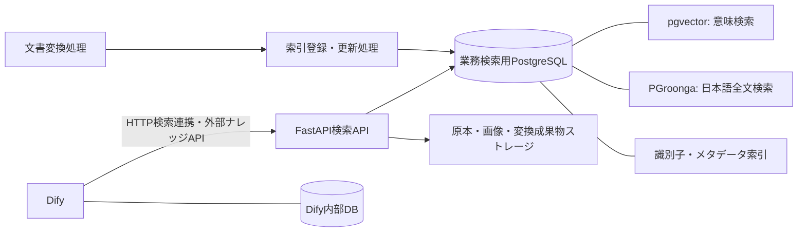

# 検索基盤・検索API設計

- 作成日: 2026-10-12
- 最終更新日: 2026-11-01
- 状態: ローカル試作の検索API・公開管理は実装済み。文書ACL・Dify本体は後続
- 対象: 部署内の維持管理システムに関するWord・Excel・PDF・TXT・Markdown文書の検索
- 開発環境: PostgreSQL 18.6・pgvector 0.8.6・PGroonga 4.1.0を導入済み。本番環境は別途検証

本書は、変換済み文書から質問の根拠を探し、Difyへ返す検索基盤を定義する。ローカル試作の検索API・明示公開・検索状態・出典取得は実装済み（[操作手順](../implementation/search-api.md)）。本番のSSO・ACL、Difyの実配備、日本語検索品質・性能の合格値は引き続き設計・評価対象とする。

OpenAI Embeddings APIによる生成・pgvector保存はCLIへ実装済み。既定は`text-embedding-3-small`・1536次元とし、モデル・次元数・APIキーを設定できる。選択中世代と実行時設定が一致するチャンクだけをEmbeddingし、DB読込ページ・API件数・合計トークンの上限を適用する。同じプロファイル・入力のベクトルは世代をまたいで再利用する。詳細は[実装手順](../implementation/openai-embedding.md)と[取り込み改善設計](05-ingestion-improvements.md)を参照。取り込みのdraftを保つ検索専用の公開コピーとAPIを追加した。文書ACLは適用していない。

### 今回の見直し（2026-10-25）

[GitHub類似プロジェクトの比較](../research/2026-10-25-github-search-api-comparison.md)を踏まえ、次を初期実装の方針とする。数値はPoCの開始値であり、測定済みの性能・精度ではない。

- 状態付きAPIを主経路、Dify標準APIを互換アダプターとし、認可・版解決・検索・文脈補完を一つのサービスへ集約する。
- 公開候補の集合とcoverageの対象集合を分ける。検索できない予定原本も不足へ含め、両者を同じDBスナップショットで読む。
- 意味・全文・識別子の3経路をRRFで統合し、内部順位とDify向け0〜1スコアを分離する。
- 件数、入力、文脈量、処理時間を制限する。依存先の障害を結果なしへ変換しない。
- v3の`selected_generations`は取り込み確認用の下書き選択であり、検索公開の根拠にしない。初版は明示承認した検索コピーと業務版を追加し、文書ACLは後続とする。

### 初回実装の範囲変更（2026-10-25・利用者指定）

PGroonga 4.1.0を既存の開発DB・テストDBへ導入し、日本語索引・正規化・pgvectorとの同居を確認した（[導入手順](../implementation/pgroonga.md)）。検索APIの実装を先行する。**利用者別・原本別の権限制御、SSO、ACL同期は保留**とし、初回はサーバーに設定したナレッジ範囲を検索するローカル試作とする。以下のACL・認可検査は権限制御を追加する段階の設計であり、初回実装の前提条件にはしない。APIの接続キーは文書ACLとは別の接続認証として扱う。

- 初回の実行モードを`local_prototype`として明示する。ローカル接続で検証し、`knowledge_id`・業務版・採用世代・公開状態による範囲制限と原文追跡は維持する。既存のdraftを自動公開しない。
- `document_acl`・`access_policies`・SSOの実装・同期を待たず、検索とcoverageを作れるようにする。未実装のACLを「検証済み」と記録せず、状態付き応答に`access_control: "not_enforced"`、`policy_revision: null`を返す。将来の権限対応版では`access_control: "enforced"`と検証した権限版を返す。
- 試作のcoverageは設定済みナレッジ・解決版全体を対象とし、`coverage_scope: "configured_knowledge_release"`とする。権限対応後は6.3の`authorized_knowledge_release`へ切り替える。検索方式・出典・不足理由の構造は共通に保つ。
- 権限検査の責務を`scope`の境界に残し、初回は設定範囲の解決を実装する。後から各検索経路のSQLへ個別に認可処理を継ぎ足す構成にしない。

Difyとの同時実装は不要。先に検索APIをHTTP契約テスト・単独クライアントで検証し、次にDify HTTP Requestノードを接続する。初回から6章のrequest／responseと成功・不足・エラーの区別を固定する。Chatflow・回答LLM・引用画面は後続で実装できる。

### 初版実装で確定した差分

- 取り込みv3の制約・metadata・CLIを保ち、`search_schema_migrations`で検索専用v1を管理する。`search_releases / search_release_bindings / search_catalogs`が業務版・対象原本・採用先を持つ。
- `file-search publish`が、確認済み原文・原文対応・ブロック・関係・入力が一致する完成ベクトルを`search_publications / search_chunks / search_blocks`へ不変のコピーとして登録する。これが初版の`published`であり、元の取り込み世代・ブロック・チャンクはdraftのままとする。
- 公開後の再抽出でコピーは書き換えず、現行検索では原本状態・選択世代・変換版・元世代の更新時刻を照合する。変更を検出した旧コピーは更新待ちへ外し、明示再公開で切り替える。公開後に生成したEmbeddingも再公開で反映する。
- 読み取りは非同期SQLAlchemy＋psycopg、質問Embeddingは専用AsyncOpenAIクライアント。期限・切断時はSQLと外部要求をキャンセルする。API起動はloopbackへ限定し、文書ACLの代わりに適用範囲を広げる処理を作らない。
- 原本取得は`/sources/{publication_id}`で公開対象とCASのハッシュを再検査する。根拠・画像を含む原文の自動外部送信や、長期公開URLは追加しない。
- 検索設定の開始値は実装済み。全文の語選択はGroongaのbigram（2文字以上、最大16語）とし、意味検索・識別子検索と統合する。実データでの精度を評価して設定版を更新する。

この実装差分を初版の正本とし、以下の元世代そのものを公開する方式や権限制御は将来の設計として読む。検索用テーブルの物理定義は[検索スキーマ](../../src/search/schema.py)、運用と未検証範囲は[実装説明](../implementation/search-api.md)を参照。

接続試験用に、設定ファイルの`search.test_mode: true`でDB・Embeddingを使わない固定応答へ切り替えられる。通常検索は既定のままとし、テスト応答は`execution_mode: test`、`metadata.test_mode: true`で区別する。テスト時は版・プロファイル・coverageを検証しないため、未確認値を`null`、coverageを`unknown`とする。切り替えとAPIごとの動作は[テストモードの操作手順](../implementation/search-api.md#dbを使わないapiテストモード)を参照。

## 1. 目的と責任範囲

検索基盤は、日本語の説明から探す検索と、関数名・テーブル名・エラーコードなどを指定する検索を組み合わせる。質問に関連する小さな抜粋に加え、必要な親見出し、表のヘッダー、画像の位置、関連シートなどの情報を取得し、回答の根拠を原本まで追跡できるようにする。

入力ファイルの変換と、その成果物の共通仕様は[文書変換設計](01-document-conversion.md)を正本とする。本書は変換済み成果物を受け取り、検索用データと索引を構築する。回答生成、会話履歴、相談画面の設計は[LLM・チャット設計](03-llm-chat.md)に分ける。

| 機能 | 検索基盤での責任 |
| --- | --- |
| 検索用データの登録 | 変換成果物を検証し、チャンク、メタデータ、ベクトル、全文索引を準備する |
| 検索 | 文書の意味検索、日本語全文検索、識別子一致検索を組み合わせる |
| 公開・権限判定 | 対象版、公開状態、ACLをサーバー側で制約し、閲覧可能な根拠だけを取得する |
| 文脈の補完 | 親子ブロック、表、関連シート、画像情報を必要な範囲で追加取得する |
| 原本の参照 | ページ、シート・セル、見出し、ファイル・行などの原本位置を返す |
| 回答生成 | 検索基盤では行わず、Dify側へ根拠を渡す |

## 2. 構成案



| 構成要素 | 役割・設計上の扱い |
| --- | --- |
| 業務検索用PostgreSQL | 文書管理情報、抽出世代、チャンク、関連情報、ACL、検索索引を保持する |
| pgvector | 文書・チャンクのEmbeddingを保持し、質問との意味的な近さによる候補を探す |
| PGroonga | 日本語の本文、見出し、用語、障害メッセージなどの全文検索に使用する候補 |
| 識別子索引 | 関数名、クラス名、テーブル名、エラーコード、パスなどを文字列として検索する |
| FastAPI | Dify向けAPI、入力検証、接続認証、検索範囲の決定、検索結果の組み立てを担う |
| 外部ストレージ | 原本ファイル、画像、レンダリング結果などの実体を保持する。DBは参照情報を保持する |
| Dify | 質問の受付、外部ナレッジ検索の呼び出し、取得根拠を使った回答生成を担う |

業務検索DBとDify内部DBは、データモデル、認証情報、移行、バックアップの責任を論理的に分離する。同じPostgreSQLサーバーに配置するか、別サーバーとするかは未決とする。Dify内部のテーブルや索引へ直接書き込む構成には依存しない。

PostgreSQL、pgvector、PGroongaの対応版と同居動作、導入権限、バックアップ・復旧手順を事前検証する。利用予定のマネージドサービスなどで拡張を導入できない場合は、この構成案の採否から見直す。

## 3. 変換成果物との共通契約

変換成果物の詳細は文書変換設計を参照する。検索側は少なくとも次の情報を受け取り、原本と抽出世代を区別して管理する。

| 項目 | 意味・制約 |
| --- | --- |
| `document_id` | 原本の論理ID。同じ文書の更新を追跡するために維持する |
| `source_version` | 原本内容のハッシュ。業務システムのリリース番号とは区別する |
| `conversion_revision` | 変換設定・処理仕様の版。同じ原本を再変換した場合の違いを識別する |
| `block_id` / `chunk_id` | 原本の版と変換世代に紐づくID。別世代の内容へ無条件に使い回さない |
| `artifact_type` | `source` または `derived`。原本に由来する抽出内容と、要約・説明などの派生成果物を区別する |
| `publication_state` | `draft` / `reviewed` / `published` / `excluded`。検索公開は`published`だけを対象とする |
| 原本位置 | 原本パス、ページ、見出し、シート名・セル範囲、テキストの行など、形式に応じた参照情報 |
| 関連情報 | 親子ブロック、表ヘッダー、関連シート、画像などを結ぶ情報 |
| 対象システム・業務版 | システム名、機能、適用リリース、適用期間など。原本ハッシュとは別の検索条件 |
| 権限情報 | 原本の閲覧範囲とその更新情報。生成された派生成果物にも原本の制約を引き継ぐ |

現行検索の対象は、原本が利用可能で、サーバーが選択したactiveな抽出世代に属し、公開状態が`published`である内容に限る。明示的な履歴検索では、指定した業務版・期間に対応する公開済み旧世代をサーバーが文書ごとに選択する。全旧世代を一律に混ぜず、同一原本の同一対象版では採用する変換世代を一つに決める。履歴の原本スナップショットにも閲覧権限を適用する。

`reviewed`はレビュー済みを表すが、検索公開済みを意味しない。派生成果物も公開判定を経てから利用し、原本からの直接引用と混同しない。

`document_id`、`source_version`、`conversion_revision`の組み合わせで抽出世代を識別し、文書変換処理が付与した`generation_id`を使用する。Embeddingのモデル名、モデル版、次元数、前処理設定は別の`embedding_profile_id`で管理する。異なるモデルのベクトルを同じ検索空間へ混在させない。

## 4. 検索処理の概要

### 4.1 検索範囲の確定

検索APIはリクエストを受け取った時点で、接続元が利用可能なナレッジ、対象システム・業務版、公開状態、検索モードに応じた採用世代、閲覧範囲を決定する。この条件は意味検索、全文検索、識別子検索のすべてに適用する。権限を持たない本文を取得した後でDifyやLLMに隠す方式は採用しない。

利用者が指定する版・機能・文書種別などの条件は検索を狭めるために使用し、サーバーが確定した閲覧範囲を広げることは認めない。`knowledge_id`や任意のメタデータ条件だけを権限の証明として扱わない。

通常は指定した現行業務版を対象とする。過去の障害確認などで履歴を検索する場合は、明示的な対象版・期間と閲覧範囲に従う。現行検索の結果へ古い版を無表示で混ぜない。

### 4.2 候補検索

| 経路 | 主な対象・狙い | 注意点 |
| --- | --- | --- |
| 文書の意味検索 | 表現が異なる質問と設計書・手順・障害記録の内容を結び付ける | 日本語、業務用語、長い表、短い手順での適合性を評価する |
| 日本語全文検索 | 正式名称、製品名、固有のメッセージ、業務用語を含む箇所を探す | 表記揺れ、トークナイザー、正規化、検索式は実データで調整する |
| 識別子一致検索 | 関数・クラス・テーブル・項目名、エラーコード、ファイルパスを探す | 大文字小文字、記号、アンダースコアを一律に除去しない |

質問は元の文字列を保持しつつ、必要に応じて自然言語部分と識別子候補を取り出す。識別子の完全一致を優先できるようにし、部分一致や別名展開を追加する場合は誤一致を評価する。全文検索と識別子一致検索の評価値を、ベクトル距離とそのまま足し合わせない。

各経路で候補数に上限を設け、同じ`(generation_id, chunk_id)`の重複をまとめる。利用者が指定する`top_k`と、内部の候補取得数は別に管理する。`top_k`にはサービス側の上限を設定する。

### 4.3 順位統合と文脈取得

候補の順位統合は、初期実装ではRRF（Reciprocal Rank Fusion）を使う。各検索経路での順位を使って統合するため、異なる尺度の生スコアを直接比較する必要を減らせる。初期比較の重み・定数・候補数は4.5に定め、実データによる評価後に検索設定の版を更新する。

必要であれば、閲覧可能な候補だけを対象に再ランキングを追加する。モデルや外部サービスに送る場合は送信先の許可範囲を確認し、候補抜粋のみに制限する。検索の都合で原本全文をLLMへ一括送信しない。

順位統合後、次の情報を必要な範囲で補完する。補完する本文・画像・関連シートにも同じ公開状態とACLを適用する。

| 取得する文脈 | 例 |
| --- | --- |
| 親ブロック | 小さな段落が属する見出し、手順の前提、章・節の説明 |
| 子・隣接ブロック | 手順の続き、表の注記、段落の前後 |
| 表・関連シート | 列ヘッダー、単位、シート名、対応するセル範囲、明示された参照先 |
| 画像情報 | キャプション、OCR結果、画像参照、元のページと位置 |
| 原本参照 | 文書名とページ、Excelのシート・セル、TXT・Markdownの行位置 |

関連情報が存在することは、その内容を回答根拠として取得してよいことを意味しない。取得件数とテキスト量に上限を設け、無関係な親文書やワークブック全体へ展開しない。画像参照を返すだけでDifyやLLMが画像を自動的に読めるとは想定せず、画像を実際に使う経路はLLM・チャット設計で検証する。

補完した根拠も、本文・ブロックID・由来・原本位置の対応を維持する。異なる`artifact_type`や原本位置の内容は、区別できるレコードまたは根拠部分として返す。生成説明を原文の引用へ連結しない。

### 4.4 プログラム解析との責務分離

プログラムの解析・取込・コード検索は別処理として設計する。本基盤が取り込む原本はWord・Excel・PDF・TXT・Markdownとし、SQL・JSON・YAML・CSV・LOG等も対象にしない。文書本文に記載された関数名・テーブル名・エラーコード等を文字列として検索する機能は維持する。AST・定義参照解決・呼出関係の解析は行わない。

### 4.5 初期検索設定とスコア

以下をサーバー管理の`search_config_version=poc-v1`として固定し、APIから内部設定を変更させない。

| 設定 | PoCの開始値・方針 |
| --- | --- |
| 候補数 | 意味・全文・識別子の各経路で最大50、統合前の和集合は最大150 |
| 意味検索 | 選択プロファイルのcosine距離。まず認可・採用版で絞った集合の正確な近傍検索を基準とする |
| 全文検索 | PGroonga。通常質問を検索式としてそのまま`&@~`へ渡さず、抽出語を`&@`のバインド値で評価する。語数最大16、各128文字、初期はORで候補取得 |
| 識別子検索 | `chunks.identifiers`に対する大文字小文字・記号を保持した要素一致。候補最大16個、各256文字。完全一致数の降順、次に安定IDで順位付け |
| 順位統合 | `RRF(d) = Σ w_i / (60 + rank_i(d))`。順位は1始まり、3経路とも重み1、不在経路の寄与0 |
| 同点 | 各経路・統合結果とも`(generation_id, chunk_id)`の辞書順で確定。実スコアが同点でも一意な`row_number`を付ける |
| 同一原本の上限 | 独立ヒットは最大3件。落とした場合は後続候補で補充し、返却件数を水増ししない |
| 文脈 | 選択ヒットごと最大2ブロック、確認済み関係を1段まで。全体で追加レコード最大5件 |
| 根拠予算 | `content`の実測合計6000トークン、1レコード最大2000トークン。`cl100k_base`で計数、JSON応答全体最大256 KiB |
| 質問展開・reranker | 初期は無効。追加時は別設定・スコア版で比較する |

質問からの識別子抽出はバッククォート内の文字列、名前・エラーコード・パス等の決定的なパターンを使う。登録側は公開時に同じパターンで文書の`search_text`から識別子を補完する。プログラム構造からの定義名・参照名の抽出は行わない。識別子だけの質問も通常の3経路へ通し、同じ認可を適用する。あいまい一致、LLMによる語の生成・自動別名展開は初期対象外とする。全文用の語分割器・辞書・正規化設定は検索設定とともに固定し、表記差や句読点だけの入力も評価する。

Dify向けスコアは`score_version=rrf-bound-v1`として、`score(d) = RRF(d) / (3 / 61)`とする。3経路と重みを固定した理論上限で割り、質問内の最大値や返却件数で再正規化しない。ある経路が0件または識別子なしでも分母は固定する。1経路だけの1位は約0.333、3経路すべて1位なら1となる。この値は経路間の合意・順位を示すだけで、無関係な最近傍を必ず除外できる尺度ではない。PoCは閾値0から比較し、関連根拠なしの評価を経て閾値・必要な関連度判定を決定する。本番の回答可否をこの値だけで判定しない。

各経路の生スコア、順位、RRF値は内部の評価情報として分離し、Difyへ生RRFをそのまま渡さない。reranker導入時に既存閾値を使い回さず、`score_version`を変えて再評価する。

文脈拡張はヒットの選択・閾値適用後とする。本文が1レコードの予算を超える場合はブロック対応に沿って追跡可能な抜粋を作り、metadataへ切り出した文字範囲を保存する。途中で切ると対応を保てない表等はレコード単位で落とし、次候補を試す。根拠を要約で置き換えない。件数・合計予算で採用できなかった場合は6.4の`limit_reasons`へ理由を残す。JSON全体の上限にはタイトル・位置・画像参照も含め、画像参照は1レコード最大10件、その他のmetadata配列も登録時・返却時に上限を検証する。超過時は文脈・低順位レコードから落とし、引用追跡に必須のmetadataは切り捨てない。

PGroongaの`pgroonga_score`は索引を使わない逐次走査では0になり得る。PoCは同点時の安定順序を保ちつつ、`EXPLAIN (ANALYZE, BUFFERS)`と索引を使う計画で順位を比較する。全スコア0を関連性なしとみなさない。[公式仕様](https://pgroonga.github.io/reference/functions/pgroonga-score.html)

HNSWは必要性を測定してから追加する。ACL・版のWHERE条件を各経路のSQL内へ必ず入れる一方、近似索引内部では走査後に絞り込みが適用されるため、候補不足は起こり得る。対応版のiterative scan、取得上限、選択性ごとの正確検索とのRecall差を比較し、検索対象を広げることで補充しない。[pgvectorの絞り込み仕様](https://github.com/pgvector/pgvector#filtering)

### 4.6 読み取りの整合性と実装の分割

1. 入力検証、接続元の認証、接続元とナレッジの事前許可確認を行う。プロファイルと検索設定の識別子を短いDB読み取りで取得する。
2. 許可されたプロバイダーへ質問だけを送りEmbeddingを取得する。未認可の質問を外部へ送らず、この外部要求中はDBトランザクション・接続を保持しない。
3. `REPEATABLE READ READ ONLY`を開始し、接続許可、既定版、Embeddingプロファイル、現在のACL、台帳版を改めて解決する。プロファイルが変わっていれば503として再試行可能にし、異なる空間のベクトルを比較しない。質問ベクトルの次元・有限値・非ゼロも検査する。
4. `expected_documents`を、認可済みナレッジの予定原本と解決版から作る。未収集・採用行なし・未索引もLEFT JOIN等で残してcoverageを計算する。ACLが不明・失敗の原本は根拠にせず、検証不能時の要求は拒否する。
5. `eligible_chunks`を、採用された公開済み世代・チャンク・全元ブロックから作る。`ready`と承認済み`partial`のみ許可する。意味経路ではさらに選択プロファイル・次元・実入力ハッシュが一致する完成ベクトルに絞る。追加フィルターは候補側へ適用する。
6. 同じ接続・スナップショットで3経路を順に実行し、`(generation_id, chunk_id)`で統合する。文脈取得と全派生元の検査も同じトランザクションで行う。別接続での並列SQLは初期版で行わない。
7. DB読み取りを終了し、本文対応・出典・予算を検査して応答を組み立てる。返却直前に接続キーの失効と、台帳・接続許可・対象原本ACLの版および許可期限を短い最新読み取りで再検査する。変更なら結果を破棄し503 `SEARCH_UNAVAILABLE`（再試行可）とする。再検査後の競合まで完全に防ぐ保証はせず、失効反映時間の運用条件を定める。
8. 本文を含めない監視イベントを別の書き込みトランザクションで保存する。読み取り専用トランザクションへ監視INSERTを混ぜない。

`snapshot_id`は1回の整合した読み取りを識別するIDであり、再検索・ページング・後日再現のトークンにはしない。原本閲覧時には別途現在の認可を実施する。

実装時の配置は`api`（HTTP・検証・エラー変換）、`retrieval/service`（一連の検索）、`scope`（認可と版）、`repositories`（SQLとcoverage）、`rank`（RRF・スコア）、`evidence`（原文対応・文脈・予算）、`query_embedding`（外部I/O）に分ける。APIモジュールを取り込みCLIから独立して起動できる構成とし、取り込み中でも公開世代の検索を行えるようにする。

## 5. データモデルと別資料

テーブル一覧、カラム、主キー・外部キー、一意制約、索引、登録・公開トランザクションは[DBテーブル設計](04-database-tables.md)を正本とする。本書では検索処理とAPIの契約を定義し、テーブル定義を重複管理しない。

| 管理対象 | 主な構造 |
| --- | --- |
| 原本・版・予定資料 | 原本台帳、原本スナップショット、検索範囲に登録した収集対象 |
| 採用版 | 業務リリースと原本ごとの要求版・採用変換世代・準備状態 |
| 根拠・検索 | 文書ブロック、チャンクとの本文対応、画像出現、関連参照、ベクトル |
| 権限・運用 | 原本ACL、接続元の許可範囲、実行試行、検索監視記録 |

本書でいうactiveな世代は、DBでは対象リリースの対応表が採用した世代を意味する。単独の世代フラグで全リリースの現行状態を表さない。予定資料は変換成功前から台帳に置き、未取得・更新失敗も不足の集計へ含める。

Embeddingモデルを変更する際は別のプロファイルで再生成し、完成前のベクトルを現行検索へ混在させない。意味検索の索引方式は、正確な近傍検索と近似近傍索引を比較して決定する。近似近傍検索と絞り込みを併用した際の候補不足・再現率も検証対象とする。

## 6. 検索APIの契約

### 6.1 エンドポイントと共通処理

| API | 用途 | 成功レスポンス |
| --- | --- | --- |
| `POST /search-with-status` | Dify HTTP Requestノードからの主経路 | `records`と検索範囲・不足・返却制限の状態 |
| `POST /retrieval` | Dify External Knowledge API互換 | `records`のみ。coverageが`complete`の場合に限る |

両方ともJSONと`Authorization: Bearer <接続用APIキー>`を使う。Difyへ登録する標準連携の接続先はサービスのベースURLとし、Difyが`/retrieval`を付加する。[Dify公式契約](https://docs.dify.ai/en/cloud/use-dify/knowledge/external-knowledge-api)

内部では両アダプターが同じ`SearchRequest → RetrievalService → SearchResult`を呼ぶ。認可、世代選択、候補検索、スコア変換、coverageに別実装を作らない。Chatflowは一方のAPIを1回呼び、同じ質問を標準ナレッジノードで重ねて検索しない。

状態付き契約は初版を`api_version: "1"`としてレスポンスへ明示する。初回実装前の設計なので既存クライアントの移行はない。破壊的変更では新しいAPI版・経路を設け、Dify標準のパスや必須フィールドを独自変更しない。ページング、ストリーミング、任意のSQL・全文検索式、検索用ベクトルの直接入力は初期対象外とする。

### 6.2 共通リクエストと入力制限

| 項目 | 契約・PoCの開始値 |
| --- | --- |
| `knowledge_id` | 必須の非空文字列、最大128文字。接続元に許可された範囲と照合 |
| `query` | 必須。空白だけを拒否、最大4000 Unicodeコードポイントかつ2048トークン。超過を黙って切り捨てない |
| `retrieval_setting.top_k` | 必須の整数、1〜20。真偽値・文字列・小数からの暗黙変換を禁止 |
| `retrieval_setting.score_threshold` | 必須の有限数、0〜1。真偽値・NaN・Infinityを拒否。0は閾値なし |
| `metadata_condition` | 省略・`null`・空の`conditions`は追加絞り込みなし。オブジェクトの場合は6.3に従う |
| HTTP本文 | 展開後UTF-8で最大32 KiB。超過413、JSON以外415、形式・値の不正422 |

文字列長・トークン数は別々に検査し、質問の元文字列は識別子検索用に保持する。質問Embeddingにも上限を適用する。秘密値やモデル名・DB名をリクエストで指定させない。初期版は全階層で未知フィールドを422とし、Difyの採用版から送信される追加項目は契約試験後に明示追加する。上限を超える`top_k`は丸めず422とする。

Difyの確認コミットでは条件がない場合も`metadata_condition: null`を送るため、これを正常入力として受ける。閾値を無効にした場合は`0.0`が送られる。[呼び出しコード](https://github.com/langgenius/dify/blob/12ab116fffd4706c20eb618d706cc71e094b519e/api/services/knowledge/external/service.py#L398)

```json
{
  "knowledge_id": "maintenance-shared-poc",
  "query": "日次締め処理で E1203 が発生する条件は何か",
  "retrieval_setting": {
    "top_k": 5,
    "score_threshold": 0.0
  },
  "metadata_condition": {
    "logical_operator": "and",
    "conditions": [
      {"name": "target_release", "comparison_operator": "is", "value": "current"}
    ]
  }
}
```

### 6.3 対象版・追加フィルター

Difyが定義する全演算子の実装は初期対象にしない。次の許可リストのみを両APIで共通提供する。オブジェクトを送る場合は`conditions`配列を必須とし、空オブジェクトは422とする。未対応の条件を無視すると検索範囲が意図せず広がるため、未知の名前・演算子・型は422とする。

| `name` | 許可演算子・型 | サーバー内の意味 |
| --- | --- | --- |
| `target_release` | `is`、単一文字列 | `current`または具体的な`release_id`。版を選ぶ制御条件として先に解決 |
| `document_id` | `is` / `in`、文字列 / 文字列配列 | 原本IDの絞り込み |
| `feature_id` | `is` / `in`、文字列 / 文字列配列 | `chunks.feature_ids`の要素と一致 |
| `artifact_type` | `is` / `in`、`source` / `derived`の値 | 由来の絞り込み。派生物にも全派生元の認可を適用 |

`feature_id`はラベル付与元を整備したナレッジでのみ有効にする。現行取り込みには付与処理がないため、未整備の範囲では422 `INVALID_REQUEST`とする。必要な登録処理は10.2 U4を参照。

`logical_operator`は省略時`and`、初期版は`and`だけを受ける。`or`・ネストは422。条件数は最大8、同じ名前の重複を拒否する。文字列値は非空・最大256文字、配列は1〜20要素の重複しない文字列とする。SQLのカラム・演算子はサーバーの固定対応表から選び、値はバインドする。任意JSONパスをSQLへ展開しない。

`target_release`が省略または`current`なら`knowledge_bases.default_release_id`を1回解決し、`search_mode=current`とする。既定版未設定は409 `RELEASE_UNRESOLVED`。具体的IDは`search_mode=history`とし、同一システム・環境に属する版か、接続元が履歴参照を許可されているか確認する。初期PoCは履歴許可なしを既定とし、許可対象は接続元・ナレッジ別のサーバー管理設定で明示する。DBへ移す場合は04へ定義を追加する。不存在と参照不可の版は同じ404とする。

日付からの版推測、複数リリースの混在検索、`current`を質問やLLMの判断で置換する処理は行わない。履歴でも現在のACLを検査する。`target_release`以外の条件は認可後の候補集合との積集合であり、公開状態、原本状態、主体、ACL、Embeddingプロファイルを上書きできない。

coverageは対象ナレッジ・解決した版・現在の認可範囲全体に対して計算し、`feature_id`等の追加絞り込み前を対象とする。成功したチャンクしか持たないメタデータから予定原本を落とすことを防ぐためである。権限対応版の応答は`coverage_scope: "authorized_knowledge_release"`、初回の`local_prototype`は`configured_knowledge_release`と明示し、絞り込み検索のヒット数と不足件数を混同させない。

### 6.4 状態付き検索のレスポンス

```json
{
  "api_version": "1",
  "request_id": "request-example-001",
  "records": [
    {
      "content": "日次締め処理の E1203 は、対象日の締め状態が確定済みの場合に返す。",
      "score": 0.65,
      "title": "日次締め処理設計書 / エラー条件",
      "metadata": {
        "evidence_id": "evidence-example-001",
        "evidence_role": "hit",
        "document_id": "doc-example-001",
        "source_version": "sha256:<原本ハッシュ>",
        "conversion_revision": "sha256:<変換設定等のハッシュ>",
        "generation_id": "generation-example-001",
        "chunk_id": "chunk-example-001",
        "block_ids": ["block-example-001"],
        "artifact_type": "source",
        "publication_state": "published",
        "quality_flags": [],
        "target_release": "release-example",
        "score_version": "rrf-bound-v1",
        "source_locations": [
          {"format": "pdf", "path": "design/daily-close.pdf", "page_number": 12, "heading": "4.2 エラー条件"}
        ],
        "related_evidence_ids": [],
        "related_assets": []
      }
    }
  ],
  "retrieval_status": {
    "snapshot_id": "snapshot-example-001",
    "search_mode": "current",
    "resolved_release_id": "release-example",
    "catalog_revision": 12,
    "policy_revision": null,
    "access_control": "not_enforced",
    "embedding_profile_id": "profile-example-001",
    "search_config_version": "poc-v1",
    "coverage_scope": "configured_knowledge_release",
    "coverage_state": "incomplete",
    "pending_updates": 1,
    "failed_documents": 0,
    "partial_documents": 0,
    "uncollected_documents": 0,
    "index_pending_documents": 0,
    "unknown_documents": 0,
    "result_state": "matched",
    "returned_records": 1,
    "limit_reasons": [],
    "message": "対象範囲に更新処理待ちの資料があります。取得できた根拠の範囲で回答してください。"
  }
}
```

値・本文・IDは架空の説明用で、実応答の`request_id`と`snapshot_id`はUUIDとする。`records`は6.5の標準APIにも同じまま渡せる構造とする。

- `access_control`は`not_enforced / enforced`。初回は前者を返し、`policy_revision`はnullとする。coverageは設定ナレッジ・解決版の範囲で計算する。権限対応版では検証済みのpolicy版と認可範囲を使う。
- `content`は`content_text`とブロック対応から得る引用本文とする。`search_text`に付けた検索用見出し等を原文として返さない。`title`は表示用、`metadata`は常にオブジェクトとする。
- `evidence_id`は世代・チャンク（ない場合はブロック）・引用範囲・由来から安定生成し、文脈補完した別レコードを`related_evidence_ids`で結ぶ。`chunk_id`はチャンクに対応する場合だけ付け、親ブロックのみの文脈では省略する。別位置・別由来を一つの引用へ連結しない。
- `evidence_role`は`hit / context`。文脈レコードには`supporting_hit_ids`を付け、そのスコアは採用した支持ヒットの最大値を引き継ぐ。独立に関連度を測った値とは扱わない。
- `source_locations`は実際に返す文字範囲と一致させる。引用を部分返却した場合は`chunk_blocks`に沿った文字範囲もmetadataへ保持し、行範囲等を原文から算出できる場合は狭める。PDFのbboxやExcelのセル範囲しか対応がない場合は元要素の範囲を保持し、`location_granularity: "block"`とする。文字範囲が追えることだけを理由に、文字ごとのbboxやセル対応が得られたと扱わない。
- `result_state`は`matched / no_match / budget_exhausted`。採用可能なヒットがゼロなら`no_match`、ヒットがあるが1件も予算内に収まらない場合は`budget_exhausted`。いずれも`records: []`となり得る。`no_match`は資料の不存在を意味しない。
- `limit_reasons`は`top_k / document_cap / token_budget / context_limit / response_size`の配列。最終選択で実際に根拠を落とした理由だけを返す。内部候補の打ち切り数や経路別生スコアは利用者向けに返さない。
- 予定原本ごとの不足件数は04の状態から計算する。`pending_updates`はリリース対応の更新待ち、`failed_documents`は収集・変換等の失敗、`partial_documents`は承認済み部分抽出、`uncollected_documents`は未収集、`index_pending_documents`は必要索引未準備、`unknown_documents`は版対応欠落等の未確定を表す。同一原本は複数理由へ該当し得るため足し算で原本総数にしない。
- coverageは`complete / incomplete / unknown`。予定対象を確定できない場合は`unknown`を優先し、確定できた範囲に不足があれば`incomplete`、不足なしなら`complete`。範囲全体が不明な件数は0にせず`null`とする。`complete`は列挙・処理の完了であり、回答精度や知識の網羅を保証しない。
- 件数・メッセージは認可範囲だけから作る。原本ACLを検証できない場合は6.7のエラーとし、閲覧不可の名称・存在・失敗件数をcoverageへ含めない。

`top_k`は文脈レコードを含む`records`全体の上限である。初期版は`min(5, floor(top_k / 3))`件を文脈用に予約し、残りを独立ヒットへ割り当てる。ヒットを少なくとも1件採用した上で、必要な親見出し・表ヘッダーを優先し、関連シート、隣接ブロックの順に文脈を追加する。文脈が不要・取得不可なら予約分を後続の独立ヒットへ戻す。文脈だけを返すことはせず、スコア降順、同点は`evidence_id`の辞書順とする。後段で支持ヒットが落ちた文脈も返さない。

### 6.5 Dify互換レスポンスとChatflowの分岐

`POST /retrieval`は6.4のうち`{"records": [...]}`のみを返す。検索が成功し、coverageが`complete`で採用ヒットがなければHTTP 200と`{"records": []}`。`incomplete / unknown`は409 `COVERAGE_NOT_COMPLETE`、`budget_exhausted`は409 `RESULT_BUDGET_EXHAUSTED`とし、状態が消えた正常結果にしない。独自状態フィールドを加えてもDifyが表示するとは想定しない。

`score`は4.5の順位由来の互換値であり、確率・正答率・原本の信頼度ではない。`score_threshold`は変換後の値へ`>=`で適用し、その後に件数・文脈予算を適用する。Difyによる追加の閾値処理・再ランキングで根拠が変わる可能性も結合評価する。

ChatflowはHTTP Requestノードの成功・失敗を先に判定する。200では次の順に扱う。

1. `result_state=budget_exhausted`は結果の組み立て制限として扱い、根拠なしで回答しない。
2. `coverage_state=incomplete / unknown`なら不足を明示し、存在しない・影響がないとは断定しない。
3. `records=[]`なら確認できる根拠なしと伝える。根拠ありなら本文と出典を回答用LLMへ渡す。

非200では通常の回答生成へ進めず、エラー種別に応じて再試行または一時利用不可を表示する。原本リンクは検索範囲・版・世代・位置を検証する認可付き閲覧経路で生成し、閲覧時にも現在の権限を再確認する。ストレージの実パス、APIキー、恒久的な公開URLを返さない。画像は出現位置と原本の認可を介して取得する。PoCでは画像バイト列を検索応答へ含めない。

### 6.6 接続認証と利用者別ACL

初回は冒頭の`local_prototype`を適用し、文書ACL・SSOを保留する。以下は権限対応版の設計とする。接続キーとサーバー設定のナレッジ解決は文書ACLの実装と分離できる。

共有APIキーはDify等の接続元を認証し、`caller_id`へ対応させる。`access_policies`の有効な許可範囲と、原本ACLの`service_scope`の両方を検証する。`knowledge_id`自体は権限証明ではない。

初期PoCは参加者全員が同じ資料を読める共有範囲に限定する。標準外部ナレッジAPIから、質問者のidentity・SSO情報が自動伝播する前提は置かない。

本番で利用者別ACLが必要な場合は、SSOを検証するバックエンド／ゲートウェイが主体・所属を確定し、検索APIが検証できる短命な署名付き情報で伝える。発行者・宛先・署名・期限の検証と所属解決を実装し、具体的経路を確定するまでは共有PoCの範囲を超えて公開しない。任意の利用者ID、プロンプト、フィルター、未検証ヘッダーを認可へ使わない。標準連携で必要情報を渡せない場合は状態付きAPIへの信頼できる呼び出し経路を使う。

親子ブロック、派生成果物の全派生元、原本、画像、キャッシュ、監視にも同じ制約を適用する。PoCは検索結果キャッシュを導入しない。

### 6.7 エラー・タイムアウト・再試行

```json
{
  "error_code": 3002,
  "error_msg": "検索対象の準備が完了していません。",
  "code": "COVERAGE_NOT_COMPLETE",
  "request_id": "request-example-001",
  "retryable": false
}
```

両APIで同じエラー形式を返す。`error_code`は整数のDify向けコード、`code`は本サービスの安定した機械判定名、`error_msg`は固定の安全な説明とする。FastAPIの既定422本文が入力値・原文を反射しないよう共通ハンドラーで変換する。

| HTTP | `code`（整数コード） | 扱い |
| --- | --- | --- |
| 401 | `UNAUTHENTICATED`（1002） | キー不正・失効。再認証が必要 |
| 403 | `FORBIDDEN`（2002） | 認証済みだが検索の実行を許可しない |
| 404 | `SCOPE_NOT_FOUND`（2001） | 不存在／未許可のナレッジ・対象版を同じ応答にする |
| 409 | `RELEASE_UNRESOLVED`（3001） | 既定版を確定できない。設定修正が必要 |
| 409 | `COVERAGE_NOT_COMPLETE`（3002） | 標準APIで不足状態を表せない。状態付きAPIを使う |
| 409 | `RESULT_BUDGET_EXHAUSTED`（3003） | 標準APIで返却予算不足。運用設定を確認 |
| 413 / 415 / 422 | `REQUEST_TOO_LARGE`（4001）/ `UNSUPPORTED_MEDIA_TYPE`（4002）/ `INVALID_REQUEST`（4003） | 入力修正。自動再試行しない |
| 429 | `RATE_LIMITED`（5001） | 呼び出し元の制限。`Retry-After`に従う |
| 503 | `SEARCH_UNAVAILABLE`（5002） | DB・質問Embedding・必須経路・認可基盤が利用不能 |
| 504 | `SEARCH_TIMEOUT`（5003） | 要求の全体期限超過 |
| 500 | `INTERNAL_ERROR`（9001） | 想定外の障害。request IDで調査 |

初期版は必須検索経路の実行失敗時に503/504とし、全文だけ等への黙った縮退を行わない。識別子が質問に含まれない場合の経路省略や正常な0件は失敗ではない。原本別のベクトル欠落・部分抽出はcoverageの不足であり、外部APIやDBの実行障害とは区別する。

PoCの開始値は全体10秒、質問Embedding最大4秒、DB各SQLの`statement_timeout`最大2秒、DB接続取得最大1秒とする。各上限は残り全体時間を超えないよう短縮し、期限・切断時には実行中SQLと外部要求をキャンセルして接続を解放する。Dify側タイムアウトは開始値15秒とし、ゲートウェイを含めて調整する。API側の外部要求は初期版では自動再試行なしとし、SDKの既定再試行も無効化する。

`retryable=true`は一時的な429/503/504に限る。認可の設定・同期不備等による503はfalseとする。Dify側は残り時間がある場合だけ最大1回、バックオフとジッターを付けて再試行する。200の空結果や409では同一要求を再送しない。POSTは読み取り処理だが、再試行ごとに新しい`request_id`・DBスナップショットとなり、同一結果は保証しない。

## 7. 更新・削除・再索引

1. 原本の変更・削除・権限変更を検出し、管理台帳の状態を更新する。
2. 変更された原本の新しい`source_version`と`conversion_revision`に対応する抽出世代を準備する。
3. 変換成果物の整合性、原本位置、公開状態、権限、Embedding、全文・識別子索引の準備状態を検証する。
4. 必要なレビューと公開判定が済んだ世代について、active指定をトランザクションで原子的に切り替える。
5. 切り替えに伴うキャッシュ無効化と監視記録を行う。古い世代は履歴方針に従って保持・削除する。

同じ原本内容・変換設定・Embeddingプロファイルの再実行は、重複登録を避けられる処理とする。公開前の部分的な登録結果が検索に混入しないようにし、チャンクごとに新旧が混在する切り替えを避ける。

原本が更新されたことを検知した後、新世代の変換や索引登録に失敗した場合は、古い世代を現行として扱わない。現行検索から外して「更新処理待ち・失敗」として監視し、6.4の状態付き検索APIで不足を回答側へ伝える。旧世代の履歴参照を認める場合は、対象版と旧版であることを明示し、履歴閲覧権限を確認する。原本が変わらない変換設定の改善でも、失敗した新世代が公開済みになったと扱わない。

削除と権限縮小は、変換・Embeddingの再生成完了を待たず、検索対象からの除外とキャッシュ無効化を優先する。DB上の原本状態・権限を検索時に照合し、残存するベクトルや全文索引だけで結果が返らないようにする。ストレージ、履歴世代、派生成果物、原本閲覧経路への反映も確認する。検出から反映までの時間上限と障害時の運用は未決事項とする。

キャッシュを導入する場合は、ナレッジ範囲、認可主体または権限集合、権限の版、抽出世代、検索設定の版を区別する。利用者や世代の異なる結果を共有しない。

## 8. 監視・運用

| 観点 | 監視候補 |
| --- | --- |
| 取り込み・更新 | 未処理件数、失敗件数、変換・索引処理時間、原本更新から公開までの時間 |
| 索引整合性 | active世代の欠落、ベクトル未生成、モデル次元の不一致、原本リンク切れ |
| 検索 | 処理時間、タイムアウト、各経路の候補数、結果なし率、閾値での除外件数 |
| 権限 | 接続認証失敗、範囲外アクセスの拒否、権限変更の反映遅延 |
| 利用品質 | 原本参照の正しさ、関連性の評価、古い版の混入、利用者が報告した不足 |

監視の保存に失敗した場合、PoCでは本文なしの運用アラートを出して検索応答を継続する。監査記録の永続化を必須とする本番運用への変更は別途決定する。

監視ログはリクエストIDと処理・設定の版を中心とし、質問本文・原文抜粋の保存は必要性、閲覧権限、保管期間を決めてから行う。APIキーなどの秘密情報は記録しない。障害時に原因を追えることと、業務情報の複製を増やさないことを両立する。

業務検索DB、原本ストレージ、権限情報の整合したバックアップ・復旧手順を検証する。再索引で復元できる情報と、原本や権限台帳のように別途保護が必要な情報を区別する。

## 9. 評価方針

実務の質問と、その根拠となる原本位置を評価セットとして用意する。回答生成の評価とは分けて、必要な根拠が検索結果へ含まれるかを先に確認する。

| 評価項目 | 確認内容 |
| --- | --- |
| 仕様確認 | 質問の言い換えでも、該当する設計・手順・実装に到達できるか |
| 識別子検索 | 関数名、テーブル名、記号を含むエラーコードを取りこぼさないか |
| 障害履歴 | 現行仕様と過去事象を区別し、対象時期・版に合う記録を取得できるか |
| Office由来の構造 | 表のヘッダーや関連シートを含めても原本位置が正しいか |
| 画像・OCR | 抽出文面の誤りや画像情報の不足を検出し、原本確認へつなげられるか |
| 関連文書なし | 無関係な候補を高スコアとして返さず、結果なしを扱えるか |
| 権限制約 | 本文、引用、関連情報、キャッシュから閲覧不可の情報が漏れないか |
| 更新と障害 | 旧版混入、削除・権限変更の未反映、失敗世代の公開が起きないか |
| 性能 | 文書数・チャンク数・同時利用数を変えた際の処理時間と資源使用量 |

検索方式ごとの比較、上位候補に正しい根拠が入る割合、不要候補の割合、原本位置の正確さを測定する。権限・版の絞り込みを有効にした実際の条件で評価し、索引単体の速度だけで採否を決めない。評価セットに合うように調整する質問と、最終確認用の質問を分ける。

### 9.1 API公開前の受入条件

| 分類 | 必須の確認 |
| --- | --- |
| 入力・互換 | `metadata_condition`の省略/null/空、閾値0・1、top_k境界、真偽値・文字列数値、未知項目、未対応条件、巨大入力、SQL・検索式に見える文字列 |
| 認可・版 | 全経路・文脈・画像・派生元で未許可情報ゼロ、同名chunk_idの別世代を混同しない、現行／履歴・キー失効・ACL期限・権限変更時の結果破棄 |
| coverage | 成功チャンクゼロでも予定原本が残る、採用行欠落・更新失敗・部分抽出・ベクトル欠落を検出、閲覧不可の名称・件数は返さない |
| スコア・予算 | 手計算したRRFとの一致、閾値の前後、同点の安定性、文脈込みtop_k、実測トークン・JSON上限、出典と切り出し範囲の一致 |
| 障害 | Embedding失敗・不正次元・DB失敗・PGroonga不在・全体期限・切断を空結果にしない。キャンセル後に接続が残らない |
| Dify | 採用版で実送信JSON・HTTPエラー・再試行・引用表示・状態分岐を確認。不足時の標準API409を確認 |

意味のみ／全文のみ／識別子のみ／統合を、同じ認可・版の評価セットで比較し、Recall@候補数、Recall@返却件数、MRR、nDCG、根拠なし質問の誤ヒット率、p50/p95と経路別時間を記録する。厳しいACL・少ない対象版でも測定する。合格値は業務側と評価セットを確定してから決め、未測定の開始値を実績と表現しない。

### 9.2 段階導入

1. 公開・業務版を導入するDB移行と管理手順を先に整備する。初回は上記`local_prototype`とし、ACL移行は後続へ分ける。v3のdraft制約を単に外して全世代を検索する実装は行わない。Embeddingプロファイルは10.1どおり既存列・IDを維持し、公開先の選択とFK制約を移行で追加する。
2. 設定したローカル試作範囲で状態付きAPI、3経路、RRF、coverage、出典・予算・監視を実装する。PGroongaが未導入なら全経路の完成扱いで公開しない。
3. Dify互換アダプターとChatflowを結合評価する。まずHTTP主経路で不足表示を検証する。
4. 評価後にHNSW、reranker、質問展開、利用者別ACLを個別導入する。精度・性能の改善を確認できたものだけ有効にする。

## 10. 実装との照合結果と残る未決事項

2026-10-25に、取り込みのソース・設定・既存テストと照合した。前回は実装済みの仕様と、本番運用・検索評価の課題をまとめて「未決」としていたため、以下へ整理する。未実装であることと、実装方針が未決であることを分けて扱う。

### 10.1 現行実装を引き継ぎ、未決から外す事項

| 項目 | 検索初版で引き継ぐ仕様・判断 | 根拠 |
| --- | --- | --- |
| 開発DB・依存 | 開発DBはPostgreSQL 18.6・サーバー拡張pgvector 0.8.6。Python・SDKの版は現行pyprojectと環境構築手順を正本とし、検索追加依存はsearch extraへ分離する。拡張とPythonパッケージのpgvectorの版を混同しない | [Compose](../../compose.yaml)、[依存定義](../../pyproject.toml)、今回のローカルDB読み取り |
| Embeddingの既定値 | providerはOpenAI、既定モデルは`text-embedding-3-small`・1536次元。`text-embedding-3-large`と短縮次元も設定可能。質問側はナレッジが採用する保存済みプロファイルのmodel・dimensionsを使い、プロセスの既定値で上書きしない | [設定と検証](../../src/file_scan/config.py)、[生成処理](../../src/file_scan/embeddings.py) |
| Embedding入力・再利用 | 既存の`provider / model / dimensions / input_version=search_text-v1`から作るプロファイルIDと、実際の`search_text`のハッシュを維持する。文書入力は見出し・列見出しを加えた`search_text`、引用は`content_text`。追加の小文字化・NFKC化・要約をEmbedding前処理へ導入しない。質問は原文を保持して埋め込む | [生成処理](../../src/file_scan/embeddings.py)、[入力ハッシュ](../../src/file_scan/state.py)、[分割](../../src/file_scan/chunking.py) |
| 距離・索引の開始方式 | 検索初版は4.5どおりcosineによる正確検索。既存ベクトルを変換せず使用し、HNSW導入を初版の必須条件にしない。既存テストは小さな一時表でcosine・HNSWの動作を確認しており、実文書・ACLでの検索性能評価とは区別する | [pgvectorテスト](../../tests/test_postgres.py)、[生成ベクトルの定義](../../src/file_scan/db.py) |
| チャンク・トークン | 本文は既定1800文字、検索用文脈込み8191トークン以内、文脈は既定1024トークンかつ全体予算の半分以下。親・節・由来・表単位を区切り、表は行境界を優先する。`cl100k_base`で実測し、本文の原文字範囲を保持。検索側で再分割して別Embeddingを作る必要はない | [分割](../../src/file_scan/chunking.py)、[計数](../../src/file_scan/tokens.py)、[既存テスト](../../tests/test_improvements.py) |
| 原本の対象範囲 | Word・Excel・PDF・TXT・Markdownに限定。プログラム解析は別処理とし、AST解析とSQL・JSON・YAML・CSV・LOGの取込を削除 | [対応形式](../../src/file_scan/parsers.py)、[設定](../../src/file_scan/config.py) |
| 文脈量・関連シート | 取得量は4.5・6.4の開始値で決定済み。保存された親子・明示的な確認済み関係のみを使用する。Excelはシート・セル・数式・保存済み結果を保持するが、シート間の依存関係は生成していないため、初版で数式から関連シートを自動展開しない。関係がなければ文脈追加0件で正常 | [抽出](../../src/file_scan/parsers.py)、[関係保存](../../src/file_scan/pipeline.py)、[共通型](../../src/file_scan/domain.py) |
| 原本・画像の保存方式 | 現行のファイルシステム＋SHA-256内容アドレス方式を採用する。実体は`storage_dir/objects/sha256/<先頭2桁>/<ハッシュ>`、DBには参照を保存する。1DBのstorage root固定、完全ハッシュ検査、画像の実体共通化と出現位置の分離を引き継ぐ。初版で別のオブジェクトストレージへ置換しない | [保存処理](../../src/file_scan/storage.py)、[DBへの保管先固定](../../src/file_scan/pipeline.py)、[DB定義](../../src/file_scan/db.py) |
| 更新・失敗・履歴 | 原本ID、原本ハッシュ、変換プロファイルによる世代を維持する。取り込みは現在選択・失敗・設定不一致と過去の成功を分け、古い成功世代へ戻らない。削除・利用不能・除外も区別する。この判定方針を検索へ引き継ぎ、業務版ごとの採用判定を追加する | [状態判定](../../src/file_scan/state.py)、[取り込み](../../src/file_scan/pipeline.py)、[検証記録](../implementation/ingestion-improvements-validation.md) |
| 検索の開始設定 | 候補各50、RRF定数60・各経路重み1、`rrf-bound-v1`、top_k最大20、返却6000トークン等は4.5・6章で開始値を定めた。reranker・質問展開・検索結果キャッシュは初版で無効とし、採否が決まるまで実装全体を止めない | 本書4.5・6章。取り込み実績ではなく、今回の検索設計として決めた開始値 |

ローカルDBはPostgreSQL 18.6／vector 0.8.6へPGroonga 4.1.0を追加し、アプリ用・テスト用DBの有効化と日本語索引の基本動作を確認済み（[導入結果](../implementation/pgroonga.md)）。FastAPI等の検索依存も固定版で導入し、search extraへ定義済み。本番DBの環境・拡張導入可否までローカルの結果から確定するものではない。

Embeddingの`model_name`への列名変更やプロファイル全体のID再生成は初回検索に必須ではない。現在の物理列`model`・`input_version`を正本として読み、検索専用catalogへ公開先プロファイルのFK・選択制御を追加済み。04の将来案のモデル版・距離・状態の列を導入する場合も既存ID・ベクトル・キャッシュを保持する。既存API応答から固定モデルrevisionを取得・検証している実装はないため、モデル名を固定版の証明としない。

### 10.2 実装・初回結合に影響する未決事項

2026-10-26時点で、PGroonga・検索API・明示公開の管理コマンドは実装・検証済み。以下では、実装した仕組みと実資料での利用前に決める業務・運用条件を区別する。検索初版の物理表は、取り込みv3から独立した検索v1の表を使う（04章の12節を参照）。

| ID | 未決事項・必要時点 | 実装への影響 | 開始案 |
| --- | --- | --- | --- |
| U1（導入・初期実装は解決） | PGroonga 4.1.0・Groonga 16.1.4を導入済み。初期索引は`TokenBigram`＋`NormalizerAuto`。自然言語質問の分割と最大16語のリテラルOR検索を実装 | 日本語検索・正規化・索引利用・pgvector同居、公開チャンクの全文検索を実DBで確認済み。実業務の日本語検索精度は別途評価が必要 | 索引・検索設定は`poc-v1`に固定。質問の語選択は評価セットで比較。本番やComposeへ展開する際は別途拡張を構成 |
| U2（管理機構は実装済み） | PoCの対象業務リリース・各原本の要求版、公開承認者と部分抽出を許可する基準。初回の実資料公開前 | `search_releases`・`search_release_bindings`・公開コピー、coverageと承認記録を実装済み。原本ハッシュ・下書き選択から業務版や承認を自動推定できないため、実資料の初期データは未登録 | `file-search create-release`と`publish`で管理者が採用する原本・世代・承認者を明示する。原則は完全抽出を公開し、`partial`は不足を確認して`--allow-partial`で個別承認。実際のリリース名・承認基準を決めてから公開する |
| U3（初回は保留） | 共有範囲、キー管理・失効手段、原本状態・権限変更の反映期限。権限対応版の実装前 | `caller_id → knowledge_id → service_scope`の許可管理、`document_acl`、失効の再確認、収集・同期の起動頻度へ影響。ファイルをOSで読めることは質問者の閲覧権限を証明しない | 利用者指定により、初回は`local_prototype`で文書ACLを適用しない。設定ナレッジ・採用版の制限を維持し、文書ACL・利用者別SSOは後段。権限対応版へ移行する際に許可集合・失効反映条件を確定 |
| U4（登録・検索機構は実装済み） | `feature_id`の付与元・管理者と、業務固有コードの識別子抽出規則。実資料のラベル付与・精度評価前 | 公開時の`--feature-id`と、公開コピーへの識別子補完（文書本文のASCII識別子・バッククォート・パス）を追加。取り込み本文や既存メタデータを上書きせず索引・回帰試験を実装済み | 機能ラベルは管理者が公開時に明示付与。付与元が未整備のナレッジへの機能フィルターは422。業務固有の識別子は実サンプルで評価し、必要に応じて公開時の抽出規則を拡張する |
| U5 | Difyの配備方式・採用版、HTTP Requestノードからの認証と原本閲覧先。Dify結合・出典リンクの実装前 | 未知フィールドの検証、タイムアウト・再試行、状態分岐、引用表示、原本・画像閲覧時の認証が変わる。取り込みCLIからは決められない | 6章のJSON契約でバックエンドを先行し、採用Dify版を固定してHTTP主経路から結合。原本ビューアーの認可方式・URLを確定するまで恒久公開URLを生成しない |
| U6 | 実資料・質問をOpenAI等へ送信できる範囲、本番の保管先・暗号化・バックアップ復旧・保存／削除期間。実データのAPI利用・本番公開前 | 外部送信の可否により質問Embeddingを有効化できるかが変わる。保存先の変更・物理削除・暗号化をコード側へ追加する場合はストレージやジョブ設計にも影響。現行CLIの履歴保持は保存期限の決定ではない | 許可された資料・質問でのみPoCを開始。DBと固定storage rootを一緒に保護し、今回の初版では自動物理削除を追加しない。送信不可なら無断で別プロバイダーへ切り替えず、意味検索の提供方針を見直す |

FastAPI・Starlette・Uvicorn・HTTPX・greenletはsearch extraへ固定済み。起動コマンドとHTTP契約も実装済みで、実際のDify配備・接続経路の設定は後段とする。

### 10.3 初版で追加した実装

| 実装差分 | 検索初版で必要な対応 |
| --- | --- |
| 公開・採用・監視 | 取り込みv3の制約を維持し、検索v1の専用表と`file-search`管理コマンドを追加済み。公開コピーと業務版を管理し、原本・世代を自動公開しない。ACL移行は後続 |
| 質問Embeddingの専用クライアント | CLIは60秒・SDK再試行2回を既定とするバッチ処理。検索APIは4秒以内・自動再試行0回の専用AsyncOpenAI経路を実装した。`embed()`を直接呼ばず、保存済みプロファイルと応答を検査する。検索から不足文書のEmbeddingを暗黙生成しない |
| coverageの組み立て | 既存の予定原本・列挙状態・処理警告・未処理画像・未生成ベクトルを利用できるが、`status`や`current_chunks()`をそのまま公開用coverageにしない。業務リリース採用・現在のACL・公開条件を加えた6.3・6.4の集計へ変換する |
| 出典位置の変換 | 現行PDFは`page_number`、TXT・Markdownは`start_line/end_line`、Excelは`sheet_name/cell_range`等を保存する。APIもこれを引き継ぐ。PDFのbbox、表セル範囲は原本要素の位置であり、文字部分だけの正確なbbox・セルへ推測で狭めない。ブロック／チャンクの文字範囲を別に返し、位置の粒度を示す |
| 保存済み関係・文書引用 | 保存済み親子・Word目次関係等を用いる。Excelのシート参照解析は未実装で、未登録の参照先は未確認として扱う。プログラムのGitコミット引用は別処理の責務とする |
| 原本・画像の読み取り経路 | 固定storage rootを照合し、世代・原本・画像出現から認可して実体を開く。現在の`Storage`の初期化はディレクトリ作成を行うため、検索用は未存在のrootを勝手に作らず読み取り専用で扱う。確認用レポートの本文は公開用データ源にしない |

### 10.4 評価・本番運用へ残す事項

- 日本語・業務用語・コードでのモデル／次元数の精度、関連根拠なしの判定、運用閾値、候補・文脈量・応答時間の調整。4.5の開始値で実装・比較を先行できるが、本番公開の合格基準は必要。
- HNSW、reranker、質問展開、シート依存解析、検索結果キャッシュの導入。初版は無効・対象外なので、採否が未決でも初版の構造を変える必要はない。
- 固定revisionを取得できない外部Embeddingモデルの変更検知、再評価・再生成の運用。既存の4項目のプロファイル識別ではモデル提供側の変更まで検知できるとは保証しない。入力処理・モデル／次元が変わる場合は別プロファイルとして扱う。
- 本番SSOと利用者別ACLの伝播・所属同期、監査永続化の必須化、可用性目標。共有PoCには必須にしないが、利用者別に資料を制限する本番へ広げる前に再設計・検証する。
- U6の運用値に従うバックアップ復旧・保存期限・物理削除。原本・世代・画像・Embeddingキャッシュの参照を横断して検査し、共有実体を別文書の参照があるまま消さない。既存のJSON／Markdownレポートにも本文があるため、API監視ログとは別に保護・保存期間を決める。

設計照合時の既存11テストに加え、検索実装後はPython 3.14.4と専用PostgreSQLで既存取込・Embedding・実PDF変換を含む全179テストが成功した。PGroonga・公開・HTTP契約は実DBで検証済み。実OpenAI API、日本語検索品質、利用者別ACL、Dify本体でのChatflow実行は未検証。[操作手順と検証記録](../implementation/search-api.md)を参照。

## 11. 公式参考資料

2026-10-25にDify、pgvector、PGroongaとGitHub比較対象を再確認。リンク先は更新されるため、実装時には採用版との対応を再確認する。比較対象の確認コミットと採否は[調査記録](../research/2026-10-25-github-search-api-comparison.md)を参照。

- [pgvector公式リポジトリ](https://github.com/pgvector/pgvector): ベクトル格納、近傍検索、索引方式の確認先。
- [PGroonga公式ドキュメント](https://pgroonga.github.io/): PostgreSQLでの多言語全文検索、導入・設定の確認先。
- [FastAPI公式ドキュメント](https://fastapi.tiangolo.com/): 検索APIの実装と入力検証の確認先。
- [Dify External Knowledge API](https://docs.dify.ai/en/cloud/use-dify/knowledge/external-knowledge-api): 外部検索の接続認証、リクエスト・レスポンス契約の確認先。
