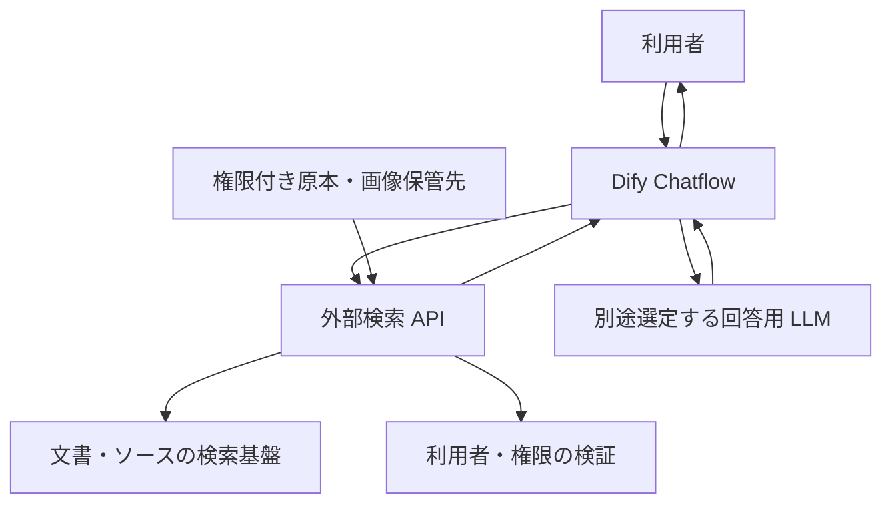

# LLM・チャット機能 概要設計

- 作成日: 2026-10-12
- 関連仕様の確認日: 2026-10-25
- 状態: 設計案・未実装
- 対象: 部署内の維持管理システムに関する仕様確認、機能追加の相談、過去障害の調査

取り込み・Embeddingの実装範囲は[取り込み改善設計（v3）](05-ingestion-improvements.md)へ更新済み。検索APIは[ローカル試作として実装済み](../implementation/search-api.md)。本書のDify Chatflow・回答・チャットは引き続き設計案であり、下書きの選択世代やEmbedding生成だけで回答を公開しない。

2026-10-25の利用者指定により、初回は文書ACL・SSOを保留したローカル試作とする。検索APIの`local_prototype`モードで検索・不足状態・出典を先に実装し、Dify本体とChatflowの実装は後続とする。本書の利用者別権限制御は、その対応段階の要件として保持する。

検索APIと同時に確定するのはJSON契約と成功・不足・エラー時の分岐である。単独HTTP試験後にHTTP Requestノードを接続し、`access_control: "not_enforced"`を権限確認済みとして扱わない。回答LLM・会話画面・引用表示の選定を待たず、検索APIを実装できる。

## 1. 目的と採用方針

Dify の Chatflow を会話画面と処理フローの構築に利用する。回答を生成する LLM は別途選定する。Dify 自体を LLM として扱わない。

文書変換と検索は外部サービスとして分離し、Dify は外部検索 API から得た根拠を使って回答する。これにより、文書・ソースの版管理、原本への参照、検索品質、アクセス制御を検索側で管理できるようにする。Dify 内蔵ナレッジとの二重登録は本案の基本構成に含めない。

PoC は参加者全員が同じ資料を閲覧できる範囲で、1 システムと限定した対象版から開始する。30〜50 問程度の実務質問を評価の開始目安とする。具体的なモデル、モデルの版、応答性能、運用費用の目標は未決であり、検証結果に基づいて決定する。

## 2. 構成と責任範囲

| 構成要素 | 責任 |
| --- | --- |
| Dify Chatflow | 質問の受け付け、検索条件の整理、検索呼び出し、回答生成の制御、会話表示 |
| 回答用 LLM | 渡された根拠の読解・比較、回答案と確認事項の生成 |
| 外部検索 API | 利用者と権限の検証、対象版の絞り込み、検索、根拠と出典情報の返却 |
| 文書変換処理 | 本文・表・画像の抽出、原本位置の保持、変換世代の管理 |
| 原本・画像保管先 | 原本や抽出画像の保管、閲覧権限を満たす参照・取得手段の提供 |

変換データの正本は [文書変換処理の詳細設計](01-document-conversion.md)、外部 API の契約の正本は [検索基盤・検索API設計](02-search-platform.md) とする。本書では同じスキーマや API を独自に再定義しない。

外部検索との接続は、検索基盤設計6.4の状態付き検索 API `POST /search-with-status` を HTTP Request ノードから呼び出す構成を採用案とする。標準外部ナレッジ API は互換経路として提供し、同じ資料を二重管理・二重検索しない。利用者識別情報、対象版、画像参照、抽出不足を受け渡せることを結合検証する。Dify の標準連携で、業務要件が自動的に満たされるとは扱わない。検索基盤設計6.5・6.7に従い、HTTPエラーでは回答生成へ進めず、200では返却予算不足・coverage・根拠の有無を確認する。

## 3. モデルの役割

| 種類 | 役割 | 主な選定観点 |
| --- | --- | --- |
| 回答用 LLM | 質問の理解、根拠の読解、回答生成 | 日本語、ソースの読解、根拠への忠実さ、画像対応の要否、費用、利用可能な環境 |
| Embedding モデル | 文書や質問を意味検索用のベクトルに変換 | 日本語とコードの検索品質、次元数、実行場所、索引の互換性 |
| Reranker | 検索候補と質問の関連度を再評価 | 検索精度の改善、追加の処理時間と費用 |

Embedding と Reranker は検索基盤側の責任とし、回答用 LLM と同じ製品・モデルでそろえることを前提にしない。Reranker の採用は評価で効果を確認して決める。Embedding の変更に伴う索引の再作成や互換性は検索基盤で管理する。

## 4. 会話フロー

1. 質問を受け付け、対象システム・機能・環境・リリースを整理する。対象版が不明で回答に影響する場合は、利用者に確認する。会話中の過去の回答は、それだけで根拠資料として扱わない。
2. 仕様確認、変更相談、障害調査などの質問意図に合わせ、検索語と絞り込み条件を作る。エラーコード、機能 ID、関数名、テーブル名などは識別子として保持する。
3. 外部検索 API を呼び出す。PoC は接続キーに結び付いた共有閲覧範囲を検索する。本番で利用者別権限が必要な場合は、利用者を示す情報を信頼できる認証経路から渡す。質問本文や LLM の出力で利用者・権限を決めない。
4. 検索結果の本文、対象版、出典、状態を確認する。状態付き検索 API の `retrieval_status` から更新待ち・抽出不足を確認し、結果なしと資料を検索できない状態を区別する。必要に応じて追加検索を行う。追加検索の回数と時間には上限を設け、値は PoC で決める。
5. 画像内の情報が必要な場合は、許可された画像を取得し、画像対応 LLM に画像入力として明示的に渡す。画像の URL やファイル名を本文へ記載しただけで、モデルが画像を読んだとは扱わない。
6. 確認できた事実、資料間の差異、推定、未確認事項を区別して回答する。出典を原本で確認できる形で表示する。
7. 根拠が不足する場合は結論を保留し、不足する資料や確認事項を示す。必要な条件が追加されたら再検索する。

ソースや資料の中の文章は調査対象のデータとして扱い、チャットの処理方針やアクセス権を変更する指示として実行しない。PoC では調査と相談を対象とし、本番システムの変更実行を会話フローに含めない。

## 5. 根拠・対象版・出典の扱い

識別情報は次の意味で利用する。詳細な構造と生成規則は文書変換処理の設計に従う。

| 項目 | 本機能での扱い |
| --- | --- |
| `document_id` | 原本を論理的に識別する ID |
| `source_version` | 原本のハッシュによって識別する版 |
| `conversion_revision` | 変換設定や変換処理等の識別子 |
| `block_id` / `chunk_id` | 原本の版と変換世代に紐付く根拠単位の識別子 |
| `artifact_type` | `source` / `derived` により原資料と派生物を区別する |
| `publication_state` | `draft` / `reviewed` / `published` / `excluded` 等の状態を示す |

`source_version` のハッシュを業務上のリリース名と混同しない。リリース名、環境、ソースのコミットなどとの対応は検索基盤の管理情報を参照する。

回答では次の情報を、質問に必要な範囲で提示する。

- 調査対象のシステム・環境・リリース。確定できない項目は未確認と示す。
- 設計上の仕様、対象版の実装、過去の事象のどれに基づく説明か。
- 原本名、ページ・節・シート・セル・コード位置などの参照箇所と、閲覧可能な原本へのリンク。
- 原資料と派生物の区別、および結論に影響する未承認状態や版の相違。
- 資料の矛盾、不足、追加確認が必要な点。

LLM に出典 URL や原本位置を推測で作らせない。検索 API が返した識別子・参照位置と対応させる。原本リンクの表示・閲覧時にもアクセス制御を適用する。

回答に利用する根拠は、検索基盤側で権限と有効世代を確認した `published` の内容に限る。`draft`、`reviewed`、`excluded` は回答根拠に含めない。公開済みであっても原本からの抽出結果と生成された説明を区別する。AI の回答を自動的に公開済みナレッジへ登録せず、有識者の確認と公開手続きを経る。

## 6. 認証・アクセス制御・データ送信

利用者の認証、検索 API の呼び出し元認証、資料の閲覧権限を分けて設計する。共有 API キーはサービスの呼び出し元を認証するものであり、個々の利用者の認証にはならない。

PoC では参加者全員が閲覧できる範囲を検索 API 側で固定する。本番で利用者別 ACL を導入する場合、検索側で改ざんを検出できる利用者情報を検証し、許可された資料だけを返す。LLM に資料を渡した後で権限判定する構成は採用しない。Dify 側の画面やワークスペースへのアクセス制御だけで、資料単位の業務権限を満たしたとは扱わない。本番の認証連携方式は未決とする。

Dify のセルフホストと、外部 LLM・Embedding・Reranker API へのデータ送信は別に管理する。各処理の実行場所、送信内容、サービス側の保存条件、会社の利用承認を確認して構成を選ぶ。セルフホストしたことだけを理由に、データが社外に送られないとは判断しない。

API キーなどの接続情報は秘密情報として管理し、会話本文や検索根拠に混在させない。

## 7. 失敗時の動作

| 状況 | 動作 |
| --- | --- |
| 該当する根拠がない | 根拠不足として回答を保留し、追加の検索条件・資料を案内する |
| 更新待ち・部分抽出・収集状態不明 | 対象範囲の不足を明示する。取得済み根拠の範囲で説明し、不存在や影響なしを断定しない |
| 資料同士が矛盾する | 対象版と出典を併記し、どちらが正しいか未確認なら断定しない |
| 検索 API の障害・タイムアウト | 検索を完了できなかったことを通知する。一般知識による回答で穴埋めしない |
| 利用者情報や権限の検証に失敗 | 検索を停止する。資料の存在や内容が漏れるエラー表示を避ける |
| 画像の取得・入力に失敗 | 画像を未確認と表示し、画像内の仕様や数値を断定しない |
| LLM の障害・出力不備 | 回答生成に失敗したことを通知し、不完全な回答を確定結果として表示しない |

障害と「検索は成功したが該当資料がない」を区別して記録する。限定的な再試行の有無と上限は実装時に決定する。

## 8. ログと運用

調査・改善のため、要求を追跡できる ID、対象システム・版、処理結果、参照した根拠 ID、利用モデルと版、処理時間、利用量、エラー種別を記録する。Dify のフローやプロンプトの変更も、評価結果と対応付けて管理する。

質問本文、検索結果、回答、画像には機密情報が含まれ得るため、全文を保存するか、どこに保存するか、保管期間、閲覧権限、マスキング・削除手順を本番前に決定する。秘密情報はログに記録しない。運用者と評価担当者の閲覧範囲を定め、会話ログを無期限保存することは前提にしない。

有識者による訂正、根拠不足の質問、資料間の矛盾を改善候補として集める。訂正内容はレビュー後に資料へ反映し、再変換・再索引を通じて検索結果を更新する。モデルやフローの更新時には既存の評価質問で品質を再確認する。

## 9. 受入観点と未決事項

PoC では仕様確認・変更相談・障害調査の実務質問を用い、以下を確認する。合格率や応答時間などの数値基準は業務側と合意して設定する。

- 根拠を取得できたか、取得した根拠を正しく読めたかを分けて評価できる。
- 対象版に一致する回答ができ、旧版や異なる環境の情報を混同しない。
- 参照位置を開いて回答を検証できる。原資料と派生物の状態が分かる。
- 不足・矛盾・検索障害を識別し、根拠なしで結論を作らない。
- PoC では共有閲覧範囲から逸脱しない。本番の利用者別 ACL は、連携経路の確定後に検索・回答・原本表示を通して検証する。
- 画像が必要な質問で、画像を実際に渡せた場合と未確認の場合を区別できる。
- 調査時間の短縮、回答の有用性、応答時間、費用を業務として評価できる。

未決事項は、Dify の配置と運用担当、本番認証、状態付き検索 API と Chatflow の結合設定、利用するモデルと版、画像入力の対象と受け渡し方式、ログ方針、可用性・バックアップ・復旧目標、費用と性能の基準とする。独自チャット画面の必要性は、社内認証、出典の表示、原本プレビューなどを Dify で満たせるか検証して判断する。

## 10. 公式参照

以下を機能検討の参照先とする。採用する Dify の版・提供形態で動作と制約を確認する。

- [Workflow と Chatflow](https://docs.dify.ai/en/cloud/use-dify/build/workflow-chatflow)
- [External Knowledge API](https://docs.dify.ai/en/cloud/use-dify/knowledge/external-knowledge-api)
- [HTTP Request ノード](https://docs.dify.ai/en/cloud/use-dify/nodes/http-request)
- [アプリケーションのログ](https://docs.dify.ai/en/cloud/use-dify/monitor/logs)
- [モデルプロバイダー](https://docs.dify.ai/en/cloud/use-dify/workspace/model-providers)
