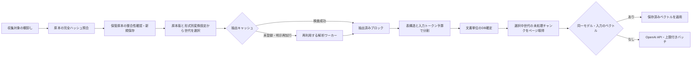

# ファイル取り込み改善設計（スキーマv3）

更新日：2026-10-25。今回の8項目の実装仕様。検索公開・リリース別採用・ACL・チャットは従来どおり未実装で、成果物はdraftのまま保持する。

2026-11-01：取込対象をWord（DOCX）・Excel（XLSX/XLSM）・PDF・TXT・Markdownに限定した。プログラム解析は別処理で設計・実装するため、本処理には含めない。SQL・JSON・YAML・YML・CSV・LOGも原本の取込対象外とする。YAMLの実行設定、JSON/JSONLの確認用出力、DB用SQLは引き続き使用する。

既存環境の設定修正・再取込・履歴の扱いは[文書形式への限定](../implementation/document-only-ingestion.md)を参照。

## 1. 処理の流れと選択世代



`selected_generations`がナレッジと文書ごとの要求変換設定・選択中世代を持つ。取り込みで列挙した文書は、まず選択をNULLにしてpendingに戻す。収集後に原本版と変換設定を確定し、対応する世代を選択する。失敗世代も選択先として残し、失敗状態を隠さない。

Embeddingは、対象に含まれる文書・availableの原本と収集状態・選択世代・最新原本版・選択時の変換設定・実行時設定のすべてが一致する場合だけ処理する。作成日時順の世代選択は廃止した。設定A→B→AではAを再利用し、B失敗時はAへ暗黙に戻らない。別設定でembedした場合は`config_mismatch`として報告する。

この選択は下書き取り込み用であり、将来の`document_release_bindings`による業務リリース別公開採用を代替しない。

## 2. 三段階の再利用

| 段階 | キー・保存先 | 無効化条件 |
| --- | --- | --- |
| 抽出 | 原本のSHA-256＋形式別`extraction_revision` → `extraction_cache` | その形式のパーサー・依存・抽出設定、PDFならモデル固定版が変化 |
| 分割・世代 | 文書ID＋原本版＋`conversion_revision` → 既存の世代表・blocks・chunks | 抽出設定または分割実装・文字数・トークン数・文脈予算が変化 |
| Embedding | `embedding_profile_id`＋実際の`search_text`のハッシュ → `embedding_cache` | モデル・次元・入力版、または実際の入力が変化 |

抽出プロファイルから分割条件を分離した。PDF以外のプロファイルにはDoclingモデルやPDFバックエンドの設定を含めない。共通のパーサーソース・domainのコード変更は保守的に再抽出の対象とする。

抽出キャッシュはブロック・関係・品質・実体参照をJSONで持ち、ペイロードハッシュを検証する。画像は既存ストレージのID・サイズ・ハッシュを確認して読む。欠落画像は再抽出し、破損画像をキャッシュで隠さない。キャッシュ更新は文書のDB登録と同じトランザクションで行う。`--retry-partial`で実際に再処理する文書は抽出キャッシュを使わない。

Embeddingキャッシュはベクトルを入力単位で保存する。チャンクへの適用結果は従来の`chunk_embeddings`にも保存し、既存の検索用データ構造を維持する。同じページ内の同一入力は1回だけ送信する。v2の既存ベクトルはプロファイル・入力ハッシュで検索し、新世代にもAPI再送なしで利用できる。キャッシュの利用は公開・権限判定ではない。

## 3. 表とトークンを考慮する分割

本文の上限は`chunk_max_characters`、文脈を含む最終入力の上限は`chunk_max_tokens`で制御する。対応モデル共通の`cl100k_base`で実測し、`chunks.token_count`へ保存する。既定値は1800文字・8191トークン。検索用文脈は`chunk_context_max_tokens`（既定1024、実際には全体予算の半分以下）に制限する。

Doclingの`table.table_cells[].column_header`、既存形式の`headers`、必要ならMarkdownヘッダーから列情報を取得する。表は行境界を優先し、各検索用入力へ列見出しを引き継ぐ。1行が上限を超える場合は原本文字範囲に沿って分割し、`table_row_split`を付ける。長大な列情報や見出しの検索用文脈を省略した場合は`search_context_truncated`を付ける。

文脈は`search_text`だけに加え、`content_text`や原本ブロックは変更しない。`chunk_blocks`の範囲はUnicodeコードポイントで保持し、本文と原文の一致を保存前に検査する。送信直前にも上限を再検査し、不整合な入力はAPIへ送らない。

## 4. 解析プロセス・モデルの再利用

`workers.ParsePool`はspawn方式の子プロセスを最大`parse_workers`個まで作り、文書間で再利用する。既定1、上限4。現在は文書ごとに取得・解析・DB確定を順に行うため、同時解析は1文書であり、設定を増やしても文書解析の並列実行にはならない。既定1でモデルの重複ロードを避ける。

各プロセスはモデル配置先・検査済みfingerprint・Converter型でDocling Converterをキャッシュする。APIキー・DB接続は子へ渡さない。文書ごとの`parse_timeout_seconds`は維持し、期限超過やプロセス終了時はそのワーカーを停止・交換する。`parse_worker_max_tasks`回、または処理後のピークメモリが`parse_worker_max_memory_mb`以上になったワーカーも交換する。これは文書途中のハードなメモリ制限ではない。

レポートの`parser_workers`に起動・再利用・交換数、ピークメモリ・計測可否を出す。全体のingest/embed排他は維持する。残存ジョブを回収する処理はDB全体排他に依存するため、ロックだけを解除して並列化しない。

## 5. Embeddingの読み込み・要求上限

対象世代と入力ハッシュが一致する未処理チャンクをDB側で絞り込み、`(generation_id, chunk_id)`のキー範囲でページ取得する。既定`embedding.read_batch_size=128`、上限1000。過去・別ナレッジの全ベクトルをPython辞書へ読み込まない。キャッシュ照合もそのページの入力ハッシュだけを問い合わせる。

1要求は`embedding.batch_size`（既定16、上限32）と`embedding.batch_max_tokens`（既定262112、上限300000）の両方で制限する。同時API要求は1。1入力は保守的に8191以下とする。[OpenAI API仕様](https://developers.openai.com/api/reference/python/resources/embeddings/methods/create)は1入力8192、1要求の合計300000を上限としている（確認日2026-10-25）。

DB接続を閉じてからAPIを呼び、検査済み応答を短いトランザクションで保存する。バッチ排他のセッション接続だけは保持する。成功済みバッチは後続失敗でも残し、再実行で未完了分を処理する。レポートは`embedded`（API結果を適用したチャンク数）、`api_inputs`（API入力件数）、`reused`（他世代等の保存済み入力から適用）、`unchanged`、`failed`、`unready_documents`を区別する。個別の入力エラー詳細は最大100件で、集計件数は全体を示す。

## 6. モデルの固定版と整合性

配布対象の正本は`src/file_scan/docling-models.lock.json`。Docling版・取得元・固定コミット・許可パターン・期待ファイルとSHA-256をGit管理する。`data/models/docling/model-manifest.json`は実際の配置記録であり、両者を分ける。

通常取得はlockの固定コミットだけを指定し、main等を再解決しない。モデル更新は`download_docling_models.py --update-lock`で明示的に行い、lockの差分もレビューする。`--verify-only`は取得せず検査する。

使用前にモデル版・ファイル一覧・存在・サイズ・ハッシュを照合する。プロセス内ではmanifest・lock・各ファイルのdevice/inode/サイズ/mtime/ctimeが同じ場合のみ検査を再利用する。モデルが変化すれば同じmanifestでも再照合し、不一致を失敗として扱う。PDF以外の取り込みはモデル配置に依存しない。

## 7. 状態表示と履歴

`status.documents`は現在のincluded文書数。`generations`は選択中世代の`succeeded / partial / failed / pending / unavailable / stale / config_mismatch`別件数。`historical_generations`は除外文書も含む過去世代の処理状態別件数。`embeddings`はプロファイル別に現在の対象チャンクの`ready / pending / total`を示す。履歴は削除しない。

## 8. 変更のない原本のI/O

既存原本がある場合も共有元を全文ハッシュし、読み取り前後の署名・サイズを照合する。ハッシュが一致すれば既存保管物も検証して再利用し、一時ファイルへのコピー・fsync・再インストールを省略する。mtime・サイズだけでは変更なしと判断しない。同サイズの内容変更も検知する。

新規原本は従来どおりストリームでコピー・ハッシュする。同サイズで内容が変わった場合や保管原本が欠落した場合は、確認後に改めてコピーするため原本を2回読むことがある。保管物の破損は失敗として残す。ネットワークの全文読み込み自体は省略しない。共有側の信頼できる更新通知は未導入であり、強い整合性を維持する方式を採った。

各ファイルの`source_bytes_read`、`temporary_bytes_written`、`original_reused`を実行レポートへ記録する。変更のない再取り込みでは一時書き込み0を検証する。

## 9. DB移行と運用

スキーマv3は`selected_generations`、`extraction_cache`、`embedding_cache`と入力ハッシュ照合用索引を追加する。v1からはEmbedding用2表も追加する。既存表・原本・世代・ベクトルを削除しない。未知版、管理表の欠落、追加先の同名衝突は自動修復しない。

```sh
file-scan init-db --config config.local.yaml
python scripts/download_docling_models.py --config config.local.yaml --verify-only
file-scan ingest --config config.local.yaml
file-scan status --config config.local.yaml
# 実キーとembedding.enabled=trueを設定した場合だけ生成する
file-scan embed --config config.local.yaml
```

移行時に旧世代の作成日時から選択を推測しない。次回ingestで明示的な選択を作るまでpendingとして扱う。v3の変換プロファイルはv2と異なるため、旧抽出結果を無検査でキャッシュへ転用せず、初回は再抽出する。新しい世代・キャッシュの初回作成後は段階ごとに再利用する。

検証は`tests/test_improvements.py`と既存テストで行う。PostgreSQL・pgvectorはテスト専用DB内の一時schema、APIはSDKのHTTP模擬、PDFは事前配置した実モデルを使用する。性能改善率、実共有サーバーのI/O、実API課金・検索品質は別途実測する。

検証済み結果は[取り込み改善v3の検証記録](../implementation/ingestion-improvements-validation.md)を参照。
