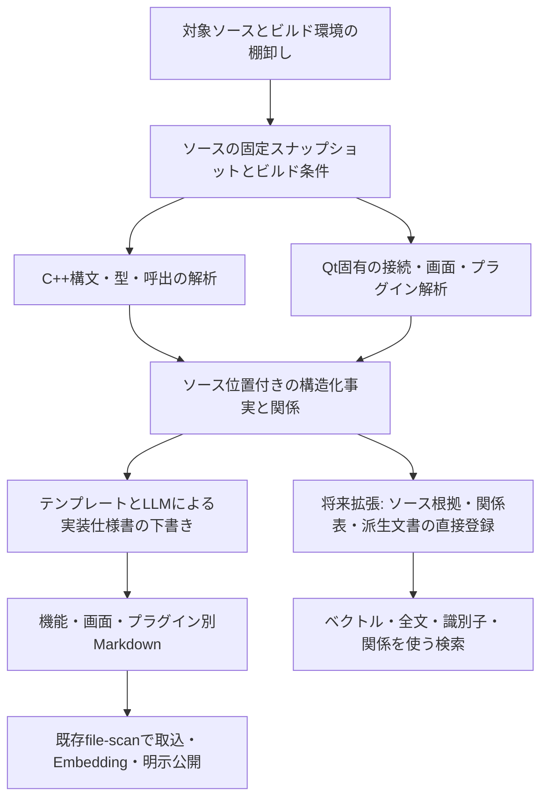

# C++／Qt専用取込・仕様書生成の設計案

作成日：2026-11-01。方式検討用の設計案。C++解析器・専用CLI・DB拡張は未実装。

2026-11-02：利用・参考候補を[GitHubプロジェクト比較](../research/2026-11-02-github-cpp-qt-analysis-comparison.md)へ整理した。Doxygen・clang-uml・Code-Graph-RAG・CocoIndex等の役割と、対象Qtアプリで追加検証する範囲を記載する。

同日追補：前回調査で未掲載だったCodeWiki 2.0を確認し、仕様ドキュメント生成の優先検証候補へ追加した。依存グラフ・階層的な文書生成・差分更新を利用する案と、抽出結果から独自に文書化する案を比較する。Qt 3固有の接続・画面・プラグイン解析と既存DBへの接続は、別途評価する。

外部ツールの役割と初期の処理順序は[解析の全体イメージ](07-cpp-qt-analysis-overview.md)へ整理した。CodeWikiの出力とQt補完資料を後段で照合し、既存取込へ渡す構成を初期案とする。

対象はQtを使ったアプリ本体と多数のプラグイン。利用者から「Qtは古い版で、おそらく3系」「ビルド方式は不明」「ビルド可能な環境はある」と確認した。Qtの正確な版、対象ソース、ビルド設定はまだ実物確認していない。

## 1. 推奨する構成

**C++構文解析、Qtの版に応じた固有解析、プラグイン・画面・処理の関連付けを行い、その結果から根拠付きの実装仕様書を生成する。** DBは既存のPostgreSQL＋pgvectorを利用できる。



最初はMarkdownを接続点にすると既存の取込処理を活用しやすい。将来のソース行への直接引用・プラグイン横断の影響調査には、構造化事実も保持して検索側を拡張する。

LLMには、解析で得た事実と必要な範囲のソースを渡す。全ソースを一括投入する方式や、文字数だけでソースを分割する方式を基本設計にはしない。

## 2. 現行実装との接続条件

以下は設計書だけでなく、現行コードを確認した結果。

| 現行の実装 | C++側での扱い |
| --- | --- |
| `src/file_scan/config.py`は文書形式だけを許可 | C++原本の拡張子を既存取込へ追加せず、別の解析処理を作る |
| `src/file_scan/pipeline.py`は1ファイルごとに原本版・抽出世代を管理 | 複数ソースから仕様書を生成する処理は、この前段でプロジェクト単位の整合性を管理する |
| `src/file_scan/embeddings.py`は選択中世代の`search_text`を埋め込む | 生成Markdownの取込後は現行の`embed`を使える。コード専用表に入れたデータをそのまま処理するAPIではない |
| `src/file_scan/db.py`に`blocks`・`chunks`・`artifact_relations`・Embedding表がある | 保存構造の考え方は共用できる。文書単位の登録経路を無改造でプロジェクト解析へ転用できるとは扱わない |
| `src/search/management.py`は`artifact_type=source`の世代だけを公開し、本文と原文の文字範囲一致を検査 | 派生仕様書を直接`derived`で登録して公開するには拡張が必要 |
| 検索公開時の関係コピーは同一世代内の確認済み関係に限定 | ファイルやプラグインをまたぐソース関係の探索は追加実装が必要 |
| `src/search/evidence.py`の引用位置は公開原本のパスを使う | Markdown経由の引用先は生成Markdown。C++原本の位置を本文へ書いても、ソースの直接引用機能にはならない |
| 1DBに対して`storage_dir`を固定 | 同じDBへ接続する新しい取込設定も、既存DBに結び付いた保管ルートを使う |

現在の検索公開では`content_data`全体を引き継いでおらず、表向け項目等に絞っている。ソース情報をJSONへ追加するだけでは、検索結果や引用APIまで届かない。

## 3. 最初にビルド環境で確認すること

### Qtの正確な版と使用するSDK

利用開始時期からQtのメジャー版を断定しない。ビルド時に実際に選ばれるQtの`qglobal.h`にある`QT_VERSION_STR`を確認する。Qt 3の原本にもこの定義が存在する。[Qt 3のqglobal.h原文（マニュアル収録版）](https://qt.developpez.com/doc/3.3/qglobal-h/)

ビルドで使用する`qmake`が分かれば、その実体のパスを指定して`-v`を実行する。別途インストールされたQtやPATH先頭のqmakeだけで判定しない。qmake自身の版とQtライブラリの版を区別する。Qt Creatorを使っている場合も、IDEの版と対象アプリのQtの版を区別する。

### 収集する情報

| 情報 | 主な確認場所・目的 |
| --- | --- |
| Qtの版、include、ライブラリ、moc、uic | ビルドで使用するSDKの特定 |
| OS、32／64bit、コンパイラと版、標準ライブラリ | 解析条件と対象バイナリ条件の再現 |
| ビルドの入口 | `.pro`・`.pri`、`CMakeLists.txt`、`.dsw`・`.dsp`・`.sln`・`.vcproj`等、Makefile、実行スクリプト |
| コンパイルコマンドと作業ディレクトリ | include、define、言語モード、応答ファイルの展開 |
| 本体・共通ライブラリ・各プラグインの出力 | ソースと機能・ターゲットの所属を対応付ける |
| 配置構成と設定ファイル | どのプラグインをどこから読み、どう有効化するか |
| 原本の文字コード | CP932等を含むコメント・日本語文字列と位置の対応 |

既存環境でビルド情報を収集し、解析用データを出力する。旧Qtのビルド環境をそのままUbuntu 26.04へ移せることは前提にしない。必要なら解析器もビルド環境に近い環境で動かし、JSON・Markdown等の成果物を取込環境へ渡す。

Git管理であればコミットとサブモジュール版を記録する。未コミット変更やGit管理外のソースも対象なら、各ファイルの内容ハッシュを持つ固定スナップショットを作り、コミットIDだけで同一性を判断しない。

## 4. 解析方式の選択

| 手段 | 役割 | 制約・採用方針 |
| --- | --- | --- |
| Clang LibTooling | クラス、型、継承、宣言・定義、解決可能な呼出、ソース位置の抽出 | 意味解析の主候補。旧SDK・コンパイラ拡張との互換性を小さな単位で先に確認する |
| Qt専用の字句・マクロ・XML解析 | Signal／Slot、画面、プラグイン登録、読込経路の抽出 | 必須。Qt 3／4／5以降で解析ルールを切り替える |
| Tree-sitter C++ | ビルド条件を再現できないファイルの構造抽出 | 代替経路。型解決や呼出先の確定を保証しない。Qtマクロ周辺の構文エラーも計測する |
| Doxygen XML | API一覧、コメント、クラス構造等の補助資料 | 導入初期の棚卸しに使える。Qt固有の接続や業務仕様の復元は別に行う |
| LLM | 構造化事実とソース断片を基にした説明・仕様書の下書き | 関係や業務ルールの唯一の判定器にはしない |

Tree-sitterは構文エラーがあっても有用な構造を得ることを目指すパーサーであり、DoxygenはXML出力を提供する。どちらも補助経路として評価する。[Tree-sitter公式説明](https://tree-sitter.github.io/tree-sitter/)、[Doxygenの出力形式](https://www.doxygen.nl/manual/output.html)

Clangは実際のコンパイル条件を使う構成にする。`compile_commands.json`は翻訳単位ごとのコマンドと作業ディレクトリを保存する標準的な入力である。[Clang LibTooling](https://clang.llvm.org/docs/LibTooling.html)、[Compilation Database仕様](https://clang.llvm.org/docs/JSONCompilationDatabase.html)

ビルド方式別に取得方法を選ぶ。

- CMake＋Makefile／Ninjaなら`CMAKE_EXPORT_COMPILE_COMMANDS`を利用できる。Visual Studioジェネレーターでも同じ設定で出力されるとは扱わない。ターゲット所属・リンク依存は、必要に応じてCMake File API等で別途取得する。[CMake公式説明](https://cmake.org/cmake/help/latest/variable/CMAKE_EXPORT_COMPILE_COMMANDS.html)、[CMake File API](https://cmake.org/cmake/help/latest/manual/cmake-file-api.7.html)
- qmake＋対応するmake環境なら、Bear等によるコンパイラ実行の捕捉を検討する。ビルド対象が実行されなければ全コマンドは集まらないため、独立した解析用ビルドで対象を網羅する。[Bearの開発元](https://github.com/rizsotto/Bear)
- 古いVisual Studioや独自ビルドなら、プロジェクト設定と実際のビルドログから解析用コマンドを組み立てる。Bearが任意のWindows環境で使えるとは前提にしない。

ビルドが成功することと、現行Clangで旧SDKを正確に解析できることは別である。元ソースを改造せず、解析用の引数調整・互換定義が必要なら記録する。意味を変える補完が残る範囲は部分解析とする。

Clangが展開後に見る構造だけでは、Qtの宣言意図を取り出しにくい場合がある。元トークンとプリプロセッサのマクロ展開情報も保存し、`signals`・`slots`等の位置を関連付ける。単純な正規表現だけで入れ子・コメント・文字列を横断して解析しない。

## 5. Qt 3系を含む解析対象

| 対象 | 抽出する内容 |
| --- | --- |
| `.h`・`.hpp`・`.cpp`・`.cc`・`.cxx`等 | クラス、関数、型、継承、状態、分岐、入出力、エラー処理、直接呼出 |
| `Q_OBJECT`・`signals`・`slots`・`emit`・プロパティ宣言 | Qtの公開機能とイベント発生箇所。利用版に存在する構文を解析 |
| `connect(..., SIGNAL(...), ..., SLOT(...))` | 送信元・受信先・シグネチャ・条件付き接続・切断。旧版で優先する |
| `.ui` | 画面項目、表示文字列、メニュー、アクション、配置階層、明示された接続 |
| **Qt 3の`.ui.h`** | **利用者が記述したSlot実装等を含むソースとして必ず調べる。生成ヘッダーと一括除外しない** |
| 旧プラグインのエクスポート・ファクトリー | `Q_EXPORT_PLUGIN`等、対象SDKで実際に使われる登録方式と提供機能 |
| 独自のプラグイン読込・登録処理 | `QLibrary`、動的シンボル解決、独自Factory、関数ポインタ、OSのDLL読込、設定による選択 |
| `.pro`・`.pri`・Makefile・IDE設定・ビルドログ | 機能の所属、依存ライブラリ、条件付きビルド、生成コードとの対応 |
| 翻訳ファイル・リソース・機能設定 | 存在する形式を確認して、画面の日本語名・識別子・有効化条件を対応付ける |

Qt 3のDesignerは`.ui.h`へSlot等の実装を記録する。これは`uic`生成物とは異なる、版管理されるソースである。ここを除外すると、画面の処理本体を取りこぼし得る。[Qt 3 Designerの原文マニュアル（保存版）](https://documentation.help/Qt-3.0.5/designer-manual-4.html)

Qt 3の`.ui`は`UI`ルート要素を持ち、接続・画面項目等を記録する。Qt 6向けのスキーマをそのまま適用せず、版を識別して解析する。[Qt 3.3.4同梱マニュアル原本](https://sources.debian.org/data/main/q/qt-x11-free/3:3.3.4-3sarge3/doc/html/designer-manual-16.html)

Qt 3当時のカスタムウィジェットプラグイン資料には`Q_EXPORT_PLUGIN`による登録が示されている。ただし、アプリ独自のサブ機能がQt標準プラグインの仕組みを使っているとは限らない。実際の本体側ローダーと登録処理を起点に調べる。[Qt 3のプラグイン作成マニュアル原本（保存版）](https://documentation.help/Qt-3.0.5/designer-manual-6.html)

Qt 4なら`Q_EXPORT_PLUGIN2`等、Qt 5以降なら`Q_PLUGIN_METADATA`・`Q_DECLARE_INTERFACE`・`Q_INTERFACES`・`QPluginLoader`等を版に応じて追加する。後年の機構をQt 3へ一律適用しない。[Qt 4期のプラグイン解説](https://wiki.qt.io/Plugins)、[現行Qtのプラグインマクロ](https://doc.qt.io/qt-6/qtplugin.html)

新しい版であれば、関数ポインタ・lambdaによる接続、`connectSlotsByName`、QMLとの接続等も対象にする。存在を確認してから対応範囲を決める。[自動接続の公式説明](https://doc.qt.io/qt-6/qmetaobject.html#connectSlotsByName)

`moc`・`uic`の生成コードは意味解析に必要な入力として利用するが、通常は利用者が読む仕様書の主要な説明対象から外す。生成物の判定はファイル名だけで決めず、ビルド手順・ヘッダーコメント・元ファイルとの対応で確認する。

## 6. 多数のプラグインをどう整理するか

本体、共通ライブラリ、プラグイン、画面・機能を別々の実体として管理する。ディレクトリ名だけでプラグインを確定せず、ビルド出力・登録クラス・ローダー・設定の対応で境界を決める。共有ソースは複数のターゲットへ所属できるようにする。

プラグインごとに次を記録する。

- 安定したプラグインID、表示名、ターゲット、出力DLL／共有ライブラリ、登録・生成クラス。
- 提供インターフェース、コマンド、画面、初期化・終了処理。
- 本体の読込箇所、有効化条件、使用する設定、実装が利用する共通機能。
- ビルド依存、機能上の依存、実行時の読込依存を区別した関係。
- 関係の根拠と未解決事項。

Qt 5以降に見つかるIIDはインターフェースの識別子であり、複数の実装が共有し得る。IIDだけをプラグインの一意IDにしない。独自メタデータに依存情報がある場合は、そのアプリの規約を読み取るアダプターを追加する。[Q_DECLARE_INTERFACEの公式説明](https://doc.qt.io/qt-6/qtplugin.html#Q_DECLARE_INTERFACE)

プラグイン関係はPostgreSQLの通常テーブルでも保持できる。最初から別製品のグラフDBを導入する必要はない。

## 7. 解析結果の確実性と根拠

抽出する関係の例は`declares`、`defines`、`inherits`、`calls`、`connects_signal_slot`、`loads_plugin`、`implements_interface`、`uses_setting`、`accesses_table`。SQL文字列が組み立てられる場合などは、解決できた範囲だけを保存する。

関係ごとに、少なくとも次の状態を分ける。

| 状態 | 意味 |
| --- | --- |
| `resolved_static` | 対象ビルド条件で宣言・参照や接続式を静的に対応付けた。実行されたことは意味しない |
| `candidate` | 仮想呼出、関数ポインタ、文字列等からの候補。対象を一意に確定できていない |
| `observed_runtime` | 特定のビルド・設定・試験シナリオで観測した。全経路の網羅を意味しない |
| `unresolved` | 接続・呼出・読込の記述はあるが、相手や条件が未解決 |

Signal／Slotがソース上で接続されていても、条件分岐・切断・オブジェクト寿命・スレッド条件で実行時の挙動は変わる。後年のQtでは接続種別によって実行時期も異なる。[Qt公式Signal／Slot説明](https://doc.qt.io/qt-6/signalsandslots.html)

ソース根拠は、`repository_id`、固定した`snapshot_id`、コミット（存在する場合）、ビルド条件ID、相対パス、ファイルハッシュ、文字コード、開始・終了位置、シンボルIDを持つ。行・列だけでなく元バイト範囲も保持し、文字コード変換後の文字範囲と対応付ける。

Clangのシンボル識別子等は利用できる範囲で保存する。完全修飾名だけではオーバーロード・匿名要素・内部リンケージを区別できないため、宣言位置とシグネチャ等を併用する。コンパイル条件やツールの版も識別範囲に含める。

## 8. 生成する仕様ドキュメント

| 文書 | 内容 |
| --- | --- |
| システム構成 | 本体、共通基盤、各プラグイン、外部システムの関係 |
| プラグイン仕様 | 目的、提供機能、登録・読込・終了、依存、有効化条件 |
| 画面仕様 | 項目、表示名、入力制約、ボタン、イベント、画面遷移 |
| 機能・処理仕様 | 起動契機、入力、条件分岐、処理手順、出力、エラー、データ更新 |
| インターフェース仕様 | 関数・型・Signal／Slot、引数、戻り値、呼出・接続関係 |
| 未確認事項 | 静的に解決できない箇所、動作確認が必要な条件、業務上の意味が不明な値 |

テンプレートで事実の一覧を作り、LLMは必要なソースを参照して自然言語の説明を補う。生成した各説明に`evidence_ids`を対応付け、ソースで確認できる内容と推定を明示する。モデル・プロンプト・入力ハッシュ・生成条件も保存する。

ソースから作る文書は「現在の実装仕様」の下書きとする。設計意図、業務上の正当性、未実装の要件、運用ルールは、原ソースだけで確定できない。既存の設計書・テスト・運用知識との照合対象にする。レビュー済みかどうかは、解析の確実性とは別項目で管理する。

処理フロー図・プラグイン依存図は、構造化した関係から生成する。未解決の関係は図でも候補と分かる表示にする。

## 9. ベクトル登録する単位

**仕様説明とソースの根拠を両方保持する。** 生成した説明だけを保存すると、ソースの省略・誤解釈を後から検証しにくくなる。

| 種類 | 主な分割単位 | 用途 |
| --- | --- | --- |
| 仕様説明 | 機能、画面、プラグイン、仕様書の節 | 日本語の機能質問 |
| ソース根拠 | 関数・メソッド、インターフェース、接続式、画面項目、登録処理 | 実装確認・引用・変更箇所の特定 |
| 関係 | ノード間のエッジと根拠ID | 呼出先・呼出元、依存、接続、影響範囲 |

関係は通常の表で保持し、関係ごとのEmbedding生成は必須にしない。巨大な関数は論理的なブロックに分け、親関数・シグネチャ・所属を引き継ぐ。大きなクラス全体を1チャンクにせず、機能の説明と各メソッドを関連付ける。

検索入力には機能の日本語名、画面表示名、プラグイン名、完全修飾名、必要な説明・ソースを含める。モデル・次元・入力仕様を統一し、同じDBでも互換でないベクトルを混ぜて比較しない。パーサー・生成モデル・プロンプトの更新とEmbeddingモデルの更新は別の版として扱う。

## 10. 第1段階：生成Markdownを既存取込へ渡す

新しい`src/cpp_scan/`等のモジュールで、棚卸し・解析・仕様書生成を行う構成を提案する。ここで示すモジュール名は設計案であり、まだ存在しない。

生成物は、業務データ用の管理先に次のように分けて配置する。

```text
cpp-analysis/<snapshot-and-profile>/
  manifest.json       # 対象原本、版、解析条件、成功・失敗、出力一覧
  facts/              # シンボル・接続・プラグイン・根拠の構造化データ
  documents/          # プラグイン・画面・機能別のMarkdown
  review/             # 未解決事項と品質レポート
```

Markdown本文には、対象版・ビルド条件・生成文書である旨・確認状態・根拠パスと行範囲を記載する。機能やプラグインごとの安定したファイル名を使う。収集先に公開する一式は解析結果とmanifestを照合して確定し、生成途中の空フォルダや古い残存ファイルを成功した最新版として取り込まない。

解析・生成失敗時は取込へ進めず、失敗範囲を報告する。部分出力を採用する場合は不足を明記し、消えたファイルを削除と判断する前に棚卸しが完全に成功したことを確認する。Markdownに「未確認」と書くだけでは現行取込の`processing_status=partial`にはならないため、生成側のmanifest検査と公開前確認で不足を管理する。

生成後は、生成Markdown専用の設定で既存のコマンドを使える。

```sh
file-scan scan --config config.cpp-docs.local.yaml
file-scan init-db --config config.cpp-docs.local.yaml
file-scan ingest --config config.cpp-docs.local.yaml
file-scan status --config config.cpp-docs.local.yaml
# Embeddingを有効化し、送信先・対象内容を設定済みの場合
file-scan embed --config config.cpp-docs.local.yaml
```

`config.cpp-docs.local.yaml`は今後作成する設定例の名称。`include_extensions`は`.md`だけとし、収集元は完成した文書一式の配置先に限定する。DBを共用するなら`storage_dir`は既存DBと同じにする。初期検証は別の`knowledge_id`を使うと、既存文書の所属管理と切り分けやすい。検索は既存と同じく、対象リリースへの明示公開後に利用する。

この方式でDB上の`source`が意味するのは、取り込んだMarkdown原本である。C++ソースそのものを検証したという意味ではない。引用先もMarkdownになる。C++原本のパス・ハッシュ等はMarkdown本文と別保存の構造化データへ記録し、現行処理がsidecar JSONを自動読込するとは扱わない。

現行の検索APIは要求ごとに1つの`knowledge_id`を指定する。文書ナレッジとコード仕様ナレッジを分けた場合、両方を1回で横断する検索は呼出側の統合かAPI拡張が必要である。

## 11. 第2段階：ソース根拠と生成仕様書を直接管理

ソース行の直接引用・生成文書の根拠検証・依存関係の探索が必要になった段階で、専用取込と検索の接続を拡張する。

| 論理データ | 主な内容 |
| --- | --- |
| プロジェクト解析世代 | ソース一覧ハッシュ、Qt・SDK・コンパイル条件、解析器と版、処理状態 |
| ソースファイル | 原本保管参照、内容ハッシュ、パス、文字コード、生成物区分 |
| シンボル・所属 | クラス、関数、画面、プラグイン、ターゲットとソースの多対多関係 |
| コード関係 | 呼出、接続、継承、読込、依存、解決状態、条件、根拠 |
| 生成文書・根拠対応 | 文書版、節・主張と根拠ID、生成条件、確認状態 |

これは論理的な追加候補であり、DDLや既存スキーマの版はまだ確定しない。既存表との共用範囲は実装設計時に決める。複数ファイルの事実を1つの抽出世代と見なすなら、プロジェクト原本のmanifestと個々の保管原本の整合性を検証する登録経路が必要になる。

EmbeddingのAPI呼出・入力制限・キャッシュ・ベクトル検査は共通サービスとして再利用できるようにする。現行`embed()`は文書の選択世代と変換プロファイルに依存するため、専用表へ行を追加するだけで使えるとは扱わない。既存の非公開関数を新処理から多数直接呼び出す構成にはしない。

検索公開側では、原本コードは`source`、生成説明は`derived`として区別し、派生文書から根拠へ戻れる形にする。生成説明と元コードの文字列一致は要求せず、説明の根拠IDと、根拠コードそのものの原文一致をそれぞれ検査する。生成説明をソースからの逐語引用として返さない。

現行の公開コピー・候補フィルター・引用組立てまで合わせて拡張し、`content_data`、ソース別の位置、ファイルをまたぐ関係を保持する。プラグインID・ビルド条件・コード版による検索条件も、この段階で実装する。異なる版や条件の関係は探索時に混在させない。

検索例は、日本語の質問から仕様説明を取得し、識別子で対象を絞り、確認済みまたは明示された候補の関係を限られた深さで展開して根拠コードを付ける。ベクトル検索・PGroonga・識別子検索の既存構成に関係探索を加える案とする。

## 12. 差分更新と品質管理

ソース本文だけのハッシュでは、ヘッダー・define・SDKの変更を検出できない。解析結果のキーに翻訳単位、依存ヘッダーと生成入力、ビルド条件、ツール版を含める。同一ファイルが複数条件でコンパイルされる場合は別の解析結果を持たせる。

変更したヘッダーの利用先、変更したインターフェースの実装・呼出側、プラグイン読込・画面接続の影響を再評価する。生成仕様書は依存した事実・根拠の変更に応じて更新する。Embeddingはモデルと実際の入力が同じならキャッシュを再利用する。

Markdown経由では本文に含めたコミットID等の変更も再取込・再Embeddingの対象になり得る。初期検証では追跡可能性を優先する。本格構成では版情報をメタデータとして保持し、検索入力へ入れる情報と分けて不要な再計算を抑える。

解析対象ファイル数、コンパイル条件取得率、意味解析の成功・部分成功・失敗数、プラグインの発見数と所属未解決数、Signal／Slotの解決率、生成文書の根拠付与率を報告する。除外した第三者ライブラリや生成コードも対象外として集計し、未解析を0件成功に見せない。

実行時補完が必要なら、対象版で利用できる計測方法を選び、試験用環境でプラグイン読込・接続・代表的な画面操作を観測する。メタオブジェクト情報だけですべての動的接続や全経路を列挙できるとは扱わない。解析バッチがプラグインを自動ロードする構成にはしない。

## 13. 最初の検証範囲

まず本体のプラグインローダー、共通インターフェース、代表プラグイン1〜2個、その画面と処理を対象とする。

1. ビルドで使うQtの版、コンパイラ、プロジェクトの入口、対象プラグインの実際の登録方式を確認する。
2. クラス・関数・画面・Signal／Slot・プラグイン読込を抽出し、人が選んだ正解箇所と比較する。Qt 3なら`.ui.h`の処理を含める。
3. プラグイン仕様、画面仕様、代表的な処理仕様をMarkdownにする。未解決の呼出・条件付きの読込も含める。
4. 生成Markdownを既存取込へ渡し、再実行・更新検知・下書き登録・Embedding・明示公開後の検索を確認する。
5. 「このボタンは何を更新するか」「このプラグインはどの条件で有効か」「このエラーの発生箇所はどこか」等の業務質問を用意し、根拠に戻れるか評価する。

次に、共通ヘッダー変更、プラグイン削除、取得失敗、条件別の実装差を追加検証してから対象を広げる。解析率・回答の正しさ・引用の正しさ・処理時間・生成費用を実測して、全体展開の条件を決める。現時点で精度や全体処理時間を保証する数値は置かない。

最初に受け取る対象は、ビルド情報の記録、本体ローダーと共通インターフェース、代表プラグインのソース一式である。ビルド方式がまだ分からなくても、これらの棚卸しから進められる。
