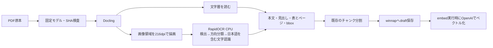

# 日本語PDF OCRの実装・導入・運用

更新日：2026-11-02。横書き中心の日本語スキャン書籍に、**Docling＋RapidOCR 3.9.1＋ONNX Runtime 1.24.1 CPU**を採用した。Doclingは2.140.0、Pythonは3.14.4。PDF以外の取込形式やDBスキーマ版は変更しない。

## 処理の流れ



OCRは文字の転記を行う。図の矢印や構成の意味説明、画像の直接Embeddingは行わない。Office埋込画像・単独PNG／JPEGのOCRも今回の対象外。OCR本文は`artifact_type=source`、`extraction_method=docling_cpu_rapidocr_ja`として保存し、通常本文と同じチャンク・Embedding経路を使う。OCR自体にOpenAIキーは不要で、取込中の外部OCR API呼び出しもない。

## 設定

```yaml
pdf_backend: docling
docling_artifacts_path: data/models/docling
pdf_ocr:
  enabled: true
  mode: auto
  scale: 3.0
  timeout_seconds: 1800
```

| 項目 | 動作 |
| --- | --- |
| enabled | 省略時true。falseならOCRモデルの検査・読込・OCRを行わない |
| mode=auto | DoclingのDEFAULTモード。通常の文字層を利用し、画像の面積等からOCR領域を選ぶ。混在PDFに使用 |
| mode=full_page | 全ページをOCRし、既存の文字セルをOCR結果に置換。不良文字層を持つPDF用 |
| scale | 72dpiの倍率。既定3.0＝216dpi、許容1～4。上げると時間・メモリが増える |
| timeout_seconds | モデル初回ロード込みの1ファイルの期限。既定1800秒。Docling内部と親ワーカーで適用 |

言語`iso:ja`、`backend=onnxruntime`、`model_size=small`、CPU・2スレッド、文字採用スコア0.5は固定。現在のレジストリでは日本語を含むPP-OCRv6の共通認識モデルへ解決される。縦書き・ルビ・旧字体を含む実書籍の品質は別途評価する。autoは既存文字層の誤字を自動判定する機能ではない。必要なら対象フォルダを分け、full_page用の設定で取り込む。

`pdf_backend: native`はpypdfによる文字層抽出だけを行い、`pdf_ocr`は適用しない。Doclingの失敗をnativeに自動置換する処理はない。

## 新規導入・既存環境の更新

プロジェクトルートで、対象OS上のPython仮想環境を有効にして実行する。既存のモデル取得だけではOCR追加モデルは揃わない。

```sh
# Ubuntuのみ：通常OpenCV wheelのロードに必要
sudo apt install -y libgl1 libglib2.0-0t64
source .venv/bin/activate
# 旧構成のheadlessと通常OpenCVはcv2を共有するため、両方削除後に固定版を入れ直す。
python -m pip uninstall -y opencv-python-headless opencv-python
python -m pip install -r requirements/ubuntu-26.04.lock
python -m pip install --no-deps --no-build-isolation -e '.[dev,search]'
python -m pip check
python scripts/check_python_environment.py
python scripts/download_docling_models.py --config config.local.yaml
python scripts/download_docling_models.py --config config.local.yaml --verify-only
```

準備コマンドだけが公式配布元へ通信する。通常取得はGit管理のlockを使い、モデルの最新版を自動選択しない。

| 配置 | 内容 |
| --- | --- |
| `data/models/docling/docling-project--*/` | 既存のレイアウト・TableFormerモデル |
| `data/models/docling/RapidOcr/PP-OCRv6_det_small.onnx` | 文字領域検出、9,929,594 bytes |
| `data/models/docling/RapidOcr/ch_ppocr_mobile_v2.0_cls_mobile.onnx` | 行の方向分類、585,532 bytes |
| `data/models/docling/RapidOcr/PP-OCRv6_rec_small.onnx` | 日本語を含む文字認識・文字集合、21,234,383 bytes |
| `model-manifest.json` / `ocr-model-manifest.json` | 実体の配置記録。Git管理の2つのlockと照合 |

OCR文字集合はONNXメタデータに含まれるため別辞書ファイルを配布しない。`cl100k_base`はEmbedding入力のトークン計数用であり、OCR認識辞書とは別。OCRモデル3点の合計は31,749,509 bytes。元の配布URL・SHA-256は`src/file_scan/rapidocr-models.lock.json`を参照。

オフライン環境では、対象OS・Python向けwheelを事前に取得し、lockの全依存を配置する。モデルは上記取得コマンド実行済みの`docling_artifacts_path`全体（両manifestとRapidOcrを含む）を通常ファイルとしてコピーし、`--verify-only`で検査する。`.venv`はOSをまたいでコピーしない。モデル不足・改変・依存版不一致は`rapidocr_model_integrity_failed`で失敗する。取込時の自動ダウンロードは行わない。

モデル更新は保守作業として`--update-lock`を明示した場合だけ行う。この操作はレイアウト・表・OCRの両lockを更新する。通常導入には付けない。依存版・認識結果・モデルの利用条件を合わせて確認する。

## 状態・再実行・長い書籍

本文が取れた全面スキャン背景と図を区別する。原画像が1点でPDFページの95%以上を覆い、DoclingのOCRセルと検索本文が存在するページでは、その原画像の`ocr_background`をtrueにして画像待ちを外す。原画像の実体とページ参照は残す。Doclingが検出した部分的な図や、位置を確定できない複数画像は意味説明待ちを残す。本文OCRの成功で図の説明完了を代用しない。

OCR後も本文のないページは`pdf_page_without_text_after_ocr`、全体が空なら`no_extractable_text`を記録し、部分抽出にする。白紙か認識失敗かは原本で確認する。Doclingの部分変換・未処理ページも警告に残す。`ocr_pages`、`ocr_text_cells`、`ocr_confidence_mean`、`ocr_background_pages`は確認用metricsに記録する。スコアは正解率ではなく、自動公開の条件には使わない。

OCRの有効／モード／scale・ライブラリ版・モデルSHAを抽出プロファイルに含める。条件変更後の通常の`file-scan ingest`で新世代が作られる。原本単位の抽出キャッシュを再利用し、分割設定だけの変更ではOCRをやり直さない。期限だけの変更は抽出内容の版を変えない。部分抽出を同条件で再処理する場合は`--retry-partial`を指定する。

長い書籍は実物で所要時間・ピークメモリを測り、1800秒を超えるなら期限を調整する。既定のワーカー数は1。メモリ閾値1536 MiBは処理後の交換基準で、処理中の強制上限ではない。ページごとの途中保存・失敗ページだけの再開は未実装。期限を超えた文書は親プロセスが停止し、成功扱いせず、再実行は原本全体から行う。

## 検証と受入

```sh
set -a
source .env
set +a
python scripts/test_postgres.py --tb=short
```

`tests/test_rapidocr.py`は同梱の日本語横書き画像（文字層なし）を使い、ネットワーク接続を禁止した実OCR、通常文字との混在、全ページOCRによる不良文字層置換、空白ページ、図の待ち、モデル改変、設定変更と実PostgreSQL登録・再利用を確認する。モデル・DB未配置時のスキップは受入成功として扱わない。

macOS arm64・Python 3.14.4、PostgreSQL 18.6・pgvector 0.8.6・PGroonga 4.1.0で全232テスト成功、スキップ0件。固定依存105件の不一致0件、pip check・Ruff・配布wheelへの両lock同梱も確認した。最終テスト結果はローカルの`artifacts/ocr-bootstrap/pytest.xml`。Ubuntu VM上での実行性能と、実書籍のCER・重要な数値・用語・表・読順・ルビの品質評価は導入先で実施する。同梱の人工画像が読めても、全書籍の認識精度を保証するものではない。

採用検討の経緯は[OCR調査](../research/2026-11-02-japanese-scanned-book-ocr.md)、Doclingの共通設定は[PDF抽出](docling-pdf.md)を参照。公式実装：[固定DoclingのRapidOCR統合](https://github.com/docling-project/docling/blob/v2.140.0/docling/models/stages/ocr/rapid_ocr_model.py)、[RapidOCR](https://github.com/RapidAI/RapidOCR)、[ONNX Runtime CPU](https://onnxruntime.ai/docs/install/)。
